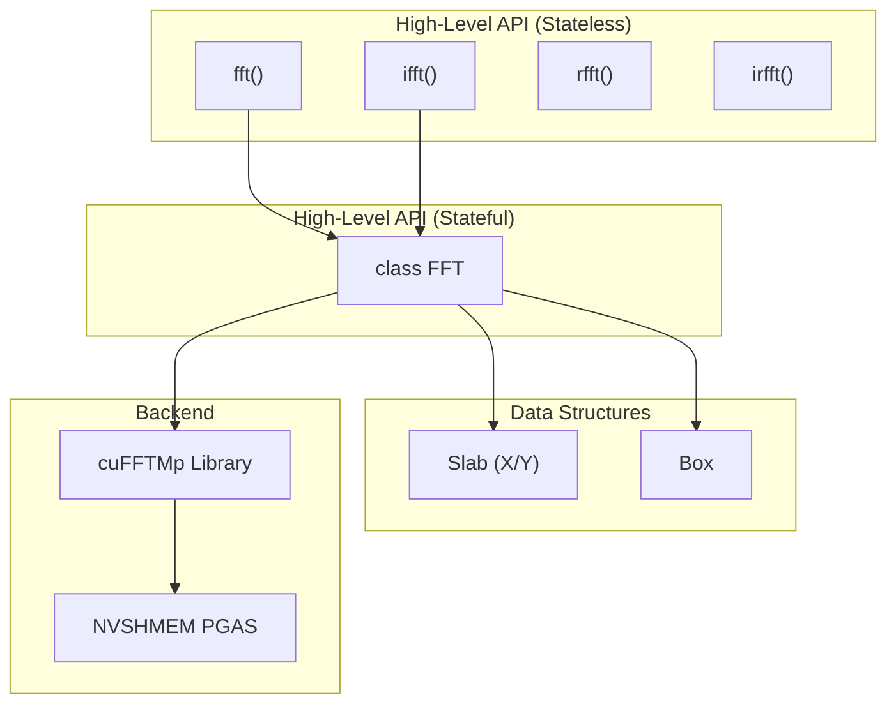
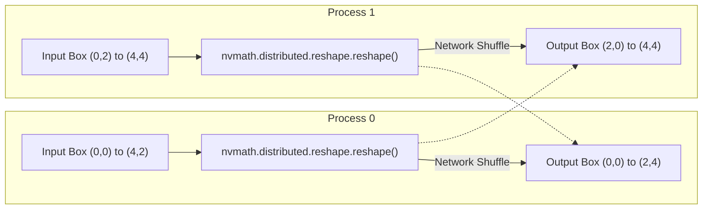

<!-- source: DeepWiki mcp.deepwiki.com · repo NVIDIA/nvmath-python · page 6.2 Distributed FFT and Reshape · fetched 2026-10-26 -->

# Distributed FFT and Reshape

Relevant source files

The following files were used as context for generating this wiki page:

- [docs/sphinx/distributed-apis/fft/index.rst](docs/sphinx/distributed-apis/fft/index.rst)
- [docs/sphinx/distributed-apis/utils.rst](docs/sphinx/distributed-apis/utils.rst)

The `nvmath-python` library provides high-performance distributed Fast Fourier Transforms (FFT) and data redistribution (Reshape) capabilities for multi-node, multi-GPU systems. These modules leverage NVIDIA's **cuFFTMp** library to handle complex communication patterns across processes using the NVSHMEM Partitioned Global Address Space (PGAS) model.

## Distributed Fast Fourier Transform

The `nvmath.distributed.fft` module provides APIs for N-dimensional discrete Fourier transformations at scale [docs/sphinx/distributed-apis/fft/index.rst:10-12](). It supports 2-D and 3-D FFTs, including forward/inverse complex-to-complex (C2C), real-to-complex (R2C), and complex-to-real (C2R) transforms [docs/sphinx/distributed-apis/fft/index.rst:13-28]().

### Key Characteristics
*   **In-place Operations**: All distributed FFT operations are in-place, meaning the result buffer is shared with the input [docs/sphinx/distributed-apis/fft/index.rst:43-44]().
*   **Symmetric Memory**: GPU operands must be allocated on the NVSHMEM symmetric heap to allow cross-process access [docs/sphinx/distributed-apis/fft/index.rst:38-41]().
*   **Distribution Models**: Supports `Slab` (optimized) and `Box` (flexible) distributions [docs/sphinx/distributed-apis/fft/index.rst:35-36]().

### Data Flow and Distribution
When performing a distributed FFT, users must define how the global tensor is partitioned across ranks.

| Distribution Type | Description | Optimization Level |
| :--- | :--- | :--- |
| **Slab** | Decomposition along a single axis (e.g., `Slab.X` or `Slab.Y`). [docs/sphinx/distributed-apis/fft/index.rst:71-71]() | Highest [docs/sphinx/distributed-apis/fft/index.rst:68-69]() |
| **Box** | Arbitrary 2D/3D rectangular partitions defined by process-specific coordinates. [docs/sphinx/distributed-apis/fft/index.rst:145-146]() | High (less than Slab) [docs/sphinx/distributed-apis/fft/index.rst:149-150]() |

#### FFT Entity Mapping
The following diagram maps the high-level FFT operations to the underlying code entities.

**FFT Code Entity Mapping**

**Sources:** [docs/sphinx/distributed-apis/fft/index.rst:10-22](), [docs/sphinx/distributed-apis/fft/index.rst:32-36](), [docs/sphinx/distributed-apis/fft/index.rst:114-115]()

## Distributed Reshape

The `nvmath.distributed.reshape` module is used to redistribute local operands across multiple processes [docs/sphinx/distributed-apis/utils.rst:93-96](). This is essentially a global "shuffle" operation that changes how data is partitioned (e.g., moving from a column-wise distribution to a row-wise distribution) [docs/sphinx/distributed-apis/utils.rst:102-103]().

### Usage Pattern
Distributed reshape supports arbitrary `Box` distributions. Each process specifies its `input_box` (where its current data resides in the global space) and `output_box` (where it wants the data to reside after the shuffle) [docs/sphinx/distributed-apis/utils.rst:110-111]().

**Reshape Operation Logic**

**Sources:** [docs/sphinx/distributed-apis/utils.rst:135-144]()

## Symmetric Memory Requirements

Both distributed FFT and Reshape utilize the NVSHMEM backend, which requires GPU operands to be allocated on a **Symmetric Heap** [docs/sphinx/distributed-apis/utils.rst:8-11](). This ensures that every process has a memory segment at the same virtual address, enabling efficient RDMA operations.

### Allocation and Management
*   **`allocate_symmetric_memory`**: Helper to allocate CuPy arrays or PyTorch tensors on the symmetric heap [docs/sphinx/distributed-apis/utils.rst:12-28]().
*   **`free_symmetric_memory`**: **Mandatory** explicit deallocation. Because freeing symmetric memory is a collective operation, it cannot be left to the non-deterministic Python garbage collector [docs/sphinx/distributed-apis/utils.rst:35-42]().
*   **Uniformity**: While the heap must be symmetric, `nvmath-python` allows for non-uniform local shapes using the `make_symmetric=True` flag, which pads the allocation to the size of the largest rank's request [docs/sphinx/distributed-apis/utils.rst:51-69]().

### Memory Helper Functions
| Function | Role |
| :--- | :--- |
| `nvmath.distributed.allocate_symmetric_memory` | Allocates a tensor/ndarray on the NVSHMEM symmetric heap. [docs/sphinx/distributed-apis/utils.rst:84-84]() |
| `nvmath.distributed.free_symmetric_memory` | Collectively frees symmetric memory across all ranks. [docs/sphinx/distributed-apis/utils.rst:85-85]() |
| `nvmath.distributed.fft.allocate_operand` | Specialized allocator for FFT that handles R2C/C2R padding requirements. [docs/sphinx/distributed-apis/fft/index.rst:50-53]() |

**Sources:** [docs/sphinx/distributed-apis/utils.rst:5-42](), [docs/sphinx/distributed-apis/utils.rst:81-85](), [docs/sphinx/distributed-apis/fft/index.rst:50-53]()

---

