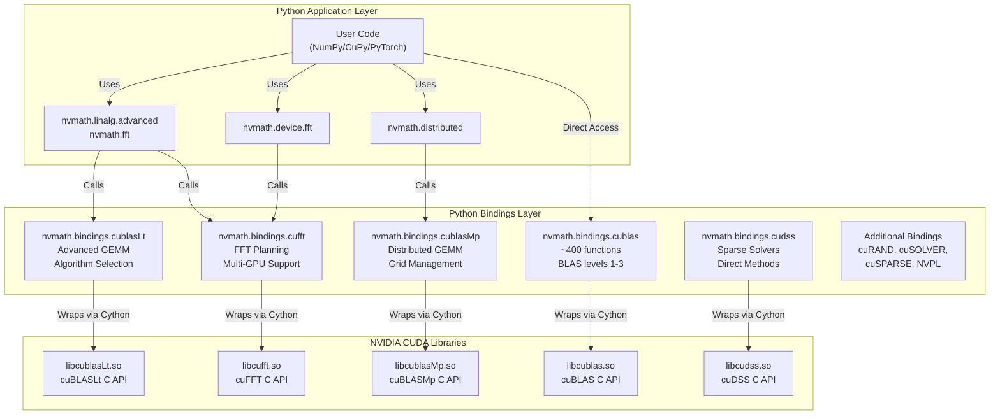
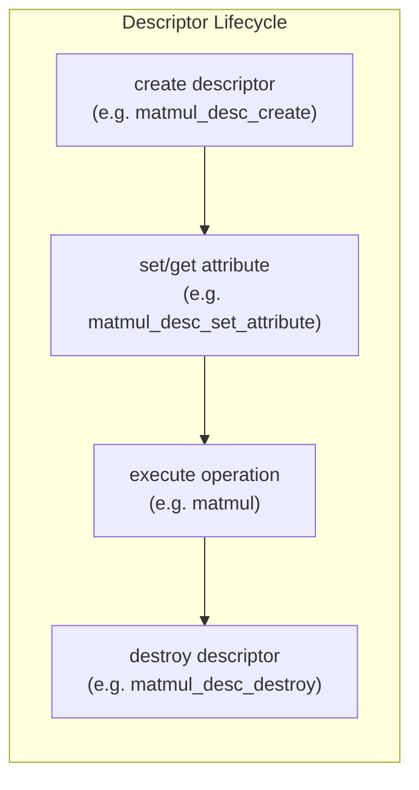

<!-- source: DeepWiki mcp.deepwiki.com · repo NVIDIA/nvmath-python · page 7 Python Bindings Reference · fetched 2026-10-26 -->

# Python Bindings Reference

Relevant source files

The following files were used as context for generating this wiki page:

- [docs/sphinx/bindings/cublas.rst](docs/sphinx/bindings/cublas.rst)
- [docs/sphinx/bindings/cublasLt.rst](docs/sphinx/bindings/cublasLt.rst)
- [docs/sphinx/bindings/cublasMp.rst](docs/sphinx/bindings/cublasMp.rst)
- [docs/sphinx/bindings/cudss.rst](docs/sphinx/bindings/cudss.rst)
- [docs/sphinx/bindings/cufft.rst](docs/sphinx/bindings/cufft.rst)
- [docs/sphinx/bindings/index.rst](docs/sphinx/bindings/index.rst)

## Purpose and Scope

This document provides comprehensive reference documentation for the low-level Python binding modules in `nvmath-python`. These bindings provide direct Python access to NVIDIA's native CUDA library APIs through Cython-based wrappers. Each binding module under `nvmath.bindings` exposes the C API of its corresponding CUDA library with a Pythonic naming convention while maintaining direct mapping to the underlying functionality [docs/sphinx/bindings/index.rst:13-16]().

The bindings serve as the foundation layer for `nvmath-python`'s higher-level APIs. For information about high-level Host APIs that build on these bindings, see [Host APIs](#4). For device-side usage patterns, see [Device APIs](#5). For distributed computing patterns, see [Distributed APIs](#6).

**Target Audience:** Users who need fine-grained control over CUDA library operations, custom workflow integration, or functionality not exposed through high-level APIs.

## Binding Layer Architecture

The Python bindings form a bridge between Python code and NVIDIA's compiled CUDA libraries. Each binding module wraps a specific CUDA library and exposes its functions, enumerations, and data structures to Python.

**Sources:** [docs/sphinx/bindings/index.rst:24-52](), [docs/sphinx/bindings/cublas.rst:1-10](), [docs/sphinx/bindings/cublasLt.rst:1-10](), [docs/sphinx/bindings/cublasMp.rst:1-10](), [docs/sphinx/bindings/cufft.rst:1-10](), [docs/sphinx/bindings/cudss.rst:1-10]()

## Binding Modules Overview

The following libraries are currently supported with corresponding Python modules [docs/sphinx/bindings/index.rst:24-52]():

| Module | CUDA Library | Primary Functions |
|--------|--------------|-------------------|
| `nvmath.bindings.cublas` | cuBLAS | Basic Linear Algebra (BLAS levels 1-3) [docs/sphinx/bindings/cublas.rst:3-7]() |
| `nvmath.bindings.cublasLt` | cuBLASLt | Advanced matrix multiplication with algorithm selection [docs/sphinx/bindings/cublasLt.rst:3-7]() |
| `nvmath.bindings.cublasMp` | cuBLASMp | Distributed matrix operations across multiple GPUs/nodes [docs/sphinx/bindings/cublasMp.rst:3-7]() |
| `nvmath.bindings.cufft` | cuFFT | Fast Fourier Transforms (1D/2D/3D, Xt API) [docs/sphinx/bindings/cufft.rst:3-7]() |
| `nvmath.bindings.cudss` | cuDSS | Direct sparse solvers (CSR/dense) [docs/sphinx/bindings/cudss.rst:3-7]() |
| `nvmath.bindings.curand` | cuRAND | Random number generation [docs/sphinx/bindings/index.rst:40-41]() |
| `nvmath.bindings.cusolver` | cuSOLVER | Dense and sparse direct solvers [docs/sphinx/bindings/index.rst:42-45]() |
| `nvmath.bindings.cusparse` | cuSPARSE | Sparse matrix-vector and matrix-matrix operations [docs/sphinx/bindings/index.rst:46-47]() |
| `nvmath.bindings.nvpl.*` | NVPL | ARM-optimized BLAS and FFT [docs/sphinx/bindings/index.rst:48-51]() |

## Naming & Calling Conventions

All public APIs follow `PEP 8` style with specific modifications for library consistency [docs/sphinx/bindings/index.rst:59-60]():

*   **Prefixes Stripped:** Library prefixes (e.g., `cublas`, `curand`) are removed from function and enum names [docs/sphinx/bindings/index.rst:62-65]().
*   **Case Style:** Function names use `snake_case`, while enum types use `PascalCase` [docs/sphinx/bindings/index.rst:63-64]().
*   **Return Values:** Output arguments in C are often returned directly as Python objects (e.g., 2-tuples for multiple outputs) [docs/sphinx/bindings/index.rst:66-67]().
*   **Error Handling:** C error codes are converted into Python exceptions [docs/sphinx/bindings/index.rst:69]().
*   **Pointers:** Passed as plain Python `int` objects [docs/sphinx/bindings/index.rst:68]().

| C Entity | Python Binding Entity |
| :--- | :--- |
| `cublasDgemm` | `cublas.dgemm` [docs/sphinx/bindings/index.rst:75]() |
| `curandSetGeneratorOrdering` | `curand.set_generator_ordering` [docs/sphinx/bindings/index.rst:76]() |
| `cublasLtMatmulTile_t` | `cublasLt.MatmulTile` [docs/sphinx/bindings/index.rst:77]() |
| `CUSOLVER_EIG_MODE_NOVECTOR` | `cusolver.EigMode.NOVECTOR` [docs/sphinx/bindings/index.rst:79]() |

## Memory Management

### Pointer and Data Lifetime
Users are responsible for managing the lifetime of memory buffers. nvmath-python expects `int` pointer addresses [docs/sphinx/bindings/index.rst:116-117](). Recommended libraries for management:
*   **Host Memory:** `numpy.ndarray` (via `buf.ctypes.data`) [docs/sphinx/bindings/index.rst:101-125]().
*   **Device Memory:** `cupy.ndarray` (via `buf.data.ptr`) [docs/sphinx/bindings/index.rst:101-133]().

### C Structs and Handles
C structs, handles, and descriptors are not exposed as Python classes; they are treated as plain Python `int` [docs/sphinx/bindings/index.rst:147-151](). For read-only host sequences, nvmath-python may automatically convert Python lists to the required C type [docs/sphinx/bindings/index.rst:153-165]().

## Common Patterns Across Bindings

### Handle Management
Most libraries follow a standard lifecycle pattern for resource management [docs/sphinx/bindings/index.rst:147-151]():

| Pattern | cuBLAS | cuBLASLt | cuBLASMp | cuFFT | cuDSS |
|---------|--------|----------|----------|-------|-------|
| **Create** | `create()` [docs/sphinx/bindings/cublas.rst:113]() | `create()` [docs/sphinx/bindings/cublasLt.rst:44]() | `create()` [docs/sphinx/bindings/cublasMp.rst:30]() | `create()` [docs/sphinx/bindings/cufft.rst:34]() | `create()` [docs/sphinx/bindings/cudss.rst:40]() |
| **Destroy** | `destroy()` [docs/sphinx/bindings/cublas.rst:173]() | `destroy()` [docs/sphinx/bindings/cublasLt.rst:45]() | `destroy()` [docs/sphinx/bindings/cublasMp.rst:31]() | `destroy()` [docs/sphinx/bindings/cufft.rst:35]() | `destroy()` [docs/sphinx/bindings/cudss.rst:45]() |
| **Stream** | `set_stream()` [docs/sphinx/bindings/cublas.rst:341]() | N/A | `stream_set()` [docs/sphinx/bindings/cublasMp.rst:32]() | `set_stream()` [docs/sphinx/bindings/cufft.rst:67]() | `set_stream()` [docs/sphinx/bindings/cudss.rst:67]() |

### Descriptor and Attribute Management
Advanced libraries use descriptors for complex configurations. The pattern involves creating a descriptor and then setting attributes [docs/sphinx/bindings/cublasLt.rst:72-88]().

**Sources:** [docs/sphinx/bindings/cublasLt.rst:72-88](), [docs/sphinx/bindings/cublasMp.rst:39-47](), [docs/sphinx/bindings/cudss.rst:36-55]()

## Child Page Reference

For detailed function signatures, enums, and usage examples, refer to the following child pages:

- [cuBLAS Bindings](#7.1) — Covers ~400 functions including Level 1, 2, 3 BLAS and 64-bit variants [docs/sphinx/bindings/cublas.rst:34-431]().
- [cuBLASLt Bindings](#7.2) — Focuses on `matmul` heuristics, epilogues, and algorithm selection [docs/sphinx/bindings/cublasLt.rst:18-35]().
- [cuBLASMp Bindings](#7.3) — Covers distributed grid management and multi-GPU GEMM [docs/sphinx/bindings/cublasMp.rst:37-53]().
- [cuFFT Bindings](#7.4) — Reference for FFT planning, Xt advanced features, and multi-GPU support [docs/sphinx/bindings/cufft.rst:55-90]().
- [cuDSS Bindings](#7.5) — Reference for sparse direct solvers and matrix descriptors [docs/sphinx/bindings/cudss.rst:51-64]().
- [Additional Bindings](#7.6) — Reference for cuRAND, cuSPARSE, cuSOLVER, and NVPL bindings [docs/sphinx/bindings/index.rst:40-51]().

**Sources:** [docs/sphinx/bindings/cublas.rst:1-431](), [docs/sphinx/bindings/cublasLt.rst:1-89](), [docs/sphinx/bindings/cublasMp.rst:1-64](), [docs/sphinx/bindings/cufft.rst:1-90](), [docs/sphinx/bindings/cudss.rst:1-69](), [docs/sphinx/bindings/index.rst:1-87]()

---

