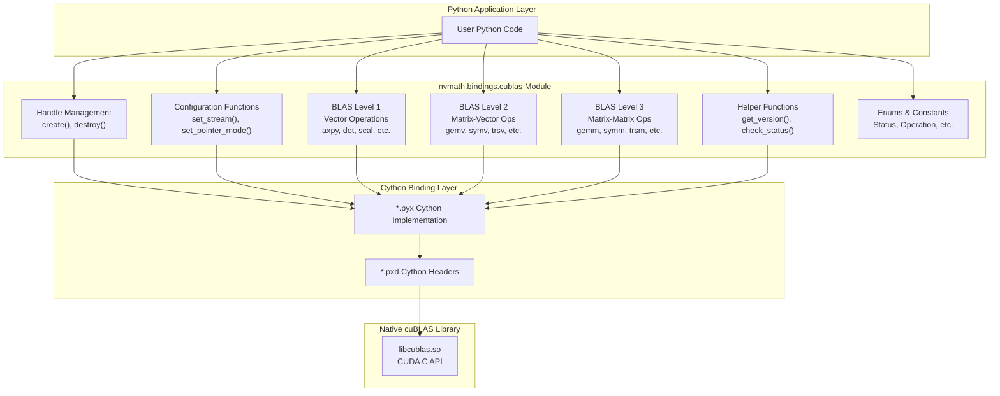
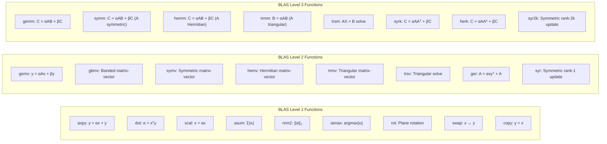
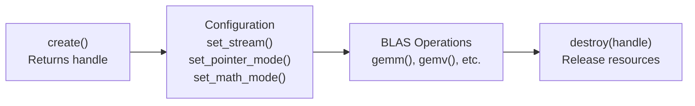
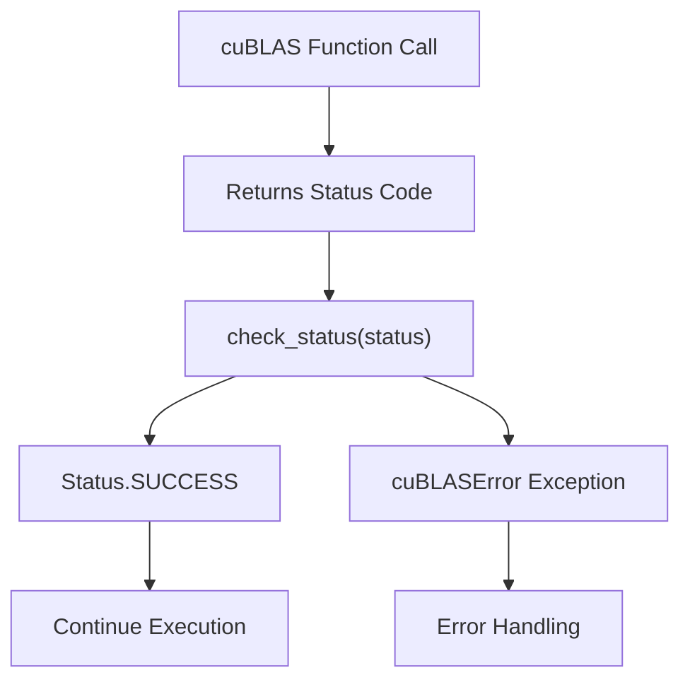
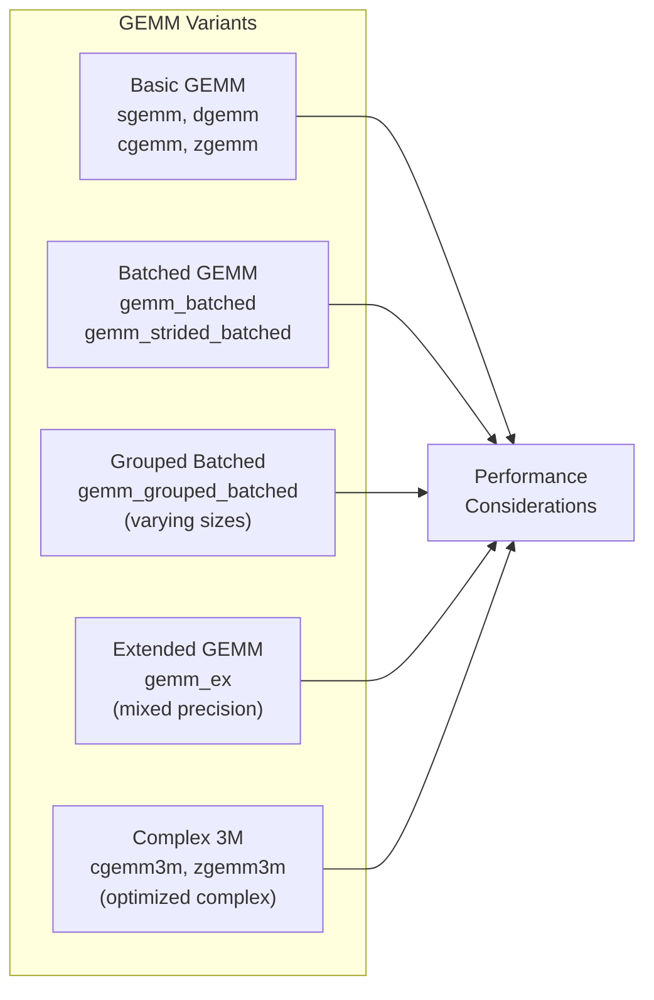
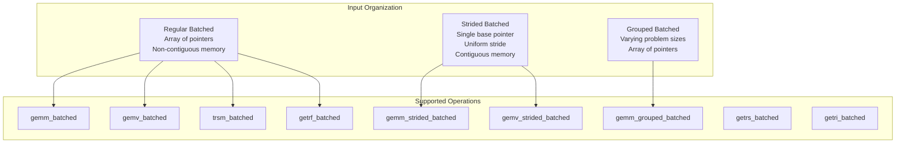

<!-- source: DeepWiki mcp.deepwiki.com · repo NVIDIA/nvmath-python · page 7.1 cuBLAS Bindings · fetched 2026-10-26 -->

# cuBLAS Bindings

<details>
<summary>Relevant source files</summary>

The following files were used as context for generating this wiki page:

- [docs/sphinx/bindings/cublas.rst](docs/sphinx/bindings/cublas.rst)

</details>


## Purpose and Scope

The `nvmath.bindings.cublas` module provides comprehensive Python bindings to NVIDIA's cuBLAS library, exposing approximately 400 functions for basic linear algebra operations on NVIDIA GPUs. This module offers direct, low-level access to cuBLAS functionality, preserving the C API semantics while providing Pythonic interfaces.

These bindings are primarily intended for:
- Users who need fine-grained control over cuBLAS operations
- Performance-critical applications requiring explicit resource management
- Integration with existing CUDA-accelerated workflows
- Building higher-level abstractions on top of cuBLAS

For high-level linear algebra operations with automatic algorithm selection, see [Linear Algebra Operations](#4.1). For advanced GEMM operations with algorithmic heuristics, see [cuBLASLt Bindings](#7.2). For distributed matrix operations, see [cuBLASMp Bindings](#7.3).

**Sources:** [docs/sphinx/bindings/cublas.rst:1-10]()

## Binding Architecture

The cuBLAS bindings layer wraps the native cuBLAS C API using Cython, providing type-safe Python interfaces while maintaining near-native performance. The module handles memory management, type conversions, and error checking transparently.

### Layering Structure

Title: "cuBLAS Binding Architecture"


**Sources:** [docs/sphinx/bindings/cublas.rst:1-430]()

### Function Categories by BLAS Level

Title: "BLAS Operation Levels in nvmath.bindings.cublas"


**Sources:** [docs/sphinx/bindings/cublas.rst:31-430]()

## Function Naming Conventions

cuBLAS function names follow a systematic naming pattern that encodes the data type, operation, and optional features:

### Standard Naming Pattern

```
[prefix][operation][suffix]
```

### Type Prefixes

| Prefix | Data Type | Description |
|--------|-----------|-------------|
| `s` | `float` | Single-precision real (32-bit) |
| `d` | `double` | Double-precision real (64-bit) |
| `c` | `complex<float>` | Single-precision complex |
| `z` | `complex<double>` | Double-precision complex |
| `cs` | Mixed | Complex input, real scaling |
| `zd` | Mixed | Double complex input, double real scaling |

### Common Suffixes

| Suffix | Meaning |
|--------|---------|
| `_64` | 64-bit integer indexing (supports arrays > 2³¹ elements) |
| `_batched` | Batched operation with array of pointers |
| `_strided_batched` | Batched operation with regular stride between matrices |
| `_grouped_batched` | Batched with varying problem sizes |
| `_ex` | Extended precision or type-generic version |
| `3m` | Optimized algorithm for complex arithmetic (uses 3 real multiplications) |

### Example Function Names

```
sgemm           → Single-precision general matrix multiply
dgemm_64        → Double-precision GEMM with 64-bit indexing
cgemm_batched   → Complex single-precision batched GEMM
zgemm_strided_batched_64 → Double complex strided batched GEMM with 64-bit indexing
gemm_ex         → Type-generic extended GEMM
```

**Sources:** [docs/sphinx/bindings/cublas.rst:34-430]()

## Data Type Support

The cuBLAS bindings support a comprehensive range of numeric types for different precision and performance requirements:

### Supported Precision Types

| Python Type | CUDA Type | Bytes | Use Case |
|-------------|-----------|-------|----------|
| `numpy.float32` | `float` | 4 | Fast single-precision computation |
| `numpy.float64` | `double` | 8 | High-precision scientific computing |
| `numpy.complex64` | `cuComplex` | 8 | Complex single-precision |
| `numpy.complex128` | `cuDoubleComplex` | 16 | Complex double-precision |
| `numpy.float16` | `__half` | 2 | Low-precision training (via `_ex` functions) |
| `numpy.int8` | `int8_t` | 1 | Integer arithmetic (via specialized functions) |

### Type-Generic Functions

Extended functions (suffix `_ex`) support mixed-precision operations and flexible compute types:

```
gemm_ex         → Supports input type A, input type B, output type C, compute type
axpy_ex         → Type-generic vector addition
dot_ex          → Type-generic dot product
scal_ex         → Type-generic scaling
```

**Sources:** [docs/sphinx/bindings/cublas.rst:34-269, 321, 356]()

## Handle and Context Management

### Handle Lifecycle

Title: "cuBLAS Handle Lifecycle"


### Key Handle Management Functions

| Function | Purpose |
|----------|---------|
| `create()` | Initialize cuBLAS handle [docs/sphinx/bindings/cublas.rst:113]() |
| `destroy(handle)` | Release cuBLAS resources [docs/sphinx/bindings/cublas.rst:173]() |
| `set_stream(handle, stream)` | Associate handle with CUDA stream [docs/sphinx/bindings/cublas.rst:341]() |
| `set_pointer_mode(handle, mode)` | Set pointer mode (host/device) [docs/sphinx/bindings/cublas.rst:339]() |
| `set_math_mode(handle, mode)` | Configure math acceleration (Tensor Cores, etc.) [docs/sphinx/bindings/cublas.rst:334]() |
| `set_workspace(handle, workspace, size)` | Provide workspace for algorithms [docs/sphinx/bindings/cublas.rst:346]() |
| `set_atomics_mode(handle, mode)` | Configure atomic operation usage [docs/sphinx/bindings/cublas.rst:333]() |

### Configuration State Functions

| Function | Purpose |
|----------|---------|
| `get_stream(handle)` | Query current stream [docs/sphinx/bindings/cublas.rst:282]() |
| `get_pointer_mode(handle)` | Query pointer mode [docs/sphinx/bindings/cublas.rst:277]() |
| `get_math_mode(handle)` | Query math mode [docs/sphinx/bindings/cublas.rst:272]() |
| `get_atomics_mode(handle)` | Query atomics configuration [docs/sphinx/bindings/cublas.rst:270]() |
| `get_version()` | Get cuBLAS library version [docs/sphinx/bindings/cublas.rst:287]() |
| `get_cudart_version()` | Get CUDA runtime version [docs/sphinx/bindings/cublas.rst:271]() |

**Sources:** [docs/sphinx/bindings/cublas.rst:113, 173, 270-287, 333-346]()

## Error Handling

The cuBLAS bindings provide comprehensive error checking and reporting:

### Status Checking

Title: "cuBLAS Error Handling Flow"


### Error Reporting Functions

| Function | Purpose |
|----------|---------|
| `check_status(status)` | Raises `cuBLASError` exception if status indicates failure [docs/sphinx/bindings/cublas.rst:85]() |
| `get_status_name(status)` | Returns string name of status code [docs/sphinx/bindings/cublas.rst:280]() |
| `get_status_string(status)` | Returns descriptive error message [docs/sphinx/bindings/cublas.rst:281]() |

### Status Enum Values

The `Status` enum includes:
- `SUCCESS`: Operation completed successfully
- `NOT_INITIALIZED`: cuBLAS library not initialized
- `ALLOC_FAILED`: Memory allocation failed
- `INVALID_VALUE`: Invalid parameter value
- `ARCH_MISMATCH`: GPU architecture not supported
- `MAPPING_ERROR`: Memory access error
- `EXECUTION_FAILED`: Kernel launch failed
- `INTERNAL_ERROR`: Internal cuBLAS error
- `NOT_SUPPORTED`: Functionality not supported
- `LICENSE_ERROR`: License check failed

**Sources:** [docs/sphinx/bindings/cublas.rst:17, 25, 85, 280-281]()

## BLAS Level 1 Operations

BLAS Level 1 functions perform vector-vector operations with O(n) complexity.

### Core Vector Operations

| Operation Category | Functions | Description |
|-------------------|-----------|-------------|
| **Vector Addition** | `saxpy`, `daxpy`, `caxpy`, `zaxpy`, `axpy_ex` | y = αx + y |
| **Dot Product** | `sdot`, `ddot`, `cdotc`, `zdotc`, `dot_ex` | α = xᵀy or α = x*y |
| **Scaling** | `sscal`, `dscal`, `cscal`, `zscal`, `scal_ex` | x = αx |
| **Copy** | `scopy`, `dcopy`, `ccopy`, `zcopy`, `copy_ex` | y = x |
| **Swap** | `sswap`, `dswap`, `cswap`, `zswap`, `swap_ex` | x ↔ y |

### Reduction Operations

| Operation | Functions | Description |
|-----------|-----------|-------------|
| **Sum of Absolute Values** | `sasum`, `dasum`, `scasum`, `dzasum`, `asum_ex` | Σ\|xᵢ\| |
| **2-Norm** | `snrm2`, `dnrm2`, `scnrm2`, `dznrm2`, `nrm2_ex` | ‖x‖₂ = √(Σxᵢ²) |
| **Index of Max Absolute** | `isamax`, `idamax`, `icamax`, `izamax`, `iamax_ex` | argmax\|xᵢ\| |
| **Index of Min Absolute** | `isamin`, `idamin`, `icamin`, `izamin`, `iamin_ex` | argmin\|xᵢ\| |

### 64-bit Indexing Variants

All Level 1 functions have `_64` variants for handling arrays larger than 2³¹ elements:
- `saxpy_64`, `daxpy_64`, `caxpy_64`, `zaxpy_64` [docs/sphinx/bindings/cublas.rst:39, 166, 320, 433]()
- `sdot_64`, `ddot_64`, `cdotc_64`, `zdotc_64` [docs/sphinx/bindings/cublas.rst:45, 172, 332]()

**Sources:** [docs/sphinx/bindings/cublas.rst:34-430]()

## BLAS Level 2 Operations

BLAS Level 2 functions perform matrix-vector operations with O(n²) complexity.

### General Matrix-Vector Multiplication

| Functions | Operation | Matrix Type |
|-----------|-----------|-------------|
| `sgemv`, `dgemv`, `cgemv`, `zgemv` | y = αAx + βy | General matrix |
| `sgbmv`, `dgbmv`, `cgbmv`, `zgbmv` | y = αAx + βy | Banded matrix |
| `ssymv`, `dsymv`, `csymv`, `zsymv` | y = αAx + βy | Symmetric matrix |
| `chemv`, `zhemv` | y = αAx + βy | Hermitian matrix |

### Batched Matrix-Vector Operations

The bindings provide batched versions of `gemv` for processing multiple matrix-vector products:

| Functions | Description |
|-----------|-------------|
| `sgemv_batched`, `dgemv_batched`, `cgemv_batched`, `zgemv_batched` | Batch of matrix-vector products with array of pointers [docs/sphinx/bindings/cublas.rst:71, 189, 364]() |
| `sgemv_strided_batched`, `dgemv_strided_batched`, `cgemv_strided_batched`, `zgemv_strided_batched` | Batch with regular stride between matrices [docs/sphinx/bindings/cublas.rst:73, 191, 366]() |

**Sources:** [docs/sphinx/bindings/cublas.rst:48-245, 347-416]()

## BLAS Level 3 Operations

BLAS Level 3 functions perform matrix-matrix operations with O(n³) complexity, providing the highest computational intensity and GPU utilization.

### General Matrix Multiplication (GEMM)

Title: "GEMM Variants in cuBLAS Bindings"


### GEMM Operation Types

| Function Pattern | Operation | Features |
|------------------|-----------|----------|
| `{s,d,c,z}gemm` | C = αAB + βC | Standard precision GEMM [docs/sphinx/bindings/cublas.rst:53, 179, 352]() |
| `{s,d,c,z}gemm_batched` | Multiple GEMMs with array of pointers | Independent problems [docs/sphinx/bindings/cublas.rst:55, 181, 354]() |
| `{s,d,c,z}gemm_strided_batched` | Multiple GEMMs with regular stride | Uniform spacing [docs/sphinx/bindings/cublas.rst:59, 185, 360]() |
| `gemm_ex` | Mixed precision, flexible types | Performance tuning [docs/sphinx/bindings/cublas.rst:264]() |
| `{c,z}gemm3m` | Optimized complex multiplication | 3 real multiplications [docs/sphinx/bindings/cublas.rst:61]() |

**Sources:** [docs/sphinx/bindings/cublas.rst:52-268, 352-361]()

## Batched Operations

Batched operations enable efficient execution of multiple independent problems in a single kernel launch.

### Batching Modes

Title: "Data Organization for Batched Operations"


### Batched Linear System Solvers

| Function | Operation | Description |
|----------|-----------|-------------|
| `{s,d,c,z}getrf_batched` | PA = LU | Batched LU factorization [docs/sphinx/bindings/cublas.rst:80, 196, 371]() |
| `{s,d,c,z}getrs_batched` | Ax = b | Batched solve using LU factors [docs/sphinx/bindings/cublas.rst:82, 198, 373]() |
| `{s,d,c,z}getri_batched` | A⁻¹ | Batched matrix inversion [docs/sphinx/bindings/cublas.rst:81, 197, 372]() |
| `{s,d,c,z}geqrf_batched` | A = QR | Batched QR factorization [docs/sphinx/bindings/cublas.rst:75, 193, 368]() |
| `{s,d,c,z}gels_batched` | min‖Ax - b‖ | Batched least squares [docs/sphinx/bindings/cublas.rst:52, 178, 351]() |

**Sources:** [docs/sphinx/bindings/cublas.rst:52-198, 262-268, 353-374, 422-428]()

## Utility and Helper Functions

### Matrix and Vector Data Transfer

| Function Category | Functions | Purpose |
|------------------|-----------|---------|
| **Matrix Copy** | `set_matrix`, `get_matrix` | Copy matrix between host and device [docs/sphinx/bindings/cublas.rst:273, 335]() |
| **Async Matrix Copy** | `set_matrix_async`, `get_matrix_async` | Asynchronous matrix transfer [docs/sphinx/bindings/cublas.rst:275, 337]() |
| **Vector Copy** | `set_vector`, `get_vector` | Copy vector between host and device [docs/sphinx/bindings/cublas.rst:283, 342]() |
| **Async Vector Copy** | `set_vector_async`, `get_vector_async` | Asynchronous vector transfer [docs/sphinx/bindings/cublas.rst:285, 344]() |

**Sources:** [docs/sphinx/bindings/cublas.rst:273-286, 335-345]()

## Enums and Constants

The cuBLAS bindings expose comprehensive enumerations for configuring operations:

### Core Configuration Enums

| Enum | Purpose | Common Values |
|------|---------|---------------|
| `Status` | Operation result codes [docs/sphinx/bindings/cublas.rst:25]() | `SUCCESS`, `NOT_INITIALIZED`, `INVALID_VALUE` |
| `Operation` | Matrix transpose operations [docs/sphinx/bindings/cublas.rst:22]() | `N` (none), `T` (transpose), `C` (conjugate transpose) |
| `FillMode` | Matrix storage specification [docs/sphinx/bindings/cublas.rst:19]() | `LOWER`, `UPPER` |
| `DiagType` | Diagonal element specification [docs/sphinx/bindings/cublas.rst:18]() | `NON_UNIT`, `UNIT` |
| `PointerMode` | Scalar location [docs/sphinx/bindings/cublas.rst:23]() | `HOST`, `DEVICE` |
| `ComputeType` | Compute precision mode [docs/sphinx/bindings/cublas.rst:16]() | `COMPUTE_32F`, `COMPUTE_64F` |

**Sources:** [docs/sphinx/bindings/cublas.rst:9-26]()

---

**Related Documentation:**
- For advanced GEMM operations and algorithm selection, see [cuBLASLt Bindings](#7.2)
- For distributed matrix operations across multiple GPUs, see [cuBLASMp Bindings](#7.3)
- For high-level matrix multiplication API, see [Linear Algebra Operations](#4.1)
- Official NVIDIA cuBLAS documentation: https://docs.nvidia.com/cuda/cublas/

**Sources:** [docs/sphinx/bindings/cublas.rst:1-430]()

---

