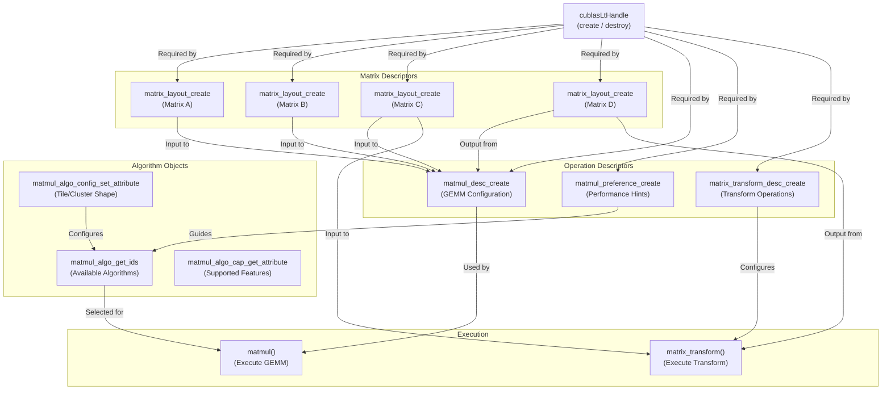
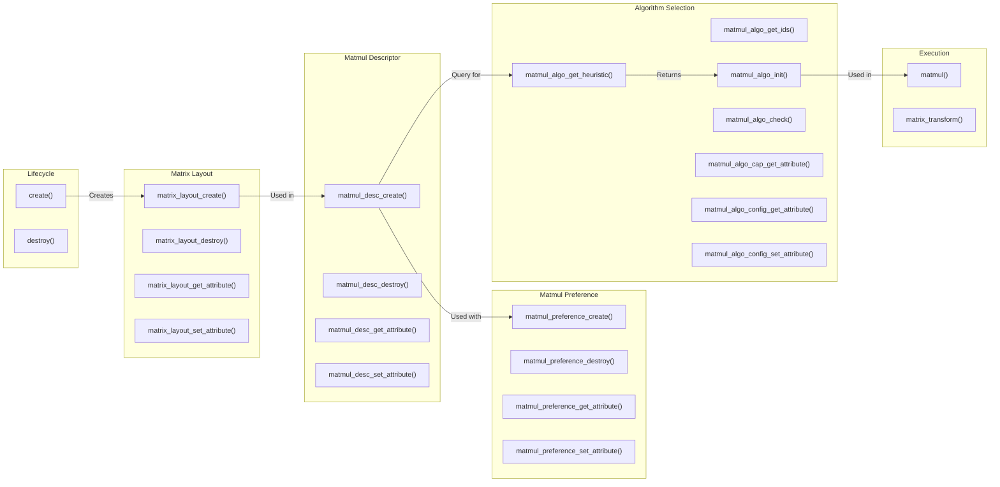
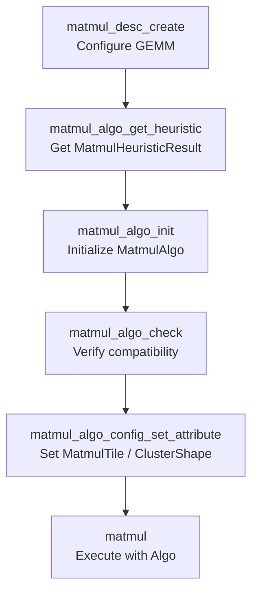

<!-- source: DeepWiki mcp.deepwiki.com · repo NVIDIA/nvmath-python · page 7.2 cuBLASLt Bindings · fetched 2026-10-26 -->

# cuBLASLt Bindings

Relevant source files

The following files were used as context for generating this wiki page:

- [docs/sphinx/bindings/cublasLt.rst](docs/sphinx/bindings/cublasLt.rst)

## Purpose and Scope

The `nvmath.bindings.cublasLt` module provides Python bindings to NVIDIA's cuBLASLt library, which offers advanced General Matrix Multiply (GEMM) operations with fine-grained control over algorithm selection and performance tuning. Unlike basic cuBLAS operations (see [cuBLAS Bindings](#7.1)), cuBLASLt exposes a descriptor-based API that enables:

- **Algorithm selection** through heuristics and explicit configuration [docs/sphinx/bindings/cublasLt.rst:69-71]()
- **Performance optimization** via algorithm capability queries and preferences [docs/sphinx/bindings/cublasLt.rst:65-79]()
- **Fused operations** through epilog configurations (e.g., GEMM + bias + activation) [docs/sphinx/bindings/cublasLt.rst:18-18]()
- **Matrix transformations** with scaling and transposition [docs/sphinx/bindings/cublasLt.rst:84-88]()
- **Cluster and tile shapes** for specialized hardware features [docs/sphinx/bindings/cublasLt.rst:16-29]()

The bindings provide direct, low-level access to cuBLASLt's C API. For simplified, high-level matrix operations, see [Linear Algebra Operations](#4.1) which uses these bindings internally via `nvmath.linalg.advanced.Matmul`.

**Sources:** [docs/sphinx/bindings/cublasLt.rst:1-89]()

---

## Core Concepts

### Descriptor-Based API Model

cuBLASLt uses an object-oriented descriptor pattern where operations are configured through multiple descriptor types before execution. This differs from the function-based cuBLAS API by separating configuration from execution.

**Entity Association Diagram: Descriptor Lifecycle**

**Sources:** [docs/sphinx/bindings/cublasLt.rst:44-88]()

### GEMM Operation Model

cuBLASLt performs GEMM operations with optional epilog fusion:

**D = α·op(A)·op(B) + β·C + epilog**

where:
- `op()` can be transpose or conjugate-transpose.
- `epilog` can include bias addition, activation functions (ReLU, GELU), auxiliary outputs, etc. [docs/sphinx/bindings/cublasLt.rst:18-18]()
- `α` and `β` are scalar multipliers.

**Sources:** [docs/sphinx/bindings/cublasLt.rst:1-89]()

---

## API Organization

The cuBLASLt bindings expose **89 symbols** organized into functional categories:

| Category | Count | Examples |
|----------|-------|----------|
| **Enums & Constants** | 35 | `Epilogue`, `MatmulTile`, `ClusterShape`, `PointerMode` |
| **Handle Management** | 2 | `create()`, `destroy()` |
| **Descriptor Functions** | 24 | `matmul_desc_create()`, `matrix_layout_set_attribute()` |
| **Algorithm Functions** | 9 | `matmul_algo_get_heuristic()`, `matmul_algo_check()` |
| **Execution Functions** | 2 | `matmul()`, `matrix_transform()` |
| **Utility Functions** | 17 | `get_version()`, `logger_set_level()`, `heuristics_cache_set_capacity()` |

**Sources:** [docs/sphinx/bindings/cublasLt.rst:9-89]()

### Function Flow Diagram

**Sources:** [docs/sphinx/bindings/cublasLt.rst:38-89]()

---

## Descriptor Types and Configuration

### Matrix Layout Descriptors

Matrix layout descriptors specify memory layout properties for input/output matrices.

**Key Attributes (MatrixLayoutAttribute enum):** [docs/sphinx/bindings/cublasLt.rst:30-30]()

| Attribute | Purpose |
|-----------|---------|
| `TYPE` | Data type (FP32, FP16, INT8, etc.) |
| `ORDER` | Row-major or column-major (`Order` enum) |
| `ROWS` | Number of rows |
| `COLS` | Number of columns |
| `LD` | Leading dimension (stride) |
| `BATCH_COUNT` | Number of batched operations |

**Functions:** [docs/sphinx/bindings/cublasLt.rst:80-83]()
- `matrix_layout_create(handle, type, rows, cols, ld, order)`
- `matrix_layout_set_attribute(descriptor, attr, value, size)`
- `matrix_layout_get_attribute(descriptor, attr, value, size)`
- `matrix_layout_destroy(descriptor)`

### Matmul Operation Descriptors

Matmul descriptors configure the GEMM operation itself, including compute type, scale type, and epilog operations.

**Key Attributes (MatmulDescAttribute enum):** [docs/sphinx/bindings/cublasLt.rst:22-22]()

| Attribute | Purpose | Examples |
|-----------|---------|----------|
| `COMPUTE_TYPE` | Precision for accumulation | FP32, TF32, FP64 |
| `SCALE_TYPE` | Type of α and β scalars | Same as compute or separate |
| `POINTER_MODE` | Host or device pointers | `PointerMode.HOST/DEVICE` |
| `EPILOGUE` | Fused post-GEMM operation | `Epilogue.RELU`, `GELU`, `BIAS` |

**Functions:** [docs/sphinx/bindings/cublasLt.rst:72-75]()
- `matmul_desc_create(handle, compute_type, scale_type)`
- `matmul_desc_set_attribute(descriptor, attr, value, size)`
- `matmul_desc_get_attribute(descriptor, attr, value, size)`
- `matmul_desc_destroy(descriptor)`

### Matmul Preference Descriptors

Preference descriptors guide algorithm selection by specifying performance constraints and workspace allocation.

**Key Attributes (MatmulPreferenceAttribute enum):** [docs/sphinx/bindings/cublasLt.rst:26-26]()

| Attribute | Purpose |
|-----------|---------|
| `SEARCH_MODE` | Algorithm search strategy (`MatmulSearch` enum) |
| `MAX_WORKSPACE_BYTES` | Maximum workspace memory allowed |
| `REDUCTION_SCHEME` | Atomic vs split-K reduction (`ReductionScheme` enum) |

**Functions:** [docs/sphinx/bindings/cublasLt.rst:76-79]()
- `matmul_preference_create(handle)`
- `matmul_preference_set_attribute(descriptor, attr, value, size)`
- `matmul_preference_get_attribute(descriptor, attr, value, size)`
- `matmul_preference_destroy(descriptor)`

---

## Algorithm Selection Workflow

Algorithm selection in cuBLASLt involves querying available algorithms, filtering by capabilities, and selecting optimal algorithms based on heuristics.

**Entity Association Diagram: Algorithm Selection**

**Sources:** [docs/sphinx/bindings/cublasLt.rst:64-71]()

### Key Algorithm Functions

- `matmul_algo_get_ids(...)`: Returns available algorithm IDs [docs/sphinx/bindings/cublasLt.rst:70-70]()
- `matmul_algo_get_heuristic(...)`: Returns `MatmulHeuristicResult` array with recommended algorithms [docs/sphinx/bindings/cublasLt.rst:69-69]()
- `matmul_algo_init(...)`: Initializes algorithm object [docs/sphinx/bindings/cublasLt.rst:71-71]()
- `matmul_algo_check(...)`: Verifies algorithm compatibility [docs/sphinx/bindings/cublasLt.rst:66-66]()
- `matmul_algo_cap_get_attribute(...)`: Retrieves algorithm capabilities [docs/sphinx/bindings/cublasLt.rst:65-65]()
- `matmul_algo_config_set_attribute(...)`: Sets algorithm configuration (tile, stages) [docs/sphinx/bindings/cublasLt.rst:68-68]()

**Sources:** [docs/sphinx/bindings/cublasLt.rst:64-71]()

---

## Execution Functions

### GEMM Execution

The primary execution function performs the configured matrix multiplication:

`matmul(handle, matmul_desc, alpha, A, layout_A, B, layout_B, beta, C, layout_C, D, layout_D, algo, workspace, workspace_size, stream)` [docs/sphinx/bindings/cublasLt.rst:64-64]()

**Operation:** Computes `D = α·op(A)·op(B) + β·C + epilog`

### Matrix Transformation

Standalone matrix transformation for scaling, transposition, or type conversion:

`matrix_transform(handle, transform_desc, alpha, A, layout_A, beta, B, layout_B, C, layout_C, stream)` [docs/sphinx/bindings/cublasLt.rst:84-84]()

**Operation:** Computes `C = α·op(A) + β·op(B)`

---

## Enumerations and Constants

### Key Enumerations

- **Epilogue**: Fused post-GEMM operations like `RELU`, `GELU`, `BIAS`, `BGRADA` [docs/sphinx/bindings/cublasLt.rst:18-18]()
- **MatmulTile**: Thread block tile dimensions for performance tuning [docs/sphinx/bindings/cublasLt.rst:29-29]()
- **ClusterShape**: CTA cluster dimensions for Hopper architecture [docs/sphinx/bindings/cublasLt.rst:16-16]()
- **PointerMode**: Specifies if α/β are on `HOST` or `DEVICE` [docs/sphinx/bindings/cublasLt.rst:33-33]()
- **ReductionScheme**: Atomic vs split-K reduction strategies [docs/sphinx/bindings/cublasLt.rst:35-35]()

**Sources:** [docs/sphinx/bindings/cublasLt.rst:15-35]()

---

## Utilities and Logging

### Logging Configuration

- `logger_set_level(level)`: Configure verbosity [docs/sphinx/bindings/cublasLt.rst:62-62]()
- `logger_set_mask(mask)`: Filter log categories [docs/sphinx/bindings/cublasLt.rst:63-63]()
- `logger_open_file(filename)`: Redirect logs to file [docs/sphinx/bindings/cublasLt.rst:61-61]()
- `logger_force_disable()`: Disable all logging [docs/sphinx/bindings/cublasLt.rst:60-60]()

### Heuristics Cache

- `heuristics_cache_get_capacity()`: Query current cache size [docs/sphinx/bindings/cublasLt.rst:58-58]()
- `heuristics_cache_set_capacity(capacity)`: Configure cache size [docs/sphinx/bindings/cublasLt.rst:59-59]()

### Attribute Type Queries

Helper functions to determine the correct Python/NumPy dtype for attribute values:
- `get_matmul_desc_attribute_dtype(attr)` [docs/sphinx/bindings/cublasLt.rst:50-50]()
- `get_matrix_layout_attribute_dtype(attr)` [docs/sphinx/bindings/cublasLt.rst:52-52]()
- `get_matmul_preference_attribute_dtype(attr)` [docs/sphinx/bindings/cublasLt.rst:51-51]()

**Sources:** [docs/sphinx/bindings/cublasLt.rst:46-63]()

---

## Reference Documentation

For comprehensive details on the C API that these bindings wrap, refer to the [NVIDIA cuBLASLt Documentation](https://docs.nvidia.com/cuda/cublas/#using-the-cublaslt-api). [docs/sphinx/bindings/cublasLt.rst:6-7]()

---

