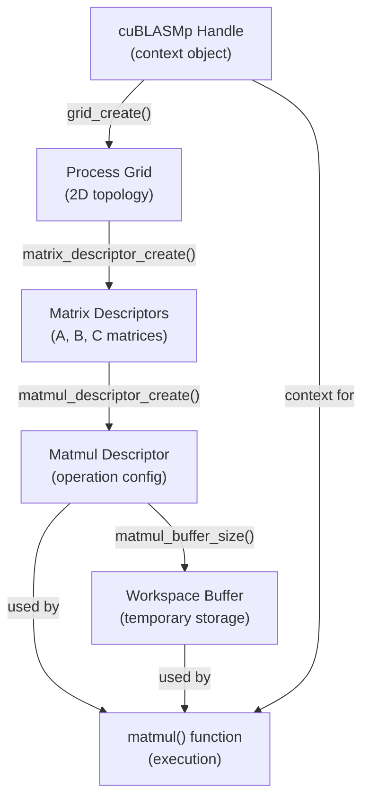
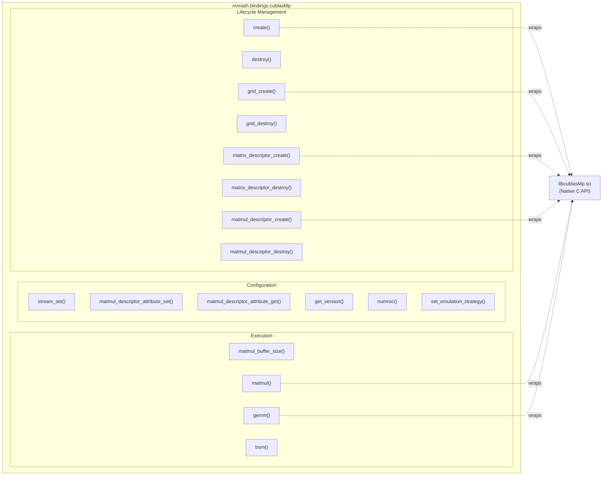
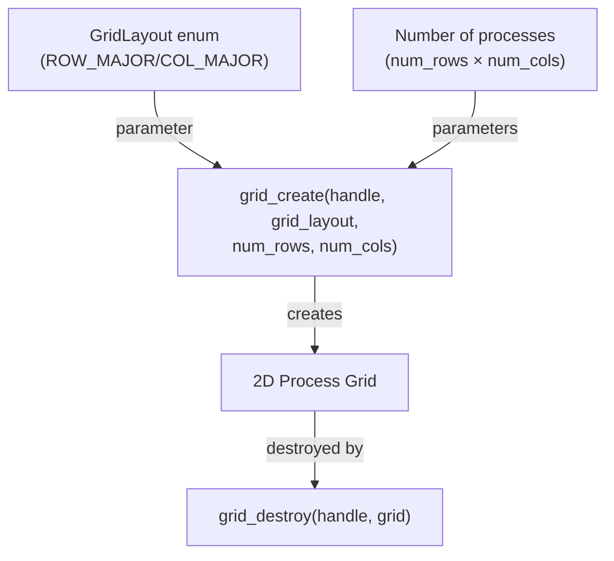
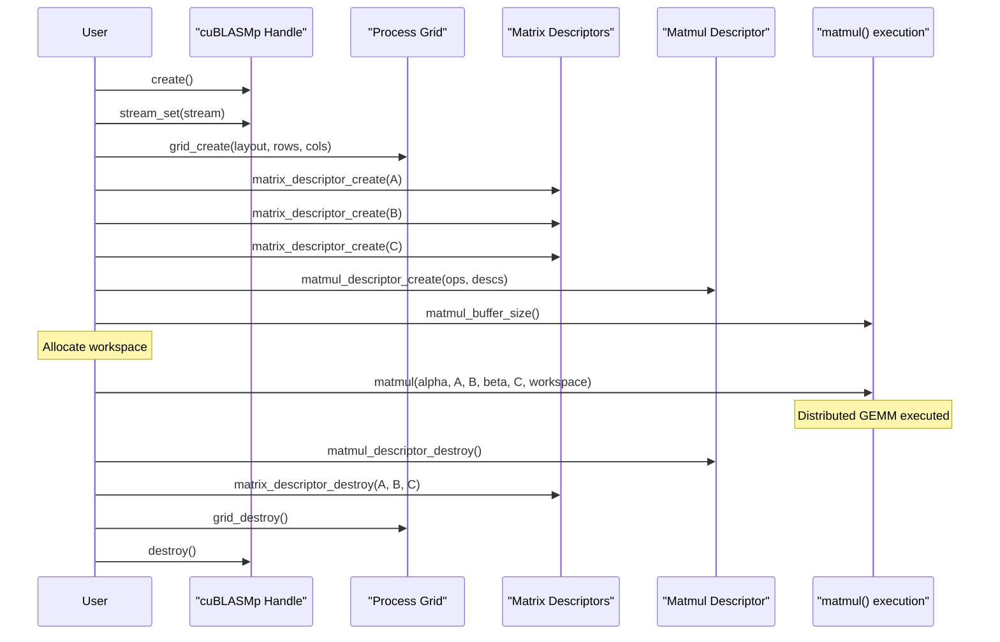

<!-- source: DeepWiki mcp.deepwiki.com · repo NVIDIA/nvmath-python · page 7.3 cuBLASMp Bindings · fetched 2026-10-26 -->

# cuBLASMp Bindings

Relevant source files

The following files were used as context for generating this wiki page:

- [docs/sphinx/bindings/cublasMp.rst](docs/sphinx/bindings/cublasMp.rst)

## Purpose and Scope

The `nvmath.bindings.cublasMp` module provides Python bindings to NVIDIA's cuBLASMp library, which enables distributed matrix multiplication across multiple GPUs. This page documents the low-level Python API that wraps the native cuBLASMp C API, including handle management, grid configuration, matrix descriptor creation, and distributed GEMM execution.

For high-level distributed linear algebra operations, see [Distributed APIs](#6). For single-GPU linear algebra operations, see [cuBLAS Bindings](#7.1) and [cuBLASLt Bindings](#7.2).

**Sources:** [docs/sphinx/bindings/cublasMp.rst:1-46]()

## Overview

cuBLASMp extends BLAS functionality to distributed memory systems, allowing matrix operations to be performed across multiple GPUs within a single node or across multiple nodes. The library uses a 2D process grid topology where matrices are distributed using a block-cyclic distribution scheme.

The binding module exposes the complete cuBLASMp C API through Cython, maintaining the same function signatures and semantics while providing Python-native error handling and type annotations.

**Sources:** [docs/sphinx/bindings/cublasMp.rst:1-8]()

## Key Concepts

**Distributed Matrix Multiplication Workflow**

The cuBLASMp API follows an object-oriented design pattern where descriptors encapsulate configuration state and handles manage library context.

**Sources:** [docs/sphinx/bindings/cublasMp.rst:25-64]()

## Module Organization

The `nvmath.bindings.cublasMp` module is organized into lifecycle management, configuration, and execution functions.

**API Organization by Responsibility**

**Sources:** [docs/sphinx/bindings/cublasMp.rst:25-64]()

## API Components

### Handle Management

| Function | Purpose | Returns |
|----------|---------|---------|
| `create()` | Creates cuBLASMp library handle | Handle object |
| `destroy(handle)` | Destroys cuBLASMp library handle | None |
| `stream_set(handle, stream)` | Associates CUDA stream with handle | None |
| `stream_get(handle)` | Gets current CUDA stream | Stream object |
| `get_version(handle)` | Queries library version | Version number |

The handle serves as the primary context object for all cuBLASMp operations. It encapsulates device resources and configuration state.

**Sources:** [docs/sphinx/bindings/cublasMp.rst:30-34]()

### Grid Management

**Grid Configuration Flow**

| Function | Purpose | Parameters |
|----------|---------|------------|
| `grid_create(handle, grid_layout, num_rows, num_cols)` | Creates 2D process grid | Handle, layout enum, grid dimensions |
| `grid_destroy(handle, grid)` | Destroys process grid | Handle, grid object |

The process grid defines how matrix data is distributed across GPUs. A `GridLayout` of `ROW_MAJOR` means processes are numbered row-wise, while `COL_MAJOR` numbers them column-wise.

**Sources:** [docs/sphinx/bindings/cublasMp.rst:16, 37-38]()

### Matrix Descriptors

Matrix descriptors define the properties and distribution of matrices in distributed operations.

| Function | Purpose | Key Parameters |
|----------|---------|----------------|
| `matrix_descriptor_create(handle, grid, rows, cols, ...)` | Creates matrix descriptor | Handle, grid, dimensions, block sizes, data type |
| `matrix_descriptor_init(...)` | Initializes an existing descriptor | Handle, descriptor, parameters |
| `matrix_descriptor_destroy(handle, desc)` | Destroys matrix descriptor | Handle, descriptor |

Matrix descriptors encapsulate:
- **Global dimensions** (M×N)
- **Block-cyclic distribution parameters** (MB, NB)
- **Leading dimension** (LLD)
- **Data type**
- **Process grid position**

**Sources:** [docs/sphinx/bindings/cublasMp.rst:39-41]()

### Matmul Descriptors

Matmul descriptors configure the distributed GEMM operation, including operation types (transpose), compute types, and epilog operations.

| Function | Purpose |
|----------|---------|
| `matmul_descriptor_create(handle, ...)` | Creates matmul descriptor |
| `matmul_descriptor_init(...)` | Initializes matmul descriptor |
| `matmul_descriptor_destroy(handle, desc)` | Destroys matmul descriptor |
| `matmul_descriptor_attribute_set(handle, desc, attribute, value)` | Sets descriptor attribute |
| `matmul_descriptor_attribute_get(handle, desc, attribute)` | Gets descriptor attribute |

Configurable attributes via `MatmulDescriptorAttribute` enum:
- Algorithm type (`MatmulAlgoType`)
- Epilog operations (`MatmulEpilogue`)
- Matrix scaling factors (`MatmulMatrixScale`)

**Sources:** [docs/sphinx/bindings/cublasMp.rst:17-20, 43-47]()

### Execution Functions

The library provides several BLAS-like distributed operations. Each execution function typically has a corresponding `buffer_size` function to query workspace requirements.

| Operation | Execution Function | Workspace Query |
|-----------|--------------------|-----------------|
| Matrix Multiplication (Advanced) | `matmul()` | `matmul_buffer_size()` |
| General Matrix Multiplication | `gemm()` | `gemm_buffer_size()` |
| Triangular Solve | `trsm()` | `trsm_buffer_size()` |
| Symmetric Rank-k Update | `syrk()` | `syrk_buffer_size()` |
| General Matrix Addition | `geadd()` | `geadd_buffer_size()` |
| Matrix Redistribution | `gemr2d()` | `gemr2d_buffer_size()` |

**Sources:** [docs/sphinx/bindings/cublasMp.rst:48-63]()

### Utility and Strategy Functions

| Function | Purpose |
|----------|---------|
| `numroc(n, nb, iproc, isrcproc, nprocs)` | Computes local dimension of distributed matrix |
| `set_emulation_strategy(handle, strategy)` | Sets emulation strategy for multi-GPU behavior |
| `get_emulation_strategy(handle)` | Gets current emulation strategy |

The `numroc()` function (Number of Rows or Columns) calculates the local dimension of a block-cyclically distributed matrix, essential for local buffer allocation.

**Sources:** [docs/sphinx/bindings/cublasMp.rst:15, 35-36, 42]()

## Enums and Constants

The module exposes several enumeration types from the native cuBLASMp library:

| Enum Type | Purpose |
|-----------|---------|
| `EmulationStrategy` | Configures library emulation modes |
| `GridLayout` | Defines process grid ordering (`ROW_MAJOR`, `COL_MAJOR`) |
| `MatmulAlgoType` | Selects GEMM algorithm variant |
| `MatmulDescriptorAttribute` | Descriptor configuration keys |
| `MatmulEpilogue` | Configures post-GEMM operations (Bias, ReLU, etc.) |
| `MatmulMatrixScale` | Defines scaling behavior for A, B, C matrices |
| `Status` | Function return status codes |
| `cuBLASMpError` | Python exception types raised on failure |

**Sources:** [docs/sphinx/bindings/cublasMp.rst:15-22]()

## Typical Usage Pattern

**Typical cuBLASMp Workflow Sequence**

The workflow demonstrates the lifecycle of a distributed operation:
1. **Initialization**: Create handle and configure stream.
2. **Grid Setup**: Define 2D process topology.
3. **Matrix Configuration**: Create descriptors for input/output matrices.
4. **Operation Configuration**: Create and configure the specific operation descriptor (e.g., matmul).
5. **Workspace Allocation**: Query required buffer size.
6. **Execution**: Perform distributed operation across all GPUs in the grid.
7. **Cleanup**: Destroy descriptors, grid, and handle.

**Sources:** [docs/sphinx/bindings/cublasMp.rst:30-49]()

## Multi-GPU Configuration

cuBLASMp requires coordination with a communication backend (like MPI or NVSHMEM). Each process in the distributed application:
- Manages one or more GPUs.
- Holds a local portion of the distributed matrices.
- Participates in the collective distributed operation.

### Process Grid Topology

The 2D process grid determines data distribution. A `GridLayout` of `ROW_MAJOR` means processes are numbered left-to-right, top-to-bottom, while `COL_MAJOR` numbers them top-to-bottom, left-to-right.

### Block-Cyclic Distribution

Matrices are distributed using a block-cyclic pattern. The `numroc()` function is used to calculate how many rows or columns a specific process owns based on the global dimensions and block sizes.

**Sources:** [docs/sphinx/bindings/cublasMp.rst:16, 42]()

## Error Handling

All functions return a `Status` enum value. Non-success statuses raise `cuBLASMpError` exceptions in Python. The binding layer automatically checks return codes and converts them to Python exceptions with descriptive error messages.

**Sources:** [docs/sphinx/bindings/cublasMp.rst:21-22]()

## Reference Documentation

For comprehensive details on each function's parameters, return values, and behavior, refer to the [cuBLASMp C API documentation](https://docs.nvidia.com/cuda/cublasmp).

**Sources:** [docs/sphinx/bindings/cublasMp.rst:6-7]()

---

