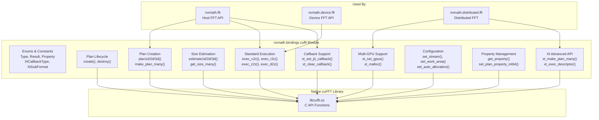
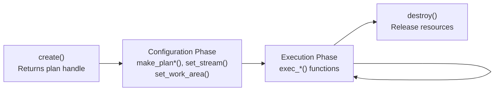
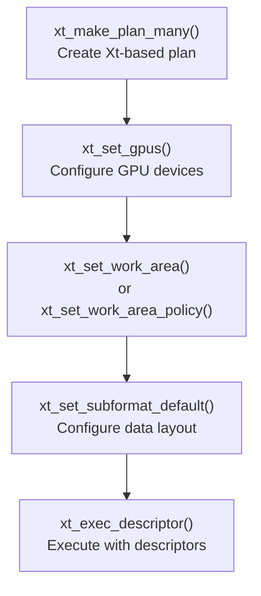
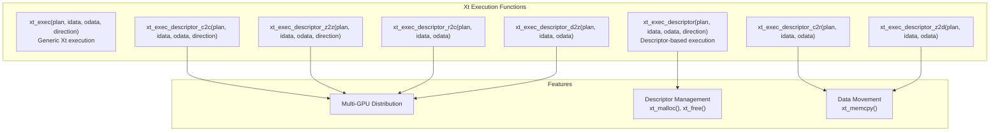
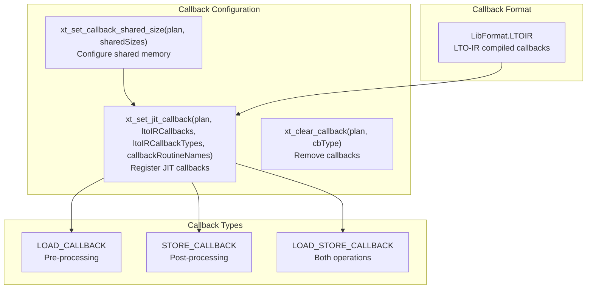
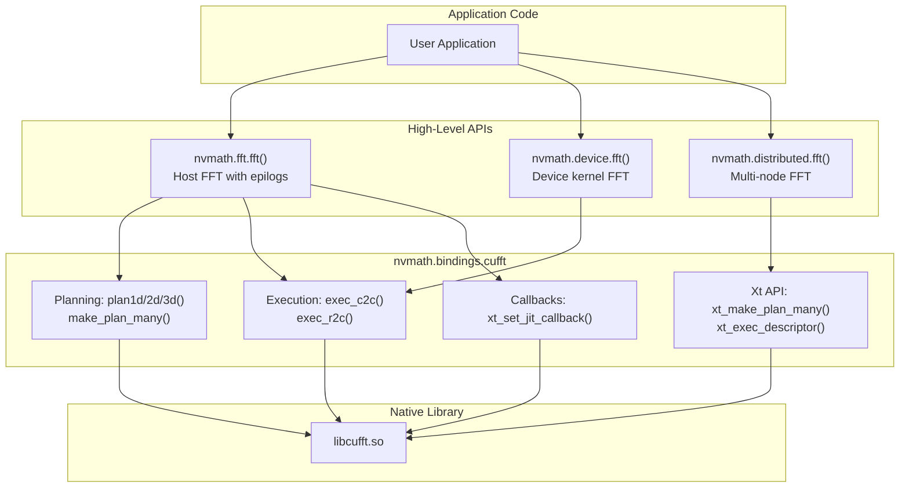

<!-- source: DeepWiki mcp.deepwiki.com · repo NVIDIA/nvmath-python · page 7.4 cuFFT Bindings · fetched 2026-10-26 -->

# cuFFT Bindings

<details>
<summary>Relevant source files</summary>

The following files were used as context for generating this wiki page:

- [docs/sphinx/bindings/cufft.rst](docs/sphinx/bindings/cufft.rst)

</details>


## Purpose and Scope

This page documents `nvmath.bindings.cufft`, the Python binding module that provides direct access to NVIDIA's cuFFT (CUDA Fast Fourier Transform) library. These bindings expose the low-level C API of cuFFT to Python, enabling precise control over FFT planning, execution, and advanced features including multi-GPU operations.

The bindings provide thin wrappers around the native cuFFT library functions, preserving the original API semantics while adding Python-friendly interfaces and error handling. For higher-level FFT interfaces that integrate with NumPy/CuPy arrays, see [FFT Operations](#4.2). For device-side FFT usage within custom CUDA kernels, see [Device APIs](#5).

**Sources:** [docs/sphinx/bindings/cufft.rst:1-90]()

## Module Architecture

The `nvmath.bindings.cufft` module organizes cuFFT functionality into several functional areas, each corresponding to different aspects of FFT operations:



**Diagram: cuFFT Bindings Module Organization**

The module provides 89 functions across nine functional areas, each mapping directly to cuFFT C API functions with Python-friendly signatures and automatic error checking via `check_status()`.

**Sources:** [docs/sphinx/bindings/cufft.rst:10-90]()

## Enums and Constants

The module exposes several enumerations and constants that control FFT behavior, data types, and advanced features:

| Enum Type | Purpose | Key Values |
|-----------|---------|------------|
| `Type` | Specifies FFT transform type and precision | Complex-to-complex (C2C, Z2Z), real-to-complex (R2C, D2Z), complex-to-real (C2R, Z2D) |
| `Result` | Return codes for error handling | SUCCESS, INVALID_PLAN, ALLOC_FAILED, INVALID_TYPE, EXEC_FAILED |
| `Property` | Library properties for querying | MAJOR_VERSION, MINOR_VERSION, PATCH_LEVEL |
| `Compatibility` | ABI compatibility modes | NATIVE, FFTW_PADDING, FFTW_ASYMMETRIC, FFTW_ALL |
| `XtCallbackType` | Callback insertion points | LOAD_CALLBACK, STORE_CALLBACK, LOAD_STORE_CALLBACK |
| `XtCopyType` | Memory copy directions for Xt API | HOST_TO_DEVICE, DEVICE_TO_HOST, DEVICE_TO_DEVICE |
| `XtSubFormat` | Data layout for multi-GPU | UNDEFINED, DEFAULT, INPLACE, INPLACE_SHUFFLED |
| `XtWorkAreaPolicy` | Work area management strategy | PERFORMANCE, MINIMAL, USER |
| `XtQueryType` | Query types for plan information | UNDEFINED, EXECUTE_FORWARD, EXECUTE_INVERSE |
| `LibFormat` | Library format for callbacks | NATIVE, LTOIR |

These enums correspond directly to cuFFT's native constants (e.g., `CUFFT_C2C`, `CUFFT_SUCCESS`) and are used throughout the planning and execution API.

**Sources:** [docs/sphinx/bindings/cufft.rst:9-25]()

## Plan Lifecycle Management

FFT operations in cuFFT follow a handle-based lifecycle pattern. Plans must be created, configured, and destroyed explicitly:



**Diagram: FFT Plan Lifecycle**

The `create()` function allocates a plan handle, which is then passed to all subsequent configuration and execution functions. Plans persist across multiple executions, enabling efficient reuse. The `destroy()` function releases all associated resources including GPU memory allocated for work areas.

**Sources:** [docs/sphinx/bindings/cufft.rst:34-35]()

## Planning Functions

Planning functions create and configure FFT plans. The module provides three planning paradigms:

### Basic Planning Functions

These functions combine plan creation and configuration in a single call:

| Function | Dimensions | Description |
|----------|------------|-------------|
| `plan1d(plan, nx, type, batch)` | 1D | Single-dimensional FFT with batch support |
| `plan2d(plan, nx, ny, type)` | 2D | Two-dimensional FFT |
| `plan3d(plan, nx, ny, nz, type)` | 3D | Three-dimensional FFT |
| `plan_many(plan, rank, n, ...)` | N-D | Arbitrary-dimensional batched FFT with advanced striding |

### Make Plan Functions

These functions configure an existing plan handle created by `create()`:

| Function | Dimensions | Indexing |
|----------|------------|----------|
| `make_plan1d(plan, nx, type, batch, workSize)` | 1D | 32-bit |
| `make_plan2d(plan, nx, ny, type, workSize)` | 2D | 32-bit |
| `make_plan3d(plan, nx, ny, nz, type, workSize)` | 3D | 32-bit |
| `make_plan_many(plan, rank, n, ...)` | N-D | 32-bit |
| `make_plan_many64(plan, rank, n, ...)` | N-D | 64-bit |

The 64-bit variants (`make_plan_many64`) support arrays with more than 2³¹ elements, essential for large-scale computations.

### Xt Advanced Planning

The Xt API provides enhanced planning for multi-GPU and distributed scenarios:



**Diagram: Xt Planning Workflow**

The Xt API supports multi-GPU configurations via `xt_set_gpus()`, custom memory management through `xt_malloc()` and `xt_memcpy()`, and flexible work area policies.

**Sources:** [docs/sphinx/bindings/cufft.rst:55-63, 79-89]()

## Size Estimation Functions

Before creating a plan, size estimation functions determine memory requirements:

| Function | Purpose | Use Case |
|----------|---------|----------|
| `estimate1d(nx, type, batch, workSize)` | Estimate 1D FFT memory | Quick estimation without plan creation |
| `estimate2d(nx, ny, type, workSize)` | Estimate 2D FFT memory | Quick estimation without plan creation |
| `estimate3d(nx, ny, nz, type, workSize)` | Estimate 3D FFT memory | Quick estimation without plan creation |
| `estimate_many(rank, n, ..., workSize)` | Estimate arbitrary-dimensional | Quick estimation with striding |
| `get_size(plan, workSize)` | Query existing plan memory | After plan creation |
| `get_size_many(plan, rank, n, ..., workSize)` | Query multi-dimensional plan | After plan creation with striding |
| `get_size_many64(plan, rank, n, ..., workSize)` | Query with 64-bit indexing | Large-scale arrays |
| `xt_get_size_many(plan, ..., workSize)` | Query Xt plan memory | Multi-GPU scenarios |

These functions write the required work area size (in bytes) to the `workSize` output parameter, enabling pre-allocation of GPU memory via `set_work_area()` or automatic management via `set_auto_allocation()`.

**Sources:** [docs/sphinx/bindings/cufft.rst:36-39, 46-53, 79]()

## Execution Functions

Execution functions perform the actual FFT computation. Functions are named according to their transform type and precision:

### Standard Execution API

| Function | Transform Type | Precision | Description |
|----------|----------------|-----------|-------------|
| `exec_c2c(plan, idata, odata, direction)` | Complex-to-Complex | Single | Forward/inverse FFT with complex32 data |
| `exec_z2z(plan, idata, odata, direction)` | Complex-to-Complex | Double | Forward/inverse FFT with complex64 data |
| `exec_r2c(plan, idata, odata)` | Real-to-Complex | Single | Forward FFT from real32 to complex32 |
| `exec_d2z(plan, idata, odata)` | Real-to-Complex | Double | Forward FFT from real64 to complex64 |
| `exec_c2r(plan, idata, odata)` | Complex-to-Real | Single | Inverse FFT from complex32 to real32 |
| `exec_z2d(plan, idata, odata)` | Complex-to-Real | Double | Inverse FFT from complex64 to real64 |

All execution functions accept device pointers (`idata` for input, `odata` for output). For C2C and Z2Z transforms, the `direction` parameter controls forward (`CUFFT_FORWARD`) or inverse (`CUFFT_INVERSE`) operation.

### Xt Execution API

The Xt API provides descriptor-based execution for advanced scenarios:



**Diagram: Xt Execution Functions and Features**

The Xt execution API enables multi-GPU FFT by distributing data across devices configured via `xt_set_gpus()`. Descriptors created with `xt_malloc()` manage distributed memory layouts.

**Sources:** [docs/sphinx/bindings/cufft.rst:40-45, 70-77]()

## Multi-GPU Support

The cuFFT bindings provide comprehensive multi-GPU support through the Xt API:


**Diagram: Multi-GPU FFT Workflow**

### Multi-GPU Functions

| Function | Purpose |
|----------|---------|
| `xt_set_gpus(plan, nGPUs, whichGPUs)` | Configure which GPUs will participate in the FFT |
| `xt_malloc(plan, descriptor, format)` | Allocate distributed memory across selected GPUs |
| `xt_free(descriptor)` | Release distributed memory descriptor |
| `xt_memcpy(plan, dstPointer, srcPointer, type)` | Copy data between host/device/distributed layouts |
| `xt_set_subformat_default(plan, subformat_forward, subformat_inverse)` | Configure data distribution format |
| `xt_set_work_area_policy(plan, workArea, workAreaPolicy)` | Control work area allocation across GPUs |

The `whichGPUs` parameter to `xt_set_gpus()` specifies an array of device IDs. Memory allocated via `xt_malloc()` is automatically distributed according to the specified `format` (e.g., `XtSubFormat.DEFAULT` for standard distribution).

**Sources:** [docs/sphinx/bindings/cufft.rst:78, 81-82, 85-89]()

## Callback Support

The cuFFT bindings support custom load/store callbacks for kernel fusion:



**Diagram: Callback Configuration Flow**

Callbacks enable custom operations before FFT input (load callbacks) or after FFT output (store callbacks), fusing operations into the FFT kernel for improved performance. The `xt_set_jit_callback()` function accepts LTO-IR (Link-Time Optimization Intermediate Representation) compiled callbacks, matching the format used by the higher-level `nvmath.fft` API.

**Sources:** [docs/sphinx/bindings/cufft.rst:69, 84, 86]()

## Property and Configuration Management

The bindings provide functions for querying library properties and configuring plan behavior:

### Property Management

| Function | Purpose |
|----------|---------|
| `get_property(type, value)` | Query library properties (version, patch level) |
| `get_version(version)` | Get cuFFT library version |
| `get_plan_property_int64(plan, property, value)` | Query 64-bit plan properties |
| `set_plan_property_int64(plan, property, inputValuePtr)` | Configure 64-bit plan properties |
| `reset_plan_property(plan, property)` | Reset property to default value |

### Stream and Memory Configuration

| Function | Purpose |
|----------|---------|
| `set_stream(plan, stream)` | Associate plan with CUDA stream for asynchronous execution |
| `set_work_area(plan, workArea)` | Provide pre-allocated work area memory |
| `set_auto_allocation(plan, autoAllocate)` | Enable/disable automatic work area allocation |
| `xt_query_plan(plan, queryStruct, queryType)` | Query Xt plan information |

The `set_stream()` function enables integration with CUDA stream-based workflows, allowing FFT operations to overlap with other GPU kernels. The `set_auto_allocation()` function controls whether cuFFT automatically allocates work memory (default: enabled) or expects user-provided memory via `set_work_area()`.

**Sources:** [docs/sphinx/bindings/cufft.rst:46-47, 54, 64-68, 83, 88]()

## Error Handling

All cuFFT binding functions that can fail return a `Result` enum value. The module provides the `check_status(status)` utility function for automatic error checking:

```python
# Manual error checking
status = cufft.create(plan)
if status != cufft.Result.SUCCESS:
    raise RuntimeError(f"cuFFT error: {status}")

# Automatic error checking
cufft.check_status(cufft.create(plan))
```

Common error codes include:
- `Result.SUCCESS`: Operation completed successfully
- `Result.INVALID_PLAN`: Invalid plan handle
- `Result.ALLOC_FAILED`: Memory allocation failure
- `Result.INVALID_TYPE`: Invalid transform type specified
- `Result.EXEC_FAILED`: Execution failure
- `Result.INVALID_VALUE`: Invalid parameter value

The `check_status()` function automatically raises appropriate Python exceptions with descriptive messages when errors occur, matching the exception hierarchy used throughout nvmath-python.

**Sources:** [docs/sphinx/bindings/cufft.rst:33]()

## Integration with Higher-Level APIs

The cuFFT bindings serve as the foundation for higher-level FFT functionality in nvmath-python:



**Diagram: cuFFT Bindings Integration with nvmath-python APIs**

While users typically interact with the higher-level APIs documented in [FFT Operations](#4.2), [Device APIs](#5), and [Distributed APIs](#6), the cuFFT bindings provide direct access to all underlying functionality for advanced use cases requiring fine-grained control over planning, memory management, and execution.

**Sources:** [docs/sphinx/bindings/cufft.rst:1-90]()

---

