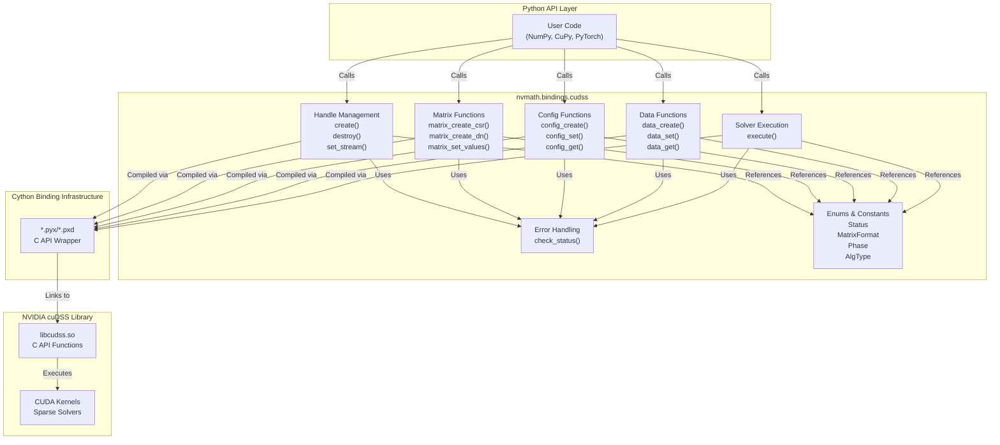
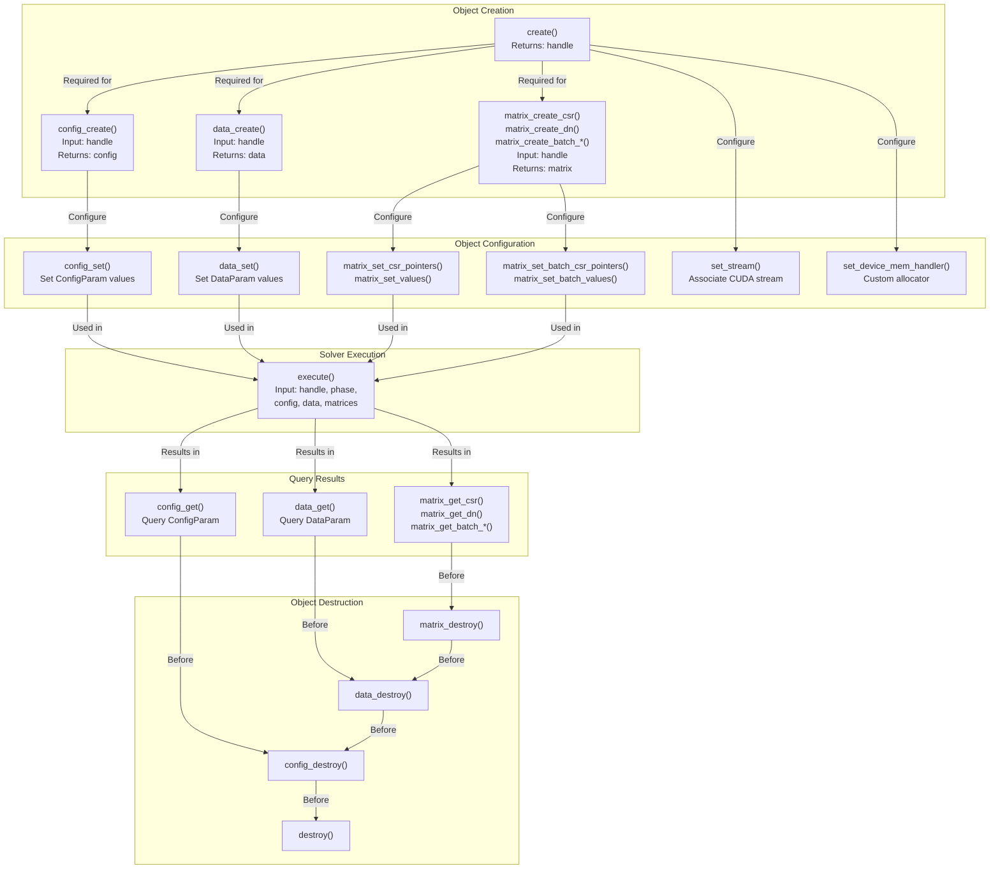
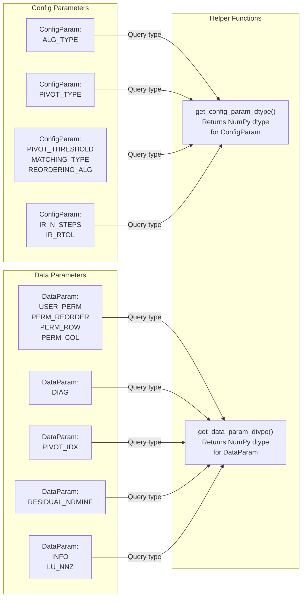
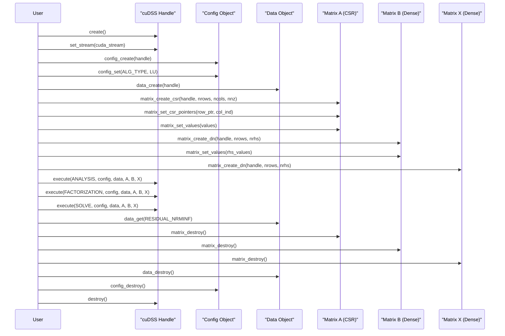
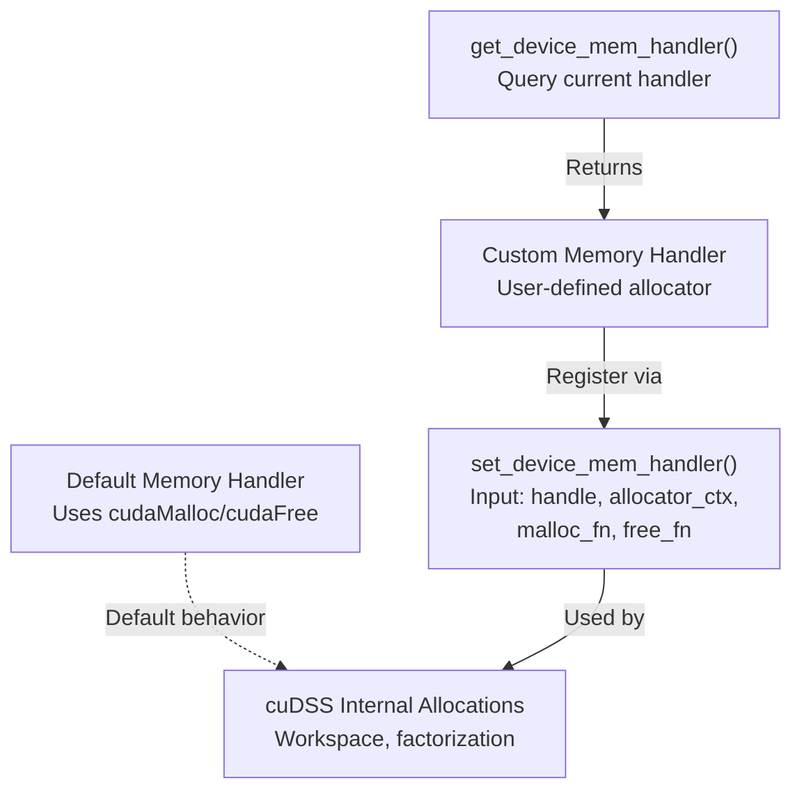

<!-- source: DeepWiki mcp.deepwiki.com · repo NVIDIA/nvmath-python · page 7.5 cuDSS Bindings · fetched 2026-10-26 -->

# cuDSS Bindings

Relevant source files

The following files were used as context for generating this wiki page:

- [docs/sphinx/bindings/cudss.rst](docs/sphinx/bindings/cudss.rst)

## Purpose and Scope

This document provides a complete reference for the `nvmath.bindings.cudss` module, which exposes Python bindings to NVIDIA's cuDSS (CUDA Direct Sparse Solver) library. The cuDSS library provides high-performance direct solvers for sparse linear systems, supporting various matrix formats, factorization algorithms, and configuration options.

This page covers the low-level Python bindings to the cuDSS C API. For higher-level abstractions or usage in distributed contexts, see [Distributed APIs](#6). For integration with other NVIDIA linear algebra libraries, see [cuBLAS Bindings](#7.1) and [cuBLASLt Bindings](#7.2).

**Sources:** [docs/sphinx/bindings/cudss.rst:1-69]()

---

## Overview

The `nvmath.bindings.cudss` module provides comprehensive access to cuDSS functionality for solving sparse linear systems of the form `Ax = b` or `AX = B` using direct methods. The library supports multiple factorization algorithms (LU, Cholesky, QR) and sparse matrix storage formats (CSR, dense, batched variants).

The binding layer follows cuDSS's object-oriented design with four primary handle types:

- **cuDSS Handle**: Main library context managing resources and configuration.
- **Matrix Descriptors**: Describe sparse or dense matrix properties and data layout.
- **Config Objects**: Store solver configuration parameters (algorithm, pivoting, etc.).
- **Data Objects**: Store solver-specific data and results (permutations, residuals, etc.).

**Key Features:**
- Direct sparse solver algorithms (LU, Cholesky, LDL^T, QR).
- CSR (Compressed Sparse Row) and dense matrix formats.
- Batched operations for solving multiple independent systems.
- 32-bit and 64-bit integer indexing support.
- Custom memory allocation handlers.
- Multi-threaded and multi-GPU support via threading/communication layers.

**Sources:** [docs/sphinx/bindings/cudss.rst:1-69]()

---

## Architecture and Integration

### cuDSS Binding Layer Architecture

The cuDSS bindings provide direct, low-overhead access to cuDSS C API functions while maintaining Python's ease of use through automatic status checking and enum exposure.

**Sources:** [docs/sphinx/bindings/cudss.rst:1-69]()

---

## Core Object Model

The cuDSS API follows an object-based workflow where users create and manage four types of opaque handles.

### Object Lifecycle and Relationships

**Object Relationships:**

| Object Type | Creation Function | Destruction Function | Purpose |
|-------------|------------------|---------------------|---------|
| cuDSS Handle | `create()` | `destroy()` | Main library context, manages resources |
| Config | `config_create()` | `config_destroy()` | Solver configuration (algorithm, pivoting, etc.) |
| Data | `data_create()` | `data_destroy()` | Solver data (permutations, residuals, iterative refinement) |
| Matrix | `matrix_create_*()` | `matrix_destroy()` | Matrix descriptors (A, B, X) |

**Sources:** [docs/sphinx/bindings/cudss.rst:32-68]()

---

## Enums and Constants

The cuDSS bindings expose numerous enumeration types that control solver behavior and describe matrix properties. All enums follow the naming convention from the cuDSS C API.

### Primary Enumerations

| Enum Type | Purpose | Key Values |
|-----------|---------|------------|
| `Status` | API return status codes | Success, error conditions |
| `Phase` | Solver execution phase | Analysis, factorization, solve, refactorization |
| `AlgType` | Factorization algorithm | LU, Cholesky, LDL^T, QR |
| `MatrixFormat` | Storage format | CSR, dense |
| `MatrixType` | Matrix properties | General, symmetric, Hermitian, SPD |
| `MatrixViewType` | Upper/lower view | Full, upper, lower |
| `Layout` | Memory layout | Row-major, column-major |
| `IndexBase` | Index numbering | Zero-based, one-based |
| `PivotType` | Pivoting strategy | None, static, dynamic |
| `OpType` | Matrix operation | Non-transpose, transpose, conjugate-transpose |

### Configuration and Data Parameters

The `ConfigParam` enum controls solver behavior, while `DataParam` identifies data objects returned by the solver.

**Sources:** [docs/sphinx/bindings/cudss.rst:9-28](), [docs/sphinx/bindings/cudss.rst:47-48]()

---

## Function Reference by Category

### Handle Management Functions

Functions for creating and configuring the main cuDSS library context:

| Function | Purpose |
|----------|---------|
| `create()` | Create cuDSS handle |
| `destroy()` | Destroy cuDSS handle |
| `get_property()` | Query library properties (version, capabilities) |
| `set_stream()` | Associate CUDA stream with handle |
| `set_device_mem_handler()` | Set custom memory allocation handler |
| `get_device_mem_handler()` | Get current memory handler |
| `set_comm_layer()` | Configure communication layer for multi-GPU |
| `set_threading_layer()` | Configure threading layer |

**Sources:** [docs/sphinx/bindings/cudss.rst:40-68]()

### Configuration Object Functions

Functions for managing solver configuration:

| Function | Purpose |
|----------|---------|
| `config_create()` | Create configuration object |
| `config_destroy()` | Destroy configuration object |
| `config_set()` | Set configuration parameter (requires `ConfigParam` enum) |
| `config_get()` | Get configuration parameter value |
| `get_config_param_dtype()` | Query NumPy dtype for a `ConfigParam` |

**Sources:** [docs/sphinx/bindings/cudss.rst:36-47]()

### Data Object Functions

Functions for managing solver data and results:

| Function | Purpose |
|----------|---------|
| `data_create()` | Create data object |
| `data_destroy()` | Destroy data object |
| `data_set()` | Set data parameter (input to solver) |
| `data_get()` | Get data parameter (output from solver) |
| `get_data_param_dtype()` | Query NumPy dtype for a `DataParam` |

**Sources:** [docs/sphinx/bindings/cudss.rst:41-48]()

### Matrix Descriptor Functions

Functions for creating and managing matrix descriptors:

#### Single Matrix Operations

| Function | Purpose |
|----------|---------|
| `matrix_create_csr()` | Create CSR sparse matrix descriptor |
| `matrix_create_dn()` | Create dense matrix descriptor |
| `matrix_destroy()` | Destroy matrix descriptor |
| `matrix_get_csr()` | Get CSR matrix properties |
| `matrix_get_dn()` | Get dense matrix properties |
| `matrix_get_format()` | Query matrix storage format |
| `matrix_set_csr_pointers()` | Set CSR row/column pointers and indices |
| `matrix_set_values()` | Set matrix values array |

**Sources:** [docs/sphinx/bindings/cudss.rst:53-64]()

#### Batched Matrix Operations

| Function | Purpose |
|----------|---------|
| `matrix_create_batch_csr()` | Create batched CSR matrix descriptor |
| `matrix_create_batch_dn()` | Create batched dense matrix descriptor |
| `matrix_get_batch_csr()` | Get batched CSR properties |
| `matrix_get_batch_dn()` | Get batched dense properties |
| `matrix_set_batch_csr_pointers()` | Set CSR pointers for batched operations |
| `matrix_set_batch_values()` | Set values for batched operations |

**Sources:** [docs/sphinx/bindings/cudss.rst:51-62]()

### Solver Execution and Error Handling

| Function | Purpose |
|----------|---------|
| `execute()` | Execute solver phase (analysis, factorization, solve) |
| `check_status()` | Verify cuDSS status code, raise exception on error |

**Sources:** [docs/sphinx/bindings/cudss.rst:35-46]()

---

## Typical Usage Workflows

### Workflow 1: Single System Solve (CSR Format)

**Key Steps:**
1. Create handle and configure stream via `create()` and `set_stream()`.
2. Create config and set algorithm parameters via `config_create()` and `config_set()`.
3. Create data object via `data_create()`.
4. Create matrix descriptors for A (sparse), B (dense), and X (dense).
5. Execute three-phase solve: analysis → factorization → solve using `execute()`.
6. Query residual via `data_get()`.
7. Destroy objects in reverse dependency order.

**Sources:** [docs/sphinx/bindings/cudss.rst:32-68]()

---

## Memory and Communication Management

### Custom Memory Handlers

The cuDSS bindings support custom memory allocation handlers for fine-grained control over GPU memory usage.

### Multi-GPU Hooks

- `set_comm_layer()`: Configure communication layer (e.g., MPI-based) for multi-GPU execution.
- `set_threading_layer()`: Configure CPU threading (e.g., OpenMP) to optimize host-side performance.

**Sources:** [docs/sphinx/bindings/cudss.rst:49-68]()

---

## Summary

The `nvmath.bindings.cudss` module provides comprehensive Python access to NVIDIA's cuDSS sparse direct solver library. Key features include:

- **Direct sparse solvers** with LU, Cholesky, LDL^T, and QR factorizations.
- **CSR and dense matrix formats** with batched variants.
- **Configurable algorithms** via `Config` objects.
- **Multi-phase execution** (analysis, factorization, solve, refactorization).
- **Custom memory handlers** and stream management.
- **Automatic error checking** via `check_status()`.

**Sources:** [docs/sphinx/bindings/cudss.rst:1-69]()

---

