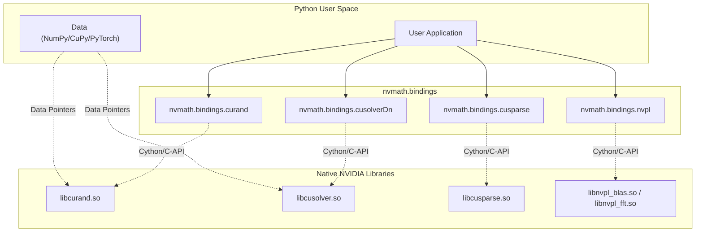
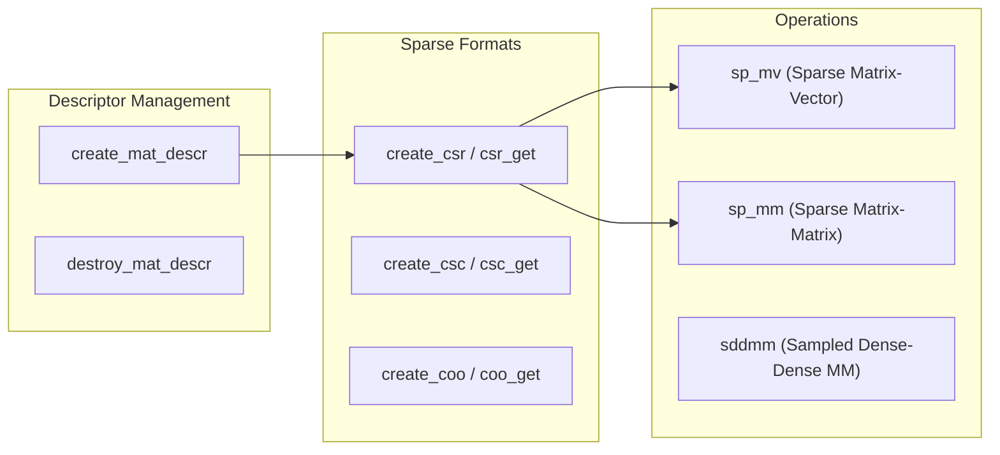

<!-- source: DeepWiki mcp.deepwiki.com · repo NVIDIA/nvmath-python · page 7.6 Additional Bindings · fetched 2026-10-26 -->

# Additional Bindings

Relevant source files

The following files were used as context for generating this wiki page:

- [docs/sphinx/bindings/curand.rst](docs/sphinx/bindings/curand.rst)
- [docs/sphinx/bindings/cusolver.rst](docs/sphinx/bindings/cusolver.rst)
- [docs/sphinx/bindings/cusolverDn.rst](docs/sphinx/bindings/cusolverDn.rst)
- [docs/sphinx/bindings/cusparse.rst](docs/sphinx/bindings/cusparse.rst)
- [docs/sphinx/bindings/nvpl.blas.rst](docs/sphinx/bindings/nvpl.blas.rst)
- [docs/sphinx/bindings/nvpl.fft.rst](docs/sphinx/bindings/nvpl.fft.rst)

This page provides a reference for the remaining library bindings within `nvmath-python`. While core operations like `cublas` and `cufft` are central to the ecosystem, `nvmath.bindings` also provides comprehensive Python interfaces for random number generation, sparse and dense solvers, tensor operations, and multi-GPU communication primitives. Additionally, it includes support for NVIDIA Performance Libraries (NVPL) targeting ARM platforms.

## Overview of Additional Libraries

The `nvmath.bindings` subpackage aims to provide a near 1-to-1 mapping of C-level APIs to Python, while handling details like error checking and memory pointer management.

### Random Number Generation (cuRAND)
The `nvmath.bindings.curand` module provides bindings for the cuRAND library, enabling high-performance pseudo- and quasi-random number generation on the GPU.

*   **Implementation**: It supports both host-side generator management and direct generation into GPU memory.
*   **Key Functions**: 
    *   `create_generator` and `create_generator_host` for initializing RNG states [docs/sphinx/bindings/curand.rst:29-30]().
    *   `generate_uniform`, `generate_normal`, and `generate_log_normal` for standard distributions [docs/sphinx/bindings/curand.rst:37-46]().
    *   `set_pseudo_random_generator_seed` for reproducibility [docs/sphinx/bindings/curand.rst:55-55]().

### Dense and Sparse Solvers (cuSOLVER & cuSPARSE)
These modules provide low-level access to LAPACK-like functions and sparse matrix operations.

*   **cuSOLVER**: Divided into several sub-modules, with `nvmath.bindings.cusolverDn` focusing on dense LAPACK functions such as LU, QR, Cholesky, and SVD decompositions [docs/sphinx/bindings/cusolverDn.rst:1-7]().
*   **cuSPARSE**: Provides routines for sparse matrix-vector multiplication (`SpMV`), sparse matrix-matrix multiplication (`SpMM`), and format conversions (e.g., `csr2csc`) [docs/sphinx/bindings/cusparse.rst:1-7]().

### ARM Platform Support (NVPL)
For ARM-based systems (such as NVIDIA Grace), `nvmath-python` provides bindings for the NVIDIA Performance Libraries (NVPL). These libraries provide CPU-optimized BLAS and FFT implementations.

*   **NVPL BLAS**: Includes standard Level 1, 2, and 3 BLAS routines like `sgemm` and `dgemm`, along with batched variants [docs/sphinx/bindings/nvpl.blas.rst:28-69]().
*   **NVPL FFT**: Provides an interface compatible with FFTW for high-performance CPU Fourier transforms [docs/sphinx/bindings/nvpl.fft.rst:3-7]().

---

## Data Flow and Naming Conventions

The bindings follow a consistent pattern where C-style status codes are automatically converted into Python exceptions via `check_status` functions.

### Binding Naming Pattern
| Library | Module | Function Prefix |
| :--- | :--- | :--- |
| cuRAND | `nvmath.bindings.curand` | `curand` (stripped in Python) |
| cuSOLVER Dn | `nvmath.bindings.cusolverDn` | `cusolverDn` (stripped in Python) |
| cuSPARSE | `nvmath.bindings.cusparse` | `cusparse` (stripped in Python) |
| NVPL BLAS | `nvmath.bindings.nvpl.blas` | `nvpl_blas` (standard BLAS names) |

### System Architecture Diagram
The following diagram illustrates how these additional bindings bridge the gap between Python user code and the underlying C/C++ libraries.

**Title: Binding Layer Data Flow**

Sources: [docs/sphinx/bindings/curand.rst:1-58](), [docs/sphinx/bindings/cusolverDn.rst:1-10](), [docs/sphinx/bindings/cusparse.rst:1-10](), [docs/sphinx/bindings/nvpl.blas.rst:1-10]()

---

## Library Reference

### cuSOLVER Dense (Dn)
The `cusolverDn` module is one of the most extensive in the package, providing high-level linear algebra solvers.

| Category | Key Function Examples |
| :--- | :--- |
| **Linear Solvers** | `sgetrf`, `sgetrs`, `spotrf`, `spotrs` [docs/sphinx/bindings/cusolverDn.rst:227-253]() |
| **SVD** | `sgesvd`, `sgesvdj`, `sgesvda_strided_batched` [docs/sphinx/bindings/cusolverDn.rst:219-226]() |
| **Eigenvalue** | `ssyevd`, `ssyevdx`, `ssyevj` [docs/sphinx/bindings/cusolverDn.rst:258-265]() |
| **Management** | `create`, `destroy`, `set_stream` [docs/sphinx/bindings/cusolverDn.rst:77-107]() |

### cuSPARSE
`cuSPARSE` handles operations on sparse matrices where most elements are zero, using specialized storage formats like CSR, CSC, and COO.

**Title: cuSPARSE Entity Mapping**

Sources: [docs/sphinx/bindings/cusparse.rst:95-118](), [docs/sphinx/bindings/cusparse.rst:191-244]()

### NVPL (NVIDIA Performance Libraries)
NVPL bindings allow `nvmath-python` to be used on CPU-only or hybrid ARM environments.

*   **NVPL BLAS**: Implements the standard BLAS interface. For example, `sgemm` performs $C = \alpha AB + \beta C$ on single-precision floats [docs/sphinx/bindings/nvpl.blas.rst:51-51]().
*   **NVPL FFT**: Follows the FFTW execution model.
    1.  **Plan**: Create a plan using `plan_many_c2c_float` [docs/sphinx/bindings/nvpl.fft.rst:49-49]().
    2.  **Execute**: Run the transform with `execute_c2c_float` [docs/sphinx/bindings/nvpl.fft.rst:38-38]().
    3.  **Destroy**: Free resources with `destroy` [docs/sphinx/bindings/nvpl.fft.rst:33-33]().

### cuRAND Enums
The `curand` module defines several enums to configure the generator's behavior:
*   `RngType`: Selects the algorithm (e.g., XORWOW, Philox, Sobol) [docs/sphinx/bindings/curand.rst:19-19]().
*   `Ordering`: Determines how the random numbers are ordered in memory [docs/sphinx/bindings/curand.rst:18-18]().
*   `DirectionVectorSet`: Used for quasi-random generators [docs/sphinx/bindings/curand.rst:16-16]().

Sources: [docs/sphinx/bindings/curand.rst:9-21](), [docs/sphinx/bindings/nvpl.fft.rst:12-21](), [docs/sphinx/bindings/nvpl.blas.rst:12-19]()

---

