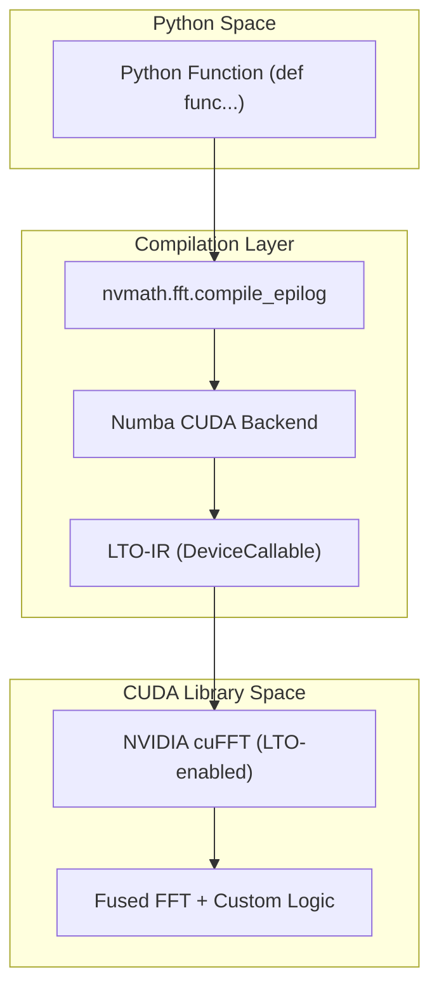
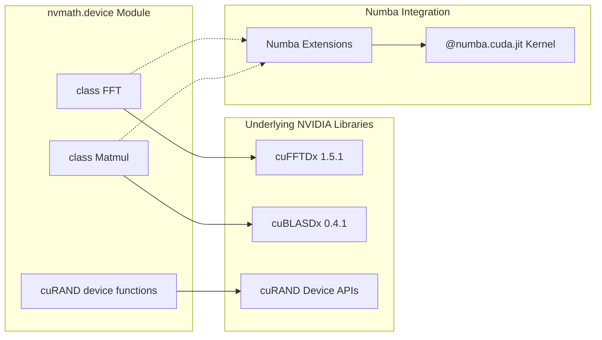

<!-- source: DeepWiki mcp.deepwiki.com · repo NVIDIA/nvmath-python · page 8 Advanced Usage Patterns · fetched 2026-10-26 -->

# Advanced Usage Patterns

Relevant source files

The following files were used as context for generating this wiki page:

- [docs/sphinx/device-apis/index.rst](docs/sphinx/device-apis/index.rst)
- [docs/sphinx/distributed-apis/index.rst](docs/sphinx/distributed-apis/index.rst)
- [docs/sphinx/host-apis/fft/index.rst](docs/sphinx/host-apis/fft/index.rst)

This page serves as a collection of advanced techniques and patterns for power users of `nvmath-python`. It covers high-level strategies for kernel fusion, integration with JIT compilers like Numba, and scaling to multi-GPU environments.

## Overview

The `nvmath-python` library is designed with a three-tier API architecture (Host, Device, and Distributed) to support various levels of control and performance requirements. Advanced usage typically involves moving beyond stateless host calls to leverage:
*   **Kernel Fusion**: Combining mathematical operations with custom logic via epilogs and prologs to minimize memory bandwidth bottlenecks.
*   **Device Integration**: Embedding high-performance library calls directly into custom CUDA kernels.
*   **Distributed Scaling**: Partitioning data and computation across multiple GPUs and nodes using the SPMD (Single Program, Multiple Data) model.

## Custom Epilogs and Prologs

For host-side operations like FFT and Matrix Multiplication, `nvmath-python` supports fusing user-defined logic with the core library kernels. This is achieved through Link-Time Optimization (LTO) and custom callbacks.

*   **FFT Callbacks**: User-defined functions can be compiled to LTO-IR format and provided as a `prolog` or `epilog` to an FFT operation [docs/sphinx/host-apis/fft/index.rst:44-54]().
*   **Compilation**: The library provides helper functions `nvmath.fft.compile_prolog` and `nvmath.fft.compile_epilog` which use Numba to compile Python code into the required LTO-IR format [docs/sphinx/host-apis/fft/index.rst:55-60]().
*   **Benefits**: Fusing operations like scaling or DFT-based convolutions directly into the FFT kernel reduces the need for intermediate memory passes.

For details, see [Custom Epilogs and Prologs](#8.1).

### FFT Callback Workflow

The diagram below illustrates how a Python function is transformed into a fused GPU kernel.

Sources: [docs/sphinx/host-apis/fft/index.rst:44-63]()

## Numba Integration

The `nvmath.device` module allows users to call high-performance math primitives directly from within CUDA kernels. This is primarily supported through Numba extensions.

*   **Supported Libraries**: Device-side APIs are available for `cuFFTDx`, `cuBLASDx`, and `cuRAND` [docs/sphinx/device-apis/index.rst:10-15]().
*   **Usage Patterns**: Users can define functions, query device traits (such as required shared memory), and execute math operations within a `numba.cuda.jit` decorated kernel [docs/sphinx/device-apis/index.rst:20-22]().
*   **Low-level Access**: For users not using Numba, low-level interfaces are available for other third-party JIT compilers [docs/sphinx/device-apis/index.rst:23-24]().

For details, see [Numba Integration](#8.2).

### Device API Code Entity Mapping

This diagram bridges the high-level Python modules to the underlying device-side code entities.

Sources: [docs/sphinx/device-apis/index.rst:10-32]()

## Multi-GPU and Distributed Computing

The `nvmath.distributed` module provides a way to scale computations across multi-node, multi-GPU systems using an SPMD approach.

*   **Execution Model**: Applications are launched with multiple processes (one per GPU), typically via MPI (e.g., `mpirun`) [docs/sphinx/distributed-apis/index.rst:16-19]().
*   **Data Distribution**: Users specify how global operands are partitioned into local partitions (e.g., Slab or Box distributions) [docs/sphinx/distributed-apis/index.rst:21-25]().
*   **Symmetric Memory**: Certain operations, such as Distributed FFT and Reshape, require operands to be allocated in **symmetric memory** via NVSHMEM [docs/sphinx/distributed-apis/index.rst:27-31]().
*   **Runtime Initialization**: Users must explicitly initialize the distributed runtime before calling distributed APIs [docs/sphinx/distributed-apis/index.rst:33-36]().

For details, see [Multi-GPU and Distributed Computing](#8.3).

Sources: [docs/sphinx/distributed-apis/index.rst:5-36]()

---

