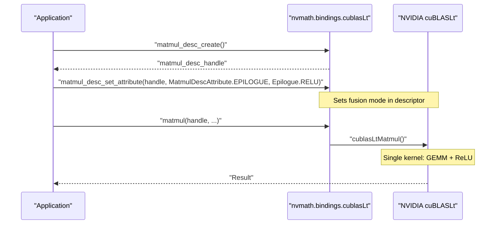

<!-- source: DeepWiki mcp.deepwiki.com · repo NVIDIA/nvmath-python · page 8.1 Custom Epilogs and Prologs · fetched 2026-10-26 -->

# Custom Epilogs and Prologs

<details>
<summary>Relevant source files</summary>

The following files were used as context for generating this wiki page:

- [docs/sphinx/bindings/cublasLt.rst](docs/sphinx/bindings/cublasLt.rst)
- [docs/sphinx/bindings/cufft.rst](docs/sphinx/bindings/cufft.rst)

</details>


## Purpose and Scope

This page provides a deep dive into defining, compiling, and using custom epilog and prolog functions in `nvmath-python`. These mechanisms enable **kernel fusion**, allowing post-computation operations (epilogs) or pre-computation operations (prologs) to execute within the same GPU kernel as the main FFT or matrix multiplication. This reduces global memory traffic and kernel launch overhead.

Key technologies covered include:
*   **cuBLASLt Epilogs**: Built-in and custom operations for matrix multiplication.
*   **cuFFT LTO-IR Callbacks**: Custom Python functions compiled to Link Time Optimization Intermediate Representation (LTO-IR) for FFT operations.

## Understanding Epilogs and Prologs

### Epilogs
Epilogs are operations applied to the output of a computation immediately after the main algorithm finishes, while the data is still in GPU registers or shared memory. In `nvmath-python`, these are primarily managed via `nvmath.linalg.advanced.Matmul` and `nvmath.fft`.

### Prologs
Prologs are operations applied to input data as it is loaded from global memory into the computation engine. This is supported in FFT operations via LTO-IR callbacks, allowing transformations like windowing without a separate kernel.

### Diagram: Kernel Fusion with Prologs and Epilogs


**Diagram: Kernel Fusion Comparison**

The fused approach eliminates intermediate global memory round-trips, significantly reducing memory bandwidth pressure.

## Matrix Multiplication Epilogs

Matrix multiplication epilogs are implemented through the `nvmath.bindings.cublasLt` module and the high-level `Matmul` API.

### Available Epilog Types
The `Epilogue` enum in `nvmath.bindings.cublasLt` defines the available operations that can be fused with the GEMM kernel [docs/sphinx/bindings/cublasLt.rst:18-18]().

| Epilog Type | Operation | Use Case |
| :--- | :--- | :--- |
| `RELU` | `max(0, x)` | Neural network activation |
| `BIAS` | `x + bias` | Adding bias vector to output rows |
| `GELU` | Gaussian Error Linear Unit | Transformer activations |
| `DRELU` | Gradient of ReLU | Backpropagation |
| `DRELU_BGRAD` | Gradient of ReLU + Bias Gradient | Combined backprop operations |

### Epilog Specification and Execution

The application interacts with `cuBLASLt` through descriptors. Attributes like `EPILOGUE` are set using `matmul_desc_set_attribute` [docs/sphinx/bindings/cublasLt.rst:75-75]().



**Diagram: cuBLASLt Epilog Configuration**

Sources: [docs/sphinx/bindings/cublasLt.rst:18-19](), [docs/sphinx/bindings/cublasLt.rst:64-64](), [docs/sphinx/bindings/cublasLt.rst:75-75]()

## FFT Prologs and Epilogs (LTO-IR)

`nvmath-python` leverages `cuFFT`'s Just-In-Time (JIT) callback mechanism. This allows users to write Python functions that are compiled to LTO-IR and linked directly into the `cuFFT` kernel.

### LTO-IR Compilation Process

The process uses Numba to compile Python to PTX, which is then wrapped into LTO-IR. This IR is passed to `cuFFT` via `xt_set_jit_callback` [docs/sphinx/bindings/cufft.rst:86-86]().

```mermaid
flowchart TB
    PY_FUNC["Python Callback<br/>(Numba JIT)"] --> LTO_GEN["nvmath.fft.compile_epilog()"]
    LTO_GEN --> LTO_BYTES["LTO-IR Binary (bytes)"]
    
    LTO_BYTES --> CUFFT_CALL["xt_set_jit_callback()"]
    CUFFT_CALL --> CUFFT_PLAN["cuFFT Plan Handle"]
    
    CUFFT_PLAN --> EXEC["xt_exec_descriptor_c2c()"]
    Note over EXEC: Executes fused FFT + Callback
```

**Diagram: FFT LTO-IR Callback Pipeline**

Sources: [docs/sphinx/bindings/cufft.rst:21-21](), [docs/sphinx/bindings/cufft.rst:86-86](), [docs/sphinx/bindings/cufft.rst:72-77]()

### FFT Execution with Callbacks

The `nvmath.bindings.cufft` module provides low-level access to these features:
*   **`XtCallbackType`**: Enum to specify if the callback is for Load (Prolog) or Store (Epilog) [docs/sphinx/bindings/cufft.rst:21-21]().
*   **`xt_set_jit_callback`**: Function to attach the compiled LTO-IR to a plan [docs/sphinx/bindings/cufft.rst:86-86]().
*   **`xt_set_callback_shared_size`**: Configures shared memory if the callback requires it [docs/sphinx/bindings/cufft.rst:84-84]().

### Callback Types and Signatures

| Callback Type | cuFFT Enum | Purpose |
| :--- | :--- | :--- |
| **Load (Prolog)** | `CUFFT_CB_LD_*` | Transform data before FFT (e.g., windowing) |
| **Store (Epilog)** | `CUFFT_CB_ST_*` | Transform data after FFT (e.g., scaling, filtering) |

## Performance Benefits of Fusion

1.  **Memory Bandwidth**: By performing operations in registers before writing to global memory, fusion avoids the `Read -> Compute -> Write -> Read -> Compute -> Write` cycle.
2.  **Instruction Latency**: Fusing small element-wise operations (like ReLU or scaling) into a compute-bound kernel (like GEMM or FFT) often results in the additional operations being "hidden" by the main computation's latency.
3.  **Kernel Launch Overhead**: Reducing the number of kernels launched to the GPU stream minimizes CPU-side overhead, which is critical for small-to-medium batch sizes.

## Implementation Details

### Matrix Layout and Descriptors
When using epilogs in matrix multiplication, the output matrix layout must be carefully managed. The `matrix_layout_set_attribute` function is used to configure data types and strides that the epilog might require [docs/sphinx/bindings/cublasLt.rst:83-83]().

### FFT Plan Management
Callbacks must be associated with a plan after `create` [docs/sphinx/bindings/cufft.rst:34-34]() and before `exec` [docs/sphinx/bindings/cufft.rst:40-45](). Using the `Xt` (Extended) API variants like `xt_make_plan_many` [docs/sphinx/bindings/cufft.rst:80-80]() is required for LTO-IR callback support.

Sources: [docs/sphinx/bindings/cublasLt.rst:1-88](), [docs/sphinx/bindings/cufft.rst:1-90]()

---

