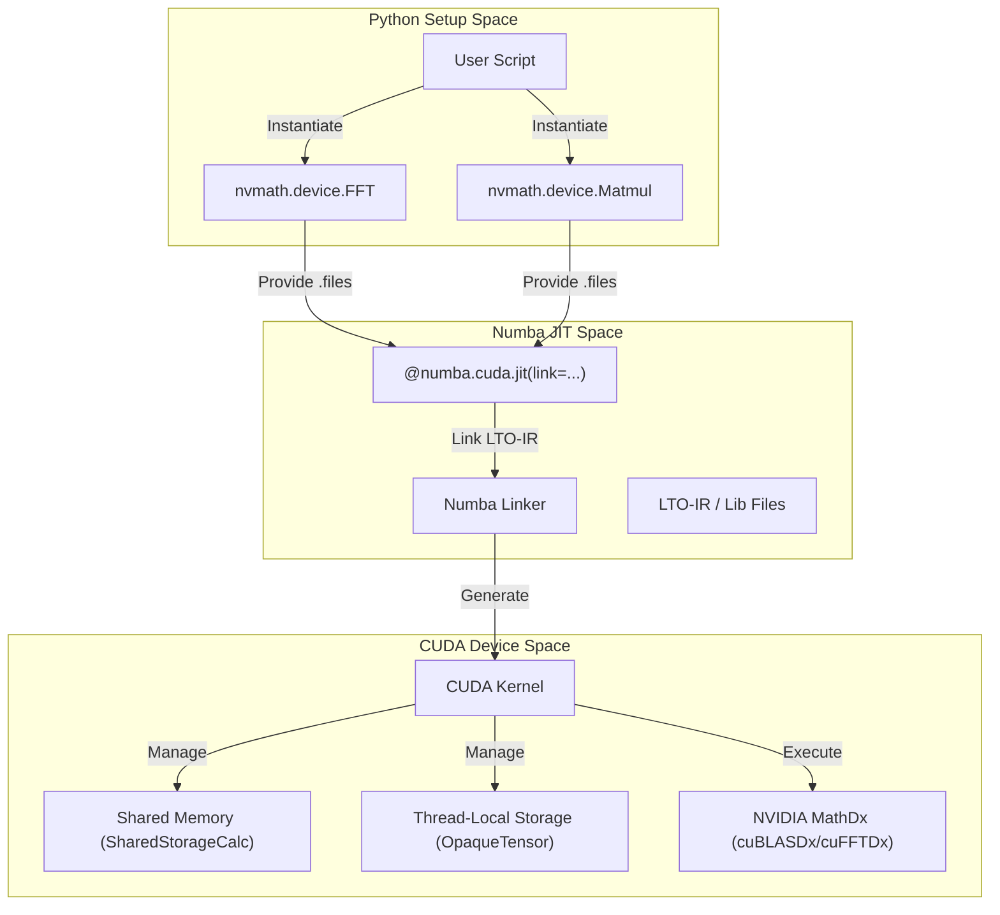
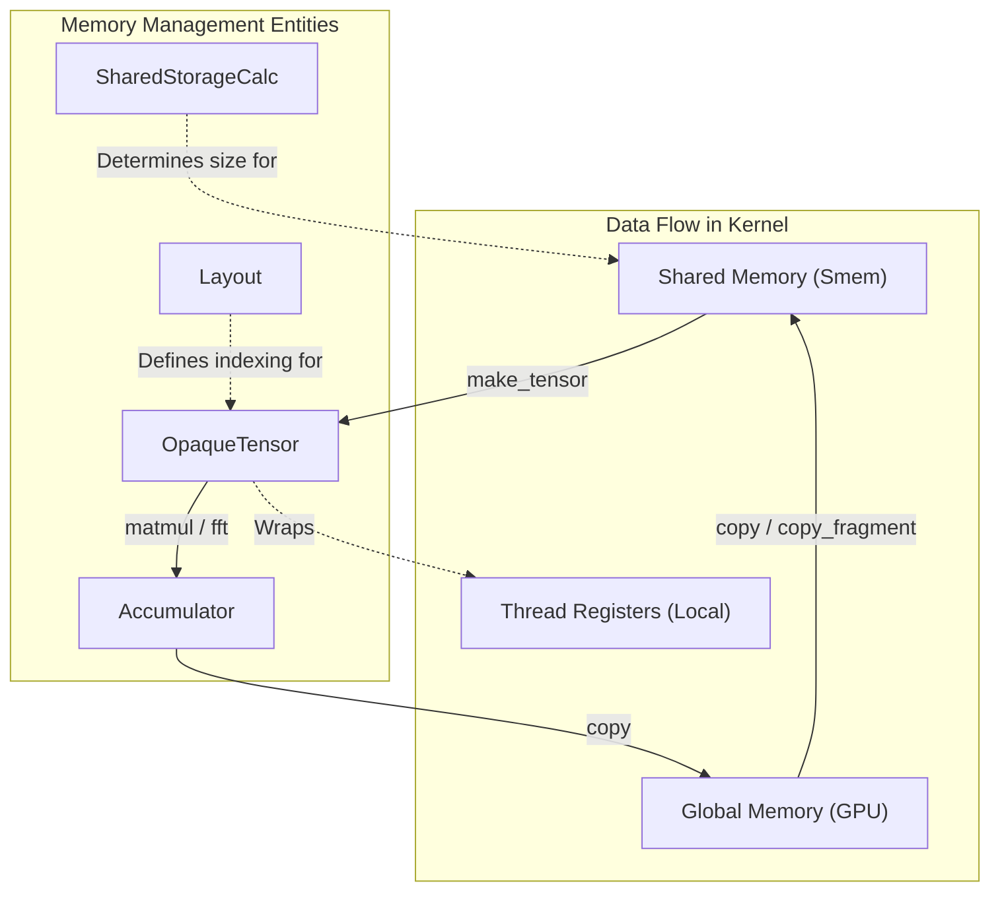

<!-- source: DeepWiki mcp.deepwiki.com · repo NVIDIA/nvmath-python · page 8.2 Numba Integration · fetched 2026-10-26 -->

# Numba Integration

<details>
<summary>Relevant source files</summary>

The following files were used as context for generating this wiki page:

- [docs/sphinx/device-apis/cublas.rst](docs/sphinx/device-apis/cublas.rst)
- [docs/sphinx/device-apis/cufft.rst](docs/sphinx/device-apis/cufft.rst)
- [docs/sphinx/device-apis/utils.rst](docs/sphinx/device-apis/utils.rst)

</details>


## Purpose and Scope

This document explains how to use `nvmath-python` with Numba to create optimized CUDA kernels that leverage NVIDIA's high-performance math libraries. The integration allows developers to call NVIDIA library functions directly from inside custom CUDA kernels, enabling advanced GPU-accelerated algorithms while remaining within the Python ecosystem. This page details the use of `nvmath.device` APIs, memory configuration (shared/thread-local), and common integration patterns.

## Overview of Integration

`nvmath-python` exposes NVIDIA's device-side (Dx) APIs through the `nvmath.device` module. These APIs, specifically designed for integration with custom kernels, support cuBLASDx and cuFFTDx. When used with Numba, these functions are linked into the kernel during the JIT compilation process.

### Numba Integration Architecture

The following diagram bridges the natural language concepts of kernel definition to the specific code entities provided by `nvmath.device`.


Sources: [docs/sphinx/device-apis/cublas.rst:17-19](), [docs/sphinx/device-apis/cufft.rst:17-21]()

## Supported Device APIs

`nvmath-python` currently supports two primary math libraries for device-side integration via `nvmath.device`.

| Library | nvmath.device Entity | Description |
| :--- | :--- | :--- |
| **cuBLASDx** | `Matmul`, `matmul`, `axpby`, `copy` | Device-side BLAS operations including GEMM, vector scaling, and fragment copying. [docs/sphinx/device-apis/cublas.rst:31-38]() |
| **cuFFTDx** | `FFT`, `fft` | Device-side Fast Fourier Transforms (C2C, R2C, etc.). [docs/sphinx/device-apis/cufft.rst:33-34]() |

### Data Types and Utilities
The integration provides specialized types to match CUDA's device-side requirements:
*   **Complex Types**: `Complex`, `complex32`, `complex64`, `complex128` [docs/sphinx/device-apis/utils.rst:23-27]()
*   **Vector Types**: `half2`, `half4`, `float32x2`, `float64x2` [docs/sphinx/device-apis/utils.rst:30-35]()
*   **Precision Helpers**: `np_float16x2`, `np_float16x4` for NumPy compatibility [docs/sphinx/device-apis/utils.rst:28-29]()

## Memory Configuration and Data Flow

Using `nvmath.device` functions within a Numba kernel requires precise memory management. Unlike host-side APIs that handle allocations, device APIs require the user to provide both thread-local storage (registers) and shared memory.

### Shared and Local Memory Patterns


Sources: [docs/sphinx/device-apis/cublas.rst:40-48]()

### 1. Shared Memory Allocation
For cuBLASDx and cuFFTDx, the amount of shared memory required depends on the operation size and execution mode.
*   **cuBLASDx**: Use `SharedStorageCalc` to determine the required bytes for a given `Matmul` configuration [docs/sphinx/device-apis/cublas.rst:48]().
*   **cuFFTDx**: The `FFT` object provides a `shared_memory_size` attribute (in bytes) to be passed to the Numba kernel launch.

### 2. Thread-Local Storage (Opaque Tensors)
Data processed by individual threads or fragments is managed via `OpaqueTensor` [docs/sphinx/device-apis/cublas.rst:40]().
*   Use `make_tensor` to create a view over local or shared memory [docs/sphinx/device-apis/cublas.rst:33]().
*   `copy_fragment` and `copy_wait` are used to asynchronously move data into these tensors for processing [docs/sphinx/device-apis/cublas.rst:36-38]().

## Integration Patterns with Numba

### Linking LTO-IR
The most critical step in Numba integration is providing the path to the library files (LTO-IR) to the `@cuda.jit` decorator. This allows Numba to resolve the external device function calls during its compilation phase.

```python
# Conceptual Numba Integration
from numba import cuda
from nvmath.device import FFT

# 1. Create the device API object
fft_op = FFT(...)

# 2. Pass fft_op.files to the link parameter
@cuda.jit(link=fft_op.files)
def my_custom_kernel(data):
    # Internal kernel logic calling fft_op
    ...
```

### Execution Pipelines
For advanced performance tuning, `nvmath.device` exposes pipeline abstractions:
*   **DevicePipeline**: Manages execution flow at the device level [docs/sphinx/device-apis/cublas.rst:45]().
*   **TilePipeline**: Specifically for tiled matrix operations in cuBLASDx [docs/sphinx/device-apis/cublas.rst:46]().

## Common Utilities

The `nvmath.device` module includes utilities to ensure the compiled kernel matches the hardware:
*   **Compute Capability**: `ComputeCapability` and `ISAVersion` are used to ensure the generated LTO-IR is compatible with the target GPU [docs/sphinx/device-apis/utils.rst:43-46]().
*   **Dim3**: Used for defining block and grid dimensions compatible with CUDA's `dim3` struct [docs/sphinx/device-apis/utils.rst:47]().
*   **Current LTO**: `current_device_lto` provides information about the LTO-IR being used for the current device context [docs/sphinx/device-apis/utils.rst:22]().

Sources: [docs/sphinx/device-apis/cublas.rst:1-54](), [docs/sphinx/device-apis/cufft.rst:1-35](), [docs/sphinx/device-apis/utils.rst:1-48]()

---

