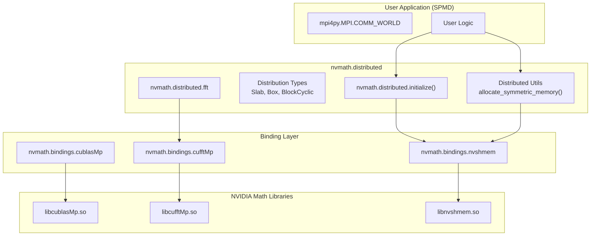
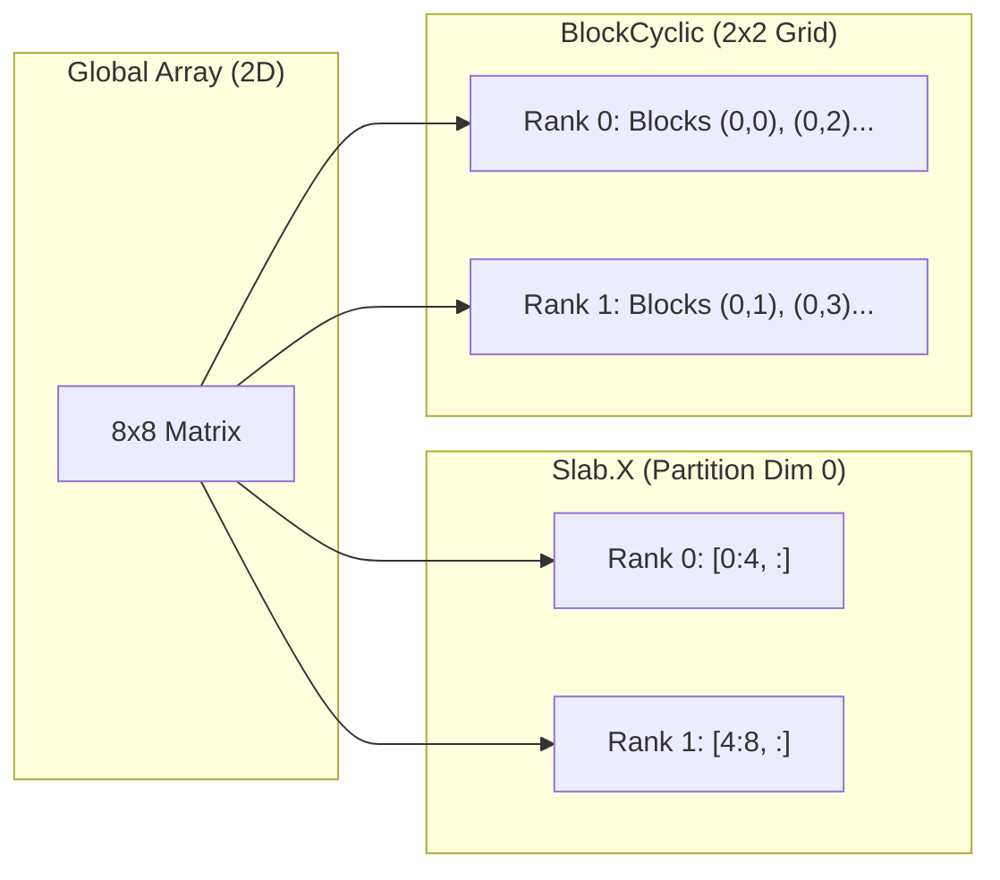

<!-- source: DeepWiki mcp.deepwiki.com · repo NVIDIA/nvmath-python · page 8.3 Multi-GPU and Distributed Computing · fetched 2026-10-26 -->

# Multi-GPU and Distributed Computing

<details>
<summary>Relevant source files</summary>

The following files were used as context for generating this wiki page:

- [docs/sphinx/distributed-apis/distribution.rst](docs/sphinx/distributed-apis/distribution.rst)
- [docs/sphinx/distributed-apis/index.rst](docs/sphinx/distributed-apis/index.rst)
- [docs/sphinx/distributed-apis/runtime.rst](docs/sphinx/distributed-apis/runtime.rst)

</details>


## Purpose and Scope

This page covers advanced patterns for multi-GPU and multi-node computing in `nvmath-python`, focusing on the `nvmath.distributed` API. These APIs enable distributed computation across multiple GPUs and compute nodes using NVIDIA's `cuFFTMp` and `cuBLASMp` libraries, which implement the **NVSHMEM** Partitioned Global Address Space (PGAS) model for efficient inter-GPU communication.

Distributed APIs are called from host code but execute on a multi-node multi-GPU system, typically following a Single Program, Multiple Data (SPMD) model where each process manages a local partition of the global data.

**Sources:** [docs/sphinx/distributed-apis/index.rst:1-32](), [docs/sphinx/distributed-apis/runtime.rst:1-13]()

---

## Architecture Overview



**Distributed Computing Architecture**

The distributed computing system in `nvmath-python` integrates Python-based communication (MPI) with low-level GPU communication backends (NVSHMEM, NCCL).

- **MPI Layer**: Used for bootstrapping the distributed environment [docs/sphinx/distributed-apis/runtime.rst:24-25]().
- **nvmath.distributed API**: Provides high-level abstractions for runtime initialization, symmetric memory management, and operand distribution.
- **NVSHMEM**: The primary backend for symmetric memory operations, enabling a PGAS model where GPUs can directly access remote memory [docs/sphinx/distributed-apis/runtime.rst:34-35]().
- **cuFFTMp/cuBLASMp**: Native libraries that perform the actual distributed math operations.

**Sources:** [docs/sphinx/distributed-apis/index.rst:5-35](), [docs/sphinx/distributed-apis/runtime.rst:1-40]()

---

## Distributed Runtime and Initialization

To use distributed APIs, the application must be launched with multiple processes (e.g., via `mpirun`), typically with one process per GPU [docs/sphinx/distributed-apis/index.rst:16-19]().

### Initialization Sequence

The `nvmath.distributed.initialize()` function must be called by every process before any distributed math operations are performed.

| Argument | Description |
|----------|-------------|
| `device_id` | The local CUDA device ID assigned to the process. |
| `comm` | An MPI communicator (e.g., `mpi4py.MPI.COMM_WORLD`). |
| `backends` | List of communication backends to initialize (e.g., `["nvshmem", "nccl"]`). |

```python
# Initialization Pattern
import nvmath.distributed
from mpi4py import MPI

comm = MPI.COMM_WORLD
# Logic to determine device_id per rank...
nvmath.distributed.initialize(device_id, comm, backends=["nvshmem", "nccl"])
```

**Sources:** [docs/sphinx/distributed-apis/runtime.rst:10-21](), [docs/sphinx/distributed-apis/index.rst:33-35]()

---

## Operand Distribution Strategies

`nvmath-python` supports several distribution types to describe how global arrays are partitioned across processes.

### Slab Distribution
Slab partitions an N-D array along a single dimension. It is natively supported by `cuFFTMp` [docs/sphinx/distributed-apis/distribution.rst:33-79]().
- **Slab.X**: Partitioned on axis 0.
- **Slab.Y**: Partitioned on axis 1.
- **Slab.Z**: Partitioned on axis 2.

### Box Distribution
A Box describes a contiguous rectangular subsection of the global array by specifying lower and upper corners. This is used for custom data decompositions in `cuFFTMp` and Reshape APIs [docs/sphinx/distributed-apis/distribution.rst:85-121]().

### Block Distributions
Mainly used for dense linear algebra (`cuBLASMp`), these distribute data into blocks assigned to a process grid [docs/sphinx/distributed-apis/distribution.rst:125-188]().
- **BlockCyclic**: Blocks are distributed in a cyclic pattern to balance load.
- **BlockNonCyclic**: A special case of BlockCyclic where each process owns a single contiguous block.



**Sources:** [docs/sphinx/distributed-apis/distribution.rst:5-188]()

---

## Symmetric Memory and In-Place Operations

Certain distributed operations (FFT, Reshape) require GPU operands to be allocated in **symmetric memory** [docs/sphinx/distributed-apis/index.rst:27-31]().

### The Symmetric Heap
Symmetric memory is allocated on a special heap managed by NVSHMEM. It ensures that an allocation on one rank has a corresponding allocation at the same virtual address on all other ranks.

- **Helpers**: `nvmath-python` provides utilities to allocate `CuPy` ndarrays or `PyTorch` tensors in symmetric memory [docs/sphinx/distributed-apis/index.rst:29-31]().
- **In-Place Nature**: Distributed FFTs are often performed in-place. When `reshape=False`, the output array shares the same underlying symmetric buffer as the input, even if the logical distribution (e.g., from `Slab.X` to `Slab.Y`) changes the local shape [docs/sphinx/distributed-apis/index.rst:27-29]().

**Sources:** [docs/sphinx/distributed-apis/index.rst:27-31](), [docs/sphinx/distributed-apis/runtime.rst:33-40]()

---

## Distributed FFT and Reshape

Distributed FFTs involve multi-step transformations that often result in a change of data distribution.

1. **Input**: Data is typically distributed as `Slab.X`.
2. **Execution**: The `nvmath.distributed.fft` API performs the transform.
3. **Redistribution**: Depending on the `reshape` option, the output may be returned in a different distribution (e.g., `Slab.Y`) to avoid expensive global transposes if the next operation can handle it [docs/sphinx/distributed-apis/distribution.rst:76-79]().

The **Reshape API** (`nvmath.distributed.reshape`) allows for explicit redistribution of tensors across processes, provided the operands are in symmetric memory [docs/sphinx/distributed-apis/distribution.rst:117-118]().

**Sources:** [docs/sphinx/distributed-apis/distribution.rst:76-121](), [docs/sphinx/distributed-apis/index.rst:27-29]()

---

## Distributed Linear Algebra (cuBLASMp)

Distributed matrix multiplication via `cuBLASMp` typically uses the **PBLAS 2D block-cyclic distribution** [docs/sphinx/distributed-apis/distribution.rst:12-14]().

### Compatibility and Conversion
While `cuBLASMp` requires block-cyclic layouts, `nvmath-python` can perform implicit conversions. For instance, a `Slab` distribution is compatible with a 2D block distribution if partition sizes are uniform [docs/sphinx/distributed-apis/distribution.rst:14-18]().

### Grid Management
Users must define a `ProcessGrid` (e.g., `2x2` or `1x4`) to specify how the MPI ranks are mapped to the logical matrix dimensions [docs/sphinx/distributed-apis/distribution.rst:161-166]().

**Sources:** [docs/sphinx/distributed-apis/distribution.rst:10-18](), [docs/sphinx/distributed-apis/distribution.rst:132-188]()

---

