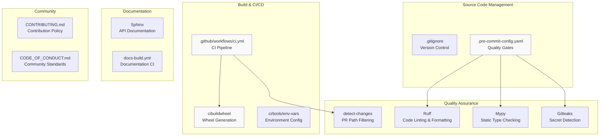
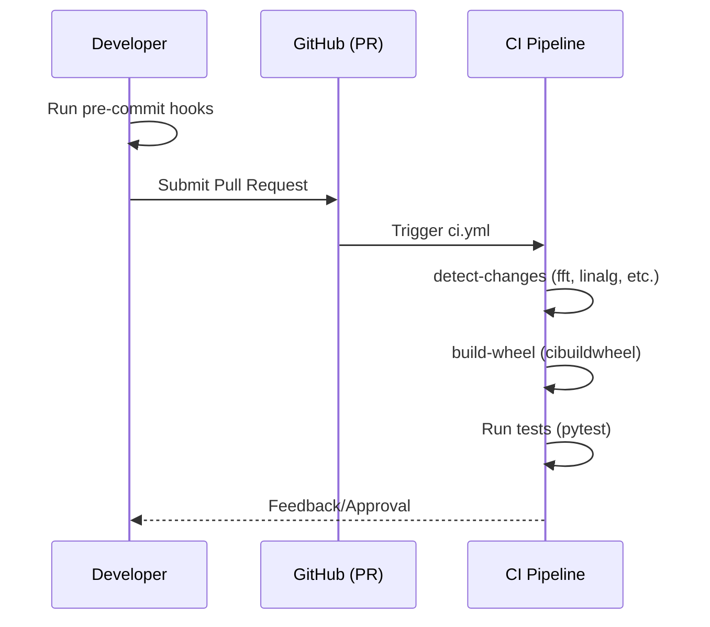

<!-- source: DeepWiki mcp.deepwiki.com · repo NVIDIA/nvmath-python · page 9 Development Guide · fetched 2026-10-26 -->

# Development Guide

Relevant source files

The following files were used as context for generating this wiki page:

- [.github/workflows/build-wheel.yml](.github/workflows/build-wheel.yml)
- [.github/workflows/ci.yml](.github/workflows/ci.yml)
- [CONTRIBUTING.md](CONTRIBUTING.md)

This page provides comprehensive guidance for developers who want to build nvmath-python from source, contribute to the project, or understand the development infrastructure. For information about using the library in your applications, see [Installation & Getting Started](#2).

nvmath-python uses a sophisticated development infrastructure that includes:
- Custom build system with CUDA path detection and `cibuildwheel` integration.
- CI/CD pipelines for automated testing across Linux and Windows.
- Pre-commit hooks for code quality and security.
- Sphinx-based versioned documentation system.
- Contribution guidelines and community standards.

## Overview of Development Infrastructure

The development infrastructure consists of several integrated components:

Sources: [.github/workflows/ci.yml](), [.github/workflows/build-wheel.yml](), [CONTRIBUTING.md]()

This page provides an overview of the development infrastructure. For detailed information on specific topics, see:
- [Building from Source](#9.1) — Detailed build process and CUDA dependency management.
- [CI/CD Pipeline](#9.2) — GitHub Actions workflows and the test matrix.
- [Code Quality and Pre-commit Hooks](#9.3) — Linting, type checking, and security scanning.
- [Documentation System](#9.4) — Sphinx configuration and versioned documentation.
- [Contributing Guidelines](#9.5) — Contribution workflow and community engagement.

## CI/CD and Build Infrastructure

The project uses GitHub Actions to automate the build and test process across various platforms and CUDA versions.

### Build System and Wheel Generation
Wheels are built using `pypa/cibuildwheel` [.github/workflows/build-wheel.yml:130-131](). The build process supports:
- **Platforms**: `linux-64`, `linux-aarch64`, and `win-64` [.github/workflows/build-wheel.yml:18-20]().
- **Caching**: Uses `sccache` to speed up C++/Cython compilation [.github/workflows/build-wheel.yml:52-59]().
- **Python Versions**: Supports Python 3.10 through 3.13 [.github/workflows/build-wheel.yml:35-39]().

### CI Pipeline Logic
The main CI entry point is [.github/workflows/ci.yml](). It includes sophisticated logic to optimize resource usage:
- **`should-skip`**: Detects `[no-ci]` or `[doc-only]` tags in PR titles to skip unnecessary compute [.github/workflows/ci.yml:57-81]().
- **`detect-changes`**: Maps modified files to specific submodules (e.g., `fft`, `linalg`, `distributed`) to run only relevant tests [.github/workflows/ci.yml:99-117]().

### Test Matrix
The CI exercises a complex matrix of configurations, including different CUDA versions (cu12, cu13), backends (CuPy, PyTorch, NVPL/MKL), and GPU architectures (Volta through Blackwell) [.github/workflows/ci.yml:31-48]().

Sources: [.github/workflows/ci.yml](), [.github/workflows/build-wheel.yml]()

## Code Quality Assurance

nvmath-python maintains high standards through automated checks.

### Pre-commit Hooks
The project uses `pre-commit` to run various linters and security scanners. Key tools include:
- **Ruff**: For linting and formatting.
- **Mypy**: For static type checking.
- **Gitleaks**: For secret detection.
- **Codespell**: For catching typos.

### Change Detection Mapping
The CI pipeline uses a dependency graph to determine the impact of changes:
- Changes to `nvmath/bindings/` force a retest of all submodules [.github/workflows/ci.yml:89-90]().
- Changes to shared infrastructure (e.g., `nvmath/internal/`, `pyproject.toml`) trigger full retests [.github/workflows/ci.yml:93-95]().

Sources: [.github/workflows/ci.yml:83-117]()

## Contributing to nvmath-python

The project has specific guidelines for community involvement as outlined in [CONTRIBUTING.md]().

### Contribution Categories

| Category | Action |
| :--- | :--- |
| **Bugs & Features** | File an [issue](https://github.com/NVIDIA/nvmath-python/issues) [.CONTRIBUTING.md:6-8](). |
| **Code Contributions** | Currently **not accepted**; planned for the future [.CONTRIBUTING.md:12-14](). |
| **Sharing Work** | Use [GitHub Discussions](https://github.com/NVIDIA/nvmath-python/discussions) [.CONTRIBUTING.md:17-21](). |

### Development Flow for Contributors

Sources: [CONTRIBUTING.md](), [.github/workflows/ci.yml]()

## Documentation System

The documentation is built using Sphinx and is integrated into the CI/CD pipeline via `docs-build.yml`. It supports versioned documentation, allowing users to view docs for specific releases or the latest development branch.

For details, see [Documentation System](#9.4).

Sources: [.github/workflows/ci.yml:61]() (reference to doc-only skipping)

## Beta Status Notice

nvmath-python is currently in **Beta** status. This means APIs may change, and the development infrastructure is continuously evolving to support broader contribution models and more extensive hardware testing.

Sources: [CONTRIBUTING.md:12-16]() (Note on future code contribution plans)

---

