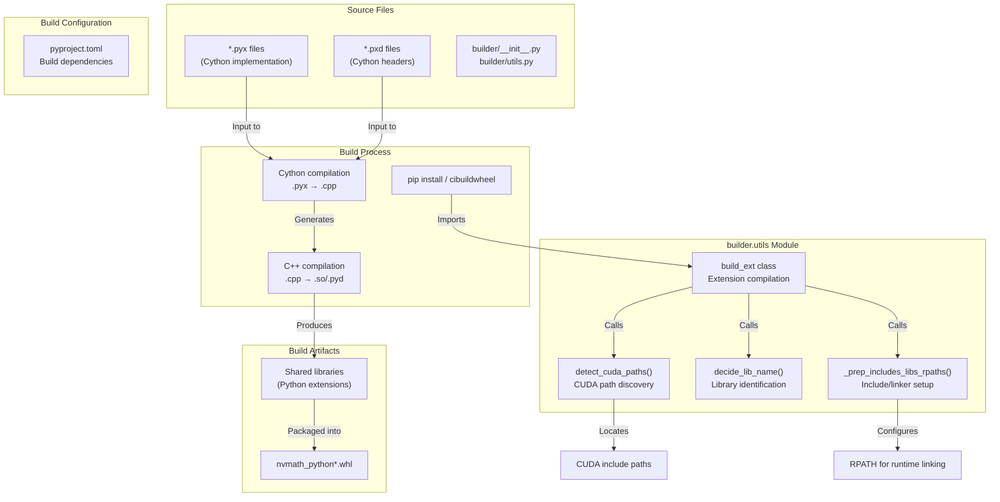
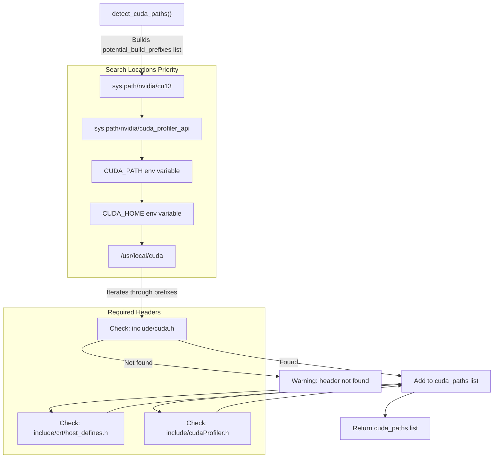
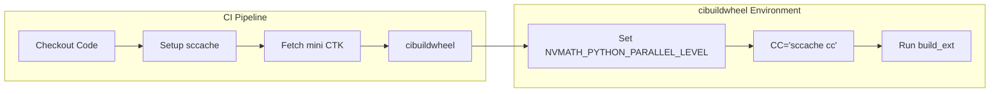

<!-- source: DeepWiki mcp.deepwiki.com · repo NVIDIA/nvmath-python · page 9.1 Building from Source · fetched 2026-10-26 -->

# Building from Source

Relevant source files

The following files were used as context for generating this wiki page:

- [.github/actions/fetch_ctk/action.yml](.github/actions/fetch_ctk/action.yml)
- [.github/workflows/build-wheel.yml](.github/workflows/build-wheel.yml)
- [builder/__init__.py](builder/__init__.py)
- [builder/utils.py](builder/utils.py)

This page provides a comprehensive guide for building nvmath-python from source code. It covers CUDA dependency detection, build configuration, compilation processes, and troubleshooting common build issues.

**Scope**: This page focuses exclusively on the build system mechanics and compilation workflow. For information about code quality tools and pre-commit hooks, see [Code Quality and Pre-commit Hooks](#9.3). For CI/CD details, see [CI/CD Pipeline](#9.2).

## Overview

Building nvmath-python from source involves compiling Cython extensions that wrap NVIDIA's native CUDA libraries. The build system, located in the `builder/` directory, automates CUDA path detection, include directory configuration, and library linking across multiple deployment scenarios (pip wheels, custom CUDA installations, default Linux paths).

Sources: [builder/utils.py:1-146]()

## Prerequisites

Before building from source, ensure the following requirements are met:

| Requirement | Description |
|------------|-------------|
| **CUDA Toolkit** | CUDA 11.x or 12.x installed, or CUDA runtime/nvcc pip wheels |
| **Python** | Python 3.10+ (as targeted in CI [ .github/workflows/build-wheel.yml:35-39 ]()) |
| **C++ Compiler** | GCC 7+ or MSVC (for Windows) [ .github/workflows/build-wheel.yml:87-90 ]() |
| **Cython** | For compiling `.pyx` files to C++ extensions |
| **setuptools** | Modern setuptools with PEP 517/518 support |
| **CUDA Headers** | `cuda.h`, `crt/host_defines.h`, `cudaProfiler.h` |

Sources: [builder/utils.py:12-52](), [.github/workflows/build-wheel.yml:35-45]()

## Build System Architecture

The build system leverages a custom `build_ext` command to inject CUDA-specific logic into the standard Python packaging workflow.

**Build System Architecture Diagram**: Shows the relationship between source files, build configuration, and the `builder.utils` module.

Sources: [builder/utils.py:78-146](), [.github/workflows/build-wheel.yml:129-161]()

## CUDA Path Detection

The `detect_cuda_paths()` function implements a search strategy to locate CUDA headers across different installation scenarios, including pip wheels which are often used in isolated build environments.

**CUDA Path Detection Flow**: Illustrates the search logic in `detect_cuda_paths()` and required header validation.

The function searches for CUDA installations in the following order:
1. **Pip wheel locations** in `sys.path`: `nvidia/cu13` and `nvidia/cuda_profiler_api` [builder/utils.py:23-27]().
2. **Environment variables**: `CUDA_PATH` or `CUDA_HOME` [builder/utils.py:28]().
3. **Default Linux path**: `/usr/local/cuda` [builder/utils.py:28]().

Three headers are validated for each potential path:
- `include/cuda.h`
- `include/crt/host_defines.h`
- `include/cudaProfiler.h` (required by internal bindings) [builder/utils.py:47-51]().

Sources: [builder/utils.py:12-52]()

## Build Extension Compilation

The `build_ext` class extends setuptools' standard build extension command to handle CUDA-specific configuration.

### Key Methods

**`build_ext.__init__()`** [builder/utils.py:79-85]()
- Calls `detect_cuda_paths()` to locate CUDA installations.
- Stores results in `self._nvmath_cuda_paths`.
- Prints discovered CUDA paths to stdout for debugging.

**`decide_lib_name(ext_name)`** [builder/utils.py:55-75]()
- Extracts library name from extension module name to determine appropriate linker flags.
- Supports: `cublasMp`, `cublas`, `cusolver`, `cufftMp`, `cufft`, `cusparse`, `curand`, `nvpl`, `nvshmem`, `nccl`, `mathdx`, `cudss`, `cutensor`.

**`build_ext._prep_includes_libs_rpaths(lib_name)`** [builder/utils.py:87-130]()
- Configures include directories from `self._nvmath_cuda_paths`.
- Sets RPATH based on build mode:
  - **Wheel mode**: Uses `$ORIGIN/../../..` relative path to reach other `nvidia-*` wheels in `site-packages` [builder/utils.py:94-112]().
  - **Editable mode**: Uses absolute paths from `site.getsitepackages()` [builder/utils.py:95-98]().
- Adds `-Wl,--strip-all` linker flag in wheel mode to reduce binary size [builder/utils.py:102]().
- Special handling for `nvpl` bindings to account for its unique directory structure and MKL dependencies [builder/utils.py:117-127]().

**`build_ext.build_extension(ext)`** [builder/utils.py:132-141]()
- Determines library name and configures include/link arguments.
- Sets `DISABLE_CUSPARSE_DEPRECATED` macro for `cusparse` extensions to reduce build noise [builder/utils.py:135-140]().

**`build_ext.build_extensions()`** [builder/utils.py:143-145]()
- Enables parallel compilation using `os.cpu_count()` to speed up the build [builder/utils.py:144]().

Sources: [builder/utils.py:55-146]()

## CI Build Environment

The repository uses GitHub Actions and `cibuildwheel` for official builds.

**CI Build Integration**: Relationship between GitHub Actions and the build system.

- **Mini CUDA Toolkit**: The CI uses a composite action `fetch_ctk` to download specific CUDA components (headers and libraries) from NVIDIA's redistributable server [ .github/actions/fetch_ctk/action.yml:80-116 ]().
- **Caching**: `sccache` is utilized to speed up C++ compilation across CI runs [ .github/workflows/build-wheel.yml:52-59 ]().
- **Parallelism**: `NVMATH_PYTHON_PARALLEL_LEVEL` is passed to the build environment to control the number of compiler processes [ .github/workflows/build-wheel.yml:138 ]().

Sources: [.github/workflows/build-wheel.yml:129-161](), [.github/actions/fetch_ctk/action.yml:1-172]()

## Troubleshooting

### CUDA Headers Not Found
If the build fails with "include/cuda.h not found", ensure `CUDA_PATH` is set or that the `nvidia-cuda-runtime-cu12` (or similar) pip wheels are installed in your environment [builder/utils.py:41-45]().

### Parallel Build Issues
The build system defaults to using all CPU cores [builder/utils.py:144](). If you encounter OOM (Out of Memory) errors during compilation, set the `NVMATH_PYTHON_PARALLEL_LEVEL` environment variable to a lower value before building [ .github/workflows/build-wheel.yml:138 ]().

### Windows Build Requirements
On Windows, the build requires `yq` for environment processing in CI [ .github/workflows/build-wheel.yml:91-113 ]() and a valid MSVC installation [ .github/workflows/build-wheel.yml:87-90 ](). Note that `libcufile` is explicitly excluded on Windows platforms [ .github/actions/fetch_ctk/action.yml:42-45 ]().

Sources: [builder/utils.py:12-52](), [.github/workflows/build-wheel.yml:138](), [.github/actions/fetch_ctk/action.yml:42-45]()

---

