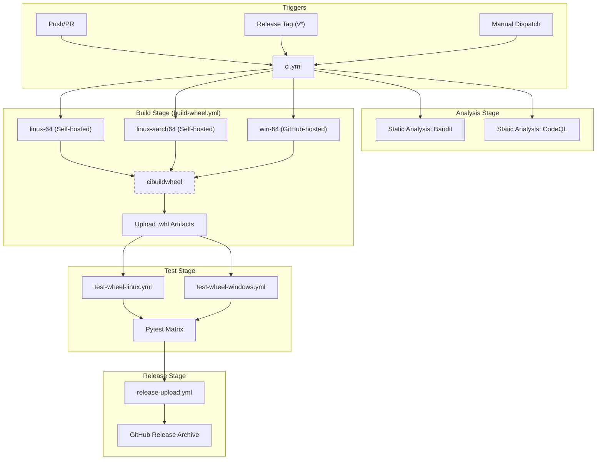
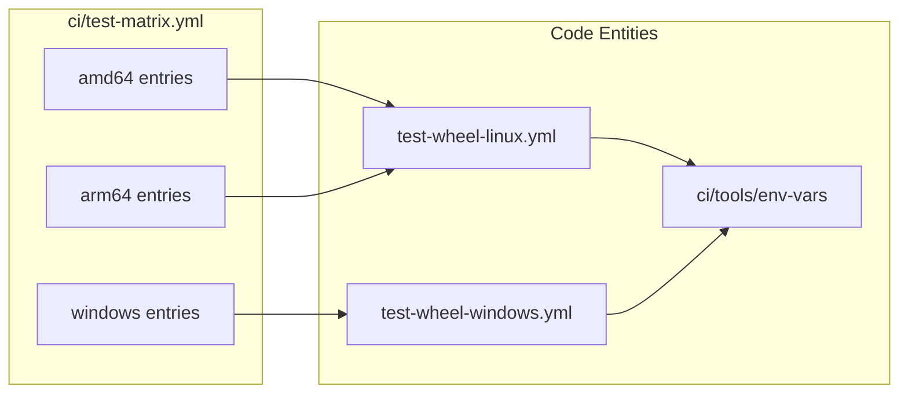

<!-- source: DeepWiki mcp.deepwiki.com · repo NVIDIA/nvmath-python · page 9.2 CI/CD Pipeline · fetched 2026-10-26 -->

# CI/CD Pipeline

Relevant source files

The following files were used as context for generating this wiki page:

- [.github/workflows/bandit.yml](.github/workflows/bandit.yml)
- [.github/workflows/build-wheel.yml](.github/workflows/build-wheel.yml)
- [.github/workflows/ci.yml](.github/workflows/ci.yml)
- [.github/workflows/codeql.yml](.github/workflows/codeql.yml)
- [.github/workflows/coverage.yml](.github/workflows/coverage.yml)
- [.github/workflows/release-upload.yml](.github/workflows/release-upload.yml)
- [.github/workflows/release.yml](.github/workflows/release.yml)
- [.github/workflows/test-sdist-linux.yml](.github/workflows/test-sdist-linux.yml)
- [.github/workflows/test-wheel-linux.yml](.github/workflows/test-wheel-linux.yml)
- [.github/workflows/test-wheel-windows.yml](.github/workflows/test-wheel-windows.yml)
- [ci/ci-pipeline.svg](ci/ci-pipeline.svg)
- [ci/test-matrix.yml](ci/test-matrix.yml)
- [ci/versions.yml](ci/versions.yml)

The `nvmath-python` CI/CD infrastructure is designed to automate the lifecycle of the library, from static analysis and multi-platform wheel builds to comprehensive testing across a diverse matrix of NVIDIA GPUs and CUDA Toolkit (CTK) versions. The pipeline is primarily implemented using GitHub Actions, leveraging self-hosted runners for GPU-intensive tasks and `sccache` for optimized compilation.

## Pipeline Architecture

The pipeline follows a tiered execution model triggered by repository events such as PRs, merges to `main`, or release tags [ .github/workflows/ci.yml:13-21]().

### Workflow Data Flow

The following diagram illustrates the relationship between trigger events, build stages, and artifact management.

**CI/CD System Flow**

Sources: [ .github/workflows/ci.yml:56-120](), [ .github/workflows/build-wheel.yml:31-46](), [ .github/workflows/release-upload.yml:33-41]()

## Build Configuration and Strategy

The build process is managed by `build-wheel.yml`, which utilizes `pypa/cibuildwheel` to produce PEP 600 compliant wheels [ .github/workflows/build-wheel.yml:130-135]().

### Build Matrix
The build stage targets multiple Python versions and architectures:
*   **Python Versions**: 3.10, 3.11, 3.12, 3.13 [ .github/workflows/build-wheel.yml:35-39]().
*   **Platforms**: 
    *   `linux-64` (AMD64)
    *   `linux-aarch64` (ARM64)
    *   `win-64` (Windows AMD64) [ .github/workflows/build-wheel.yml:18-20]().

### Compilation Optimization
To reduce build times for Cython extensions, the pipeline implements `sccache`:
*   On Linux, it fetches a custom `rapidsai/sccache` binary [ .github/workflows/build-wheel.yml:52-56]().
*   It configures GitHub Actions cache service environment variables to allow `sccache` to persist across runs [ .github/workflows/build-wheel.yml:61-70]().
*   Inside the `cibuildwheel` container, `CC` and `CXX` are redirected through the host's `sccache` binary [ .github/workflows/build-wheel.yml:139-140]().

Sources: [ .github/workflows/build-wheel.yml:32-45](), [ .github/workflows/build-wheel.yml:130-150]()

## Testing Infrastructure

Testing is partitioned by submodule to allow for granular gating and parallel execution.

### Change Detection
The `detect-changes` job in `ci.yml` analyzes the PR diff to determine which test buckets must run [ .github/workflows/ci.yml:99-117]().
*   **Shared Infra**: Changes to `nvmath/internal/` or `pyproject.toml` trigger a full test suite [ .github/workflows/ci.yml:88-95]().
*   **Submodule Specific**: Changes to `nvmath/fft/` only trigger `test_fft` [ .github/workflows/ci.yml:91-117]().

### Test Matrix Configuration
The actual execution environment is defined in `ci/test-matrix.yml`. This file specifies the combination of:
*   **GPU Hardware**: v100, l4, a100, h100, rtxpro6000 [ ci/test-matrix.yml:21-62]().
*   **Driver Mode**: WDDM, TCC, or MCDM (for Windows) [ ci/test-matrix.yml:70-78]().
*   **Local CTK**: Whether to use a local CUDA Toolkit installation (`LOCAL_CTK: '1'`) or wheel-based dependencies [ ci/test-matrix.yml:21-30]().

**Code-to-Matrix Association**

Sources: [ ci/test-matrix.yml:18-80](), [ .github/workflows/test-wheel-linux.yml:40-51](), [ .github/workflows/test-wheel-windows.yml:19-30]()

## Security and Quality Assurance

The pipeline integrates several static analysis tools to ensure code quality and security.

| Tool | Purpose | Workflow |
| :--- | :--- | :--- |
| **CodeQL** | Semantic code analysis for security vulnerabilities and logic errors. | `codeql.yml` |
| **Bandit** | Scans Python code for common security issues (implemented via `ruff`). | `bandit.yml` |
| **Ruff** | Linting and formatting checks (integrated in `bandit.yml` and pre-commit). | `bandit.yml` |

### Bandit Scan Implementation
The Bandit scan is performed using `ruff` with the `S` (Security) rule selection [ .github/workflows/bandit.yml:40-43](). It dynamically extracts ignore codes from the project's `ruff.toml` to ensure consistency between local development and CI [ .github/workflows/bandit.yml:30-39]().

Sources: [ .github/workflows/codeql.yml:33-44](), [ .github/workflows/bandit.yml:30-43]()

## Release Automation

The release process is partially automated via `release.yml` and `release-upload.yml`.

1.  **Source Archiving**: `release-upload.yml` uses `git archive` to create a `.tar.gz` of the source code for a specific tag [ .github/workflows/release-upload.yml:51-57]().
2.  **Checksum Generation**: A SHA256 checksum is computed for the archive [ .github/workflows/release-upload.yml:59-63]().
3.  **GitHub Release**: The artifacts are uploaded to the GitHub release page using the `gh release upload` CLI [ .github/workflows/release-upload.yml:65-72]().

*Note: The full automation for TestPyPI and PyPI publishing is currently identified as a follow-up implementation item* [ .github/workflows/release.yml:5-24]().

Sources: [ .github/workflows/release-upload.yml:36-73](), [ .github/workflows/release.yml:43-51]()

---

