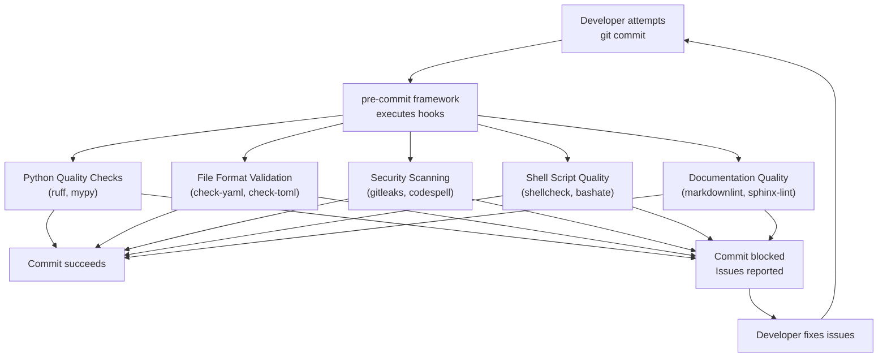
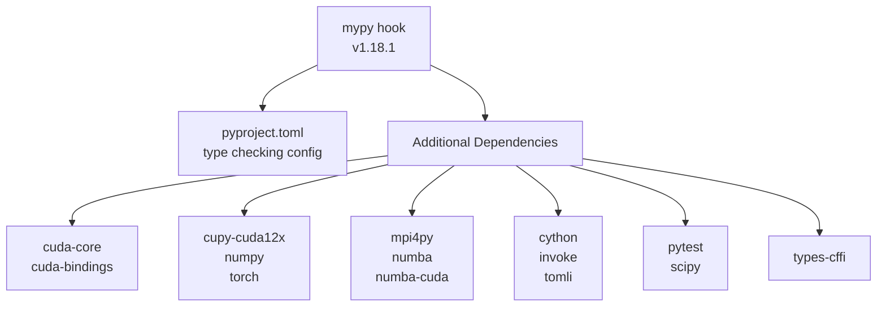
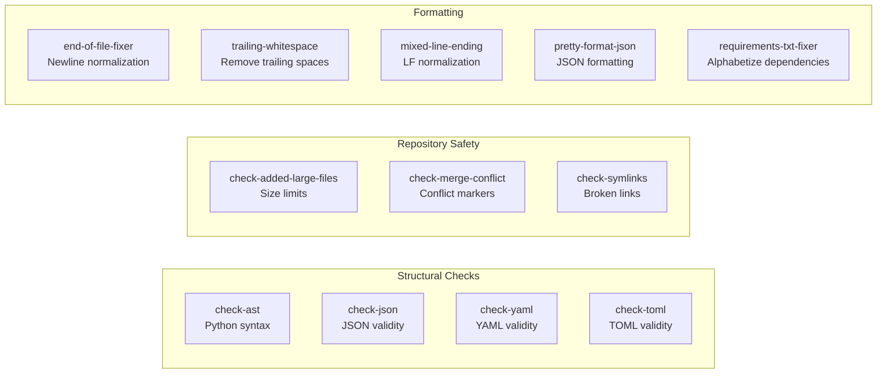
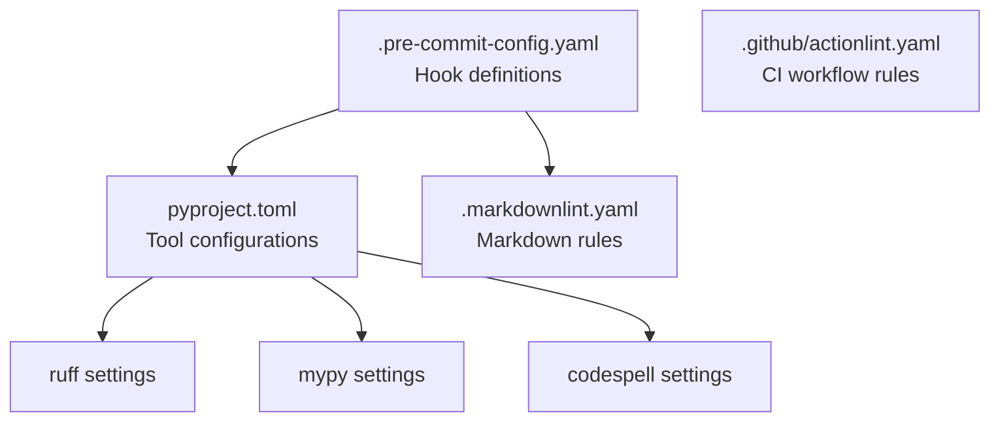

<!-- source: DeepWiki mcp.deepwiki.com · repo NVIDIA/nvmath-python · page 9.3 Code Quality and Pre-commit Hooks · fetched 2026-10-26 -->

# Code Quality and Pre-commit Hooks

<details>
<summary>Relevant source files</summary>

The following files were used as context for generating this wiki page:

- [.github/actionlint.yaml](.github/actionlint.yaml)
- [.markdownlint.yaml](.markdownlint.yaml)
- [.pre-commit-config.yaml](.pre-commit-config.yaml)

</details>


## Purpose and Scope

This page documents the automated code quality and validation system used in `nvmath-python`. The pre-commit hook framework enforces consistency, security, and quality standards before code is committed to the repository. This includes Python linting, type checking, security scanning, documentation validation, and shell script quality checks.

For information about building the project from source, see [Building from Source](). For documentation generation, see [Documentation System](). For contribution guidelines that reference these quality standards, see [Contributing Guidelines]().

## Pre-commit Framework Overview

The `nvmath-python` project uses the `pre-commit` framework to automatically run quality checks before each Git commit. This ensures that code quality issues are caught early in the development process. All checks are configured in [.pre-commit-config.yaml:5-115]().

### Pre-commit Workflow: Quality Gate Before Commit



Sources: [.pre-commit-config.yaml:5-115]()

## Installation and Setup

To enable pre-commit hooks in your development environment:

```bash
# Install pre-commit
pip install pre-commit

# Install the git hooks
pre-commit install
```

After installation, the hooks will run automatically on every `git commit`. To run all hooks manually on all files:

```bash
pre-commit run --all-files
```

Sources: [.pre-commit-config.yaml:1-115]()

## Quality Check Categories

The pre-commit system organizes checks into five major categories, each addressing different aspects of code quality:

| Category | Tools | Purpose | Auto-fix |
|----------|-------|---------|----------|
| Python Quality | `ruff`, `mypy` | Linting, formatting, type checking | Yes (ruff) |
| File Format | `pre-commit-hooks` | JSON, YAML, TOML validation | Partial |
| Security | `gitleaks`, `codespell` | Secret detection, typos | No |
| Shell Scripts | `bashate`, `shellcheck` | Bash script quality | No |
| Documentation | `markdownlint`, `sphinx-lint` | Markdown and RST validation | Yes (markdown) |

Sources: [.pre-commit-config.yaml:5-115]()

## Python Code Quality

### Ruff: Linting and Formatting

Ruff is a fast Python linter and formatter that replaces multiple tools. The project uses both `ruff` (linter) and `ruff-format` (formatter) hooks [.pre-commit-config.yaml:33-38]().

**Configuration:**

```yaml
  - repo: https://github.com/astral-sh/ruff-pre-commit
    rev: v0.13.0
    hooks:
      - id: ruff
        args: [--fix]
      - id: ruff-format
```

**Key features:**
- **Automatic fixing:** The `--fix` argument enables automatic correction of many issues [.pre-commit-config.yaml:37]().
- **Formatting:** `ruff-format` enforces consistent code style [.pre-commit-config.yaml:38]().

Sources: [.pre-commit-config.yaml:33-38]()

### Mypy: Static Type Checking

Mypy performs static type checking to catch type-related errors before runtime. The configuration includes extensive additional dependencies to support type checking for third-party libraries used in `nvmath-python`.

### Mypy Dependencies: Type Stubs for External Libraries



**Key dependencies specified in hook configuration:**
- **CUDA Stack:** `cuda-core`, `cuda-bindings>=12.9.2,<13` [.pre-commit-config.yaml:48-49]().
- **Frameworks:** `cupy-cuda12x`, `numpy`, `torch`, `scipy` [.pre-commit-config.yaml:50-57]().
- **Compiler/Parallelism:** `cython`, `numba`, `numba-cuda`, `mpi4py` [.pre-commit-config.yaml:51-53,60]().

The `--config-file pyproject.toml` argument ensures a single source of truth for type checking rules [.pre-commit-config.yaml:46]().

Sources: [.pre-commit-config.yaml:40-62]()

## File Format Validation

The project uses `pre-commit-hooks` to validate and normalize various file formats:

### File Validation and Normalization Hooks



**Key validations:**
- **Structural:** `check-ast` [.pre-commit-config.yaml:10](), `check-json` [.pre-commit-config.yaml:11](), `check-yaml` [.pre-commit-config.yaml:15](), and `check-toml` [.pre-commit-config.yaml:14]().
- **Formatting:** `end-of-file-fixer` [.pre-commit-config.yaml:18](), `trailing-whitespace` [.pre-commit-config.yaml:20](), and `mixed-line-ending` with `--fix=lf` [.pre-commit-config.yaml:21-22]().
- **JSON:** `pretty-format-json` with `--no-sort-keys` [.pre-commit-config.yaml:23-25]().

### PyProject Validation

The `validate-pyproject` hook ensures that `pyproject.toml` conforms to standards and includes schema validation via `validate-pyproject-schema-store[all]` [.pre-commit-config.yaml:27-31]().

Sources: [.pre-commit-config.yaml:6-31]()

## Security Scanning

### Gitleaks: Secret Detection

Gitleaks scans for accidentally committed secrets like API keys, passwords, and tokens [.pre-commit-config.yaml:79-82]().

```yaml
  - repo: https://github.com/gitleaks/gitleaks
    rev: v8.28.0
    hooks:
      - id: gitleaks
```

### Codespell: Typo Detection

Codespell identifies common spelling mistakes in source code and documentation, using `tomli` as a dependency for configuration parsing [.pre-commit-config.yaml:64-69]().

Sources: [.pre-commit-config.yaml:64-82]()

## Shell Script Quality

Two complementary tools validate shell scripts:

### Bashate: Style Checking

Bashate enforces bash scripting style guidelines, ignoring specific rules like line length (E006) and specific formatting (E010, E020) [.pre-commit-config.yaml:85-89]().

### Shellcheck: Static Analysis

Shellcheck performs deeper static analysis on shell scripts to detect bugs and anti-patterns [.pre-commit-config.yaml:91-95]().

Sources: [.pre-commit-config.yaml:85-95]()

## Documentation Quality

### Markdownlint: Markdown Validation

Markdownlint enforces consistent Markdown formatting. It uses custom configuration in [.markdownlint.yaml:1-15]().

**Pre-commit Hook Configuration:**
- Uses `node` version `22.14.0` [.pre-commit-config.yaml:105]().
- Ignores internal README files [.pre-commit-config.yaml:107]().

**Markdown Rules:**
- Line length limited to 92 characters (88 for code blocks) [.markdownlint.yaml:5-8]().
- Allows specific HTML elements like `` and `<h1>` [.markdownlint.yaml:11-15]().

### Sphinx-lint: RST Documentation

Sphinx-lint validates reStructuredText documentation files [.pre-commit-config.yaml:109-115]().
- **Line length:** 92 characters [.pre-commit-config.yaml:113]().
- **Exclusions:** Ignores auto-generated documentation in `generated/` directories [.pre-commit-config.yaml:114]().

Sources: [.pre-commit-config.yaml:97-115](), [.markdownlint.yaml:1-15]()

## CI/CD and Workflow Automation

The project uses GitHub Actions with `actionlint` to validate workflow files. The configuration includes labels for `self-hosted-runner` such as `linux-amd64-cpu8` to prevent validation errors for custom runners [.github/actionlint.yaml:1-10]().

### Configuration File Hierarchy



Sources: [.pre-commit-config.yaml:1-115](), [.markdownlint.yaml:1-15](), [.github/actionlint.yaml:1-10]()

---

