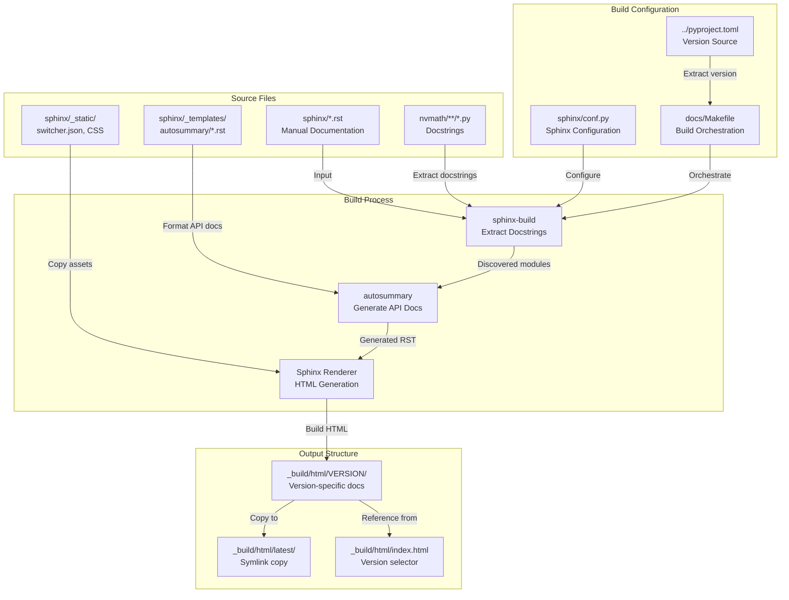
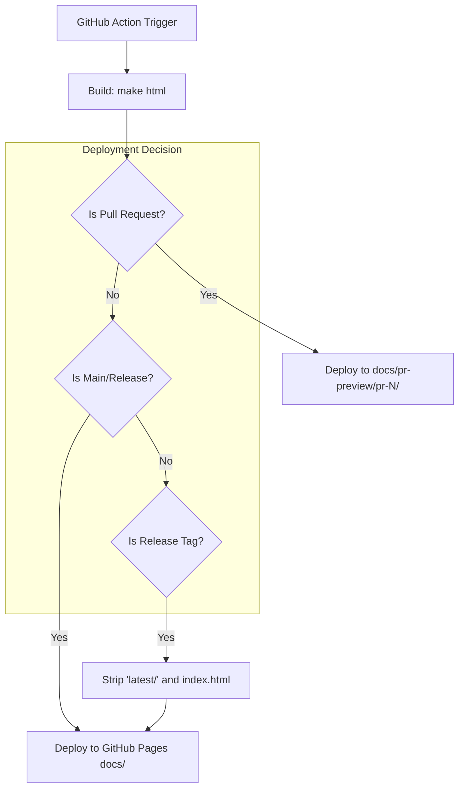

<!-- source: DeepWiki mcp.deepwiki.com · repo NVIDIA/nvmath-python · page 9.4 Documentation System · fetched 2026-10-26 -->

# Documentation System

<details>
<summary>Relevant source files</summary>

The following files were used as context for generating this wiki page:

- [.github/actions/doc_preview/action.yml](.github/actions/doc_preview/action.yml)
- [.github/workflows/build-docs.yml](.github/workflows/build-docs.yml)
- [docs/Makefile](docs/Makefile)
- [docs/README.md](docs/README.md)
- [docs/sphinx/_static/switcher.json](docs/sphinx/_static/switcher.json)
- [docs/sphinx/_templates/autosummary/class.rst](docs/sphinx/_templates/autosummary/class.rst)
- [docs/sphinx/_templates/autosummary/dataclass.rst](docs/sphinx/_templates/autosummary/dataclass.rst)
- [docs/sphinx/_templates/autosummary/namedtuple.rst](docs/sphinx/_templates/autosummary/namedtuple.rst)
- [docs/sphinx/_templates/main.html](docs/sphinx/_templates/main.html)
- [docs/sphinx/conf.py](docs/sphinx/conf.py)

</details>


## Purpose and Scope

This document describes the Sphinx-based documentation generation system for `nvmath-python`, covering the build process, version management, template customization, and CI/CD deployment workflow. It explains how API documentation is automatically extracted from Python docstrings, how multiple versions are maintained simultaneously, and how developers can build and preview documentation locally.

---

## Documentation Architecture

The documentation system uses **Sphinx** with the **autosummary** extension to automatically generate API reference documentation from Python source code. The system supports versioned documentation with a version switcher interface.

### Documentation Data Flow



**Sources:** [docs/Makefile:1-37](), [docs/README.md:1-10](), [docs/sphinx/conf.py:75-95]()

---

## Build System Components

### Makefile Targets

The build system provides several targets for documentation tasks:

| Target | Purpose | Key Behavior |
|--------|---------|--------------|
| `html` | Generate HTML documentation | Extracts version, builds to `_build/html/VERSION/`, creates `latest/` copy [docs/Makefile:22-29]() |
| `clean` | Remove build artifacts | Deletes `_build/`, `_xml/`, and all `generated/` directories [docs/Makefile:14-20]() |
| `linkcheck` | Validate external links | Checks all hyperlinks in documentation for validity [docs/Makefile:31-34]() |
| `help` | Display available targets | Shows Sphinx builder options [docs/Makefile:11-12]() |

### Version Extraction

The version number is dynamically extracted from `pyproject.toml` using a Bash regex pattern within the Makefile:

```bash
SPHINX_NVMATH_PYTHON_VER ?= $(shell [[ $$(< ../pyproject.toml) =~ [^a-zA-Z_]version\ =\ [^0-9.]*([0-9.]*) ]] && echo $${BASH_REMATCH[1]})
```

This variable determines the sub-directory name for the build output [docs/Makefile:5-9]().

### Sphinx Configuration (`conf.py`)

The configuration file handles extension loading and theme setup. Notable features include:
*   **Version Detection**: Reads version directly from `pyproject.toml` using `tomllib` [docs/sphinx/conf.py:61-69]().
*   **Extensions**: Uses `sphinx.ext.autodoc`, `autosummary`, `napoleon` (for Google/NumPy style docstrings), `nbsphinx` (for Jupyter notebooks), and `enum_tools.autoenum` [docs/sphinx/conf.py:75-95]().
*   **Theme**: Uses `nvidia_sphinx_theme` with a custom version switcher [docs/sphinx/conf.py:156-168]().
*   **Conditional Exclusion**: Can exclude `distributed-apis` if the `exclude-nvmath-distributed` tag is set [docs/sphinx/conf.py:137-139]().

**Sources:** [docs/Makefile:1-37](), [docs/sphinx/conf.py:1-170]()

---

## Version Management

### Version Switcher Configuration

The version switcher is controlled by `docs/sphinx/_static/switcher.json`. It maps version labels to their hosted URLs on `docs.nvidia.com` [docs/README.md:1-5]().

```json
[
  {
    "version": "latest",
    "url": "https://docs.nvidia.com/cuda/nvmath-python/latest"
  },
  {
    "version": "0.8.0",
    "url": "https://docs.nvidia.com/cuda/nvmath-python/0.8.0"
  }
]
```

**Sources:** [docs/sphinx/_static/switcher.json:1-43](), [docs/README.md:1-10]()

### Build Directory Layout

The `html` target organizes the build output to support both specific versions and a "latest" pointer:

1.  **Versioned Build**: Generates HTML in `_build/html/${SPHINX_NVMATH_PYTHON_VER}` [docs/Makefile:25]().
2.  **Latest Pointer**: Copies the versioned build content into `_build/html/latest/` [docs/Makefile:27]().
3.  **Root Redirect**: Copies `_templates/main.html` to `_build/html/index.html`. This file contains a meta-refresh redirecting users to `latest/index.html` [docs/Makefile:26](), [docs/sphinx/_templates/main.html:1-13]().

---

## Template System

The system uses custom Jinja2 templates in `docs/sphinx/_templates/autosummary/` to override default `autosummary` behavior for specific Python types.

### Template Mapping

| Template | Applied To | Logic |
|----------|------------|-------|
| `class.rst` | Standard Classes | Iterates through `methods` and `attributes` blocks, using `automethod` and `autoattribute` [docs/sphinx/_templates/autosummary/class.rst:1-27]() |
| `dataclass.rst` | Dataclasses | Specifically documents the `__init__` method [docs/sphinx/_templates/autosummary/dataclass.rst:1-10]() |
| `namedtuple.rst` | Named Tuples | Uses `:members: __new__` and excludes standard tuple boilerplate like `count` or `index` [docs/sphinx/_templates/autosummary/namedtuple.rst:1-10]() |

---

## CI/CD and Deployment

Documentation is built and deployed automatically via GitHub Actions.

### Build Pipeline (`build-docs.yml`)

The workflow performs the following steps:
1.  **System Dependencies**: Installs `pandoc` (for notebooks) and `libopenmpi-dev` [/.github/workflows/build-docs.yml:39-42]().
2.  **Installation**: Installs `nvmath-python` with `[cu13]` and `docs` dependency groups [/.github/workflows/build-docs.yml:54-57]().
3.  **Smoke Test**: Verifies that modules can be imported before building, ensuring `autodoc` won't fail silently [/.github/workflows/build-docs.yml:62-66]().
4.  **Execution**: Runs `make -C docs html` [/.github/workflows/build-docs.yml:74-77]().
5.  **Release Handling**: On release tags, it strips the `latest/` pointer and root index to avoid overwriting the moving "latest" documentation on the server with a static version [/.github/workflows/build-docs.yml:82-86]().

### PR Previews (`doc_preview` action)

For Pull Requests, the system deploys a preview to GitHub Pages:
*   **Deployment**: PR docs are pushed to `docs/pr-preview/pr-<number>/` [/.github/actions/doc_preview/action.yml:23-31]().
*   **Communication**: A sticky comment is added to the PR with a direct link to the preview [/.github/actions/doc_preview/action.yml:33-45]().
*   **Cleanup**: When a PR is merged or closed, the preview files are removed from the branch [/.github/actions/doc_preview/action.yml:47-55]().

### Documentation Deployment Logic



**Sources:** [/.github/workflows/build-docs.yml:1-109](), [/.github/actions/doc_preview/action.yml:1-69]()

---

## Local Development Workflow

### Building Locally
To build the documentation locally, ensure you have the `docs` dependencies installed:

```bash
pip install ".[docs]"
cd docs
make html
```

### Cleaning Artifacts
If the `autosummary` output becomes stale or contains errors from previous versions, use:
```bash
make clean
```
This specifically targets generated directories like `sphinx/bindings/generated/` and `sphinx/host-apis/**/generated` [docs/Makefile:14-20]().

**Sources:** [docs/Makefile:1-37](), [docs/README.md:1-10]()

---

