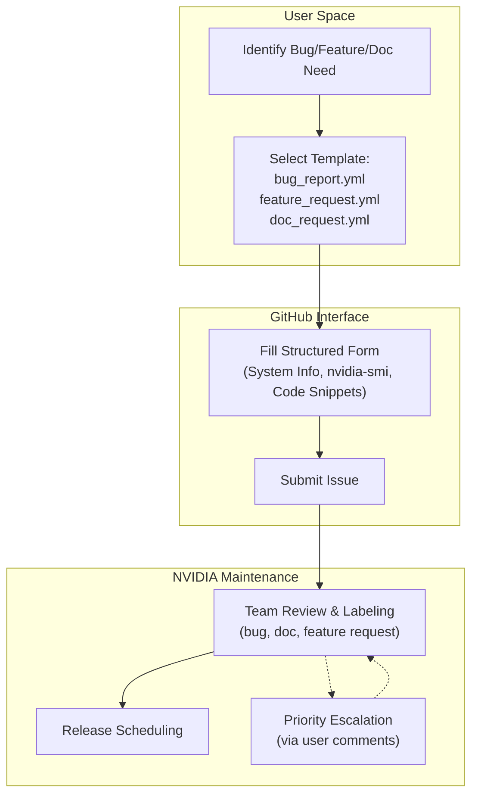
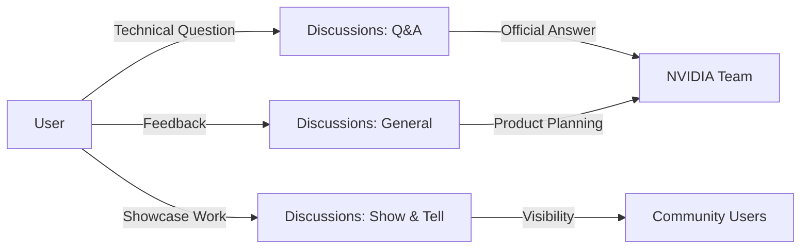

<!-- source: DeepWiki mcp.deepwiki.com · repo NVIDIA/nvmath-python · page 9.5 Contributing Guidelines · fetched 2026-10-26 -->

# Contributing Guidelines

Relevant source files

The following files were used as context for generating this wiki page:

- [.github/ISSUE_TEMPLATE/bug_report.yml](.github/ISSUE_TEMPLATE/bug_report.yml)
- [.github/ISSUE_TEMPLATE/config.yml](.github/ISSUE_TEMPLATE/config.yml)
- [.github/ISSUE_TEMPLATE/doc_request.yml](.github/ISSUE_TEMPLATE/doc_request.yml)
- [.github/ISSUE_TEMPLATE/feature_request.yml](.github/ISSUE_TEMPLATE/feature_request.yml)
- [.github/PULL_REQUEST_TEMPLATE.md](.github/PULL_REQUEST_TEMPLATE.md)
- [CONTRIBUTING.md](CONTRIBUTING.md)

## Purpose and Scope

This page provides detailed guidelines for contributing to the `nvmath-python` project. It covers the contribution workflow, structured issue reporting via GitHub templates, the current status of code contributions, and community engagement channels. This guide ensures that technical feedback and improvements are handled efficiently by the NVIDIA team.

**Sources:** [CONTRIBUTING.md:1-22](), [.github/ISSUE_TEMPLATE/config.yml:1-10]()

---

## Overview of Contribution Categories

Contributions to `nvmath-python` are categorized into three distinct workflows based on the nature of the request:

| Category | Type | Current Status | Primary Channel |
|----------|------|----------------|-----------------|
| **1. Reporting** | Bug reports, feature requests, documentation issues | **Accepted** | [GitHub Issues](https://github.com/NVIDIA/nvmath-python/issues) |
| **2. Implementation** | Code contributions (bug fixes, features) | **Not accepted** (Planned) | N/A (Contact team via issues) |
| **3. Community** | Showcasing work, technical questions | **Encouraged** | [GitHub Discussions](https://github.com/NVIDIA/nvmath-python/discussions) |

**Sources:** [CONTRIBUTING.md:4-21]()

---

## Issue Submission and Lifecycle

### Issue Reporting Workflow

The project uses structured GitHub Issue Templates to ensure all necessary technical context (CUDA versions, hardware info, reproduction scripts) is captured.

**Sources:** [CONTRIBUTING.md:6-11](), [.github/ISSUE_TEMPLATE/bug_report.yml:5-53]()

### Specialized Issue Templates

#### Bug Reports (`bug_report.yml`)
Used for runtime errors, silent failures, or performance regressions.
- **Component Tagging**: Users must specify the affected module (e.g., `fft`, `linalg`, `sparse`, `tensor`, `distributed`, `bindings`, or `device`).
- **System Information**: Includes mandatory fields for Operating System and `nvidia-smi` output to verify driver/CUDA versions.
- **Reproduction**: Requires a clear code snippet (e.g., using `cupy.asarray`) to reproduce the failure.

**Sources:** [.github/ISSUE_TEMPLATE/bug_report.yml:19-119]()

#### Feature Requests (`feature_request.yml`)
Used for suggesting API improvements or new mathematical operations.
- **Problem Statement**: Describe the limitation (e.g., "I would like to use `nvmath.linalg.advanced.Matmul` with a new epilog type").
- **Proposed Solution**: Technical description of the desired implementation.
- **Alternatives**: Discussion of manual workarounds using raw `nvmath.bindings`.

**Sources:** [.github/ISSUE_TEMPLATE/feature_request.yml:18-76]()

#### Documentation Requests (`doc_request.yml`)
Used for correcting existing docs or requesting new guides.
- **Correction Link**: Must provide a link to the existing documentation at `docs.nvidia.com/cuda/nvmath-python/latest/`.

**Sources:** [.github/ISSUE_TEMPLATE/doc_request.yml:20-44]()

---

## Code Contribution Process

### Current Policy and Pull Requests
Currently, **external code contributions are not accepted**. The project is in a transition phase, and the timeline for accepting external Pull Requests (PRs) is TBD.

**Sources:** [CONTRIBUTING.md:12-16]()

### Pull Request Requirements (Internal/Future)
When code contributions are enabled, all PRs must follow the `PULL_REQUEST_TEMPLATE.md`:
- **Issue Linking**: Must use the `closes #ISSUE_NUMBER` syntax.
- **Changelog**: The PR title is automatically included in the project `CHANGELOG`.
- **Checklist**:
    - New or existing tests must cover the changes.
    - Documentation must be updated in sync with code changes.

**Sources:** [.github/PULL_REQUEST_TEMPLATE.md:1-17]()

---

## Community Engagement via Discussions

For non-bug related interactions, the project utilizes **GitHub Discussions** as the central hub.

**Sources:** [CONTRIBUTING.md:17-21](), [.github/ISSUE_TEMPLATE/config.yml:6-10]()

---

## Technical Mapping: User Requests to Code Entities

When reporting issues or requesting features, refer to these internal code structures to help the maintainers triage efficiently:

| User Request Area | Relevant Code Entity / Path | Primary Purpose |
|-------------------|-----------------------------|-----------------|
| **FFT Logic** | `nvmath.fft` | High-level FFT API and descriptors |
| **Linear Algebra** | `nvmath.linalg.advanced.Matmul` | Advanced GEMM and epilog handling |
| **Sparse Solvers** | `nvmath.sparse.advanced.DirectSolver` | Interface for `cuDSS` |
| **Direct Bindings** | `nvmath.bindings` | Cython wrappers for `cuBLAS`, `cuFFT`, etc. |
| **Device Kernels** | `nvmath.device` | LTO-IR and Numba integration logic |
| **Distributed** | `nvmath.distributed` | `NVSHMEM` and `NCCL` multi-node orchestration |

**Sources:** [.github/ISSUE_TEMPLATE/bug_report.yml:34-53](), [.github/ISSUE_TEMPLATE/feature_request.yml:18-36]()

---

## Summary of Communication Channels

| Intent | Channel | Action |
|--------|---------|--------|
| **Bug/Crash** | GitHub Issues | Use `bug_report.yml` template |
| **New Feature** | GitHub Issues | Use `feature_request.yml` template |
| **"How-to" Questions** | GitHub Discussions | Post in "Questions" category |
| **Showcase Projects** | GitHub Discussions | Post in "Show and Tell" |
| **Urgent Attention** | GitHub Issues | Comment on the issue to notify the team |

**Sources:** [CONTRIBUTING.md:1-22](), [.github/ISSUE_TEMPLATE/config.yml:5-10]()

---

