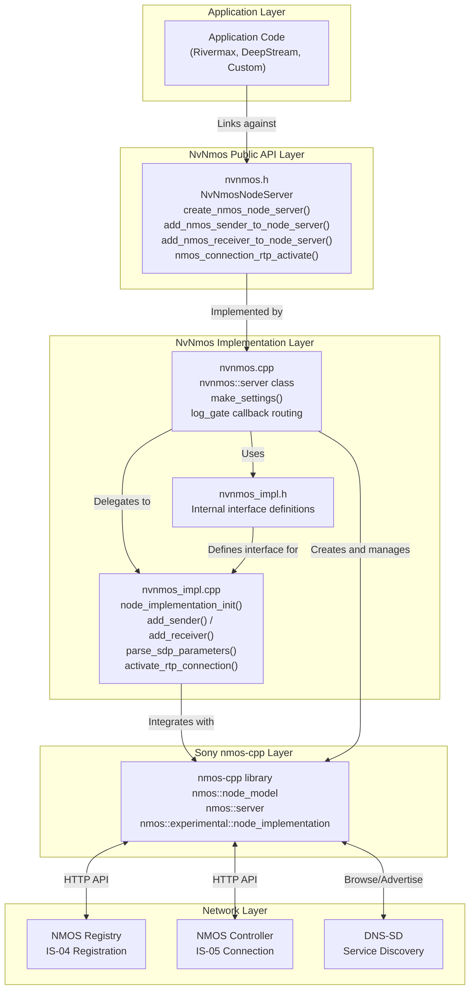
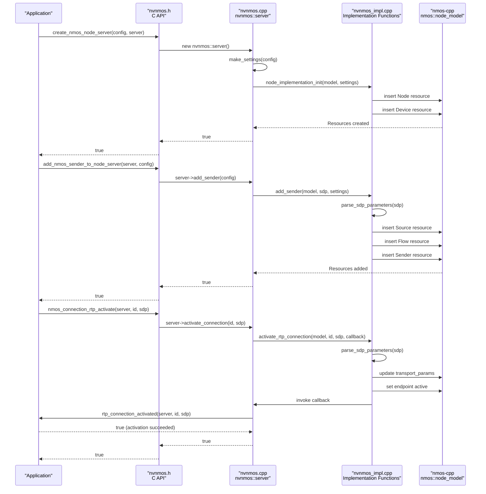

<!-- source: DeepWiki mcp.deepwiki.com · repo NVIDIA/nvnmos · page 1 Overview · fetched 2026-10-26 -->

# Overview

Relevant source files

The following files were used as context for generating this wiki page:

- [LICENSE](LICENSE)
- [README.md](README.md)
- [src/nvnmos.h](src/nvnmos.h)

This document introduces the NvNmos library, its purpose as an NMOS control plane for NVIDIA media applications, and provides a high-level architectural overview. For detailed information about building and running the library, see [Getting Started](#2). For in-depth coverage of the internal architecture and implementation, see [Architecture and Design](#5).

## Purpose and Scope

The NVIDIA Networked Media Open Specifications (NvNmos) library provides a C API for creating and managing NMOS Nodes in media applications. The library implements the NMOS control plane (registration, discovery, and connection management) while delegating the ST 2110 data plane (actual media transport) to external libraries such as NVIDIA Rivermax or NVIDIA DeepStream.

NvNmos is **not** a complete media transport solution. It handles only the NMOS protocol layer, enabling applications to:

- Register with NMOS registries and advertise their capabilities
- Respond to connection requests from NMOS controllers
- Dynamically add and remove senders and receivers
- Receive callbacks when connection parameters change

Applications remain responsible for configuring the actual media streams using the transport parameters provided through NvNmos callbacks.

**Sources:** [src/nvnmos.h:18-56](), [README.md:20-43]()

## What is NvNmos?

NvNmos is a shared library (`libnvnmos.so` on Linux, `nvnmos.dll` on Windows) that wraps the Sony nmos-cpp implementation with a simplified C API designed for integration with NVIDIA media processing workflows. The library automatically handles:

- DNS-SD service discovery to locate NMOS registries
- IS-04 registration of Node, Device, Sender, and Receiver resources
- IS-05 connection management endpoints
- Session Description Protocol (SDP) parsing and validation
- Resource lifecycle management

The primary interface is defined in [src/nvnmos.h](), which exports a C API consisting of:

- `NvNmosNodeServer` - Opaque server handle
- `create_nmos_node_server()` - Initialize and start a node
- `add_nmos_sender_to_node_server()` / `add_nmos_receiver_to_node_server()` - Register resources
- `remove_nmos_sender_from_node_server()` / `remove_nmos_receiver_from_node_server()` - Unregister resources
- `nmos_connection_rtp_activate()` - Apply connection parameters
- `destroy_nmos_node_server()` - Shutdown and cleanup

**Sources:** [src/nvnmos.h:59-478](), [README.md:52-58]()

## Supported Specifications

NvNmos supports the following AMWA NMOS specifications and related standards:

| Specification | Version | Description |
|---------------|---------|-------------|
| [AMWA IS-04](https://specs.amwa.tv/is-04/) | v1.3 | Discovery and Registration |
| [AMWA IS-05](https://specs.amwa.tv/is-05/) | v1.1 | Device Connection Management |
| [AMWA IS-09](https://specs.amwa.tv/is-09/) | v1.0 | System Parameters |
| [AMWA BCP-002-01](https://specs.amwa.tv/bcp-002-01/) | v1.0 | Natural Grouping of NMOS Resources |
| [AMWA BCP-002-02](https://specs.amwa.tv/bcp-002-02/) | v1.0 | NMOS Asset Distinguishing Information |
| [AMWA BCP-004-01](https://specs.amwa.tv/bcp-004-01/) | v1.0 | NMOS Receiver Capabilities |
| [AMWA BCP-006-01](https://specs.amwa.tv/bcp-006-01/) | v1.0 | NMOS With JPEG XS |
| SMPTE ST 2110 | - | Session Description Protocol for ST 2110-20, -22, -30, -40 |
| SMPTE ST 2022-7 | - | Seamless Protection Switching |

The library currently supports uncompressed video (SMPTE ST 2110-20) and audio (SMPTE ST 2110-30) streams.

**Sources:** [src/nvnmos.h:45-53](), [README.md:34-42]()

## Architecture Overview

### System Layering

The following diagram shows the layered architecture and how code files map to architectural layers:

**Sources:** [src/nvnmos.h:1-478](), [src/nvnmos.cpp]() (file structure), [src/nvnmos_impl.h]() (file structure), [src/nvnmos_impl.cpp]() (file structure)

### Resource Management Flow

This diagram shows how API calls flow through the implementation and which code entities handle each step:

**Sources:** [src/nvnmos.h:352-469](), [src/nvnmos.cpp]() (implementation of create/add/activate functions), [src/nvnmos_impl.cpp]() (node_implementation_init, add_sender, add_receiver, activate_rtp_connection functions)

## Key Concepts

### Configuration via SDP

NvNmos uses Session Description Protocol (SDP) as the primary mechanism for configuring senders and receivers. The SDP string contains:

- Media format parameters (video/audio codec, resolution, sample rate)
- Transport parameters (RTP ports, multicast groups)
- Custom `x-nvnmos-*` attributes for additional configuration

The `NvNmosSenderConfig` and `NvNmosReceiverConfig` structures each contain a single `sdp` field that must be populated with valid SDP data conforming to SMPTE ST 2110 standards. For details, see [Session Description Protocol (SDP)](#3.2).

**Sources:** [src/nvnmos.h:260-293]()

### Callback-Based Activation

When an NMOS Controller requests a connection change via IS-05, the library invokes the application-provided `nmos_connection_rtp_activation_callback`. This callback receives:

- The sender or receiver ID
- The updated SDP with new transport parameters
- The server handle for context

The application must configure its media transport layer and return `true` if successful, or `false` to reject the activation. For details, see [Connection Activation](#3.3) and [Callbacks and Event Handling](#4.4).

**Sources:** [src/nvnmos.h:98-125](), [src/nvnmos.h:218]()

### Resource Lifecycle

NMOS resources follow this lifecycle:

1. **Creation** - `create_nmos_node_server()` creates Node and Device resources
2. **Registration** - Resources are automatically registered with the NMOS Registry via IS-04
3. **Runtime Updates** - `add_nmos_sender_to_node_server()` and `add_nmos_receiver_to_node_server()` add resources dynamically
4. **Connection Management** - Controllers can activate/deactivate connections via IS-05
5. **Removal** - `remove_nmos_sender_from_node_server()` and `remove_nmos_receiver_from_node_server()` unregister resources
6. **Shutdown** - `destroy_nmos_node_server()` cleans up all resources

For implementation details, see [Resource Lifecycle Management](#5.2).

**Sources:** [src/nvnmos.h:352-437]()

### Separation of Control and Data Planes

NvNmos handles the **NMOS control plane**:
- Registration and discovery (IS-04)
- Connection management (IS-05)
- System parameters (IS-09)

The application handles the **ST 2110 data plane**:
- RTP stream transmission/reception
- Media processing
- PTP clock synchronization

This separation allows NvNmos to be integrated with any ST 2110 transport library. For integration patterns, see [Integration Guide](#7).

**Sources:** [README.md:20-31](), [src/nvnmos.h:18-56]()

## Platform Support

The library supports the following platforms:

| Operating System | Compiler | Status |
|-----------------|----------|--------|
| Ubuntu 22.04 | GCC 11 | Tested |
| Windows 10 | Visual Studio 2022 | Tested |

The library is designed to be portable and may work on other platforms with compatible C++11 compilers.

**Sources:** [README.md:44-50]()

## Dependencies

NvNmos depends on the following key libraries, managed via Conan:

- **Sony nmos-cpp** - Core NMOS protocol implementation
- **Boost** - C++ utilities and ASIO for networking
- **cpprestsdk** - HTTP client/server
- **WebSocket++** - WebSocket protocol support
- **OpenSSL** - TLS/SSL security
- **nlohmann_json** - JSON parsing

Runtime dependencies:
- **Avahi daemon** (Linux) or **Bonjour Service** (Windows) for DNS-SD

For build instructions, see [Building from Source](#2.1). For dependency management details, see [Dependency Management with Conan](#6.3).

**Sources:** [README.md:93-127](), [README.md:269-291]()

## Example Application

The `nvnmos-example` application ([src/nvnmos-example/main.c]()) demonstrates:

- Creating an NMOS Node with multiple senders and receivers
- Dynamically adding and removing resources
- Handling connection activation callbacks
- Logging configuration

The example uses mock senders and receivers that do not actually transport media, making it suitable for testing NMOS control plane functionality without requiring ST 2110 hardware or software.

For a walkthrough of the example, see [Running the Example Application](#2.3).

**Sources:** [README.md:57-58](), [README.md:292-331]()

## Next Steps

- **[Getting Started](#2)** - Build and run your first NMOS Node
- **[Core Concepts](#3)** - Understand NMOS resource model and SDP configuration
- **[API Reference](#4)** - Complete API documentation
- **[Architecture and Design](#5)** - Internal implementation details
- **[Integration Guide](#7)** - Integrate with ST 2110 transport libraries

**Sources:** Documentation table of contents structure

---

