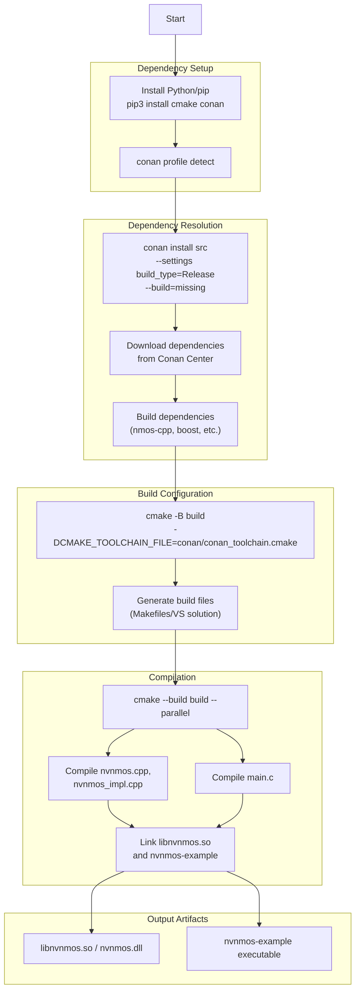
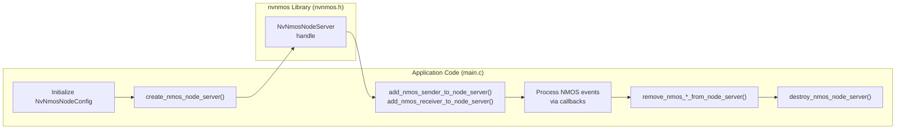
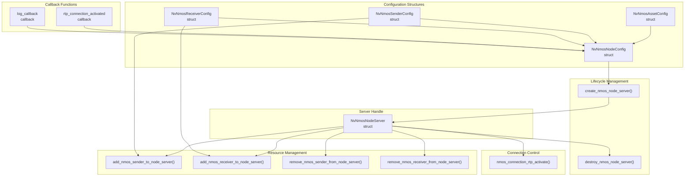

<!-- source: DeepWiki mcp.deepwiki.com · repo NVIDIA/nvnmos · page 2 Getting Started · fetched 2026-10-26 -->

# Getting Started

<details>
<summary>Relevant source files</summary>

The following files were used as context for generating this wiki page:

- [README.md](README.md)
- [src/main.c](src/main.c)

</details>


This page provides an overview of the initial setup process for the nvnmos library, from installation through running your first NMOS Node. It covers prerequisites, build options, and basic verification steps. For detailed build instructions, see [Building from Source](#2.1) or [Using Docker](#2.2). For understanding the example application workflow, see [Running the Example Application](#2.3).

## Purpose and Scope

This guide walks you through:
- Installing required dependencies (Python, CMake, Conan)
- Choosing between Docker-based and native builds
- Building the `libnvnmos.so` / `nvnmos.dll` shared library
- Running the `nvnmos-example` application to verify your setup
- Understanding the basic NMOS Node lifecycle

For architectural details about how nvnmos integrates with your application, see [Core Concepts](#3). For API reference documentation, see [API Reference](#4).

## Prerequisites Overview

The nvnmos library requires several tools and runtime services to build and operate:

### Build-Time Dependencies

| Component | Minimum Version | Purpose |
|-----------|----------------|---------|
| Python 3 | Any recent version | Package management (pip, Conan) |
| CMake | 3.17 | Build system configuration |
| Conan | 2.2 | C++ dependency management |
| C++ Compiler | GCC 11 / MSVC 2022 | Building native code |

### Runtime Dependencies

| Platform | Service | Purpose |
|----------|---------|---------|
| Linux | `avahi-daemon` | DNS-SD service discovery |
| Linux | `dbus` | IPC for avahi-daemon |
| Windows | Bonjour Service | DNS-SD service discovery |
| Both | PTP daemon (optional) | Precision time synchronization |

### C++ Libraries (Managed by Conan)

The nvnmos library depends on the Sony `nmos-cpp` library, which in turn requires:
- Boost - C++ utilities
- cpprestsdk - HTTP/REST server
- WebSocket++ - WebSocket protocol
- OpenSSL - TLS/SSL security
- nlohmann_json - JSON parsing
- jwt-cpp - Authentication tokens

These are automatically downloaded and built by Conan during the build process.

**Sources:** [README.md:93-183](), [README.md:269-290]()

## Build Workflow Overview

The nvnmos build process follows a standard Conan + CMake workflow:



**Sources:** [README.md:185-267]()

## Quick Start Paths

### Option 1: Docker Build (Recommended for First-Time Users)

The Docker-based build is the fastest way to get started. It handles all dependencies automatically and produces a portable package:

```bash
# Build the container image
docker build -t nvnmos .

# Extract the built package
docker create --name nvnmos-test nvnmos
docker cp nvnmos-test:/nvnmos-ubuntu-22.04.tar.gz .
docker rm nvnmos-test

# Run the example in container
docker run -it nvnmos /bin/bash
```

The Dockerfile implements a multi-stage build that installs dependencies, compiles the library, and packages everything into a tarball. See [Using Docker](#2.2) for details.

**Sources:** [README.md:59-91]()

### Option 2: Native Build from Source

For development work or integration into existing build systems, build natively:

**Linux:**
```bash
# Install prerequisites
pip3 install cmake~=3.17 conan~=2.2
conan profile detect

# Install dependencies
conan install src \
  -g CMakeToolchain \
  --settings:all build_type=Release \
  --build=missing \
  --output-folder=src/conan

# Configure and build
cmake -B build \
  -DCMAKE_TOOLCHAIN_FILE=conan/conan_toolchain.cmake \
  -DCMAKE_BUILD_TYPE=Release \
  src
cmake --build build --parallel
```

**Windows:**
```powershell
# Install prerequisites
pip3 install cmake~=3.17 conan~=2.2
conan profile detect

# Install dependencies
conan install src `
  -g CMakeToolchain `
  --settings:all build_type=Release `
  --build=missing `
  --output-folder=src/conan

# Configure and build
cmake -B build `
  -G "Visual Studio 17 2022" `
  -DCMAKE_TOOLCHAIN_FILE=conan/conan_toolchain.cmake `
  src
cmake --build build --config Release --parallel
```

See [Building from Source](#2.1) for complete instructions including troubleshooting.

**Sources:** [README.md:185-267]()

## Runtime Environment Setup

Before running nvnmos applications, ensure DNS-SD services are running:

**Linux:**
```bash
# Install and start services
sudo apt update
sudo apt install -y dbus avahi-daemon
sudo /etc/init.d/dbus start
sudo /etc/init.d/avahi-daemon start
```

**Windows:**
Download and install [Bonjour Print Services v2.0.2](https://support.apple.com/kb/DL999), which includes the mDNSResponder service.

**Sources:** [README.md:269-290]()

## Basic Application Structure

The nvnmos API follows a simple lifecycle pattern:



**Minimal Example Flow:**

1. **Configure Node** - Populate `NvNmosNodeConfig` with host name, port, asset tags
2. **Create Server** - Call `create_nmos_node_server()` to initialize the NMOS Node
3. **Add Resources** - Add senders/receivers using SDP strings
4. **Handle Callbacks** - Implement `rtp_connection_activated` to respond to connection requests
5. **Cleanup** - Call `destroy_nmos_node_server()` on shutdown

**Sources:** [src/main.c:228-328](), [README.md:52-58]()

## Code Entity Map: API Entry Points

This diagram maps high-level concepts to the concrete C API functions you'll use:



All these types and functions are declared in the `nvnmos.h` public API header.

**Sources:** [README.md:52-58]()

## Verification Steps

After building, verify your setup:

### 1. Check Build Artifacts

**Linux:**
```bash
ls -lh build/libnvnmos.so
ls -lh build/nvnmos-example
```

**Windows:**
```powershell
dir build\Release\nvnmos.dll
dir build\Release\nvnmos-example.exe
```

### 2. Run the Example Application

The `nvnmos-example` application requires three arguments:

```bash
./nvnmos-example <host-name> <port> <interface-ip> [log-level]
```

Example:
```bash
./nvnmos-example nmos-api.local 8080 192.0.2.0
```

The application will:
- Create an NMOS Node with 2 video+audio sender/receiver pairs
- Demonstrate adding and removing resources
- Show connection activation/deactivation
- Prompt for continuation at each step

See [Running the Example Application](#2.3) for detailed walkthrough.

**Sources:** [README.md:292-330](), [src/main.c:228-328]()

### 3. Verify NMOS APIs

While the example is running, the NMOS HTTP APIs are accessible at:

```
http://<host-address>:<port>/
```

Example endpoints:
- `http://192.0.2.0:8080/x-nmos/node/v1.3/` - IS-04 Node API
- `http://192.0.2.0:8080/x-nmos/connection/v1.1/` - IS-05 Connection API

You can browse these in a web browser or use curl:

```bash
curl http://192.0.2.0:8080/x-nmos/node/v1.3/self
curl http://192.0.2.0:8080/x-nmos/node/v1.3/senders
curl http://192.0.2.0:8080/x-nmos/node/v1.3/receivers
```

**Sources:** [README.md:332-338]()

## Common Setup Issues

| Issue | Symptom | Solution |
|-------|---------|----------|
| Port conflict | `asio listen error: Address already in use` | Change the `port` parameter to an unused port |
| DNS-SD not running | `DNSServiceRegister error: -65537` | Start avahi-daemon (Linux) or Bonjour Service (Windows) |
| Dependency build failure | Conan reports build errors | Run `conan install` with `--build=missing` flag |
| CMake version too old | CMake configuration fails | Install CMake 3.17+ via pip: `pip3 install cmake~=3.17` |

For comprehensive troubleshooting, see [Troubleshooting](#9).

**Sources:** [README.md:340-382]()

## Next Steps

Once you have successfully built and run the example application:

1. **Understand the concepts** - Read [Core Concepts](#3) to learn about the NMOS resource model and SDP configuration
2. **Explore the API** - Review [API Reference](#4) for complete function documentation
3. **Integrate with your application** - See [Integration Guide](#7) for patterns to integrate nvnmos with ST 2110 data plane libraries
4. **Study the architecture** - Read [Architecture and Design](#5) to understand internal implementation

The example application in [src/main.c]() provides a complete reference implementation demonstrating all major API features.

**Sources:** [README.md:1-382](), [src/main.c:1-328]()

---

