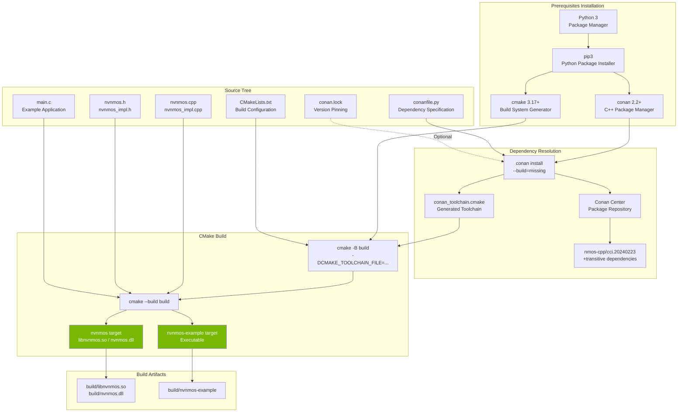
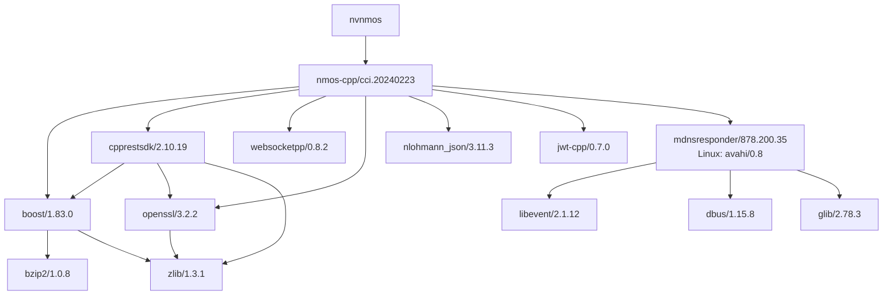
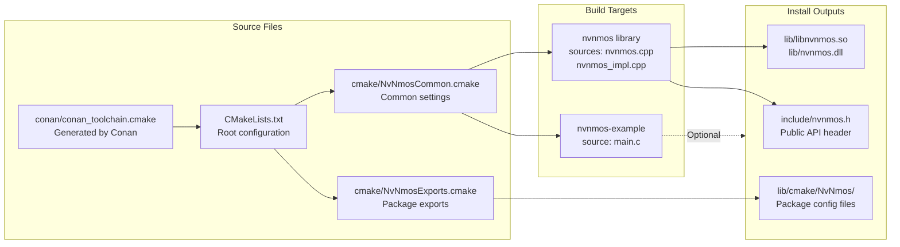

<!-- source: DeepWiki mcp.deepwiki.com · repo NVIDIA/nvnmos · page 2.1 Building from Source · fetched 2026-10-26 -->

# Building from Source

<details>
<summary>Relevant source files</summary>

The following files were used as context for generating this wiki page:

- [README.md](README.md)
- [src/CMakeLists.txt](src/CMakeLists.txt)
- [src/conan.lock](src/conan.lock)
- [src/conanfile.py](src/conanfile.py)

</details>


## Purpose and Scope

This document provides detailed instructions for building the nvnmos library and example application from source code on Linux and Windows platforms. It covers prerequisite software installation, dependency management with Conan, and the CMake build process.

For containerized builds using Docker, see [Using Docker](#2.2). For information on running the compiled example application, see [Running the Example Application](#2.3).

---

## Build Process Overview

The nvnmos library follows a standard C++ build workflow using modern tools. The following diagram illustrates the complete build pipeline from prerequisites to final artifacts:



**Sources:** [README.md:93-268](), [src/CMakeLists.txt:1-145](), [src/conanfile.py:1-25]()

---

## Prerequisites

The build system requires three foundational tools that must be installed before building nvnmos:

| Tool | Minimum Version | Purpose |
|------|----------------|---------|
| **Python 3** | 3.x | Runtime for CMake and Conan installers |
| **pip** | Latest | Python package installer for CMake and Conan |
| **CMake** | 3.17 | Build system generator |
| **Conan** | 2.2 | C++ dependency manager |

### Platform-Specific Installation

#### Python and pip Installation

**Linux:**

```sh
sudo apt install -y python3-pip
pip3 install --upgrade pip
```

The `-y` flag allows `apt install` to run non-interactively.

**Windows:**

Download and install Python 3 using PowerShell:

```PowerShell
Invoke-WebRequest `
  https://www.python.org/ftp/python/3.10.9/python-3.10.9-amd64.exe `
  -OutFile python-3.10.9-amd64.exe

./python-3.10.9-amd64.exe /quiet PrependPath=1 Include_tcltk=0 Include_test=0

pip3 install --upgrade pip
```

**Sources:** [README.md:93-127]()

#### CMake Installation

The build requires CMake 3.17 or higher. The project rejects CMake 3.24+ when using `CMAKE_PROJECT_TOP_LEVEL_INCLUDES` unless explicitly supported.

**Linux:**

```sh
pip3 install cmake~=3.17
```

On platforms like Jetson where the system CMake (3.10) is insufficient, the pip-installed CMake binary is placed in `/home/<userid>/.local/bin`. Add this directory to your `PATH`:

```sh
export PATH=/home/<userid>/.local/bin:${PATH}
```

**Windows:**

```sh
pip3 install cmake~=3.17
```

**Sources:** [README.md:129-156](), [src/CMakeLists.txt:16-24]()

#### Conan Installation

Conan 2.2 or higher is required for dependency management. Version 2.5.0 has been tested.

**Linux:**

```sh
pip3 install conan~=2.2 --upgrade
conan profile detect
```

On Jetson platforms, ensure `/home/<userid>/.local/bin` is in your `PATH`.

**Windows:**

```sh
pip3 install conan~=2.2 --upgrade
conan profile detect
```

The `conan profile detect` command automatically creates a default Conan profile based on the system's compiler and build environment.

**Sources:** [README.md:158-183]()

---

## Dependency Management with Conan

The nvnmos library depends on Sony's nmos-cpp library and its transitive dependencies. Conan automates fetching, building, and configuring these dependencies.

### Dependency Tree



**Sources:** [src/conanfile.py:23-24](), [src/conan.lock:1-56]()

### Conan Install Command

Prepare a `build` directory adjacent to the `src` directory:

```sh
mkdir build
```

**Linux:**

Install dependencies and generate the CMake toolchain file:

```sh
conan install src \
  -g CMakeToolchain \
  --settings:all build_type=<Release-or-Debug> \
  --build=missing \
  --output-folder=src/conan
```

**Windows:**

```PowerShell
conan install src `
  -g CMakeToolchain `
  --settings:all build_type=<Release-or-Debug> `
  --build=missing `
  --output-folder=src/conan
```

For Visual Studio multi-config builds, repeat the command for both `Debug` and `Release` configurations.

The `--build=missing` flag instructs Conan to build any dependencies that don't have precompiled binaries available for your platform.

**Sources:** [README.md:189-246]()

### Conan Lock File

The [conan.lock]() file pins exact versions of all dependencies to ensure reproducible builds across different environments and times. This file locks:

- Direct dependency: `nmos-cpp/cci.20240223`
- 26 transitive runtime dependencies (e.g., `boost/1.83.0`, `openssl/3.2.2`)
- 22 build-time dependencies (e.g., `cmake/3.30.0`, `ninja/1.11.1`)

To use the lock file, include `--lockfile=conan.lock` in the `conan install` command. The Dockerfile uses this by default via the `USE_CONAN_LOCK` build argument.

**Sources:** [src/conan.lock:1-56](), [README.md:89]()

### Generated Artifacts

The `conan install` command generates several files in the `src/conan` directory:

| File | Purpose |
|------|---------|
| `conan_toolchain.cmake` | CMake toolchain file with compiler flags and dependency paths |
| `CMakeDeps` files | CMake find-module files for each dependency |
| `conanbuild.*` | Platform-specific build environment scripts |
| `conaninfo.txt` | Metadata about installed dependencies |

**Sources:** [README.md:195-246](), [src/conanfile.py:21]()

---

## CMake Configuration and Build

### CMake Project Structure

The CMake build is configured through several files:



**Sources:** [src/CMakeLists.txt:1-145]()

### CMake Configuration

**Linux:**

Configure the build system with the Conan-generated toolchain:

```sh
cmake -B build \
  -DCMAKE_TOOLCHAIN_FILE=conan/conan_toolchain.cmake \
  -DCMAKE_BUILD_TYPE=<Release-or-Debug> \
  src
```

**Windows:**

For Visual Studio 2022:

```PowerShell
cmake -B build `
  -G "Visual Studio 17 2022" `
  -DCMAKE_TOOLCHAIN_FILE=conan/conan_toolchain.cmake `
  -DCMAKE_CONFIGURATION_TYPES="Debug;Release" `
  src
```

The `-G` flag specifies the generator. Windows uses multi-config generators that support both Debug and Release in a single build tree.

**Sources:** [README.md:208-258]()

### CMake Build Options

The following CMake options control the build:

| Option | Default | Description |
|--------|---------|-------------|
| `BUILD_SHARED_LIBS` | `ON` | Build nvnmos as a shared library (.so/.dll) |
| `NVNMOS_BUILD_EXAMPLES` | `ON` | Build the nvnmos-example application |
| `USE_ADD_SUBDIRECTORY` | `OFF` | Use nmos-cpp as a subdirectory instead of find_package |

Example of customizing build options:

```sh
cmake -B build \
  -DCMAKE_TOOLCHAIN_FILE=conan/conan_toolchain.cmake \
  -DCMAKE_BUILD_TYPE=Release \
  -DBUILD_SHARED_LIBS=OFF \
  -DNVNMOS_BUILD_EXAMPLES=OFF \
  src
```

**Sources:** [src/CMakeLists.txt:28-52]()

### Building the Library

**Linux:**

Build all targets using parallel compilation:

```sh
cmake --build build --parallel
```

**Windows:**

Build with a specific configuration:

```sh
cmake --build build --config <Release-or-Debug> --parallel
```

Alternatively, open the generated Visual Studio solution (`build/NvNmos.sln`) and build through the IDE.

**Sources:** [README.md:220-267]()

### Build Target Details

The CMake configuration defines two primary targets:

#### nvnmos Library Target

The `nvnmos` target is defined at [src/CMakeLists.txt:71-110]():

- **Sources:** `nvnmos.cpp`, `nvnmos_impl.cpp`
- **Public headers:** `nvnmos.h`
- **Private headers:** `nvnmos_impl.h`
- **Dependencies:** `nmos-cpp::nmos-cpp`, `nmos-cpp::compile-settings`
- **Output:** `libnvnmos.so` (Linux) or `nvnmos.dll` (Windows)

When `BUILD_SHARED_LIBS=ON`, the library is compiled with `NVNMOS_EXPORTS` defined. When `BUILD_SHARED_LIBS=OFF`, it's a static library with `NVNMOS_STATIC` defined.

An alias target `nvnmos::nvnmos` is also created for consistent naming when consumed as a CMake package.

#### nvnmos-example Executable Target

The `nvnmos-example` target is defined at [src/CMakeLists.txt:112-140]():

- **Sources:** `main.c`
- **Dependencies:** `nvnmos` library
- **Output:** `nvnmos-example` executable
- **Conditional:** Only built when `NVNMOS_BUILD_EXAMPLES=ON`

**Sources:** [src/CMakeLists.txt:56-140]()

---

## Build Outputs

After a successful build, the following artifacts are created in the `build` directory:

### Linux Build Outputs

```
build/
├── libnvnmos.so              # Shared library
├── nvnmos-example            # Example executable
└── lib/
    └── cmake/
        └── NvNmos/           # CMake package config files
```

### Windows Build Outputs

```
build/
├── Debug/
│   ├── nvnmos.dll            # Debug shared library
│   ├── nvnmos.lib            # Import library
│   └── nvnmos-example.exe    # Debug executable
├── Release/
│   ├── nvnmos.dll            # Release shared library
│   ├── nvnmos.lib            # Import library
│   └── nvnmos-example.exe    # Release executable
└── lib/
    └── cmake/
        └── NvNmos/           # CMake package config files
```

### Installed Outputs

The CMake install target places files in the configured install prefix (default: `/usr/local` on Linux, `C:\Program Files\NvNmos` on Windows):

```
<install-prefix>/
├── include/
│   └── nvnmos.h              # Public API header
├── lib/
│   ├── libnvnmos.so          # Shared library (Linux)
│   ├── nvnmos.dll            # Shared library (Windows)
│   └── cmake/
│       └── NvNmos/
│           ├── NvNmosConfig.cmake
│           ├── NvNmosTargets.cmake
│           └── NvNmosTargets-<config>.cmake
└── bin/
    └── nvnmos-example        # Example executable (optional)
```

**Sources:** [src/CMakeLists.txt:102-145]()

---

## Verifying the Build

After building, verify that the library and example were compiled successfully:

**Linux:**

```sh
# Check library
file build/libnvnmos.so
ldd build/libnvnmos.so

# Check example
file build/nvnmos-example
./build/nvnmos-example --help
```

**Windows:**

```PowerShell
# Check library
dir build\Release\nvnmos.dll

# Check example
.\build\Release\nvnmos-example.exe --help
```

The example application requires runtime dependencies (DNS-SD daemon) to function properly. For complete runtime setup and execution instructions, see [Running the Example Application](#2.3).

**Sources:** [README.md:292-331]()

---

## Alternative: Using add_subdirectory

Instead of using Conan to find the nmos-cpp package, you can build it as a CMake subdirectory. This approach is useful for development but requires manually managing all dependencies:

```sh
cmake -B build \
  -DUSE_ADD_SUBDIRECTORY=ON \
  -DNMOS_CPP_DIRECTORY=/path/to/nmos-cpp/Development \
  -DCMAKE_BUILD_TYPE=Release \
  src
```

This option is controlled at [src/CMakeLists.txt:38-52]().

**Note:** This method requires that nmos-cpp's dependencies (Boost, cpprestsdk, etc.) are already available on the system or configured through other means.

**Sources:** [src/CMakeLists.txt:38-52]()

---

## Troubleshooting Build Issues

Common build problems and solutions:

| Issue | Symptom | Solution |
|-------|---------|----------|
| **CMake version too old** | `CMake 3.17 or higher is required` | Install CMake 3.17+ via pip: `pip3 install cmake~=3.17` |
| **Conan profile not found** | `ERROR: Conan config file not found` | Run `conan profile detect` to create default profile |
| **Missing dependencies** | `Package 'nmos-cpp' not found` | Run `conan install` command before CMake configuration |
| **Toolchain file not found** | `CMake Error: Could not find toolchain file` | Ensure `conan install` completed and `--output-folder=src/conan` was used |
| **Compiler not supported** | Conan errors about compiler version | Check that your compiler is compatible: GCC 11+ or Visual Studio 2022 |

For additional troubleshooting information, see [Common Build Issues](#9.1).

**Sources:** [README.md:93-268](), [src/CMakeLists.txt:16-24]()

---

