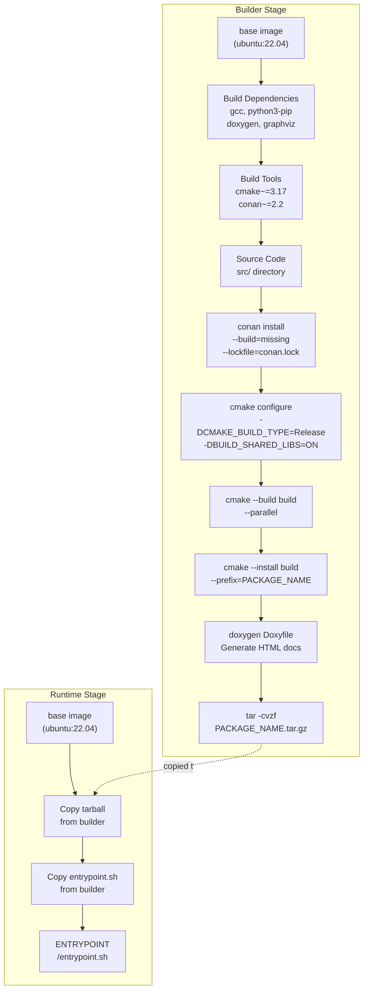
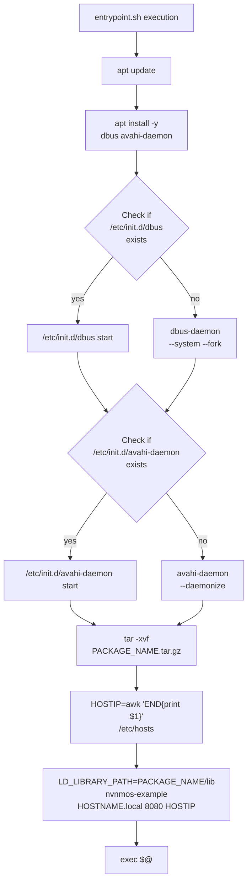
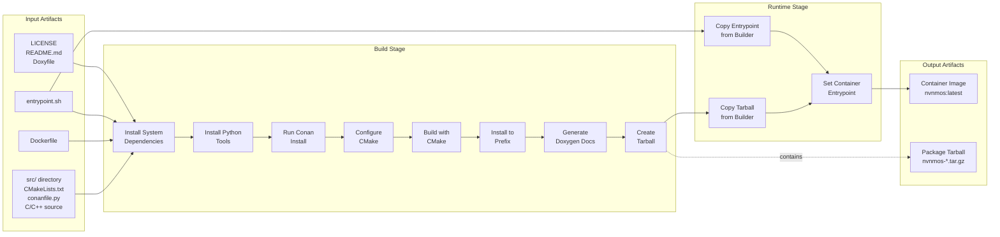

<!-- source: DeepWiki mcp.deepwiki.com · repo NVIDIA/nvnmos · page 2.2 Using Docker · fetched 2026-10-26 -->

# Using Docker

<details>
<summary>Relevant source files</summary>

The following files were used as context for generating this wiki page:

- [Dockerfile](Dockerfile)
- [README.md](README.md)
- [entrypoint.sh](entrypoint.sh)

</details>


## Purpose and Scope

This page describes how to build and run the nvnmos library using Docker containers. Docker provides a self-contained environment that handles all dependencies and build requirements, producing distributable packages that can be deployed to compatible host systems.

For manual builds without Docker, see [Building from Source](#2.1). For information about running the built artifacts, see [Running the Example Application](#2.3).

---

## Docker Build Overview

The nvnmos repository provides a Dockerfile that implements a multi-stage build process. This approach separates build-time dependencies from runtime requirements, producing a minimal final container and a portable tarball package.

**Multi-Stage Build Architecture**



**Sources:** [Dockerfile:1-88](), [README.md:59-91]()

---

## Building the Container Image

### Basic Build Command

Build the container image with the default configuration:

```sh
docker build -t nvnmos .
```

This command executes the multi-stage build defined in [Dockerfile:1-88](), producing a container tagged as `nvnmos`.

**Sources:** [README.md:63-65]()

### Build Process Stages

#### Stage 1: Builder (lines 22-72)

The builder stage performs the complete build process:

| Step | Command Location | Purpose |
|------|-----------------|---------|
| Install system packages | [Dockerfile:34]() | gcc, python3-pip, doxygen, graphviz |
| Install Python tools | [Dockerfile:35-36]() | CMake 3.17+, Conan 2.2+ |
| Copy source code | [Dockerfile:40]() | src/ directory contents |
| Install dependencies | [Dockerfile:46-53]() | Conan dependency resolution |
| Configure build | [Dockerfile:55-59]() | CMake configuration with toolchain |
| Compile | [Dockerfile:61]() | Parallel build execution |
| Install to prefix | [Dockerfile:63]() | Stage files into PACKAGE_NAME directory |
| Copy metadata | [Dockerfile:65-67]() | conan.lock, LICENSE, README.md |
| Generate docs | [Dockerfile:69]() | Doxygen HTML documentation |
| Create package | [Dockerfile:71]() | Tarball for distribution |

**Conan Dependency Installation Details**

The [Dockerfile:46-53]() command installs dependencies using the following configuration:

```sh
conan install . \
    -g CMakeToolchain \
    --settings:all build_type=Release \
    --build=missing \
    --output-folder=conan \
    --lockfile=${USE_CONAN_LOCK:+conan.lock} \
    --lockfile-partial \
    --lockfile-out=conan.lock
```

This command uses the `conan.lock` file (when `USE_CONAN_LOCK=1`) to ensure reproducible builds with locked dependency versions. The `--build=missing` flag allows Conan to build dependencies from source if prebuilt binaries are unavailable.

**CMake Configuration**

The [Dockerfile:55-59]() command configures the build:

```sh
cmake -B build \
    -DCMAKE_TOOLCHAIN_FILE=conan/conan_toolchain.cmake \
    -DCMAKE_BUILD_TYPE=Release \
    -DBUILD_SHARED_LIBS=ON \
    .
```

The `conan_toolchain.cmake` file provides compiler flags, library paths, and dependency information from the Conan installation.

**Sources:** [Dockerfile:22-72]()

#### Stage 2: Runtime (lines 73-88)

The runtime stage creates a minimal container containing only the packaged artifacts:

```dockerfile
FROM ${BASE_IMAGE}

COPY --from=builder \
    /src/${PACKAGE_NAME}.tar.gz \
    /entrypoint.sh \
    .

ENTRYPOINT ["/entrypoint.sh"]
```

This stage copies the tarball from the builder stage and sets up the entrypoint script, resulting in a much smaller final image.

**Sources:** [Dockerfile:73-88]()

---

## Build Arguments

The Dockerfile accepts several build arguments for customization:

| Argument | Default | Purpose | Example Usage |
|----------|---------|---------|---------------|
| `BASE_IMAGE` | `ubuntu:22.04` | Base container image | `--build-arg BASE_IMAGE=ubuntu:24.04` |
| `PACKAGE_SUFFIX` | Based on `BASE_IMAGE` | Package filename suffix | `--build-arg PACKAGE_SUFFIX=-custom` |
| `USE_CONAN_LOCK` | `1` | Enable reproducible builds via conan.lock | `--build-arg USE_CONAN_LOCK=0` |

### Package Naming

The package name is constructed from the base image [Dockerfile:31-32]():

```sh
ENV _BASE_IMAGE=${BASE_IMAGE//\//-}
ENV PACKAGE_NAME=nvnmos${PACKAGE_SUFFIX:--${_BASE_IMAGE//:/-}}
```

For example, with `BASE_IMAGE=ubuntu:22.04`, the package becomes `nvnmos-ubuntu-22.04.tar.gz`.

### Example: Custom Build

Build with Ubuntu 24.04 and a custom suffix:

```sh
docker build \
  --build-arg BASE_IMAGE=ubuntu:24.04 \
  --build-arg PACKAGE_SUFFIX=-custom \
  -t nvnmos:custom .
```

**Sources:** [README.md:81-90](), [Dockerfile:16-32]()

---

## Extracting the Package

After building, extract the package tarball from the container to the host system:

```sh
docker create --name nvnmos-test nvnmos
docker cp nvnmos-test:/nvnmos-ubuntu-22.04.tar.gz .
docker rm nvnmos-test
```

This sequence creates a temporary container, copies the package, and removes the container. The tarball contains:

- `lib/` - Shared libraries (libnvnmos.so or nvnmos.dll)
- `bin/` - Example application (nvnmos-example)
- `include/` - Public headers (nvnmos.h)
- `html/` - API documentation
- `conan.lock` - Dependency lock file
- `LICENSE`, `README.md` - Metadata files

**Sources:** [README.md:69-73](), [Dockerfile:63-69]()

---

## Running the Container

### Interactive Container Usage

Launch an interactive shell in the container:

```sh
docker run -it nvnmos /bin/bash
```

This executes the entrypoint script [entrypoint.sh:1-33]() which:

1. Installs runtime dependencies (dbus, avahi-daemon)
2. Starts system services
3. Extracts the package tarball
4. Runs the example application with auto-detected hostname and IP

**Sources:** [README.md:77-79]()

### Entrypoint Script Workflow



**Sources:** [entrypoint.sh:1-33]()

### Runtime Dependencies

The entrypoint installs and starts required services [entrypoint.sh:20-24]():

| Service | Package | Startup Method | Purpose |
|---------|---------|----------------|---------|
| D-Bus | `dbus` | `/etc/init.d/dbus start` or `dbus-daemon --system --fork` | Inter-process communication |
| Avahi | `avahi-daemon` | `/etc/init.d/avahi-daemon start` or `avahi-daemon --daemonize` | mDNS service discovery |

The script handles both traditional init systems and newer systemd-based containers by checking for init scripts before attempting direct daemon invocation.

**Sources:** [entrypoint.sh:20-24]()

### Application Execution

The example application is launched with environment-derived parameters [entrypoint.sh:28-30]():

```sh
export HOSTIP=`awk 'END{print $1}' /etc/hosts`
yes | LD_LIBRARY_PATH=${PACKAGE_NAME}/lib ${PACKAGE_NAME}/bin/nvnmos-example ${HOSTNAME}.local 8080 ${HOSTIP}
```

| Parameter | Value | Source | Purpose |
|-----------|-------|--------|---------|
| Hostname | `${HOSTNAME}.local` | Container hostname | mDNS service name |
| Port | `8080` | Hardcoded | HTTP API port |
| IP Address | `${HOSTIP}` | `/etc/hosts` | Network interface for mock senders/receivers |

The `yes` command automatically responds to application prompts, allowing unattended execution.

**Sources:** [entrypoint.sh:28-30]()

---

## Docker Build Flow



**Sources:** [Dockerfile:1-88](), [entrypoint.sh:1-33]()

---

## Package Contents and Structure

The tarball extracted from the container contains the complete build artifacts organized by directory:

| Directory/File | Contents | Description |
|---------------|----------|-------------|
| `bin/` | `nvnmos-example` | Example application executable |
| `lib/` | `libnvnmos.so` (Linux) | Shared library for nvnmos |
| `include/` | `nvnmos.h` | Public C API header |
| `html/` | Documentation files | Doxygen-generated API documentation |
| `conan.lock` | Lock file | Locked dependency versions |
| `LICENSE` | Apache 2.0 license | License text |
| `README.md` | Project readme | Getting started guide |

The package can be extracted on any compatible system (matching OS/architecture) and used independently of Docker. The `LD_LIBRARY_PATH` environment variable must be set to include the `lib/` directory when running the example application.

**Sources:** [Dockerfile:63-69](), [entrypoint.sh:26-30]()

---

## Advanced: Customizing the Build

### Using a Different Base Image

To build for a different Ubuntu version:

```sh
docker build \
  --build-arg BASE_IMAGE=ubuntu:24.04 \
  --build-arg PACKAGE_SUFFIX=-ubuntu-24.04 \
  -t nvnmos:ubuntu24 .
```

### Disabling Locked Dependencies

To allow Conan to use the latest available dependency versions:

```sh
docker build \
  --build-arg USE_CONAN_LOCK=0 \
  -t nvnmos:latest-deps .
```

This is useful for testing compatibility with newer dependency versions but may produce non-reproducible builds.

**Warning:** Disabling the lock file may result in build failures if newer dependency versions introduce breaking changes.

**Sources:** [Dockerfile:46-53](), [README.md:89]()

---

## Summary

The Docker build process provides a complete, self-contained build environment that:

1. Installs all build dependencies via system packages and Python tools
2. Uses Conan to manage C++ library dependencies with optional version locking
3. Builds the nvnmos library and example application using CMake
4. Generates API documentation with Doxygen
5. Packages everything into a portable tarball
6. Creates a minimal runtime container with only the necessary artifacts

The multi-stage design separates build complexity from runtime requirements, producing both a deployable container image and an extractable package suitable for host installation.

**Sources:** [Dockerfile:1-88](), [entrypoint.sh:1-33](), [README.md:59-91]()

---

