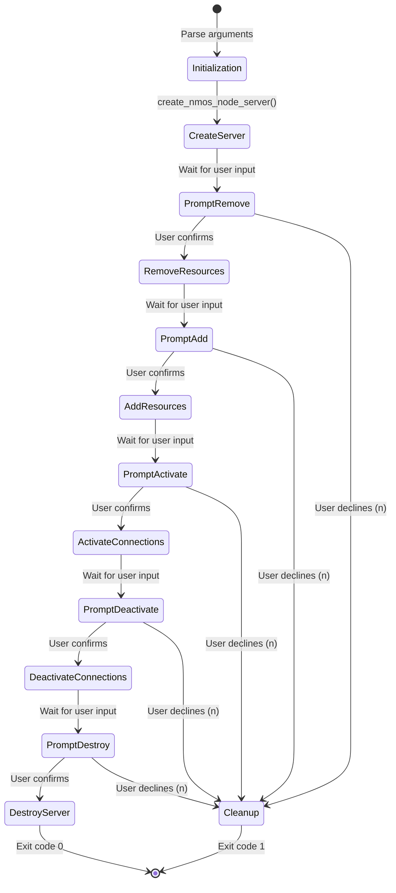
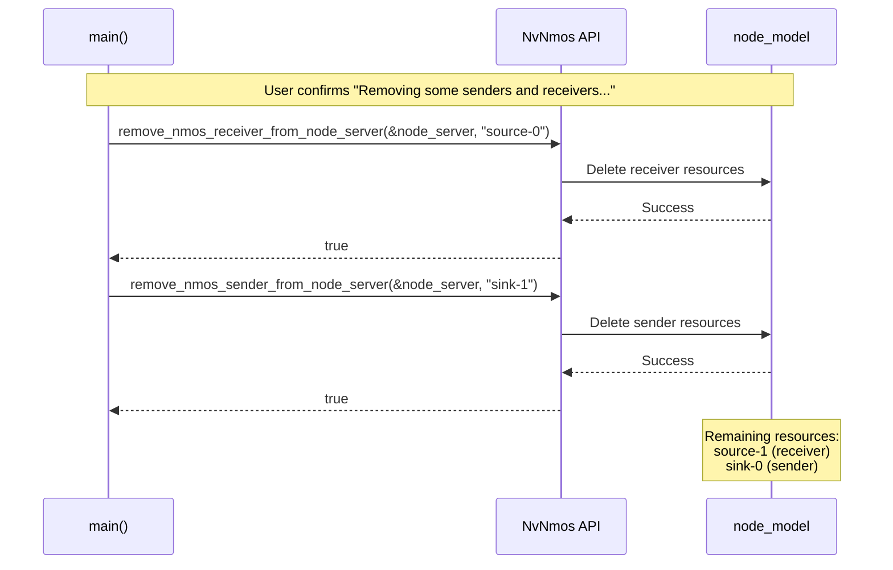
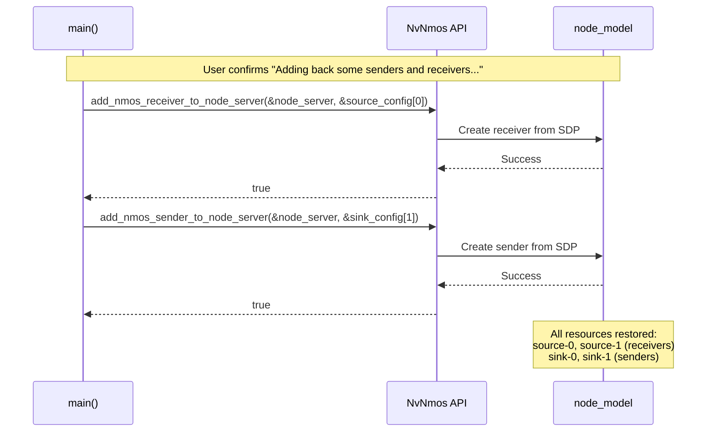
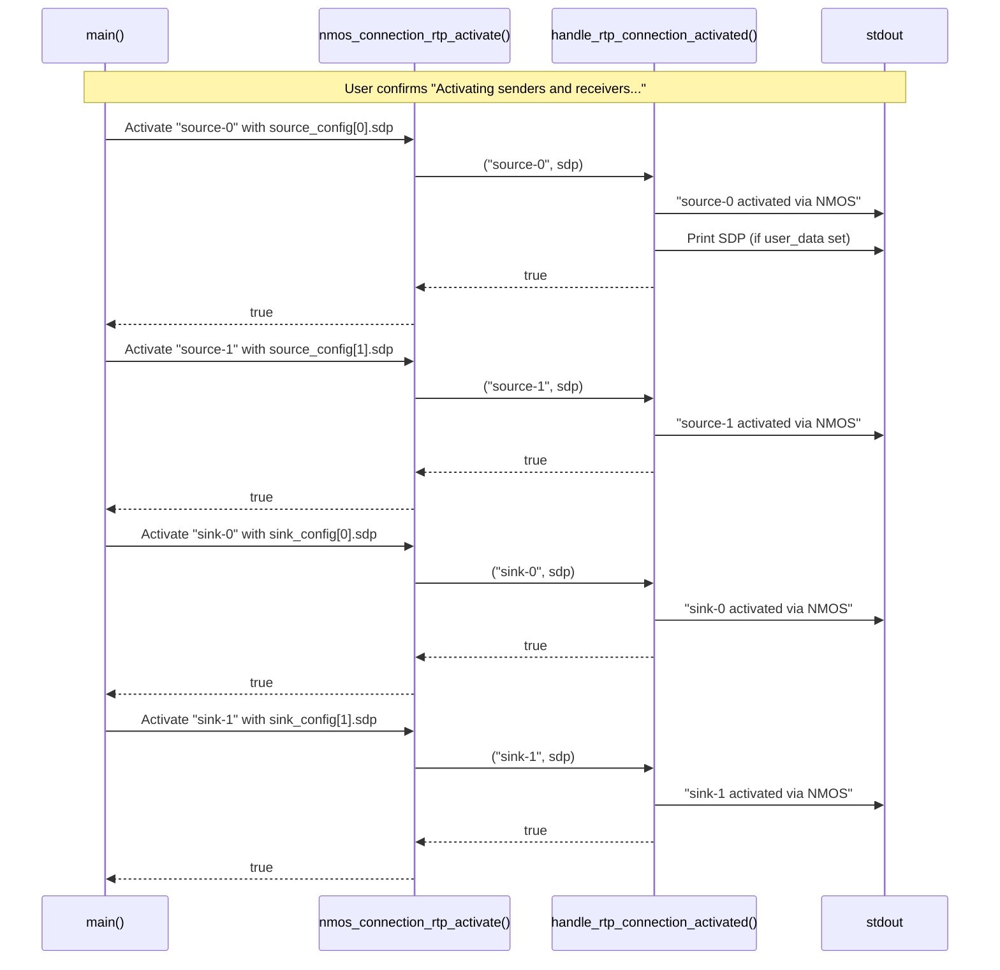

<!-- source: DeepWiki mcp.deepwiki.com · repo NVIDIA/nvnmos · page 2.3 Running the Example Application · fetched 2026-10-26 -->

# Running the Example Application

<details>
<summary>Relevant source files</summary>

The following files were used as context for generating this wiki page:

- [README.md](README.md)
- [src/main.c](src/main.c)

</details>


This document provides a walkthrough of the `nvnmos-example` application included with the NvNmos library. The example demonstrates the complete lifecycle of an NMOS Node, including resource creation, dynamic management, connection activation, and cleanup. This is a mock application that does not perform actual media transport; it focuses on demonstrating the NMOS control plane API.

For instructions on building the example application, see [Building from Source](#2.1). For containerized execution, see [Using Docker](#2.2). For details on the NMOS resource model and connection activation concepts demonstrated by this example, see [Core Concepts](#3).

## Prerequisites

Before running the example application, ensure runtime dependencies are installed and running.

### Linux Requirements

The Avahi daemon must be running to provide DNS-SD (mDNS) service discovery:

```bash
apt update
apt install -y dbus avahi-daemon

/etc/init.d/dbus start
/etc/init.d/avahi-daemon start
```

**Note:** On Ubuntu 24.04 and later, use `avahi-daemon --daemonize` instead of the init script.

### Windows Requirements

The Bonjour Service must be installed and running. Download from Apple's [Bonjour Print Services v2.0.2](https://support.apple.com/kb/DL999).

Sources: [README.md:271-290]()

## Command Line Interface

### Basic Syntax

```bash
nvnmos-example <host-name> <port> <iface-ip> [log-level]
```

### Parameters

| Parameter | Required | Description |
|-----------|----------|-------------|
| `host-name` | Yes | Registry hostname for discovery. Use `.local` suffix for mDNS or FQDN for unicast DNS-SD |
| `port` | Yes | HTTP port for serving NMOS APIs (IS-04, IS-05, IS-09) |
| `iface-ip` | Yes | IP address of network interface for mock senders/receivers |
| `log-level` | No | Logging verbosity: -40 (most verbose) to 40 (least verbose). Values > 0 are warnings/errors, < 0 are debug/trace |

### Example Invocations

**Multicast DNS-SD discovery:**
```bash
nvnmos-example nmos-api.local 8080 192.0.2.0
```

**Unicast DNS-SD discovery:**
```bash
nvnmos-example api.example.com 8080 192.168.1.100
```

**With verbose logging:**
```bash
nvnmos-example nmos-api.local 8080 192.0.2.0 -20
```

Sources: [README.md:295-312](), [src/main.c:228-234]()

## Application Workflow

The example application executes a predefined sequence of operations that demonstrate the NvNmos API's capabilities. Each step pauses for user confirmation before proceeding.



**Application Workflow State Machine**

Sources: [src/main.c:297-322](), [README.md:313-330]()

### Workflow Phases

The application outputs the following status messages as it progresses:

```
Creating NvNmos server...
Removing some senders and receivers...
Adding back some senders and receivers...
Activating senders and receivers...
Deactivating senders and receivers...
Destroying NvNmos server...
Finished
```

After each phase (except initialization), the application prompts:
```
Continue ([y]/n)?
```

- Pressing Enter or `y` continues to the next phase
- Pressing `n` triggers cleanup and exits with code 1
- Successful completion (all phases) exits with code 0

Sources: [README.md:313-330](), [src/main.c:218-226]()

## Initialization and Configuration

### Node Configuration Structure

The application constructs an `NvNmosNodeConfig` structure containing asset information, network settings, and initial resources.

```mermaid
graph TB
    subgraph "Node Configuration (main.c:248-296)"
        NodeConfig["NvNmosNodeConfig<br/>node_config"]
        AssetConfig["NvNmosAssetConfig<br/>asset_config"]
        ReceiverConfigs["NvNmosReceiverConfig[2]<br/>source_config"]
        SenderConfigs["NvNmosSenderConfig[2]<br/>sink_config"]
        
        NodeConfig --> AssetConfig
        NodeConfig --> ReceiverConfigs
        NodeConfig --> SenderConfigs
    end
    
    subgraph "Asset Tags"
        Manufacturer["manufacturer: 'Acme'"]
        Product["product: 'Widget Pro'"]
        InstanceID["instance_id: 'XYZ123-456789'"]
        Functions["functions: ['Example']"]
        
        AssetConfig --> Manufacturer
        AssetConfig --> Product
        AssetConfig --> InstanceID
        AssetConfig --> Functions
    end
    
    subgraph "Network Settings"
        HostName["host_name: argv[1]"]
        Port["http_port: argv[2]"]
        Seed["seed: 'hostname:port'"]
        
        NodeConfig --> HostName
        NodeConfig --> Port
        NodeConfig --> Seed
    end
    
    subgraph "Callbacks"
        LogCallback["log_callback:<br/>handle_log()"]
        RTPCallback["rtp_connection_activated:<br/>handle_rtp_connection_activated()"]
        LogLevel["log_level: NVNMOS_LOG_ERROR"]
        
        NodeConfig --> LogCallback
        NodeConfig --> RTPCallback
        NodeConfig --> LogLevel
    end
    
    subgraph "Initial Resources"
        Receiver0["source-0<br/>Video Receiver<br/>1920x1080p50"]
        Receiver1["source-1<br/>Audio Receiver<br/>2ch 48kHz 24bit"]
        Sender0["sink-0<br/>Video Sender<br/>1920x1080p50"]
        Sender1["sink-1<br/>Audio Sender<br/>2ch 48kHz 24bit"]
        
        ReceiverConfigs --> Receiver0
        ReceiverConfigs --> Receiver1
        SenderConfigs --> Sender0
        SenderConfigs --> Sender1
    end
```



**Node Configuration Object Structure**

Sources: [src/main.c:240-296]()

### Mock Resources

The application creates four initial resources using generated SDP configurations:

| Resource ID | Type | Media Type | Format | Description |
|-------------|------|------------|--------|-------------|
| `source-0` | Receiver | Video | ST 2110-20 | YCbCr-4:2:2, 10-bit, 1920x1080p50 |
| `source-1` | Receiver | Audio | ST 2110-30 | 2 channels, 48 kHz, 24-bit |
| `sink-0` | Sender | Video | ST 2110-20 | YCbCr-4:2:2, 10-bit, 1920x1080p50 |
| `sink-1` | Sender | Audio | ST 2110-30 | 2 channels, 48 kHz, 24-bit |

Each resource is configured with:
- **Group hint**: Logical grouping (e.g., `rx-0:video`, `tx-0:audio`)
- **Interface IP**: Network interface from `iface-ip` argument
- **Multicast addresses**: From MCAST-TEST-NET range (233.252.0.0/24)
- **RTP ports**: Conventional assignments (video: 5020, audio: 5030)
- **Clock reference**: PTP (IEEE1588-2008) or local MAC depending on `CLK_PTP` define

Sources: [src/main.c:91-216](), [src/main.c:263-286]()

### SDP Generation Functions

The application uses two helper functions to construct SDP strings:

- **`init_video_sdp()`** [src/main.c:91-152](): Generates SDP for video senders/receivers
- **`init_audio_sdp()`** [src/main.c:155-216](): Generates SDP for audio senders/receivers

Both functions support compile-time configuration via preprocessor macros for different video codecs (ST 2110-20 raw video or ST 2110-22 JPEG XS).

Sources: [src/main.c:24-65](), [src/main.c:91-216]()

## Dynamic Resource Management

The application demonstrates adding and removing resources at runtime.

### Phase 1: Resource Removal



**Resource Removal Sequence**

The application removes:
- **`source-0`**: Video receiver
- **`sink-1`**: Audio sender

Sources: [src/main.c:300-302]()

### Phase 2: Resource Addition



**Resource Addition Sequence**

The application re-adds the previously removed resources using the same configurations.

Sources: [src/main.c:304-306]()

## Connection Activation

The application demonstrates programmatic connection activation using `nmos_connection_rtp_activate()`. This simulates what would normally be triggered by an NMOS Controller via IS-05 Connection API.

### Activation Phase



**Connection Activation Sequence**

Sources: [src/main.c:308-312](), [src/main.c:80-88]()

### Deactivation Phase

Deactivation follows the same pattern but passes `NULL` instead of an SDP string:

```c
nmos_connection_rtp_activate(&node_server, "source-0", NULL);
```

The callback receives `NULL` for the `sdp` parameter and prints:
```
source-0 deactivated via NMOS
```

Sources: [src/main.c:314-318](), [src/main.c:80-88]()

### Callback Implementation

The `handle_rtp_connection_activated()` callback demonstrates proper response handling:

```c
static bool handle_rtp_connection_activated(
    NvNmosNodeServer *server,
    const char *id,
    const char *sdp)
{
    printf("%s %s\n", id, sdp ? "activated via NMOS" : "deactivated via NMOS");
    if (server->user_data && sdp) printf("%s\n", sdp);
    return true;
}
```

**Key behaviors:**
- Returns `true` to indicate successful handling
- Distinguishes activation (sdp != NULL) from deactivation (sdp == NULL)
- Optionally prints SDP content based on `user_data` flag
- In a real application, this would configure actual media transport

Sources: [src/main.c:80-88](), [src/main.c:294-295]()

## Accessing NMOS APIs

While the application is running, the NMOS Node exposes standard IS-04, IS-05, and IS-09 HTTP APIs.

### API Endpoints

The base URL for all APIs is:
```
http://<host-address>:<port>/
```

Where:
- `<host-address>` is the local IP address or hostname
- `<port>` is the value provided as the second command-line argument

### Available APIs

| API | Specification | Typical Path | Description |
|-----|---------------|--------------|-------------|
| Node API | IS-04 | `/x-nmos/node/v1.3/` | Node, device, sender, receiver resources |
| Connection API | IS-05 | `/x-nmos/connection/v1.1/` | Connection management, staged parameters |
| System API | IS-09 | `/x-nmos/system/v1.0/` | Global system parameters |

### Example Queries

**List all receivers:**
```bash
curl http://192.168.1.100:8080/x-nmos/node/v1.3/receivers/
```

**Get specific sender details:**
```bash
curl http://192.168.1.100:8080/x-nmos/node/v1.3/senders/sink-0/
```

**View receiver connection status:**
```bash
curl http://192.168.1.100:8080/x-nmos/connection/v1.1/single/receivers/source-0/active/
```

Sources: [README.md:332-338]()

## Callback Mechanisms

The example demonstrates two callback types that enable bidirectional communication between the application and the NvNmos library.

### Logging Callback

The `handle_log()` function receives all internal log messages:

```c
static void handle_log(
    NvNmosNodeServer *server,
    const char *categories,
    int level,
    const char *message)
{
    printf("%s [%d:%s]\n", message, level, categories);
}
```

**Parameters:**
- `categories`: Comma-separated log categories (e.g., "nmos,node")
- `level`: Numeric severity (-40 to 40)
- `message`: Log message text

The callback filters messages based on `node_config.log_level` before invocation.

Sources: [src/main.c:71-78](), [src/main.c:290-291]()

### RTP Connection Activated Callback

The `handle_rtp_connection_activated()` callback is invoked when:
- Application calls `nmos_connection_rtp_activate()` (as shown in this example)
- NMOS Controller sends IS-05 Connection API activation request

This callback is where a real application would:
- Parse the SDP to extract transport parameters
- Configure ST 2110 data plane (Rivermax, DeepStream, etc.)
- Start or stop media streams
- Validate that resources are available

The example simply logs the activation and returns `true` to indicate success.

Sources: [src/main.c:80-88](), [src/main.c:288]()

## Troubleshooting

### Port Already in Use

**Symptom:**
```
asio listen error: system:98 (Address already in use)
```

**Cause:** Another process is using the specified HTTP port.

**Solution:** 
- Use a different port number in the command-line arguments
- Stop the conflicting process
- On Linux, find the process with: `sudo lsof -i :<port>`

Sources: [README.md:342-349]()

### DNS-SD Service Errors

**Symptom:**
```
DNSServiceRegister reported error: -65537 while registering advertisement for: ...
DNSServiceBrowse reported error: -65537
```

**Cause:** DNS-SD daemon/service is not running.

**Solution:**

**Linux:**
```bash
sudo systemctl status avahi-daemon
sudo systemctl start avahi-daemon
```

**Windows:**
- Verify Bonjour Service is running in Services panel
- Restart the service if necessary

When DNS-SD fails, the Node cannot discover or register with NMOS Registries.

Sources: [README.md:363-382]()

### Avahi Compatibility Warnings

**Symptom:**
```
*** WARNING *** The program 'nvnmos-example' uses the Apple Bonjour compatibility layer of Avahi.
*** WARNING *** Please fix your application to use the native API of Avahi!
```

**Cause:** The nmos-cpp library uses DNS-SD APIs compatible with both Avahi and Bonjour.

**Impact:** These warnings are informational and can be safely ignored. They do not indicate a problem.

Sources: [README.md:351-360]()

### Application Exits Immediately

**Symptom:** The application exits with code 1 before completing workflow.

**Possible causes:**
- Invalid command-line arguments (insufficient parameters)
- Port conflict during initialization
- DNS-SD service unavailable
- User declined to continue at a prompt
- SDP generation buffer overflow (rare)

**Debugging:**
- Run with verbose logging: `nvnmos-example <args> -40`
- Check system logs for DNS-SD errors
- Verify all prerequisites are met
- Check return values and error messages in console output

Sources: [src/main.c:230-234](), [src/main.c:325-327]()

---

