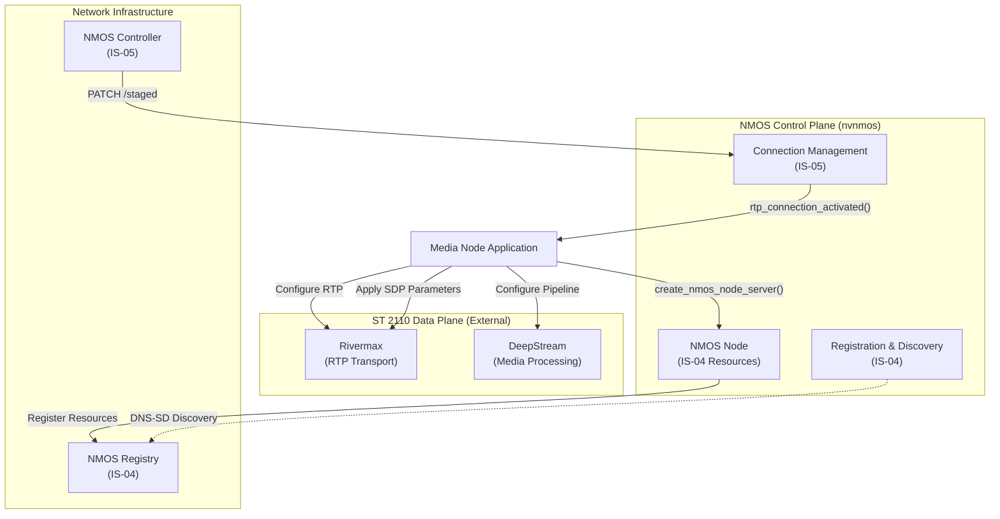
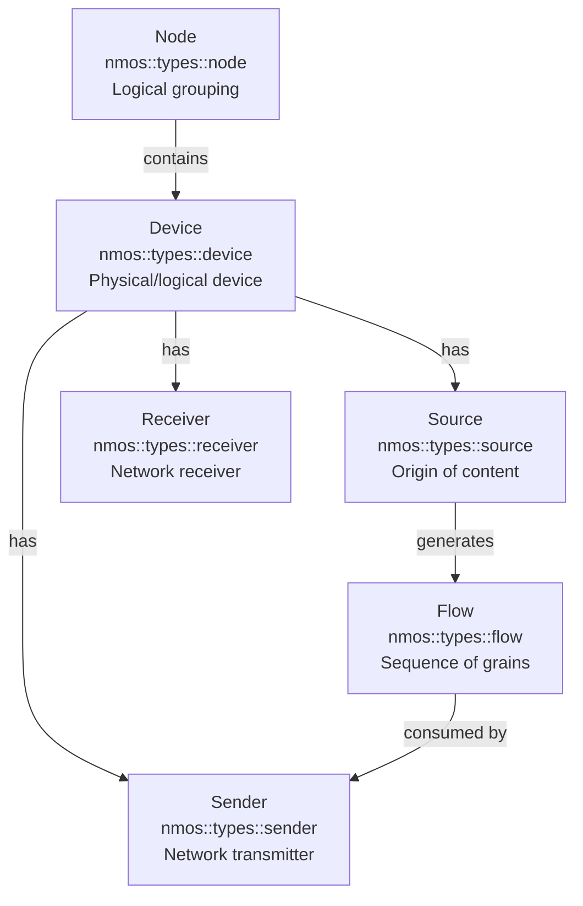
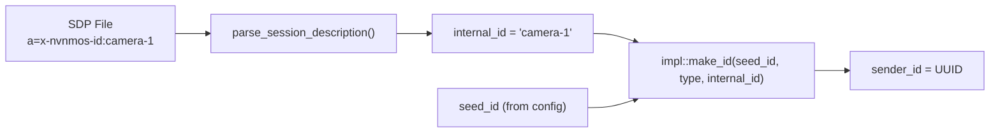
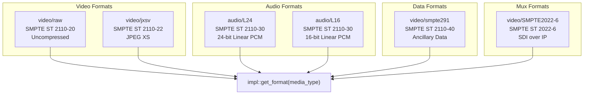
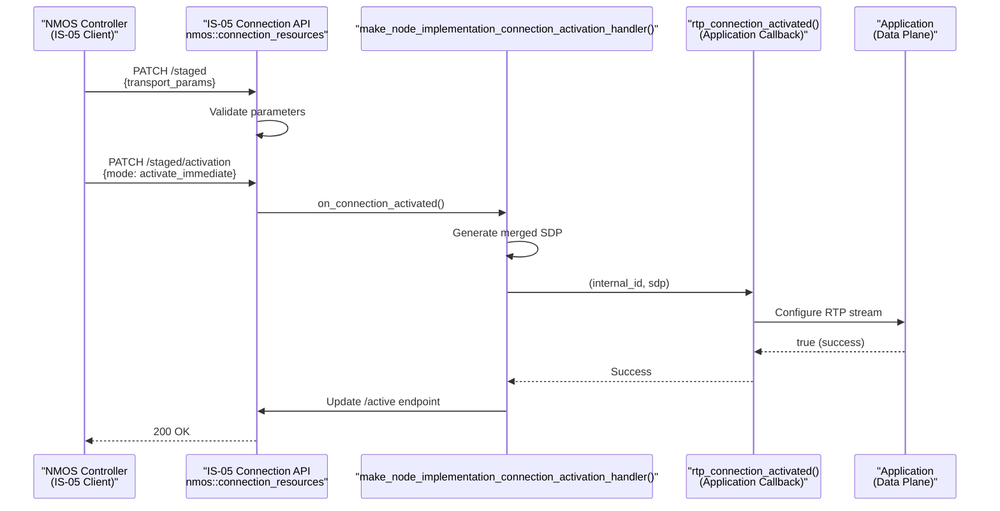
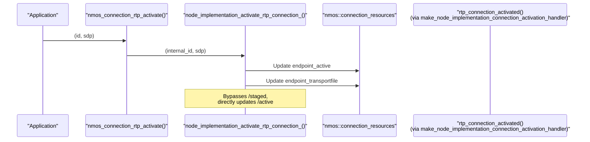
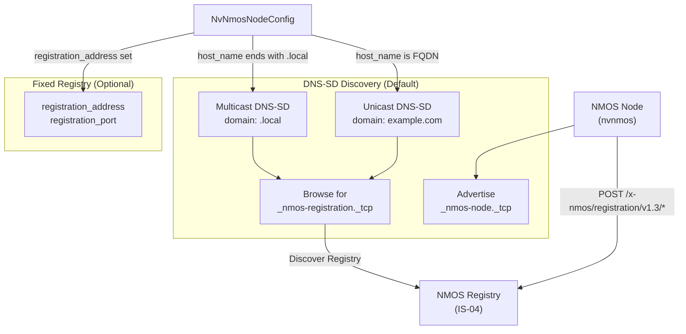
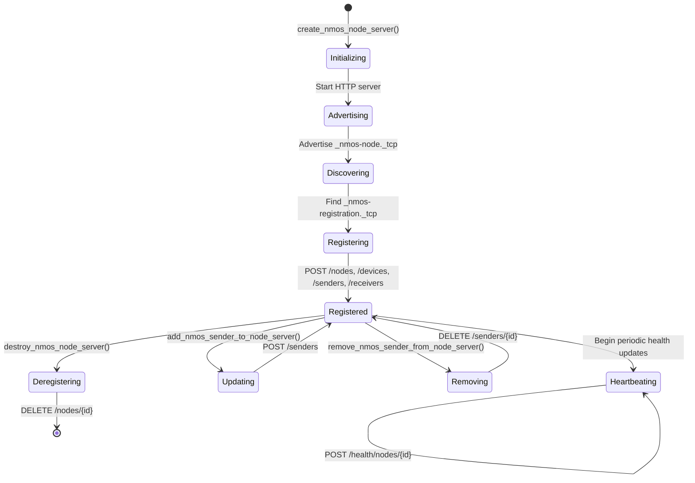
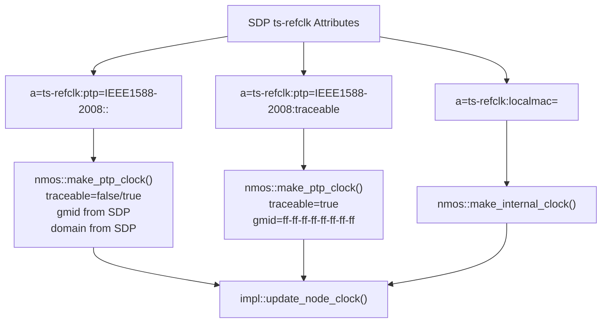
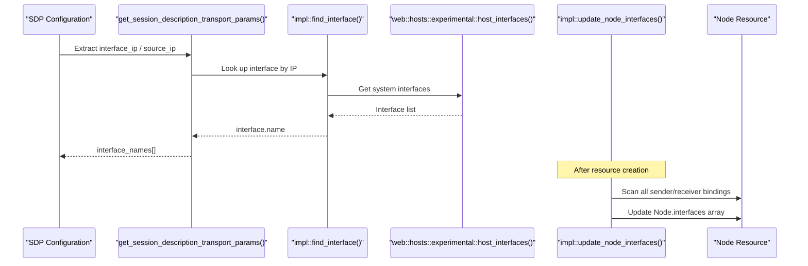

<!-- source: DeepWiki mcp.deepwiki.com · repo NVIDIA/nvnmos · page 3 Core Concepts · fetched 2026-10-26 -->

# Core Concepts

<details>
<summary>Relevant source files</summary>

The following files were used as context for generating this wiki page:

- [README.md](README.md)
- [src/nvnmos.h](src/nvnmos.h)
- [src/nvnmos_impl.cpp](src/nvnmos_impl.cpp)

</details>


This page introduces the fundamental concepts of NMOS (Networked Media Open Specifications) and how the nvnmos library implements them. It covers the separation of control plane and data plane, the NMOS resource model, and the role of Session Description Protocol (SDP) in configuring media streams.

For detailed API documentation, see [API Reference](#4). For integration patterns with ST 2110 data plane libraries, see [Integration Guide](#7).

## NMOS Overview

NMOS provides industry-standard APIs for discovering, registering, and managing professional media devices on IP networks. The nvnmos library implements the **control plane** for NMOS, handling registration, discovery, and connection management, while delegating the **data plane** (actual media transport) to external libraries like NVIDIA Rivermax or DeepStream.



**Sources:** [src/nvnmos.h:18-56](), [README.md:20-43]()

## NMOS Resource Model

NMOS defines a hierarchical resource model that describes the capabilities and configuration of media devices. The nvnmos library manages these resources internally and exposes them via HTTP APIs.

### Resource Hierarchy



**Resource Creation Flow:**

| Application Action | Internal Resources Created | ID Generation |
|-------------------|---------------------------|---------------|
| `add_nmos_sender_to_node_server(sdp)` | Source, Flow, Sender | `impl::make_id(seed_id, type, internal_id)` |
| `add_nmos_receiver_to_node_server(sdp)` | Receiver | `impl::make_id(seed_id, type, internal_id)` |

**Sources:** [src/nvnmos_impl.cpp:190-387](), [src/nvnmos_impl.cpp:389-564](), [src/nvnmos_impl.cpp:1365-1368]()

### Resource Identification

Each sender and receiver is identified by:

1. **Internal ID**: Application-provided identifier specified in SDP via `x-nvnmos-id` attribute
2. **Resource ID**: UUID generated deterministically from seed and internal ID using `impl::make_id()`
3. **Group Hint**: Optional grouping tag specified via `x-nvnmos-group-hint` attribute



**Sources:** [src/nvnmos_impl.cpp:1237-1252](), [src/nvnmos_impl.cpp:1365-1368](), [src/nvnmos_impl.cpp:1384-1400]()

## Session Description Protocol (SDP)

SDP is the primary configuration mechanism in nvnmos. Applications provide SDP strings that describe media streams, and nvnmos parses them to create and configure NMOS resources.

### SDP Configuration Flow

```mermaid
sequenceDiagram
    participant App as "Application"
    participant API as "add_nmos_sender_to_node_server()"
    participant Parse as "sdp::parse_session_description()"
    participant Extract as "get_session_description_*"
    participant Create as "node_implementation_add_sender_()"
    participant Model as "nmos::node_model"
    
    App->>API: SDP string
    API->>Parse: Parse SDP
    Parse-->>API: session_description (JSON)
    API->>Extract: Extract sdp_params
    API->>Extract: Extract transport_params
    API->>Extract: Extract internal_id
    API->>Extract: Extract group_hint
    Extract-->>API: Parsed parameters
    API->>Create: Create resources
    Create->>Model: Insert Source
    Create->>Model: Insert Flow
    Create->>Model: Insert Sender
    Model-->>App: Success
```

**Sources:** [src/nvnmos_impl.cpp:190-204](), [src/nvnmos_impl.cpp:1076-1125]()

### Standard and Custom SDP Attributes

nvnmos uses both standard SDP attributes (defined by IETF RFCs and SMPTE standards) and custom `x-nvnmos-*` attributes:

| Attribute | Level | Purpose | Spec |
|-----------|-------|---------|------|
| `ts-refclk` | Session/Media | PTP clock reference | RFC 7273 |
| `x-nvnmos-id` | Session | Unique sender/receiver identifier | nvnmos |
| `x-nvnmos-iface-ip` | Media | Interface IP for RX or source IP for TX | nvnmos |
| `x-nvnmos-src-port` | Media | Source port for TX | nvnmos |
| `x-nvnmos-group-hint` | Session | BCP-002-01 grouping tag | nvnmos |
| `inactive` | Media | Indicates disabled leg (ST 2022-7) | RFC 4566 |

**Example SDP with Custom Attributes:**

```sdp
v=0
o=- 0 0 IN IP4 192.0.2.1
s=Video Sender 1
t=0 0
a=x-nvnmos-id:camera-1
a=x-nvnmos-group-hint:studio-a
m=video 5004 RTP/AVP 96
c=IN IP4 239.1.1.1/32
a=x-nvnmos-iface-ip:192.0.2.1
a=x-nvnmos-src-port:5004
a=ts-refclk:ptp=IEEE1588-2008:traceable
```

**Sources:** [src/nvnmos.h:98-125](), [src/nvnmos.h:260-293](), [src/nvnmos_impl.cpp:1076-1125]()

## Supported Media Formats

nvnmos supports the following media formats through SDP parsing and NMOS resource creation:



**Format Detection and Resource Creation:**

The `impl::get_format()` function maps media types to internal format enums, which determine which NMOS resource creation functions are called:

- **Video (raw)**: `nmos::make_video_source()`, `nmos::make_raw_video_flow()`
- **Video (JPEG XS)**: `nmos::make_video_source()`, `nmos::make_video_jxsv_flow()`
- **Audio**: `nmos::make_audio_source()`, `nmos::make_raw_audio_flow()`
- **Data**: `nmos::make_data_source()`, `nmos::make_sdianc_data_flow()`
- **Mux**: `nmos::make_mux_source()`, `nmos::make_mux_flow()`

**Sources:** [src/nvnmos_impl.cpp:73-84](), [src/nvnmos_impl.cpp:1330-1340](), [src/nvnmos_impl.cpp:234-306]()

## Connection Activation

Connection activation is the process of applying transport parameters to establish or modify media connections. This can be initiated by an NMOS Controller (via IS-05) or by the application directly.

### Activation Flow



**Alternative: Application-Initiated Activation:**



**Sources:** [src/nvnmos_impl.cpp:874-965](), [src/nvnmos_impl.cpp:967-1072](), [src/nvnmos.h:439-469]()

### Transport Parameters

During activation, the following transport parameters are resolved and applied:

| Parameter | Type | Source | Auto Resolution |
|-----------|------|--------|-----------------|
| `source_ip` | Sender | Constraint | First constrained value |
| `destination_ip` | Sender | Auto | `impl::make_source_specific_multicast_address_v4()` |
| `source_port` | Sender | Auto | Spec default |
| `interface_ip` | Receiver | Constraint | First constrained value |
| `multicast_ip` | Receiver | Transport File | From SDP |
| `rtp_enabled` | Both | Transport File | From SDP `a=inactive` |

**Auto-resolution logic** is implemented in `make_node_implementation_auto_resolver()`:

**Sources:** [src/nvnmos_impl.cpp:778-812](), [src/nvnmos_impl.cpp:1370-1382]()

## Discovery and Registration

The nvnmos library automatically discovers NMOS Registries on the network and registers its resources using IS-04 APIs.

### Discovery Methods



**Configuration Options:**

The `NvNmosNetworkServicesConfig` structure controls discovery behavior:

```c
typedef struct _NvNmosNetworkServicesConfig
{
    const char* domain;                    // "local" forces mDNS, FQDN uses uDNS
    const char* registration_address;      // Fixed registry (disables DNS-SD)
    unsigned int registration_port;        // Port for fixed registry
    const char* registration_version;      // API version (default: "v1.3")
    const char* system_address;            // IS-09 System API address
    unsigned int system_port;
    const char* system_version;
} NvNmosNetworkServicesConfig;
```

**Sources:** [src/nvnmos.h:295-330](), [README.md:303-304]()

### Registration Lifecycle



**Registration Operations:**

| Operation | Method | Endpoint | Trigger |
|-----------|--------|----------|---------|
| Register Node | POST | `/nodes` | `node_implementation_init()` |
| Register Device | POST | `/devices` | `node_implementation_init()` |
| Register Sender | POST | `/senders` | `node_implementation_add_sender()` |
| Register Receiver | POST | `/receivers` | `node_implementation_add_receiver()` |
| Update Health | POST | `/health/nodes/{id}` | Periodic (5s default) |
| Unregister | DELETE | `/nodes/{id}` | `destroy_nmos_node_server()` |

**Sources:** [src/nvnmos_impl.cpp:153-188](), [src/nvnmos_impl.cpp:644-654]()

## Clock Management

nvnmos manages PTP clock references for senders, extracting them from SDP `ts-refclk` attributes and updating the Node's clock configuration.

### Clock Reference Types



**Clock Extraction Flow:**

1. Parse `ts-refclk` attributes from SDP: `impl::get_session_description_ts_refclks()`
2. Create clock object: `impl::make_node_clock(clock_name, ts_refclks, ptp_domain)`
3. Update Node resource: `impl::update_node_clock(node_resources, node_id, clock)`
4. Store PTP domain in settings: `nvnmos::fields::clocks(settings)[clock.name]`

**Sources:** [src/nvnmos_impl.cpp:1127-1178](), [src/nvnmos_impl.cpp:1432-1484](), [src/nvnmos_impl.cpp:374-381]()

## Interface Management

The nvnmos library automatically manages network interface bindings based on the IP addresses specified in sender and receiver configurations.

### Interface Binding Process



**Interface Resolution:**

For each leg of a sender or receiver:
1. Extract IP address from `transport_params` (source_ip for sender, interface_ip for receiver)
2. Find matching system interface: `impl::find_interface(host_interfaces, address)`
3. Store interface name in sender/receiver `interface_bindings`
4. Update Node's `interfaces` array: `impl::update_node_interfaces()`

**Sources:** [src/nvnmos_impl.cpp:1355-1362](), [src/nvnmos_impl.cpp:217-229](), [src/nvnmos_impl.cpp:1517-1562]()

---

