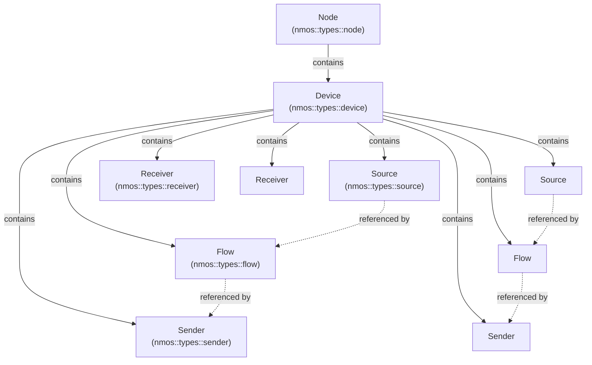
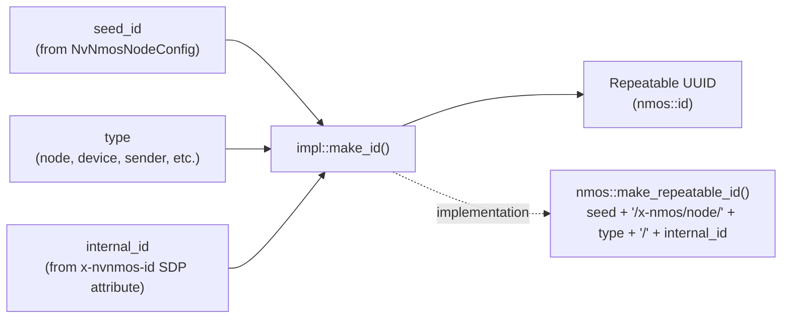
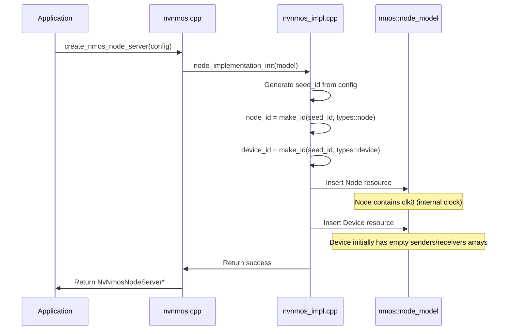
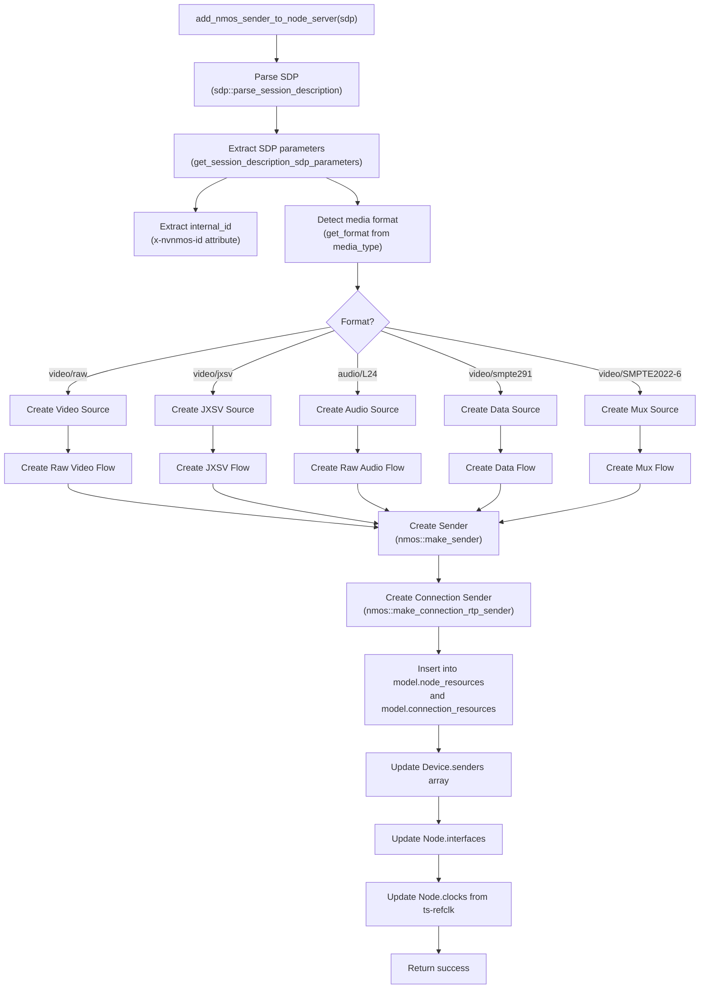
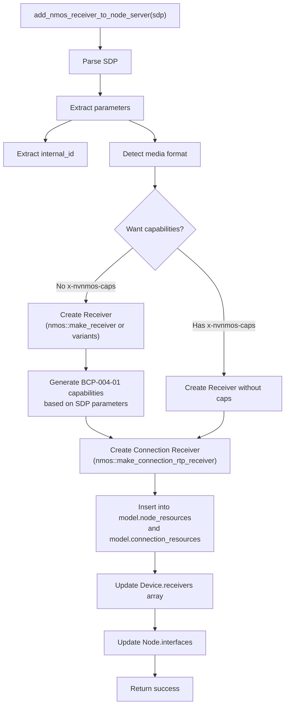
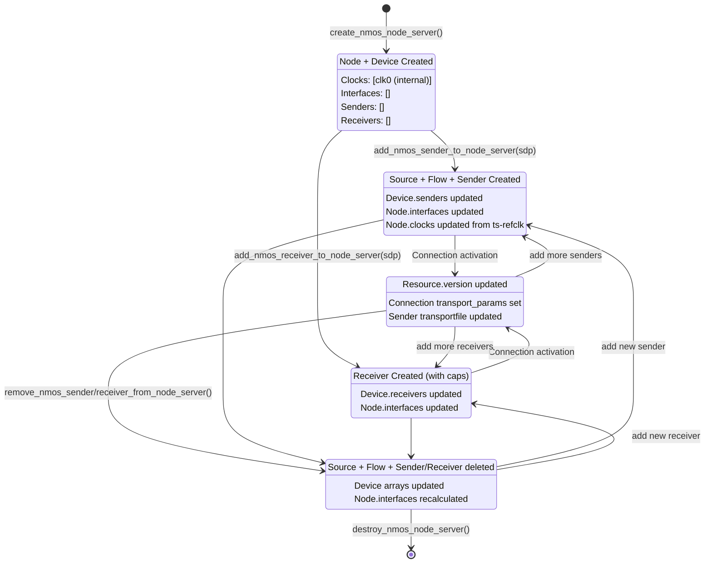

<!-- source: DeepWiki mcp.deepwiki.com · repo NVIDIA/nvnmos · page 3.1 NMOS Node Architecture · fetched 2026-10-26 -->

# NMOS Node Architecture

<details>
<summary>Relevant source files</summary>

The following files were used as context for generating this wiki page:

- [src/nvnmos.h](src/nvnmos.h)
- [src/nvnmos_impl.cpp](src/nvnmos_impl.cpp)
- [src/nvnmos_impl.h](src/nvnmos_impl.h)

</details>


## Purpose and Scope

This document describes the NMOS resource model implemented by nvnmos and how the library manages the lifecycle of Node, Device, Source, Flow, Sender, and Receiver resources. It explains the hierarchical relationships between these resources, how they are identified, and how they are created from Session Description Protocol (SDP) data.

For information about the SDP format and custom attributes used to configure resources, see [Session Description Protocol (SDP)](#3.2). For details on the connection activation workflow, see [Connection Activation](#3.3). For the overall layered architecture of the nvnmos library, see [Layered Architecture](#5.1).

## NMOS Resource Model Overview

The NMOS specifications define a hierarchical resource model where a **Node** represents a logical host, containing one or more **Devices**, which in turn contain **Sources**, **Flows**, **Senders**, and **Receivers**. The nvnmos library creates and manages these resources based on the IS-04 specification.

### Resource Hierarchy



**Sources:** [src/nvnmos_impl.cpp:153-188](), [src/nvnmos_impl.cpp:190-387](), [src/nvnmos_impl.cpp:389-564]()

## Resource Types and Relationships

### Node

A **Node** represents the NMOS API endpoint exposed by the nvnmos library. Each Node contains exactly one Device in the current implementation. The Node resource includes:

- **Clocks**: References to timing sources (e.g., PTP, internal clock)
- **Interfaces**: Network interfaces available for media transport
- **Label/Description**: Human-readable identification
- **Tags**: Asset distinguishing information per BCP-002-02

The Node is created during initialization by `node_implementation_init_()` at [src/nvnmos_impl.cpp:166-173]().

| Field | Type | Description |
|-------|------|-------------|
| `id` | UUID | Repeatable identifier generated from seed |
| `label` | String | From `nvnmos::fields::node_label` in settings |
| `description` | String | From `nvnmos::fields::node_description` in settings |
| `tags` | Object | BCP-002-02 asset tags from `nvnmos::fields::node_tags` |
| `clocks` | Array | Initially contains one internal clock (`clk0`) |
| `interfaces` | Array | Updated dynamically based on sender/receiver bindings |

### Device

A **Device** represents a logical grouping of media processing capabilities. The nvnmos library creates a single Device per Node. The Device maintains deprecated arrays of sender and receiver IDs for backwards compatibility.

The Device is created during initialization by `node_implementation_init_()` at [src/nvnmos_impl.cpp:176-182]().

| Field | Type | Description |
|-------|------|-------------|
| `id` | UUID | Repeatable identifier generated from seed |
| `node_id` | UUID | Reference to parent Node |
| `label` | String | From `nvnmos::fields::device_label` in settings |
| `description` | String | From `nvnmos::fields::device_description` in settings |
| `tags` | Object | BCP-002-02 asset tags from `nvnmos::fields::device_tags` |
| `senders` | Array | List of sender IDs (deprecated, updated dynamically) |
| `receivers` | Array | List of receiver IDs (deprecated, updated dynamically) |

### Source

A **Source** represents the origin of media content. For senders, nvnmos creates a Source for each added sender based on the media type parsed from SDP:

- **Video Source** (`nmos::make_video_source`): For `video/raw` and `video/jxsv` media types
- **Audio Source** (`nmos::make_audio_source`): For `audio/L16` and `audio/L24` media types
- **Data Source** (`nmos::make_data_source`): For `video/smpte291` ancillary data
- **Mux Source** (`nmos::make_mux_source`): For `video/SMPTE2022-6` multiplexed streams

Sources are created at [src/nvnmos_impl.cpp:231-306]() depending on the detected format.

| Field | Type | Description |
|-------|------|-------------|
| `id` | UUID | Generated from seed and internal ID |
| `device_id` | UUID | Reference to parent Device |
| `clock_name` | String | Reference to Node clock (typically `"clk0"`) |
| `grain_rate` | Rational | Frame/packet rate (for video/audio/data) |
| `channels` | Array | Audio channel configuration (audio only) |

### Flow

A **Flow** represents a sequence of grains (media units) derived from a Source. The Flow describes the media format in detail:

- **Raw Video Flow** (`nmos::make_raw_video_flow`): Uncompressed video with colorspace, sampling, bit depth
- **Video JXSV Flow** (`nmos::make_video_jxsv_flow`): JPEG XS compressed video with profile, level, sublevel
- **Raw Audio Flow** (`nmos::make_raw_audio_flow`): PCM audio with sample rate and bit depth
- **SDIANC Data Flow** (`nmos::make_sdianc_data_flow`): Ancillary data with DID/SDID filtering
- **Mux Flow** (`nmos::make_mux_flow`): Multiplexed streams

Flows are created at [src/nvnmos_impl.cpp:231-306]() in conjunction with Sources.

| Field | Type | Description |
|-------|------|-------------|
| `id` | UUID | Generated from seed and internal ID |
| `source_id` | UUID | Reference to parent Source |
| `device_id` | UUID | Reference to parent Device |
| `format` | String | NMOS format (`video`, `audio`, `data`, `mux`) |
| `media_type` | String | IANA media type (e.g., `video/raw`, `audio/L24`) |
| Format-specific | Various | Width, height, colorspace (video); sample_rate, bit_depth (audio); etc. |

### Sender

A **Sender** transmits media flows over the network. Each Sender references a Flow and specifies transport parameters. Senders support:

- **RTP transport** (`nmos::transports::rtp`)
- **Multiple legs** for redundant streams (ST 2022-7)
- **Interface bindings** specifying which network interfaces are used
- **Manifest API** providing SDP transport files

Senders are created at [src/nvnmos_impl.cpp:308-360]() and include a corresponding Connection API sender resource created at [src/nvnmos_impl.cpp:336-347]().

| Field | Type | Description |
|-------|------|-------------|
| `id` | UUID | Generated from seed and internal ID |
| `flow_id` | UUID | Reference to Flow being transmitted |
| `device_id` | UUID | Reference to parent Device |
| `transport` | String | Transport protocol (`urn:x-nmos:transport:rtp`) |
| `interface_bindings` | Array | Network interface names |
| `manifest_href` | String | URL to SDP manifest |
| `tags` | Object | Contains internal ID and optional group hint |

### Receiver

A **Receiver** accepts media streams from the network. Receivers specify:

- **Capabilities** (`caps`) describing acceptable stream formats per BCP-004-01
- **Constraint sets** limiting compatible sender configurations
- **RTP transport** with interface bindings
- **Format** and **media_type** filters

Receivers are created at [src/nvnmos_impl.cpp:425-544]() with capabilities generated at [src/nvnmos_impl.cpp:431-492]() if not explicitly disabled.

| Field | Type | Description |
|-------|------|-------------|
| `id` | UUID | Generated from seed and internal ID |
| `device_id` | UUID | Reference to parent Device |
| `transport` | String | Transport protocol (`urn:x-nmos:transport:rtp`) |
| `interface_bindings` | Array | Network interface names |
| `format` | String | NMOS format filter |
| `caps` | Object | BCP-004-01 capability constraints |
| `tags` | Object | Contains internal ID and optional group hint |

**Sources:** [src/nvnmos_impl.cpp:425-544](), [src/nvnmos.h:260-273](), [src/nvnmos.h:279-293]()

## Resource Identification

### Repeatable ID Generation

The nvnmos library generates **repeatable UUIDs** for all resources based on a seed ID provided in the Node configuration. This ensures that resources have consistent identifiers across restarts, which is important for clients that cache resource information.



The ID generation is implemented at [src/nvnmos_impl.cpp:1365-1368]():

```
nmos::id make_id(const nmos::id& seed_id, const nmos::type& type, const utility::string_t& internal_id)
{
    return nmos::make_repeatable_id(seed_id, U("/x-nmos/node/") + type.name + U('/') + internal_id);
}
```

### Internal IDs vs NMOS IDs

The library maintains two levels of identification:

| ID Type | Purpose | Storage | Example |
|---------|---------|---------|---------|
| **Internal ID** | Application-facing identifier specified in SDP via `x-nvnmos-id` | Stored in resource tags at [src/nvnmos_impl.cpp:1385-1390]() | `"camera-1"`, `"monitor-2"` |
| **NMOS ID** | UUID used in NMOS APIs | Primary resource identifier | `"a1b2c3d4-..."` |

The internal ID is extracted from SDP at [src/nvnmos_impl.cpp:1238-1252]() and used to generate the NMOS ID. Applications use internal IDs in API calls like `remove_nmos_sender_from_node_server()` and `nmos_connection_rtp_activate()`.

**Sources:** [src/nvnmos_impl.cpp:1365-1368](), [src/nvnmos_impl.cpp:1385-1400](), [src/nvnmos_impl.cpp:1238-1252]()

## Resource Creation Workflow

### Initialization Phase

When `create_nmos_node_server()` is called, the following resources are created:



The initialization creates the minimal resource structure at [src/nvnmos_impl.cpp:153-188]().

### Adding a Sender

When `add_nmos_sender_to_node_server()` is called with an SDP configuration:



This workflow is implemented in `node_implementation_add_sender_()` at [src/nvnmos_impl.cpp:190-387]().

### Adding a Receiver

When `add_nmos_receiver_to_node_server()` is called with an SDP configuration:



This workflow is implemented in `node_implementation_add_receiver_()` at [src/nvnmos_impl.cpp:389-564]().

**Sources:** [src/nvnmos_impl.cpp:190-387](), [src/nvnmos_impl.cpp:389-564](), [src/nvnmos_impl.cpp:657-678]()

## Resource Metadata

### Labels and Descriptions

Each resource has a `label` (short name) and `description` (longer explanation) field:

| Resource | Label Source | Description Source |
|----------|--------------|-------------------|
| Node | `nvnmos::fields::node_label` in settings, or generated from asset tags | `nvnmos::fields::node_description` in settings, or generated from asset tags |
| Device | `nvnmos::fields::device_label` in settings, or generated from asset tags | `nvnmos::fields::device_description` in settings, or generated from asset tags |
| Sender | `sdp_params.session_name` from SDP `s=` line | `session_info` from SDP `i=` line, extracted at [src/nvnmos_impl.cpp:1272-1275]() |
| Receiver | `sdp_params.session_name` from SDP `s=` line | `session_info` from SDP `i=` line |

Labels are set at [src/nvnmos_impl.cpp:169-170]() for Node, [src/nvnmos_impl.cpp:178-179]() for Device, [src/nvnmos_impl.cpp:350-351]() for Sender, and [src/nvnmos_impl.cpp:537-538]() for Receiver.

### Tags

Resources use the `tags` field for:

1. **Asset Distinguishing Information (BCP-002-02)**: Node and Device include manufacturer, product, instance ID, and function tags
2. **Internal ID**: Senders and Receivers store their internal ID in `tags["urn:x-nvnmos:id"]` array
3. **Group Hint (BCP-002-01)**: Optional grouping information stored in `tags["urn:x-nmos:tag:grouphint/v1.0"]`

Internal ID tagging is implemented at [src/nvnmos_impl.cpp:1385-1390]():

```
void set_internal_id(nmos::resource& resource, const utility::string_t& internal_id)
{
    using web::json::value_of;
    resource.data[nmos::fields::tags][nvnmos::fields::internal_id_tag] = value_of({ internal_id });
}
```

Group hints are set at [src/nvnmos_impl.cpp:1403-1408]() and extracted from the `x-nvnmos-group-hint` SDP attribute.

### Versions

All NMOS resources include a `version` field (TAI timestamp) that increments whenever the resource is modified. The nvnmos library updates versions when:

- Resources are created: `version` is set to current TAI time
- Device arrays are updated: When senders/receivers are added/removed at [src/nvnmos_impl.cpp:366]() and [src/nvnmos_impl.cpp:551]()
- Node interfaces/clocks change: At [src/nvnmos_impl.cpp:1505]() and [src/nvnmos_impl.cpp:1557]()
- Connection activation occurs: At [src/nvnmos_impl.cpp:1021]()

**Sources:** [src/nvnmos_impl.cpp:169-170](), [src/nvnmos_impl.cpp:350-351](), [src/nvnmos_impl.cpp:1385-1408](), [src/nvnmos_impl.cpp:1272-1275]()

## Supporting Resources

### Clocks

The Node maintains an array of clock references that Sources use for timing. The nvnmos library currently manages a single clock named `clk0`.

#### Clock Types

| Clock Type | Created By | Description |
|------------|-----------|-------------|
| **Internal Clock** | `nmos::make_internal_clock()` | Default, no external synchronization |
| **PTP Clock** | `nmos::make_ptp_clock()` | IEEE 1588 Precision Time Protocol |

Clocks are parsed from the SDP `ts-refclk` attribute at [src/nvnmos_impl.cpp:1432-1484]():

```
a=ts-refclk:ptp=IEEE1588-2008:<gmid>[:<domain>]
a=ts-refclk:ptp=IEEE1588-2008:traceable
```

The clock is created/updated when senders are added at [src/nvnmos_impl.cpp:376-380]() and when connections are activated at [src/nvnmos_impl.cpp:996-1012]().

#### Clock Metadata

| Field | Type | Description |
|-------|------|-------------|
| `name` | String | Clock identifier (e.g., `"clk0"`) |
| `ref_type` | String | `"internal"` or `"ptp"` |
| `traceable` | Boolean | For PTP: clock is traceable to international standard |
| `gmid` | String | For PTP: Grand Master ID in format `"xx-xx-xx-xx-xx-xx-xx-xx"` |
| `version` | String | TAI timestamp of last change |

### Interfaces

The Node's `interfaces` array lists network interfaces that have active bindings to senders or receivers. This array is dynamically updated whenever senders/receivers are added or removed.

The interface update logic at [src/nvnmos_impl.cpp:1518-1562]():

1. Collects all `interface_bindings` from senders at [src/nvnmos_impl.cpp:1529-1536]()
2. Collects all `interface_bindings` from receivers at [src/nvnmos_impl.cpp:1538-1545]()
3. Filters system host interfaces to include only those with active bindings at [src/nvnmos_impl.cpp:1547-1551]()
4. Updates the Node resource if the interface list changed at [src/nvnmos_impl.cpp:1553-1561]()

#### Interface Metadata

Each interface in the Node includes:

| Field | Type | Description |
|-------|------|-------------|
| `name` | String | System interface name (e.g., `"eth0"`, `"Ethernet"`) |
| `chassis_id` | String | MAC address or similar identifier |
| `port_id` | String | Interface port identifier |

Interface bindings for senders are determined from the `source_ip` or `interface_ip` transport parameter, mapped to system interfaces at [src/nvnmos_impl.cpp:217-229]() for senders and [src/nvnmos_impl.cpp:411-423]() for receivers.

**Sources:** [src/nvnmos_impl.cpp:1432-1484](), [src/nvnmos_impl.cpp:376-380](), [src/nvnmos_impl.cpp:1518-1562](), [src/nvnmos_impl.cpp:217-229]()

## Resource Lifecycle Summary



**Sources:** [src/nvnmos_impl.cpp:153-188](), [src/nvnmos_impl.cpp:190-387](), [src/nvnmos_impl.cpp:389-564](), [src/nvnmos_impl.cpp:566-642]()

---

