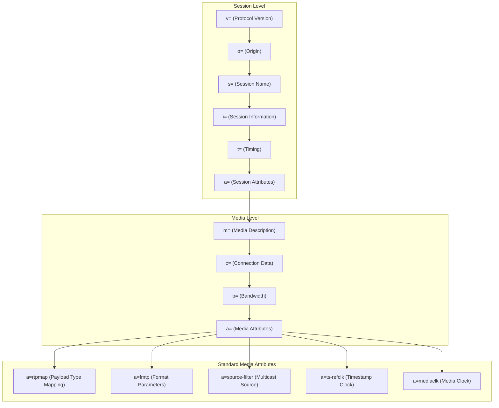
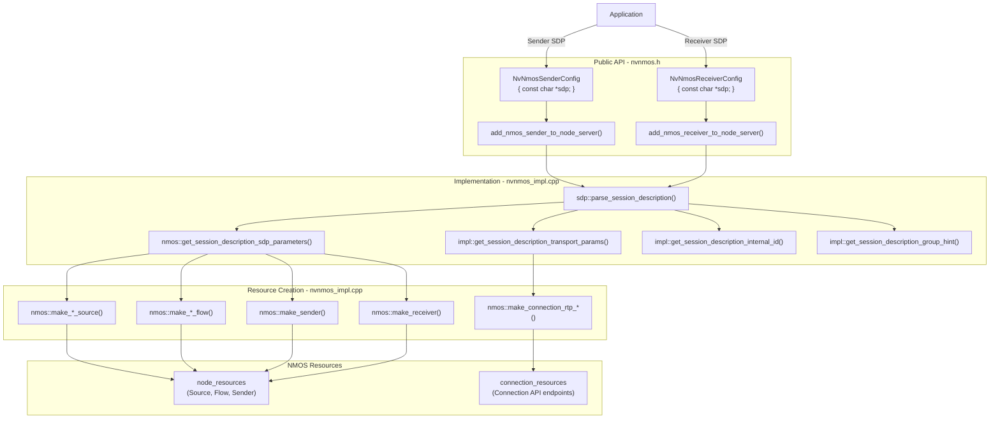
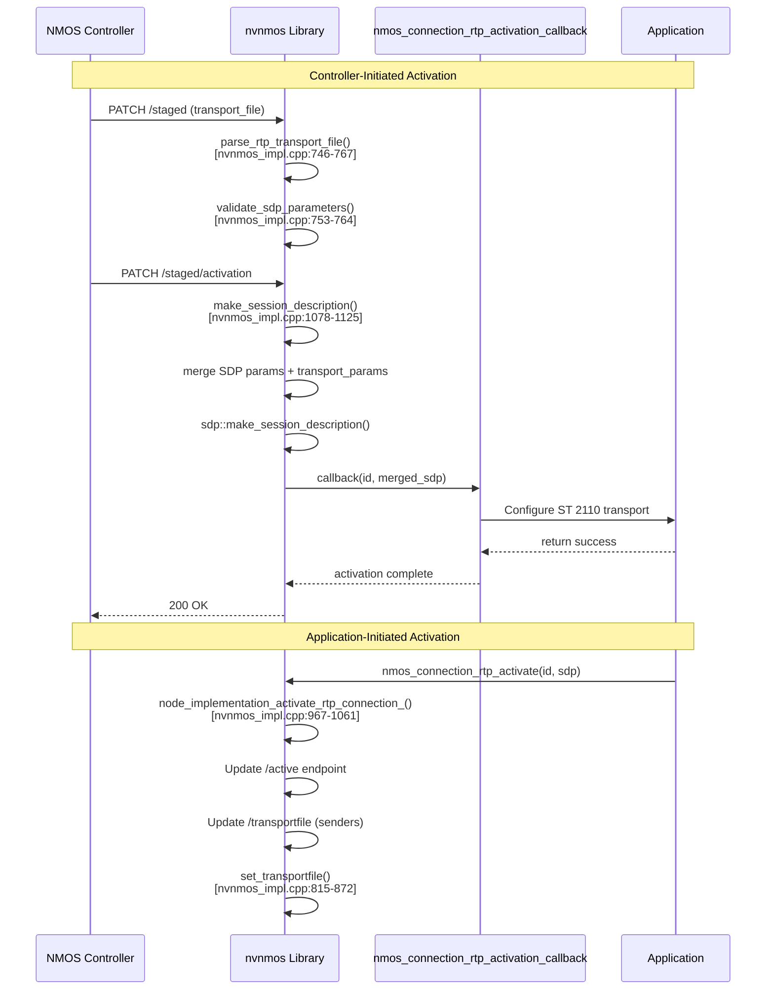
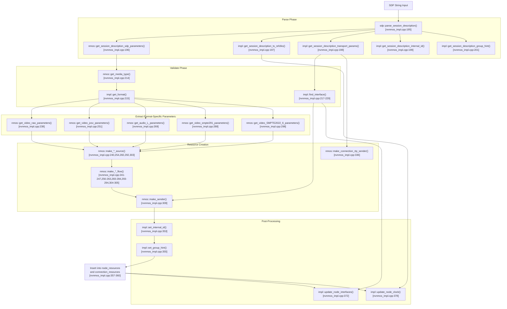

<!-- source: DeepWiki mcp.deepwiki.com · repo NVIDIA/nvnmos · page 3.2 Session Description Protocol (SDP) · fetched 2026-10-26 -->

# Session Description Protocol (SDP)

<details>
<summary>Relevant source files</summary>

The following files were used as context for generating this wiki page:

- [src/main.c](src/main.c)
- [src/nvnmos.h](src/nvnmos.h)
- [src/nvnmos_impl.cpp](src/nvnmos_impl.cpp)

</details>


## Purpose and Scope

This page describes how Session Description Protocol (SDP) is used in the nvnmos library to configure and manage NMOS senders and receivers. SDP serves as the primary configuration format for specifying media transport parameters, format details, and connection information for ST 2110 streams.

For information about the NMOS resource model (Node, Device, Sender, Receiver), see [NMOS Node Architecture](#3.1). For details about how SDP is used during connection activation workflows, see [Connection Activation](#3.3). For architectural details about the SDP processing implementation, see [SDP Processing Pipeline](#5.3).

---

## SDP in NMOS Context

In nvnmos, SDP serves two primary purposes:

1. **Initial Configuration**: SDP strings define the capabilities and default transport parameters when creating senders and receivers
2. **Runtime Activation**: SDP strings communicate updated transport parameters during IS-05 connection activation

The library uses standard IETF RFC 4566 SDP syntax, extended with SMPTE ST 2110 attributes and custom nvnmos-specific attributes.

| SDP Usage Context | Direction | Primary Functions |
|------------------|-----------|-------------------|
| Sender Configuration | Application → Library | `add_nmos_sender_to_node_server` |
| Receiver Configuration | Application → Library | `add_nmos_receiver_to_node_server` |
| Controller-Initiated Activation | Library → Application | `nmos_connection_rtp_activation_callback` |
| Application-Initiated Activation | Application → Library | `nmos_connection_rtp_activate` |

**Sources:** [src/nvnmos.h:260-293](), [src/nvnmos.h:439-469](), [src/nvnmos_impl.cpp:190-387]()

---

## SDP Structure and Standard Elements

### Required SDP Components

A valid SDP file for nvnmos must include standard SDP session-level and media-level components conforming to RFC 4566 and SMPTE ST 2110 specifications.



**Sources:** [src/nvnmos_impl.cpp:195-202](), [src/main.c:110-149]()

### Media Types and Formats

nvnmos supports the following SMPTE ST 2110 media types:

| Media Type | Format | Description | Example Encoding |
|------------|--------|-------------|------------------|
| `video/raw` | Uncompressed Video | ST 2110-20 | `raw/90000` |
| `video/jxsv` | JPEG XS Video | ST 2110-22 | `jxsv/90000` |
| `audio/L24` | 24-bit Linear Audio | ST 2110-30 | `L24/48000/2` |
| `audio/L16` | 16-bit Linear Audio | ST 2110-30 | `L16/48000/2` |
| `video/smpte291` | Ancillary Data | ST 2110-40 | `smpte291/90000` |
| `video/SMPTE2022-6` | SDI Multiplex | ST 2022-6 | `SMPTE2022-6/27000000` |

**Sources:** [src/nvnmos_impl.cpp:73-84](), [src/nvnmos_impl.cpp:1331-1340]()

---

## Custom nvnmos SDP Attributes

nvnmos extends standard SDP with custom attributes prefixed with `x-nvnmos-` to carry additional metadata required for NMOS resource management.

### Session-Level Custom Attributes

#### `a=x-nvnmos-id:<id>`

**Purpose:** Specifies the unique identifier for the sender or receiver being configured.

**Required:** Yes

**Example:** `a=x-nvnmos-id:source-0`

This ID is used to:
- Generate deterministic UUIDs for NMOS resources
- Associate the SDP with specific sender/receiver instances
- Reference the sender/receiver in API calls like `remove_nmos_sender_from_node_server`

**Sources:** [src/nvnmos.h:111-113](), [src/nvnmos.h:266-267](), [src/nvnmos_impl.cpp:199](), [src/nvnmos_impl.cpp:1237-1252]()

#### `a=x-nvnmos-group-hint:<tag>`

**Purpose:** Specifies an optional group hint tag for BCP-002-01 Natural Grouping.

**Required:** No

**Example:** `a=x-nvnmos-group-hint:rx-0:video`

Group hints enable logical grouping of related senders and receivers in NMOS controllers.

**Sources:** [src/nvnmos.h:268-269](), [src/nvnmos_impl.cpp:201](), [src/nvnmos_impl.cpp:1254-1269]()

### Media-Level Custom Attributes

#### `a=x-nvnmos-iface-ip:<address>`

**Purpose:** Specifies the interface IP address for receiving or transmitting the stream.

**Required:** Yes

**For Receivers:** The network interface IP address on which to receive the stream.

**For Senders:** The source IP address from which to transmit the stream.

**Example:** `a=x-nvnmos-iface-ip:192.0.2.0`

**Sources:** [src/nvnmos.h:114-116](), [src/nvnmos.h:270-271](), [src/nvnmos_impl.cpp:1113-1115](), [src/nvnmos_impl.cpp:1209-1213]()

#### `a=x-nvnmos-src-port:<port>`

**Purpose:** Specifies the source UDP port for senders.

**Required:** For senders only

**Example:** `a=x-nvnmos-src-port:5004`

This attribute is not applicable to receivers, as they bind to the destination port specified in the `m=` line.

**Sources:** [src/nvnmos.h:117-119](), [src/nvnmos_impl.cpp:1106-1110](), [src/nvnmos_impl.cpp:1215-1223]()

#### `a=inactive`

**Purpose:** Standard SDP attribute used to indicate disabled legs in redundant transport.

When present in a media description, it signals that `rtp_enabled` should be set to `false` for that leg in the IS-05 transport parameters.

**Example:** Used in ST 2022-7 seamless protection configurations to disable one leg.

**Sources:** [src/nvnmos.h:109-110](), [src/nvnmos_impl.cpp:1117-1121](), [src/nvnmos_impl.cpp:1225-1230]()

---

## SDP Data Flow Through nvnmos

### Configuration Flow



**Sources:** [src/nvnmos_impl.cpp:190-387](), [src/nvnmos_impl.cpp:389-564](), [src/nvnmos_impl.cpp:656-678]()

### Activation Flow



**Sources:** [src/nvnmos_impl.cpp:745-767](), [src/nvnmos_impl.cpp:875-965](), [src/nvnmos_impl.cpp:967-1061]()

---

## SDP Parsing and Processing Functions

### Core Parsing Functions

The library provides several layers of SDP parsing to extract different types of information:

| Function | Purpose | Returns | Location |
|----------|---------|---------|----------|
| `sdp::parse_session_description()` | Parse SDP string into JSON structure | `web::json::value` | nmos-cpp library |
| `nmos::get_session_description_sdp_parameters()` | Extract media format parameters | `nmos::sdp_parameters` | nmos-cpp library |
| `impl::get_session_description_transport_params()` | Extract transport parameters including custom attributes | `web::json::value` | [nvnmos_impl.cpp:1182-1235]() |
| `impl::get_session_description_internal_id()` | Extract `x-nvnmos-id` attribute | `utility::string_t` | [nvnmos_impl.cpp:1238-1252]() |
| `impl::get_session_description_group_hint()` | Extract `x-nvnmos-group-hint` attribute | `utility::string_t` | [nvnmos_impl.cpp:1255-1269]() |
| `impl::get_session_description_ts_refclks()` | Extract all `ts-refclk` attributes (multi-leg) | `vector<vector<ts_refclk_t>>` | [nvnmos_impl.cpp:1160-1178]() |

**Sources:** [src/nvnmos_impl.cpp:89-117](), [src/nvnmos_impl.cpp:1160-1235]()

### SDP Generation Functions

When activating connections, the library generates SDP by merging configuration with active transport parameters:

| Function | Purpose | Location |
|----------|---------|----------|
| `impl::make_session_description()` | Create SDP with custom nvnmos attributes | [nvnmos_impl.cpp:1078-1125]() |
| `nmos::make_session_description()` | Create standard NMOS SDP (no custom attributes) | nmos-cpp library |
| `sdp::make_session_description()` | Convert JSON SDP structure to string | nmos-cpp library |

**Sources:** [src/nvnmos_impl.cpp:1076-1125](), [src/nvnmos_impl.cpp:815-872]()

---

## SDP Examples

### Video Sender (ST 2110-20 Uncompressed)

```sdp
v=0
o=- 1234567890 1234567890 IN IP4 192.0.2.0
s=NvNmos Video Sender
i=YCbCr-4:2:2, 10 bit, 1920 x 1080, progressive, 50 Hz
t=0 0
a=x-nvnmos-id:sink-0
a=x-nvnmos-group-hint:tx-0:video
m=video 5020 RTP/AVP 96
c=IN IP4 233.252.0.0/64
a=source-filter: incl IN IP4 233.252.0.0 192.0.2.0
a=x-nvnmos-iface-ip:192.0.2.0
a=x-nvnmos-src-port:5004
a=rtpmap:96 raw/90000
a=fmtp:96 sampling=YCbCr-4:2:2; width=1920; height=1080; exactframerate=50; depth=10; TCS=SDR; colorimetry=BT709; PM=2110GPM; SSN=ST2110-20:2017; TP=2110TPN; 
a=ts-refclk:ptp=IEEE1588-2008:AC-DE-48-23-45-67-01-9F:42
a=ts-refclk:ptp=IEEE1588-2008:traceable
a=mediaclk:direct=0
```

**Key Elements:**
- Session name (`s=`) becomes the sender label in NMOS
- Session info (`i=`) becomes the sender description
- Custom `x-nvnmos-id` maps to sender identifier
- Custom `x-nvnmos-group-hint` enables BCP-002-01 grouping
- Custom `x-nvnmos-iface-ip` specifies source interface
- Custom `x-nvnmos-src-port` specifies source port
- Dual `ts-refclk` attributes specify both GMID and traceability

**Sources:** [src/main.c:90-152]()

### Audio Receiver (ST 2110-30)

```sdp
v=0
o=- 1234567890 1234567890 IN IP4 192.0.2.1
s=NvNmos Audio Receiver
i=2 ch, 48 kHz, 24 bit
t=0 0
a=x-nvnmos-id:source-1
a=x-nvnmos-group-hint:rx-0:audio
m=audio 5030 RTP/AVP 97
c=IN IP4 233.252.0.1/64
a=source-filter: incl IN IP4 233.252.0.1 192.0.2.1
a=x-nvnmos-iface-ip:192.0.2.1
a=rtpmap:97 L24/48000/2
a=fmtp:97 channel-order=SMPTE2110.(ST); 
a=mediaclk:direct=0
```

**Key Elements:**
- No `ts-refclk` attributes (not required for receivers)
- No `x-nvnmos-src-port` (not applicable to receivers)
- Custom `x-nvnmos-iface-ip` specifies receive interface
- Source filter uses any-source format (could be omitted for any-source multicast)

**Sources:** [src/main.c:154-216]()

### JPEG XS Sender (ST 2110-22)

```sdp
v=0
o=- 1234567890 1234567890 IN IP4 192.0.2.0
s=NvNmos JPEG XS Sender
i=JPEG XS, YCbCr-4:2:2, 10 bit, 1280 x 720, progressive, 59.94 Hz
t=0 0
a=x-nvnmos-id:jxs-sender-0
m=video 5020 RTP/AVP 96
c=IN IP4 233.252.0.0/64
b=AS:116000
a=source-filter: incl IN IP4 233.252.0.0 192.0.2.0
a=x-nvnmos-iface-ip:192.0.2.0
a=x-nvnmos-src-port:5004
a=rtpmap:96 jxsv/90000
a=fmtp:96 packetmode=0; profile=High444.12; level=1k-1; sublevel=Sublev3bpp; sampling=YCbCr-4:2:2; width=1280; height=720; exactframerate=60000/1001; depth=10; colorimetry=BT709; TCS=SDR; RANGE=FULL; SSN=ST2110-22:2019; TP=2110TPN
a=ts-refclk:ptp=IEEE1588-2008:AC-DE-48-23-45-67-01-9F:42
a=ts-refclk:ptp=IEEE1588-2008:traceable
a=mediaclk:direct=0
```

**Key Elements:**
- Bandwidth (`b=AS:`) specifies transport bit rate in kb/s
- `fmtp` parameters include JPEG XS specific attributes (profile, level, sublevel)
- BCP-006-01 compliance requires additional sender metadata extracted from SDP

**Sources:** [src/main.c:25-38](), [src/nvnmos_impl.cpp:249-264](), [src/nvnmos_impl.cpp:314-333]()

---

## SDP Processing Pipeline Details

### Sender Creation Pipeline



**Sources:** [src/nvnmos_impl.cpp:190-387]()

### Activation SDP Merging

During connection activation, the library merges stored SDP configuration with active transport parameters:

1. **Retrieve Stored SDP**: Get original SDP from settings [nvnmos_impl.cpp:822-830]()
2. **Parse Stored SDP**: Extract `sdp_parameters` [nvnmos_impl.cpp:831-833]()
3. **Remove Custom Attributes**: Strip `x-nvnmos-*` attributes from format parameters [nvnmos_impl.cpp:836-839]()
4. **Update Clock References**: For senders, update `ts-refclk` based on current node clock [nvnmos_impl.cpp:842-858]()
5. **Update Session Version**: Set new version timestamp [nvnmos_impl.cpp:861]()
6. **Get Active Transport Params**: From IS-05 `/active` endpoint [nvnmos_impl.cpp:863]()
7. **Merge into SDP**: Combine format and transport parameters [nvnmos_impl.cpp:867]()
8. **Generate String**: Convert to SDP text format [nvnmos_impl.cpp:868]()

For activation callbacks, additional merging occurs to handle multi-leg configurations:

1. **Check Transport File**: Use staged transport file if present, otherwise use original SDP [nvnmos_impl.cpp:902-911]()
2. **Handle Multi-Leg**: Duplicate single-leg SDP to multi-leg if needed [nvnmos_impl.cpp:920-944]()
3. **Update Session Version**: Timestamp the merged SDP [nvnmos_impl.cpp:947-948]()
4. **Add Custom Attributes**: Re-add `x-nvnmos-*` attributes [nvnmos_impl.cpp:952]()
5. **Invoke Callback**: Pass merged SDP to application [nvnmos_impl.cpp:955]()

**Sources:** [src/nvnmos_impl.cpp:815-872](), [src/nvnmos_impl.cpp:875-965]()

---

## Custom Bit Rate Attributes

For JPEG XS (BCP-006-01), nvnmos supports custom format parameters to specify bit rates:

### `x-nvnmos-format-bit-rate`

Format bit rate in bits per second (before transport overhead).

**Example:** `a=fmtp:96 x-nvnmos-format-bit-rate=110000000; ...`

### `x-nvnmos-transport-bit-rate`

Transport bit rate in bits per second (including IP/UDP/RTP overhead).

**Example:** `a=fmtp:96 x-nvnmos-transport-bit-rate=116000000; ...`

These attributes are extracted during parsing and removed before generating `/transportfile` endpoints:

| Function | Purpose | Location |
|----------|---------|----------|
| `impl::get_format_bit_rate()` | Extract or calculate format bit rate | [nvnmos_impl.cpp:1303-1313]() |
| `impl::get_transport_bit_rate()` | Extract or calculate transport bit rate | [nvnmos_impl.cpp:1316-1328]() |

The library uses an approximate 5% overhead factor (`transport_bit_rate_factor = 1.05`) to estimate transport bit rate from format bit rate when custom attributes are not present.

**Sources:** [src/nvnmos_impl.cpp:1299-1328](), [src/nvnmos_impl.cpp:252](), [src/nvnmos_impl.cpp:318-323](), [src/nvnmos_impl.cpp:836-839]()

---

## Multi-Leg SDP Handling

For ST 2022-7 redundant transport, SDP can describe multiple media descriptions (legs):

### Redundant Transport Structure

```sdp
v=0
o=- 1234567890 1234567890 IN IP4 192.0.2.0
s=Redundant Video Sender
t=0 0
a=group:DUP 0 1
a=x-nvnmos-id:redundant-sender
m=video 5020 RTP/AVP 96
c=IN IP4 233.252.0.0/64
a=mid:0
a=source-filter: incl IN IP4 233.252.0.0 192.0.2.0
a=x-nvnmos-iface-ip:192.0.2.0
a=rtpmap:96 raw/90000
a=fmtp:96 sampling=YCbCr-4:2:2; width=1920; height=1080; ...
a=ts-refclk:ptp=IEEE1588-2008:traceable
a=mediaclk:direct=0
m=video 5020 RTP/AVP 96
c=IN IP4 233.252.1.0/64
a=mid:1
a=source-filter: incl IN IP4 233.252.1.0 192.0.2.1
a=x-nvnmos-iface-ip:192.0.2.1
a=rtpmap:96 raw/90000
a=fmtp:96 sampling=YCbCr-4:2:2; width=1920; height=1080; ...
a=ts-refclk:ptp=IEEE1588-2008:traceable
a=mediaclk:direct=0
```

### Leg-Specific Processing

Each media description is processed independently for:
- Interface bindings (`a=x-nvnmos-iface-ip`)
- Source ports (`a=x-nvnmos-src-port`)
- RTP enable/disable (`a=inactive`)
- Clock references (`a=ts-refclk`)

The library handles single-to-multi-leg expansion when a Controller applies a single-leg SDP to a redundant receiver by duplicating parameters appropriately.

**Sources:** [src/nvnmos_impl.cpp:920-944](), [src/nvnmos_impl.cpp:1097-1122]()

---

## SDP Validation

The library validates SDP during transport file parsing for receivers:

### Validation Process

1. **Parse Transport File**: Extract SDP from IS-05 PATCH request [nvnmos_impl.cpp:751-752]()
2. **Get Media Type**: Determine format from RTP payload [nvnmos_impl.cpp:756]()
3. **Format-Specific Validation**: Call appropriate validator:
   - `nmos::validate_video_jxsv_sdp_parameters()` for JPEG XS
   - `nmos::validate_sdp_parameters()` for core media types
4. **Check Constraints**: Verify against receiver capabilities and constraints
5. **Return Parsed Parameters**: Or throw exception if invalid

**Sources:** [src/nvnmos_impl.cpp:746-767]()

---

## Relationship Between SDP and NMOS Resources

```mermaid
graph TB
    SDP["SDP File"]
    
    subgraph "Session-Level SDP Elements"
        S_NAME["s= (Session Name)"]
        S_INFO["i= (Session Info)"]
        X_ID["a=x-nvnmos-id"]
        X_GROUP["a=x-nvnmos-group-hint"]
        TS_REFCLK_S["a=ts-refclk (session-level)"]
    end
    
    subgraph "Media-Level SDP Elements"
        RTPMAP["a=rtpmap (media type)"]
        FMTP["a=fmtp (format params)"]
        TS_REFCLK_M["a=ts-refclk (media-level)"]
        X_IFACE["a=x-nvnmos-iface-ip"]
        X_PORT["a=x-nvnmos-src-port"]
        INACTIVE["a=inactive"]
    end
    
    subgraph "NMOS Node Resources"
        SOURCE["Source<br/>nmos::make_*_source()"]
        FLOW["Flow<br/>nmos::make_*_flow()"]
        SENDER["Sender/Receiver<br/>nmos::make_sender/receiver()"]
    end
    
    subgraph "NMOS Connection Resources"
        CONN["Connection API Resource<br/>nmos::make_connection_rtp_*()"]
        TRANSPORT_PARAMS["transport_params[]"]
        CONSTRAINTS["endpoint_constraints"]
    end
    
    subgraph "Resource Metadata"
        LABEL["label"]
        DESC["description"]
        ID["id (UUID)"]
        TAGS["tags"]
        IFACE_BINDINGS["interface_bindings[]"]
    end
    
    subgraph "Node Metadata"
        NODE_CLOCK["Node Clock<br/>impl::make_node_clock()"]
        NODE_IFACES["Node Interfaces<br/>impl::update_node_interfaces()"]
    end
    
    SDP --> S_NAME
    SDP --> S_INFO
    SDP --> X_ID
    SDP --> X_GROUP
    SDP --> RTPMAP
    SDP --> FMTP
    SDP --> TS_REFCLK_S
    SDP --> TS_REFCLK_M
    SDP --> X_IFACE
    SDP --> X_PORT
    SDP --> INACTIVE
    
    S_NAME --> LABEL
    S_INFO --> DESC
    X_ID --> ID
    X_GROUP --> TAGS
    
    LABEL --> SENDER
    DESC --> SENDER
    ID --> SOURCE
    ID --> FLOW
    ID --> SENDER
    TAGS --> SENDER
    
    RTPMAP --> SOURCE
    RTPMAP --> FLOW
    FMTP --> SOURCE
    FMTP --> FLOW
    
    TS_REFCLK_S --> NODE_CLOCK
    TS_REFCLK_M --> NODE_CLOCK
    
    X_IFACE --> IFACE_BINDINGS
    X_IFACE --> TRANSPORT_PARAMS
    X_IFACE --> CONSTRAINTS
    X_IFACE --> NODE_IFACES
    
    X_PORT --> TRANSPORT_PARAMS
    X_PORT --> CONSTRAINTS
    
    INACTIVE --> TRANSPORT_PARAMS
    
    IFACE_BINDINGS --> SENDER
    TRANSPORT_PARAMS --> CONN
    CONSTRAINTS --> CONN
```



**Sources:** [src/nvnmos_impl.cpp:190-387](), [src/nvnmos_impl.cpp:1384-1418](), [src/nvnmos_impl.cpp:1432-1484]()

---

## Common SDP Patterns

### Pattern: PTP Clock Reference

Senders must specify both GMID and traceability using dual `ts-refclk` attributes:

```sdp
a=ts-refclk:ptp=IEEE1588-2008:AC-DE-48-23-45-67-01-9F:42
a=ts-refclk:ptp=IEEE1588-2008:traceable
```

The library parses both to extract complete PTP information and updates the node clock accordingly.

**Sources:** [src/nvnmos_impl.cpp:1432-1484](), [src/main.c:103-106](), [src/main.c:167-170]()

### Pattern: Local MAC Clock Reference

For non-PTP synchronized systems:

```sdp
a=ts-refclk:localmac=CA-FE-01-CA-FE-02
```

The library creates an internal clock reference in the NMOS node.

**Sources:** [src/nvnmos_impl.cpp:1463-1468]()

### Pattern: Interface Specification

Both senders and receivers must specify the network interface:

```sdp
a=x-nvnmos-iface-ip:192.0.2.0
```

This is mapped to:
- `source_ip` for senders in transport parameters
- `interface_ip` for receivers in transport parameters
- `interface_bindings` array in sender/receiver resources

**Sources:** [src/nvnmos_impl.cpp:1113-1115](), [src/nvnmos_impl.cpp:1209-1213](), [src/nvnmos_impl.cpp:217-229]()

---

## Summary

SDP in nvnmos serves as the bridge between ST 2110 media transport configuration and NMOS resource representation. The library:

1. **Accepts** SDP strings with standard and custom attributes for sender/receiver configuration
2. **Parses** SDP to extract media format, transport parameters, and metadata
3. **Generates** NMOS resources (Source, Flow, Sender/Receiver, Connection API endpoints)
4. **Merges** SDP with runtime transport parameters during activation
5. **Validates** SDP against receiver capabilities and constraints
6. **Returns** merged SDP to applications for actual media transport configuration

The custom `x-nvnmos-*` attributes extend standard SDP to carry NMOS-specific metadata like resource identifiers, group hints, interface bindings, and source ports that are not part of standard SMPTE ST 2110 SDP specifications.

**Sources:** [src/nvnmos.h:53](), [src/nvnmos_impl.cpp:26-62](), [src/main.c:1-328]()

---

