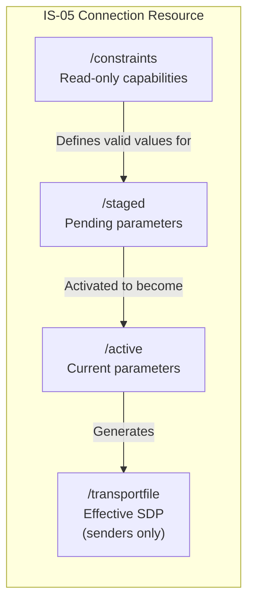
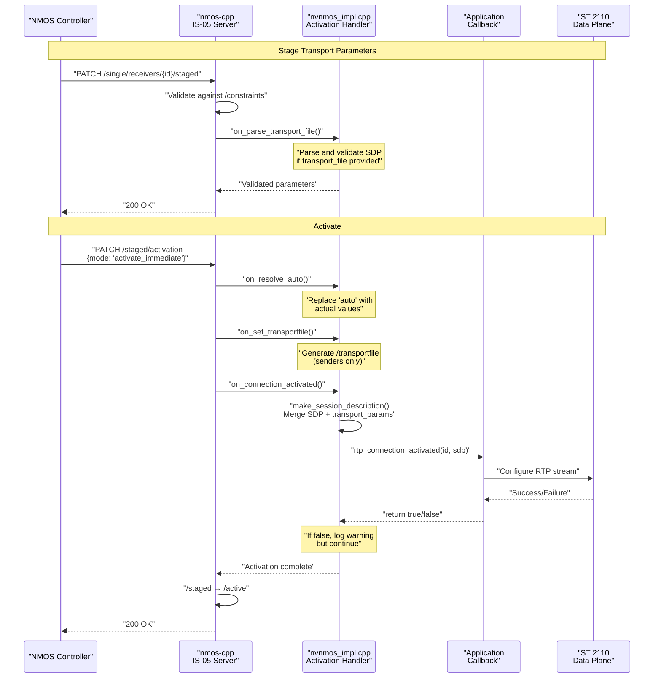
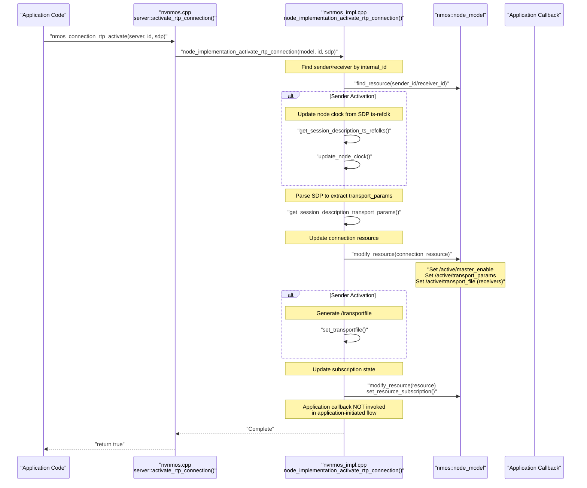
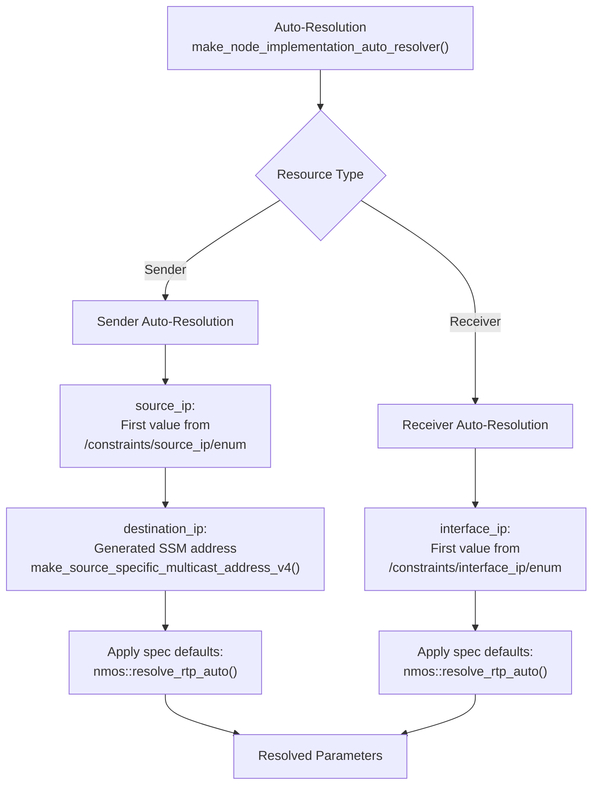
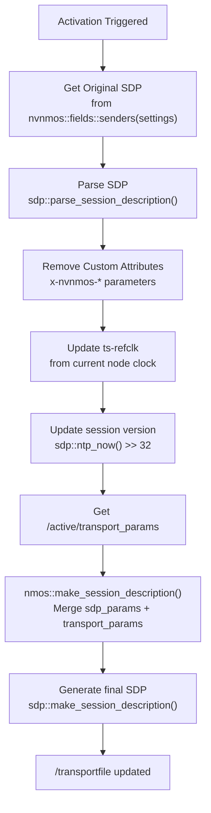
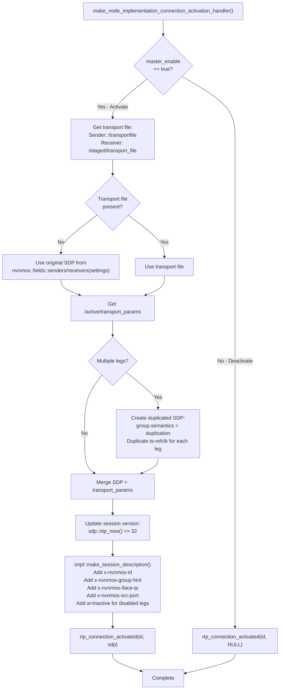
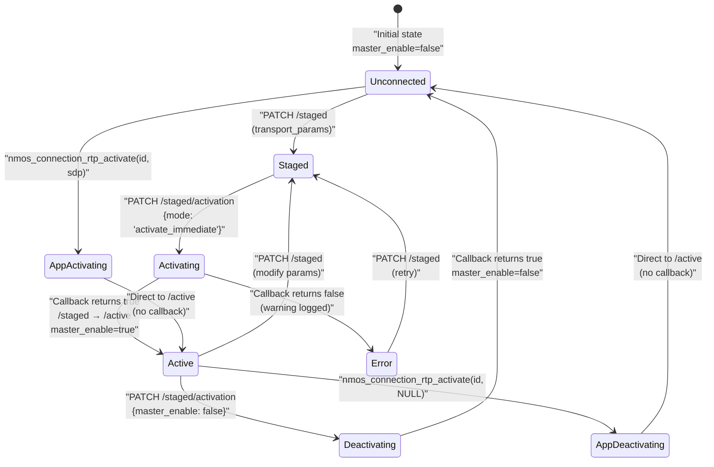

<!-- source: DeepWiki mcp.deepwiki.com · repo NVIDIA/nvnmos · page 3.3 Connection Activation · fetched 2026-10-26 -->

# Connection Activation

<details>
<summary>Relevant source files</summary>

The following files were used as context for generating this wiki page:

- [src/nvnmos.cpp](src/nvnmos.cpp)
- [src/nvnmos.h](src/nvnmos.h)
- [src/nvnmos_impl.cpp](src/nvnmos_impl.cpp)

</details>


## Purpose and Scope

This document describes the IS-05 Connection API activation flow in nvnmos and how applications respond to and initiate connection activation requests. Connection activation is the process by which transport parameters are applied to senders and receivers, either in response to requests from an NMOS Controller or initiated directly by the application.

For information about the NMOS resource model and how senders/receivers are structured, see [NMOS Node Architecture](#3.1). For details about SDP format and custom attributes used in activation, see [Session Description Protocol (SDP)](#3.2). For API reference on callback functions, see [Callbacks and Event Handling](#4.4).

## Overview

Connection activation in nvnmos supports bidirectional control:

| Direction | Initiator | Flow |
|-----------|-----------|------|
| **Controller-initiated** | NMOS Controller | Controller → IS-05 API → nmos-cpp → nvnmos → Application Callback |
| **Application-initiated** | Media Application | Application → `nmos_connection_rtp_activate()` → nvnmos → Application Callback |

Both flows result in the application's `nmos_connection_rtp_activation_callback` being invoked with the effective transport parameters encoded as SDP, allowing the application to configure its ST 2110 data plane (e.g., Rivermax, DeepStream).

**Sources:** [src/nvnmos.h:98-125](), [src/nvnmos_impl.cpp:875-965]()

## IS-05 Connection API Endpoints

The IS-05 Connection Management API exposes three key endpoints per sender or receiver:



**Endpoint Structure:**

| Endpoint | Purpose | Modifiable |
|----------|---------|------------|
| `/constraints` | Defines valid transport parameter ranges and enum values | No |
| `/staged` | Holds pending transport parameters before activation | Yes (PATCH) |
| `/active` | Holds currently active transport parameters | No (set by activation) |
| `/transportfile` | Effective SDP after auto-resolution (senders only) | No (generated) |

**Sources:** [src/nvnmos_impl.cpp:336-347](), [src/nvnmos_impl.cpp:523-531]()

## Controller-Initiated Activation Flow



**Key Functions:**

1. **Transport File Parsing** - [src/nvnmos_impl.cpp:746-767]()
   - `make_node_implementation_transport_file_parser()` creates parser
   - Validates SDP against receiver capabilities
   - Supports both core media types and `video/jxsv` (JPEG XS)

2. **Auto-Resolution** - [src/nvnmos_impl.cpp:778-812]()
   - `make_node_implementation_auto_resolver()` resolves "auto" values
   - For senders: `source_ip` from constraints, `destination_ip` generated from sender ID
   - For receivers: `interface_ip` from constraints

3. **Activation Handler** - [src/nvnmos_impl.cpp:875-965]()
   - `make_node_implementation_connection_activation_handler()` is the main callback
   - Merges transport file + transport params into effective SDP
   - Invokes application callback with merged SDP

**Sources:** [src/nvnmos_impl.cpp:746-965]()

## Application-Initiated Activation Flow

Applications can directly activate or deactivate connections using `nmos_connection_rtp_activate()`:



**Function Hierarchy:**

- [src/nvnmos.h:466-469]() - Public API `nmos_connection_rtp_activate()`
- [src/nvnmos.cpp:590-611]() - C API wrapper
- [src/nvnmos.cpp:461-472]() - `nvnmos::server::activate_rtp_connection()`
- [src/nvnmos_impl.cpp:1065-1072]() - `node_implementation_activate_rtp_connection()` (model lock)
- [src/nvnmos_impl.cpp:967-1061]() - `node_implementation_activate_rtp_connection_()` (implementation)

**Important Note:** When using application-initiated activation, the `rtp_connection_activated` callback is **not** invoked. The application already has the SDP it's activating, so the callback would be redundant. The callback is only invoked for controller-initiated activations.

**Sources:** [src/nvnmos.h:466-469](), [src/nvnmos.cpp:590-611](), [src/nvnmos_impl.cpp:967-1072]()

## Auto-Resolution Mechanism

The IS-05 specification allows transport parameters to use the special value `"auto"` to defer parameter selection to the node. nvnmos implements auto-resolution with the following rules:

**Auto-Resolution Logic:**



**Source-Specific Multicast Address Generation:**

For senders, the `destination_ip` is generated deterministically from the sender ID:

| Step | Implementation | Location |
|------|----------------|----------|
| Hash sender ID + leg number | `std::hash<utility::string_t>{}(id + '/' + leg)` | [src/nvnmos_impl.cpp:1371-1381]() |
| Convert to IPv4 address | `boost::asio::ip::address_v4(hash_value)` | [src/nvnmos_impl.cpp:1376]() |
| Force into SSM range | `a[0] = 232; a[2] |= 1;` | [src/nvnmos_impl.cpp:1379-1380]() |
| Result | Address in 232.0.1.0 - 232.255.255.255 | RFC 4607 |

**Constraints Setup:**

Constraints are populated during sender/receiver creation:

- **Senders:** [src/nvnmos_impl.cpp:336-344]() - `source_ip` constrained to interface address from SDP
- **Receivers:** [src/nvnmos_impl.cpp:523-531]() - `interface_ip` constrained to interface address from SDP

**Sources:** [src/nvnmos_impl.cpp:778-812](), [src/nvnmos_impl.cpp:1371-1382]()

## Transport File Handling

### For Receivers

When a Controller sends a transport file (SDP) to a receiver's `/staged` endpoint:

1. **Validation** - [src/nvnmos_impl.cpp:752-766]()
   - Parse SDP using `sdp::parse_session_description()`
   - Extract `nmos::sdp_parameters`
   - Validate against receiver capabilities using `nmos::validate_sdp_parameters()` or `nmos::validate_video_jxsv_sdp_parameters()`

2. **Storage** - Stored in `/staged/transport_file`

3. **Activation** - [src/nvnmos_impl.cpp:902-944]()
   - If transport file is present, use it as base SDP
   - If no transport file, use original SDP from receiver configuration
   - Merge with `/active/transport_params` to create effective SDP

### For Senders

Senders generate their `/transportfile` endpoint dynamically during activation:



**Implementation:** [src/nvnmos_impl.cpp:815-872]() - `make_node_implementation_transportfile_setter()`

**Key Points:**
- Custom `x-nvnmos-*` attributes removed before generating `/transportfile` [src/nvnmos_impl.cpp:836-839]()
- `ts-refclk` updated from current node clock state [src/nvnmos_impl.cpp:842-858]()
- Session version updated to avoid SDP collisions [src/nvnmos_impl.cpp:861]()

**Sources:** [src/nvnmos_impl.cpp:746-767](), [src/nvnmos_impl.cpp:815-872](), [src/nvnmos_impl.cpp:902-944]()

## Activation Callback Mechanism

The application callback is invoked with merged SDP that contains all necessary information for configuring the data plane:

### Callback Signature

```c
typedef bool (* nmos_connection_rtp_activation_callback)(
    NvNmosNodeServer *server,
    const char *id,           // Internal ID from x-nvnmos-id
    const char *sdp);         // Merged SDP or NULL for deactivation
```

**Parameters:**

| Parameter | Description | NULL Meaning |
|-----------|-------------|--------------|
| `server` | Pointer to the server instance | - |
| `id` | Internal ID (from `x-nvnmos-id` SDP attribute) | - |
| `sdp` | Complete SDP with transport parameters | Deactivation request |

**Sources:** [src/nvnmos.h:98-125]()

### Callback Invocation

The callback is wrapped and invoked from the connection activation handler:



**Callback Wrapper:** [src/nvnmos.cpp:131-142]()

```cpp
auto rtp_connection_activated = [activated, server, &gate_](
    const std::string& id, const std::string& sdp)
{
    if (!activated) return;
    const bool success = activated(server, id.c_str(), 
                                   !sdp.empty() ? sdp.c_str() : 0);
    if (!success)
    {
        slog::log<slog::severities::warning>(gate_, SLOG_FLF) 
            << "Activation failed for internal id: " << id;
    }
};
```

**Sources:** [src/nvnmos_impl.cpp:875-965](), [src/nvnmos.cpp:131-142]()

### SDP Content for Application

The SDP passed to the callback contains:

**Standard SDP Elements:**
- Media format parameters (video/audio/data characteristics)
- Transport parameters (IP addresses, ports, multicast settings)
- Timing information (`ts-refclk` attributes)

**Custom nvnmos Attributes:**
- `a=x-nvnmos-id:<internal_id>` - Session-level, identifies the sender/receiver
- `a=x-nvnmos-group-hint:<tag>` - Session-level (optional), grouping hint
- `a=x-nvnmos-iface-ip:<address>` - Media-level, interface IP for data plane binding
- `a=x-nvnmos-src-port:<port>` - Media-level (senders only), source port
- `a=inactive` - Media-level, indicates disabled leg (when `rtp_enabled=false`)

**SDP Generation:** [src/nvnmos_impl.cpp:1076-1125]() - `impl::make_session_description()`

**Sources:** [src/nvnmos_impl.cpp:1076-1125](), [src/nvnmos.h:111-119]()

## Multi-Leg Handling

For redundant streams (ST 2022-7), senders and receivers may have multiple legs:

### Leg Detection

Transport parameters are arrays, one element per leg:

```json
{
  "transport_params": [
    { "interface_ip": "192.0.2.1", "rtp_enabled": true },    // Leg 0
    { "interface_ip": "192.0.2.2", "rtp_enabled": true }     // Leg 1
  ]
}
```

### Single-Leg SDP on Multi-Leg Receiver

A common scenario: Controller applies single-leg SDP to a two-leg receiver:

**Handling Logic:** [src/nvnmos_impl.cpp:920-944]()

1. If `transport_params.size() > 1` but SDP has single media description
2. Duplicate SDP parameters for each leg:
   - Set `group.semantics = "DUP"` (duplication)
   - Create media stream IDs: "0", "1", etc.
   - Duplicate `ts-refclk` if present
3. Allow per-leg `rtp_enabled` control via transport params

**Example:**
- Controller sends single-leg SDP to 2-leg receiver
- Sets leg 0 `rtp_enabled=false`, leg 1 `rtp_enabled=true`
- Result: Receiver uses secondary interface

**Sources:** [src/nvnmos_impl.cpp:920-944]()

## Activation State Transitions



**State Storage:**
- `/staged` - Pending parameters, modified by PATCH requests
- `/active` - Current active parameters
- `master_enable` - Boolean indicating connected state
- `activation` - Activation timing/mode information

**Sources:** [src/nvnmos_impl.cpp:1015-1055]()

## Deactivation

Deactivation clears the connection:

**Controller-Initiated:** PATCH `/staged/activation` with `master_enable=false`
- Callback invoked with `sdp=NULL`
- Application should tear down data plane stream

**Application-Initiated:** `nmos_connection_rtp_activate(server, id, "")`
- Empty string or NULL for `sdp` parameter
- Updates `/active/master_enable=false`
- No callback invoked

**Implementation:** [src/nvnmos_impl.cpp:957-962]() - Deactivation branch

**Sources:** [src/nvnmos_impl.cpp:957-962](), [src/nvnmos.cpp:590-611]()

## Error Handling

### Callback Return Value

The application callback returns `bool` to indicate success:

- **`true`**: Activation applied successfully to data plane
- **`false`**: Activation failed (warning logged, but IS-05 activation still completes)

**Important:** Even if the callback returns `false`, the IS-05 activation proceeds. This is because:
1. The NMOS Controller expects a response
2. The application might recover later
3. The parameters are still valid from NMOS perspective

**Callback Return Handling:** [src/nvnmos.cpp:133-140]()

```cpp
const bool success = activated(server, id.c_str(), 
                               !sdp.empty() ? sdp.c_str() : 0);
if (!success)
{
    slog::log<slog::severities::warning>(gate_, SLOG_FLF) 
        << "Activation failed for internal id: " << id;
}
// Note: Activation still completes
```

### Exception Handling

The public API functions catch all exceptions and return `false`:

```cpp
NVNMOS_API bool nmos_connection_rtp_activate(
    NvNmosNodeServer *server, const char *id, const char *sdp)
{
    try {
        impl->activate_rtp_connection(id, sdp);
        return true;
    } catch (...) {
        return false;
    }
}
```

**Sources:** [src/nvnmos.cpp:133-140](), [src/nvnmos.cpp:590-611]()

## Thread Safety

Connection activation is thread-safe through model locking:

**Write Lock Acquisition:** [src/nvnmos_impl.cpp:1067]()

```cpp
void node_implementation_activate_rtp_connection(
    nmos::node_model& model, 
    const utility::string_t& internal_id, 
    const std::string& sdp, 
    slog::base_gate& gate)
{
    auto lock = model.write_lock(); // Acquire write lock
    
    node_implementation_activate_rtp_connection_(
        model.node_resources, model.connection_resources, 
        internal_id, sdp, model.settings, gate);
    
    model.notify(); // Notify observers
}
```

**Lock Types:**
- **Write Lock:** Required for modifying resources
- **Read Lock:** Used for reading resource state (not shown in activation flow)
- **Model Notification:** Triggers observers after changes

**Sources:** [src/nvnmos_impl.cpp:1065-1072]()

## Code Entity Reference

### Key Functions

| Function | File | Purpose |
|----------|------|---------|
| `nmos_connection_rtp_activate()` | [src/nvnmos.h:466-469]() | Public API for application-initiated activation |
| `make_node_implementation_connection_activation_handler()` | [src/nvnmos_impl.cpp:875-965]() | Creates callback for controller-initiated activation |
| `make_node_implementation_auto_resolver()` | [src/nvnmos_impl.cpp:778-812]() | Creates auto-resolution callback |
| `make_node_implementation_transportfile_setter()` | [src/nvnmos_impl.cpp:815-872]() | Creates sender transportfile generator |
| `make_node_implementation_transport_file_parser()` | [src/nvnmos_impl.cpp:746-767]() | Creates SDP validator for receivers |
| `node_implementation_activate_rtp_connection()` | [src/nvnmos_impl.cpp:1065-1072]() | Application activation with locking |
| `node_implementation_activate_rtp_connection_()` | [src/nvnmos_impl.cpp:967-1061]() | Application activation implementation |
| `impl::make_session_description()` | [src/nvnmos_impl.cpp:1076-1125]() | Generates merged SDP with custom attributes |
| `impl::get_session_description_transport_params()` | [src/nvnmos_impl.cpp:1182-1235]() | Parses transport params from SDP |

### Key Data Structures

| Structure | File | Purpose |
|-----------|------|---------|
| `nmos_connection_rtp_activation_callback` | [src/nvnmos.h:122-125]() | Callback type for activation events |
| `nmos::resource` | nmos-cpp | Node resource (sender/receiver) |
| `nmos::sdp_parameters` | nmos-cpp | Parsed SDP media parameters |
| `transport_params` | IS-05 spec | Array of per-leg transport parameters |
| `endpoint_active` | IS-05 spec | Active connection state |
| `endpoint_staged` | IS-05 spec | Staged connection state |

**Sources:** [src/nvnmos.h](), [src/nvnmos_impl.cpp]()

---

