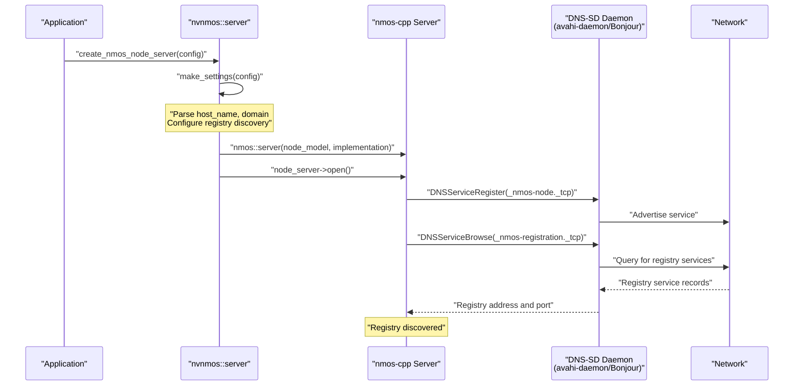
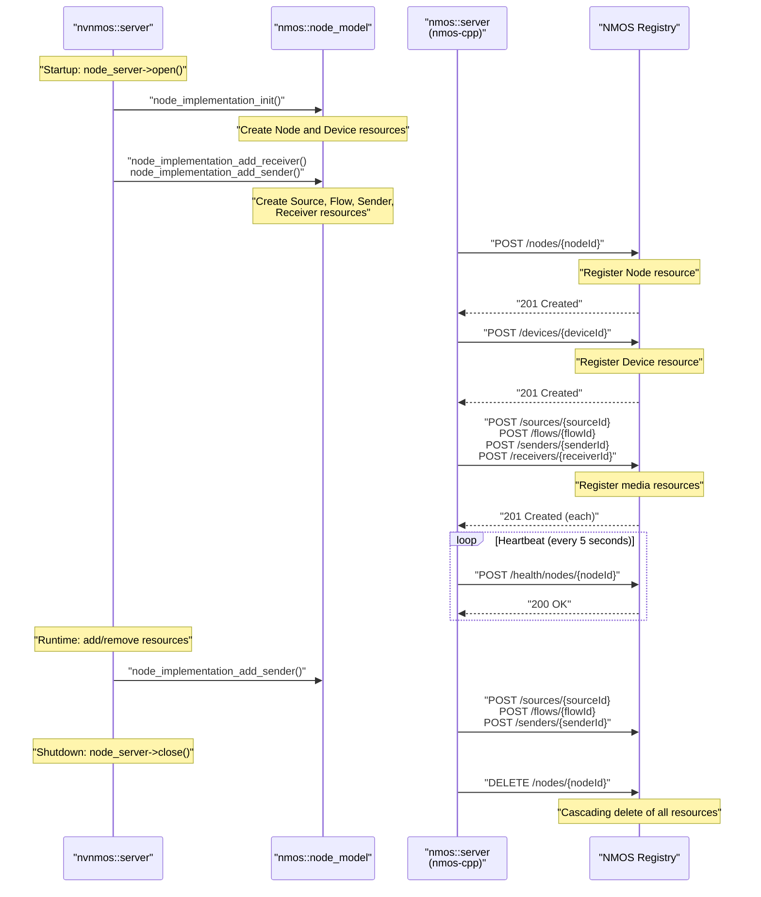
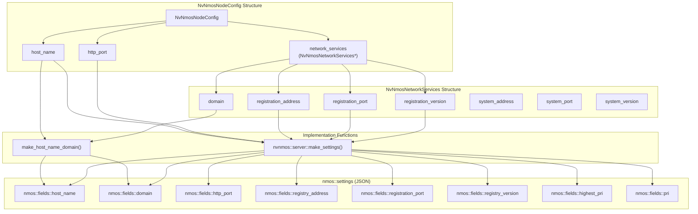
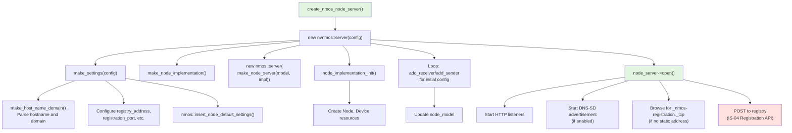

<!-- source: DeepWiki mcp.deepwiki.com · repo NVIDIA/nvnmos · page 3.4 Discovery and Registration · fetched 2026-10-26 -->

# Discovery and Registration

<details>
<summary>Relevant source files</summary>

The following files were used as context for generating this wiki page:

- [README.md](README.md)
- [entrypoint.sh](entrypoint.sh)
- [src/nvnmos.cpp](src/nvnmos.cpp)

</details>


This page explains how nvnmos Nodes discover NMOS Registries on the network using DNS-SD (DNS Service Discovery) and register their resources using the IS-04 Registration API. The discovery and registration mechanisms enable automatic configuration and zero-touch deployment of NMOS infrastructure.

For information about the NMOS resource model (Node, Device, Sender, Receiver), see [NMOS Node Architecture](#3.1). For details about connection activation after registration, see [Connection Activation](#3.3). For implementation details of how nvnmos integrates with nmos-cpp to provide these capabilities, see [Integration with nmos-cpp](#5.4).

## Discovery Mechanisms

The nvnmos library supports two modes of registry discovery:

| Mode | Trigger | Discovery Protocol | Use Case |
|------|---------|-------------------|----------|
| **Automatic DNS-SD** | No `registration_address` configured | mDNS (multicast) or unicast DNS-SD | Dynamic network environments, zero-configuration setups |
| **Static Registry** | Explicit `registration_address` in `NvNmosNetworkServices` | None (DNS-SD disabled) | Fixed infrastructure, environments without DNS-SD support |

### Multicast DNS-SD (mDNS)

When the node's host name is specified as a `.local` name (e.g., `nmos-api.local`), the library uses multicast DNS-SD to discover registries on the local network segment. This leverages the Avahi daemon (Linux) or Bonjour service (Windows) to broadcast and receive service advertisements.

**Service Types:**
- The node advertises itself as: `_nmos-node._tcp`
- The node browses for: `_nmos-registration._tcp`

### Unicast DNS-SD

When the node's host name is a fully-qualified domain name (e.g., `api.example.com`), the library uses unicast DNS-SD to query DNS servers in the specified domain (e.g., `example.com`) for NMOS services. This enables discovery across routed networks and larger-scale deployments.

### Service Advertisement Flow



**Sources:**
- [src/nvnmos.cpp:171-177]()
- [src/nvnmos.cpp:223-225]()
- [src/nvnmos.cpp:329-336]()
- [README.md:303-304]()

## IS-04 Registration Process

Once a registry is discovered (or statically configured), the node registers its resources using the IS-04 Registration API. The nmos-cpp library handles the HTTP POST requests and maintains the registration heartbeat.

### Registration Sequence



**Sources:**
- [src/nvnmos.cpp:155-177]()
- [src/nvnmos.cpp:186-201]()

### Resource Registration Lifecycle

The library manages the following registration lifecycle:

1. **Startup Registration**: When `node_server->open()` is called at [src/nvnmos.cpp:175](), the nmos-cpp library immediately begins registration
2. **Initial Resources**: Resources configured in `NvNmosNodeConfig` (senders/receivers) are registered during startup at [src/nvnmos.cpp:159-169]()
3. **Dynamic Updates**: Resources added via `add_nmos_sender_to_node_server()` or `add_nmos_receiver_to_node_server()` trigger POST requests to the registry
4. **Heartbeat Maintenance**: The nmos-cpp library automatically sends periodic heartbeat requests to maintain registration
5. **Graceful Shutdown**: When `destroy_nmos_node_server()` is called, the node sends DELETE requests to deregister

**Sources:**
- [src/nvnmos.cpp:155-177]()
- [src/nvnmos.cpp:186-201]()
- [src/nvnmos.cpp:403-416]()
- [src/nvnmos.cpp:432-445]()
- [src/nvnmos.cpp:495-503]()

## Configuration

Discovery and registration behavior is controlled through the `NvNmosNodeConfig` structure passed to `create_nmos_node_server()`.

### Network Services Configuration



**Sources:**
- [src/nvnmos.cpp:216-357]()
- [src/nvnmos.cpp:205-214]()

### Configuration Fields

| Config Field | nmos::settings Key | Purpose |
|--------------|-------------------|---------|
| `host_name` | `nmos::fields::host_name` | Node's hostname; `.local` enables mDNS, FQDN enables unicast DNS-SD |
| `network_services->domain` | `nmos::fields::domain` | DNS domain for unicast DNS-SD; extracted from FQDN if not specified |
| `http_port` | `nmos::fields::http_port` | Port for IS-04/IS-05 HTTP APIs |
| `network_services->registration_address` | `nmos::fields::registry_address` | Static registry IP/hostname; disables DNS-SD when set |
| `network_services->registration_port` | `nmos::fields::registration_port` | Registry HTTP port (default: 80) |
| `network_services->registration_version` | `nmos::fields::registry_version` | IS-04 API version (e.g., "v1.3") |

### DNS-SD Priority Control

When `registration_address` is explicitly configured at [src/nvnmos.cpp:329-336]():
```cpp
// disable DNS-SD discovery
web::json::insert(settings, std::make_pair(nmos::fields::highest_pri, 
    nmos::service_priorities::no_priority));
// disable DNS-SD advertisement
web::json::insert(settings, std::make_pair(nmos::fields::pri, 
    nmos::service_priorities::no_priority));
```

This disables both:
- **Discovery**: The node will not browse for `_nmos-registration._tcp` services
- **Advertisement**: The node will not advertise its own `_nmos-node._tcp` service

**Sources:**
- [src/nvnmos.cpp:329-336]()

## Runtime Dependencies

### Linux: Avahi Daemon

The Avahi daemon provides DNS-SD services on Linux systems. The daemon must be running before starting the nvnmos application.

**Installation and startup:**
```sh
apt install -y dbus avahi-daemon
/etc/init.d/dbus start
/etc/init.d/avahi-daemon start
```

On Ubuntu 24.04 and newer:
```sh
dbus-daemon --system --fork
avahi-daemon --daemonize
```

**Sources:**
- [entrypoint.sh:20-24]()
- [README.md:272-284]()

### Windows: Bonjour Service

The Bonjour Service (Apple's mDNSResponder) provides DNS-SD services on Windows systems.

**Installation:** Download from [Apple Support](https://support.apple.com/kb/DL999) and install the Bonjour Print Services package.

**Sources:**
- [README.md:286-290]()

### Troubleshooting DNS-SD Issues

Common error messages and their solutions:

| Error Message | Cause | Solution |
|--------------|-------|----------|
| `DNSServiceRegister reported error: -65537` | DNS-SD daemon not running | Start `avahi-daemon` (Linux) or Bonjour Service (Windows) |
| `DNSServiceBrowse reported error: -65537` | DNS-SD daemon not running | Start `avahi-daemon` (Linux) or Bonjour Service (Windows) |
| `asio listen error: system:98 (Address already in use)` | HTTP port already bound | Configure unique `http_port` value or stop conflicting process |

**Compatibility warnings** (can be ignored):
```
*** WARNING *** The program 'nvnmos-example' uses the Apple Bonjour compatibility layer of Avahi.
*** WARNING *** Please fix your application to use the native API of Avahi!
```

These warnings appear because nmos-cpp uses the Bonjour-compatible DNS-SD API provided by Avahi, rather than Avahi's native API. They do not indicate a problem with functionality.

**Sources:**
- [README.md:351-381]()
- [README.md:342-349]()

## Implementation Architecture

### Startup Sequence

The discovery and registration process begins when the application calls `create_nmos_node_server()`:



**Sources:**
- [src/nvnmos.cpp:476-492]()
- [src/nvnmos.cpp:107-183]()
- [src/nvnmos.cpp:216-357]()

### Integration with nmos-cpp

The nvnmos library delegates DNS-SD and IS-04 protocol handling to the nmos-cpp library:

| nvnmos Component | nmos-cpp Component | Responsibility |
|------------------|-------------------|----------------|
| `nvnmos::server` | `nmos::server` | HTTP server lifecycle, DNS-SD coordination |
| `nvnmos::server::make_settings()` | `nmos::settings` (JSON) | Configuration translation |
| N/A (transparent) | `nmos::node_server` | IS-04 Node API implementation |
| N/A (transparent) | `nmos::registration_handler` | Registry communication, heartbeat |
| N/A (transparent) | DNS-SD library (Avahi/Bonjour) | Service advertisement and browsing |

The nmos-cpp library automatically handles:
- DNS-SD service advertisement and browsing
- HTTP request/response for IS-04 Registration API
- Periodic heartbeat maintenance
- Connection with multiple registries (failover)
- Graceful re-registration on network changes

**Sources:**
- [src/nvnmos.cpp:99-105]()
- [src/nvnmos.cpp:142-146]()

---

