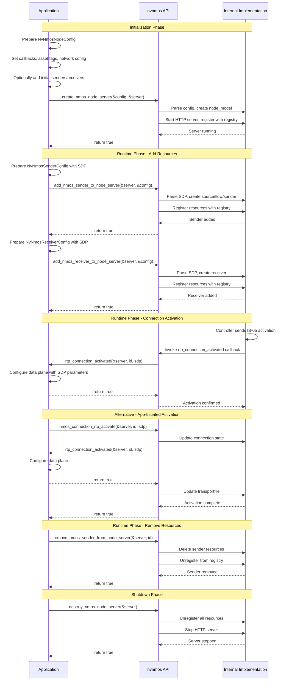
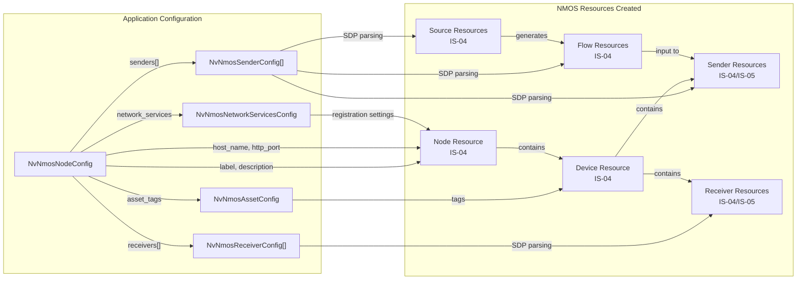

<!-- source: DeepWiki mcp.deepwiki.com · repo NVIDIA/nvnmos · page 4 API Reference · fetched 2026-10-26 -->

# API Reference

Relevant source files

The following files were used as context for generating this wiki page:

- [src/nvnmos.h](src/nvnmos.h)

This section provides comprehensive reference documentation for the nvnmos public C API defined in [src/nvnmos.h](). The API enables applications to create and manage NMOS Nodes, dynamically add/remove senders and receivers, and respond to connection activation requests from NMOS Controllers.

For conceptual information about NMOS resources and how they work, see [Core Concepts](#3). For detailed architectural information about the implementation, see [Architecture and Design](#5). For integration examples with ST 2110 data planes, see [Integration Guide](#7).

**Sources:** [src/nvnmos.h:1-478]()

---

## API Organization

The nvnmos API is organized into the following categories:

| Category | Description | Key Types/Functions |
|----------|-------------|---------------------|
| **Node Server Management** | Create, destroy, and manage the NMOS Node Server lifecycle | `create_nmos_node_server`, `destroy_nmos_node_server`, `NvNmosNodeServer` |
| **Sender/Receiver Management** | Dynamically add and remove senders and receivers | `add_nmos_sender_to_node_server`, `add_nmos_receiver_to_node_server`, `remove_nmos_sender_from_node_server`, `remove_nmos_receiver_from_node_server` |
| **Connection Activation** | Programmatically activate or deactivate connections | `nmos_connection_rtp_activate` |
| **Configuration Structures** | Define node, sender, receiver, and network settings | `NvNmosNodeConfig`, `NvNmosSenderConfig`, `NvNmosReceiverConfig`, `NvNmosAssetConfig`, `NvNmosNetworkServicesConfig` |
| **Callbacks** | Handle events from NMOS Controllers and log messages | `nmos_connection_rtp_activation_callback`, `nmos_logging_callback` |

**Sources:** [src/nvnmos.h:95-470]()

---

## API Structure Overview

The following diagram illustrates the complete organization of the nvnmos API, showing the relationships between types, structures, callbacks, and functions:

```mermaid
graph TB
    subgraph "Core Types"
        SERVER["NvNmosNodeServer<br/>(Opaque Handle)"]
    end
    
    subgraph "Configuration Structures"
        NODE_CONFIG["NvNmosNodeConfig<br/>Main configuration"]
        ASSET_CONFIG["NvNmosAssetConfig<br/>BCP-002-02 tags"]
        SENDER_CONFIG["NvNmosSenderConfig<br/>SDP for sender"]
        RECEIVER_CONFIG["NvNmosReceiverConfig<br/>SDP for receiver"]
        NETWORK_CONFIG["NvNmosNetworkServicesConfig<br/>Registry/DNS settings"]
    end
    
    subgraph "Callback Types"
        RTP_CB["nmos_connection_rtp_activation_callback<br/>Connection events"]
        LOG_CB["nmos_logging_callback<br/>Log messages"]
    end
    
    subgraph "Server Lifecycle Functions"
        CREATE["create_nmos_node_server()"]
        DESTROY["destroy_nmos_node_server()"]
    end
    
    subgraph "Runtime Functions"
        ADD_RX["add_nmos_receiver_to_node_server()"]
        ADD_TX["add_nmos_sender_to_node_server()"]
        REMOVE_RX["remove_nmos_receiver_from_node_server()"]
        REMOVE_TX["remove_nmos_sender_from_node_server()"]
        ACTIVATE["nmos_connection_rtp_activate()"]
    end
    
    NODE_CONFIG -->|"references"| ASSET_CONFIG
    NODE_CONFIG -->|"array of"| SENDER_CONFIG
    NODE_CONFIG -->|"array of"| RECEIVER_CONFIG
    NODE_CONFIG -->|"references"| NETWORK_CONFIG
    NODE_CONFIG -->|"callbacks"| RTP_CB
    NODE_CONFIG -->|"callbacks"| LOG_CB
    
    CREATE -->|"input"| NODE_CONFIG
    CREATE -->|"output"| SERVER
    DESTROY -->|"input"| SERVER
    
    ADD_RX -->|"input"| SERVER
    ADD_RX -->|"input"| RECEIVER_CONFIG
    ADD_TX -->|"input"| SERVER
    ADD_TX -->|"input"| SENDER_CONFIG
    REMOVE_RX -->|"input"| SERVER
    REMOVE_TX -->|"input"| SERVER
    ACTIVATE -->|"input"| SERVER
    
    RTP_CB -.->|"receives"| SERVER
    LOG_CB -.->|"receives"| SERVER
```

**Sources:** [src/nvnmos.h:95-470]()

---

## Typical API Usage Pattern

The following diagram shows the typical sequence of API calls during the lifecycle of an NMOS Node application:

**Sources:** [src/nvnmos.h:352-470]()

---

## Configuration Structure Relationships

The following diagram illustrates how the various configuration structures relate to each other and to the NMOS resource model:

**Sources:** [src/nvnmos.h:174-330]()

---

## Function Categories

### Server Lifecycle

| Function | Purpose | Details |
|----------|---------|---------|
| `create_nmos_node_server` | Initialize and start an NMOS Node server | See [Node Server Management](#4.1) |
| `destroy_nmos_node_server` | Stop and deinitialize the server | See [Node Server Management](#4.1) |

**Sources:** [src/nvnmos.h:352-377]()

### Resource Management

| Function | Purpose | Details |
|----------|---------|---------|
| `add_nmos_sender_to_node_server` | Add a sender at runtime | See [Sender and Receiver Management](#4.2) |
| `add_nmos_receiver_to_node_server` | Add a receiver at runtime | See [Sender and Receiver Management](#4.2) |
| `remove_nmos_sender_from_node_server` | Remove a sender at runtime | See [Sender and Receiver Management](#4.2) |
| `remove_nmos_receiver_from_node_server` | Remove a receiver at runtime | See [Sender and Receiver Management](#4.2) |

**Sources:** [src/nvnmos.h:379-437]()

### Connection Control

| Function | Purpose | Details |
|----------|---------|---------|
| `nmos_connection_rtp_activate` | Update sender/receiver transport parameters | See [Node Server Management](#4.1) |

**Sources:** [src/nvnmos.h:439-469]()

---

## Data Types Reference

### Opaque Handle

| Type | Description | File Location |
|------|-------------|---------------|
| `NvNmosNodeServer` | Opaque handle representing a running NMOS Node server. Contains `user_data` pointer for application use and `impl` pointer for internal implementation. | [src/nvnmos.h:337-349]() |

### Callback Function Types

| Type | Description | File Location |
|------|-------------|---------------|
| `nmos_connection_rtp_activation_callback` | Invoked when an IS-05 connection activation occurs. Application must return `true` if activation was successfully applied. | [src/nvnmos.h:122-125]() |
| `nmos_logging_callback` | Invoked for log messages from the library. Receives severity level, categories, and message text. | [src/nvnmos.h:159-163]() |

**Sources:** [src/nvnmos.h:95-163]()

---

## Logging Levels

The library defines the following severity levels for log messages, matching standard logging practices:

| Constant | Value | Meaning |
|----------|-------|---------|
| `NVNMOS_LOG_DEVEL` | -40 | Low-level debugging information |
| `NVNMOS_LOG_VERBOSE` | -10 | Detailed API request/response tracking |
| `NVNMOS_LOG_INFO` | 0 | Normal operational information |
| `NVNMOS_LOG_WARNING` | 10 | Minor recoverable problems |
| `NVNMOS_LOG_ERROR` | 20 | Serious recoverable errors |
| `NVNMOS_LOG_SEVERE` | 30 | Errors unlikely to be recoverable without restart |
| `NVNMOS_LOG_FATAL` | 40 | Errors likely to cause immediate termination |

**Note:** Values greater than zero indicate warnings and errors. Values less than zero indicate debugging/trace messages.

**Sources:** [src/nvnmos.h:131-146]()

---

## Error Handling

All API functions return `bool` to indicate success (`true`) or failure (`false`). The library uses the logging callback to report detailed error information. Applications should:

1. Check return values from all API calls
2. Register a `nmos_logging_callback` to receive error details
3. Filter log messages by level using `log_level` in `NvNmosNodeConfig`

For comprehensive error handling guidance, see [Error Handling and Logging](#7.3).

**Sources:** [src/nvnmos.h:220-224]()

---

## SDP Integration

The nvnmos API uses Session Description Protocol (SDP) strings to configure senders and receivers. SDP data:

- Must conform to IETF RFCs and SMPTE ST 2110 standards
- Includes custom `x-nvnmos-*` attributes for nvnmos-specific settings
- Is provided during initialization (`NvNmosSenderConfig`, `NvNmosReceiverConfig`)
- Is updated during connection activation via callbacks or `nmos_connection_rtp_activate`

For detailed information about SDP structure and custom attributes, see [Session Description Protocol (SDP)](#3.2).

**Sources:** [src/nvnmos.h:262-293]()

---

## Thread Safety

The `NvNmosNodeServer` handle is **not thread-safe**. Applications must serialize all API calls that operate on the same server instance. Callbacks are invoked from internal library threads, so applications must ensure thread-safe access to shared data when implementing callbacks.

**Sources:** [src/nvnmos.h:337-349]()

---

## Platform Compatibility

The API is available on both Linux and Windows platforms. Symbol visibility is controlled via:

- `NVNMOS_EXPORTS` - Define when building the shared library
- `NVNMOS_STATIC` - Define when using the static library
- `NVNMOS_API` macro - Automatically expands to appropriate `__declspec` or `__attribute__` directives

**Sources:** [src/nvnmos.h:62-86]()

---

## Detailed Documentation

For detailed documentation on each category:

- [Node Server Management](#4.1) - `create_nmos_node_server`, `destroy_nmos_node_server`, `nmos_connection_rtp_activate`
- [Sender and Receiver Management](#4.2) - Adding and removing senders/receivers at runtime
- [Configuration Structures](#4.3) - Complete reference for all configuration types
- [Callbacks and Event Handling](#4.4) - Implementing callbacks for connection activation and logging

---

