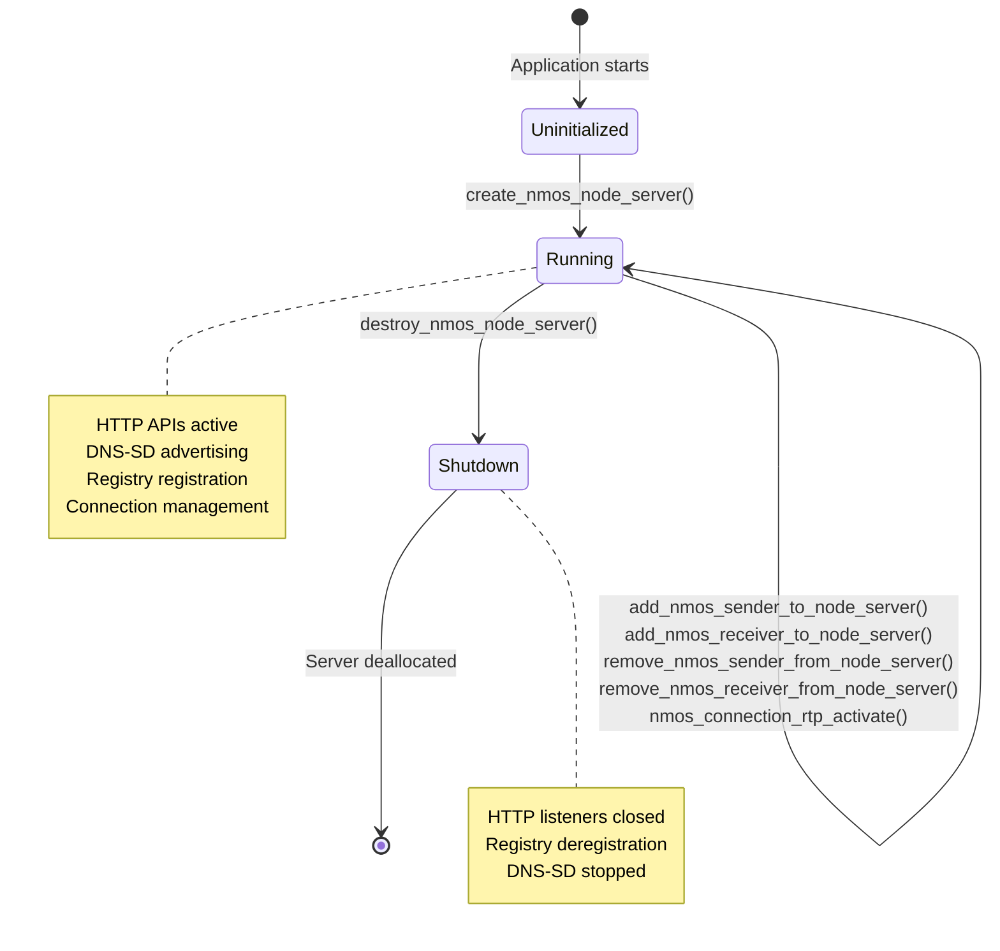
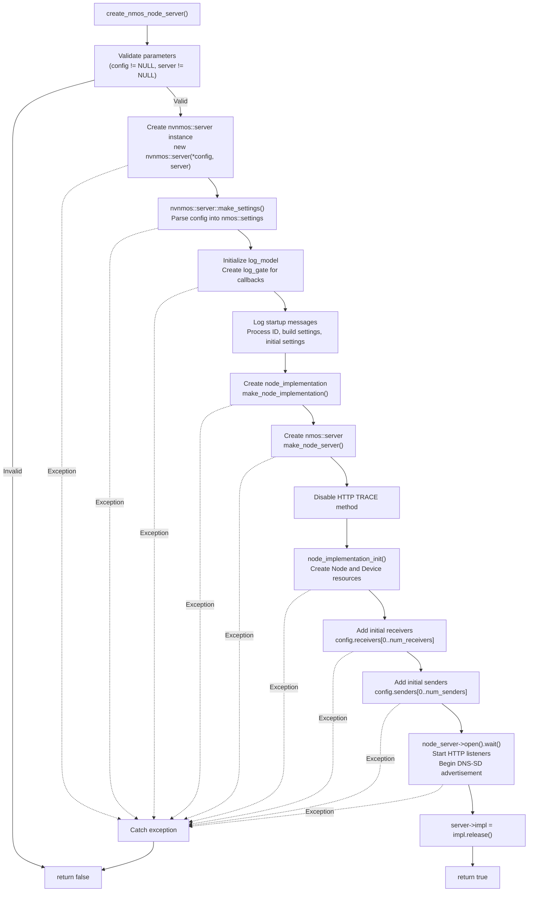
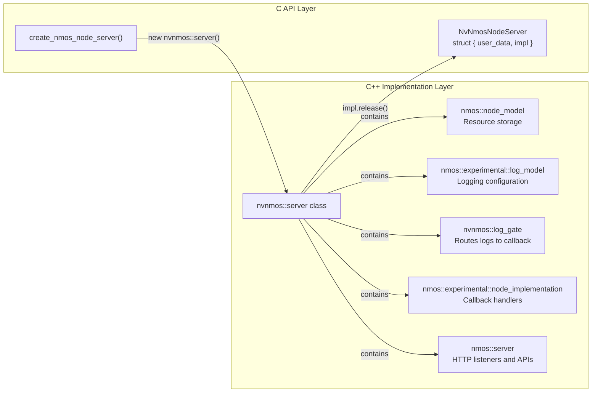
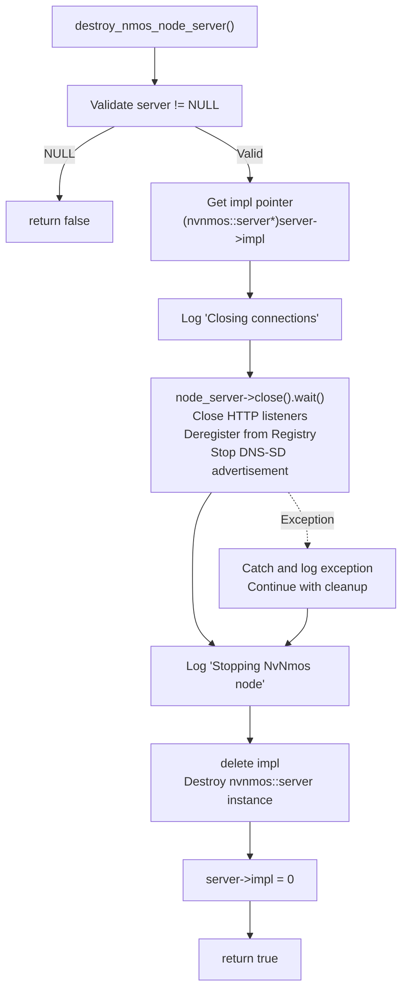
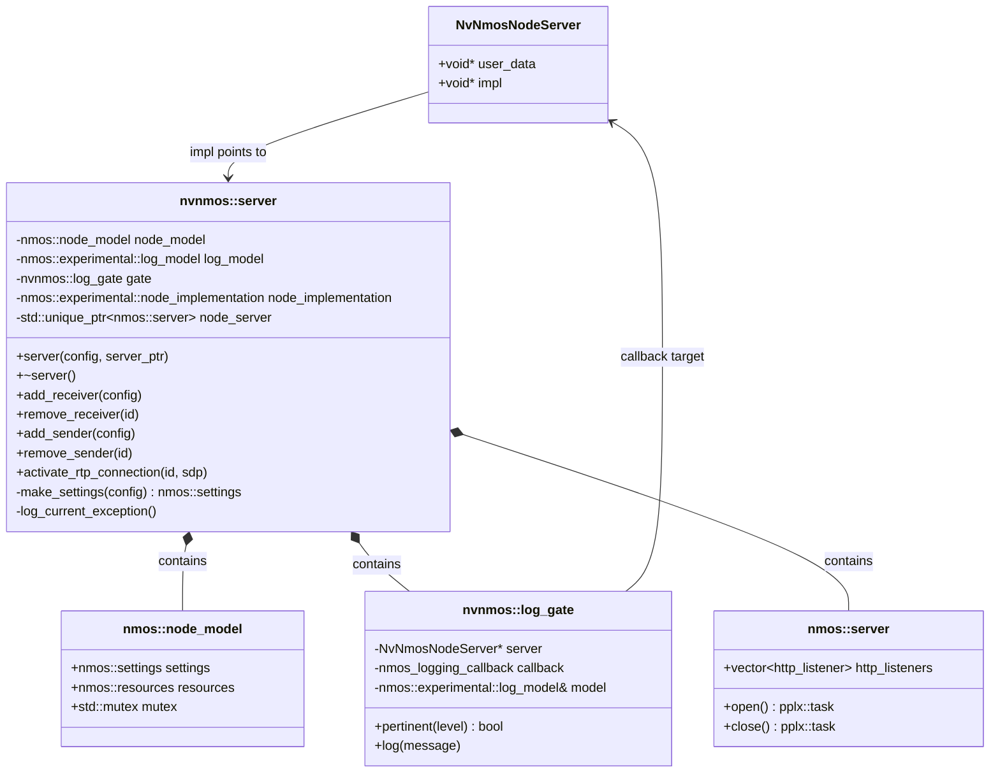

<!-- source: DeepWiki mcp.deepwiki.com · repo NVIDIA/nvnmos · page 4.1 Node Server Management · fetched 2026-10-26 -->

# Node Server Management

<details>
<summary>Relevant source files</summary>

The following files were used as context for generating this wiki page:

- [src/nvnmos.cpp](src/nvnmos.cpp)
- [src/nvnmos.h](src/nvnmos.h)

</details>


This page documents the API functions for creating, destroying, and managing the lifecycle of an NMOS Node Server. These are the fundamental operations required to initialize and terminate the nvnmos library's core functionality.

For information about managing individual senders and receivers after the node server is created, see [Sender and Receiver Management](#4.2). For details about the configuration structures used during creation, see [Configuration Structures](#4.3).

## Overview

The Node Server Management API consists of two primary functions that control the server's lifecycle:

| Function | Purpose | Required |
|----------|---------|----------|
| `create_nmos_node_server` | Initializes and starts the NMOS Node Server | Yes (first call) |
| `destroy_nmos_node_server` | Stops and deallocates the NMOS Node Server | Yes (final call) |

All operations on senders, receivers, and connections must occur between these two calls.

**Sources:** [src/nvnmos.h:352-377]()

## Server Lifecycle

The NMOS Node Server follows a simple two-state lifecycle model:



**Sources:** [src/nvnmos.cpp:107-184](), [src/nvnmos.cpp:186-201]()

## NvNmosNodeServer Structure

The `NvNmosNodeServer` structure is an opaque handle that represents a running NMOS Node Server instance. Applications interact with the server through this handle.

### Structure Definition

```c
typedef struct _NvNmosNodeServer
{
    void *user_data;  // Application-specific data
    void *impl;       // Internal implementation pointer (opaque)
} NvNmosNodeServer;
```

**Sources:** [src/nvnmos.h:337-349]()

### Member Variables

| Member | Type | Purpose | Usage |
|--------|------|---------|-------|
| `user_data` | `void*` | Application-defined pointer not used by nvnmos | Can be used to access application context in callbacks |
| `impl` | `void*` | Internal pointer to `nvnmos::server` instance | **Do not modify** - managed by the library |

### Initialization

The structure must be zero-initialized before passing to `create_nmos_node_server`. The `user_data` member may optionally be set before initialization:

```c
NvNmosNodeServer server = {0};
// Optionally set user_data for use in callbacks
server.user_data = my_application_context;
```

**Sources:** [src/nvnmos.h:334-349]()

## create_nmos_node_server

Initializes and starts an NMOS Node Server according to the specified configuration settings.

### Function Signature

```c
NVNMOS_API
bool create_nmos_node_server(
    const NvNmosNodeConfig *config,
    NvNmosNodeServer *server);
```

**Sources:** [src/nvnmos.h:352-364]()

### Parameters

| Parameter | Type | Direction | Description |
|-----------|------|-----------|-------------|
| `config` | `const NvNmosNodeConfig*` | Input | Pointer to configuration settings. Must not be `NULL`. |
| `server` | `NvNmosNodeServer*` | In/Out | Pointer to server structure to initialize. Must not be `NULL`. Should be zero-initialized before call. |

### Return Value

Returns `true` if the server was successfully created and started, `false` otherwise. On failure, the `server` structure remains unmodified.

### Behavior

The function performs the following operations in sequence:



**Sources:** [src/nvnmos.cpp:475-492](), [src/nvnmos.cpp:107-184]()

### Internal Implementation Mapping

The function creates an instance of the internal `nvnmos::server` class and stores it in the opaque `impl` pointer:



**Sources:** [src/nvnmos.cpp:82-105](), [src/nvnmos.cpp:475-492]()

### Configuration Processing

The `make_settings` function converts the `NvNmosNodeConfig` structure into an `nmos::settings` object:

| Config Field | Settings Field | Default Behavior |
|--------------|----------------|------------------|
| `host_name` | `nmos::fields::host_name` | Auto-detected system hostname |
| `host_addresses` | `nmos::fields::host_addresses` | Auto-detected system addresses |
| `http_port` | `nmos::fields::http_port` | Default ports per API |
| `label` | `nvnmos::fields::node_label`<br/>`nvnmos::fields::device_label` | Generated from `asset_tags` |
| `description` | `nvnmos::fields::node_description`<br/>`nvnmos::fields::device_description` | Generated from `asset_tags` |
| `asset_tags` | `nvnmos::fields::node_tags`<br/>`nvnmos::fields::device_tags` | None |
| `seed` | `nmos::experimental::fields::seed_id` | Random UUID generation |
| `network_services` | Registry/System API settings | DNS-SD discovery |
| `log_level` | `nmos::fields::logging_level` | As specified |
| `log_categories` | `nmos::fields::logging_categories` | All categories if not specified |

**Sources:** [src/nvnmos.cpp:216-357]()

### Error Handling

The function returns `false` in the following cases:

1. **Null parameter:** Either `config` or `server` is `NULL`
2. **Invalid configuration:** Required fields are missing or invalid (e.g., `receivers[i].sdp == NULL`)
3. **Exception during initialization:** Any exception thrown during server creation

Detailed error information is logged through the `log_callback` if configured. The function catches all exceptions and converts them to a boolean return value.

**Sources:** [src/nvnmos.cpp:475-492](), [src/nvnmos.cpp:179-183]()

### Thread Safety

This function is **not thread-safe**. Do not call `create_nmos_node_server` concurrently on the same `NvNmosNodeServer` structure. The function may be called on different `NvNmosNodeServer` structures from different threads.

### Example Usage

```c
NvNmosNodeServer server = {0};
NvNmosNodeConfig config = {0};

// Configure basic settings
config.host_name = "media-node.local";
config.http_port = 8080;

// Set up asset tags
NvNmosAssetConfig asset_tags = {
    .manufacturer = "Acme Corp",
    .product = "Media Processor",
    .instance_id = "device-001",
    .functions = (const char*[]){"Encoder"},
    .num_functions = 1
};
config.asset_tags = &asset_tags;

// Set callbacks
config.rtp_connection_activated = my_activation_callback;
config.log_callback = my_log_callback;
config.log_level = NVNMOS_LOG_INFO;

// Create server
if (!create_nmos_node_server(&config, &server)) {
    fprintf(stderr, "Failed to create NMOS Node Server\n");
    return -1;
}

// Server is now running...
```

**Sources:** [src/nvnmos.h:352-364]()

## destroy_nmos_node_server

Stops and deallocates an NMOS Node Server that was previously initialized with `create_nmos_node_server`.

### Function Signature

```c
NVNMOS_API
bool destroy_nmos_node_server(
    NvNmosNodeServer *server);
```

**Sources:** [src/nvnmos.h:366-377]()

### Parameters

| Parameter | Type | Direction | Description |
|-----------|------|-----------|-------------|
| `server` | `NvNmosNodeServer*` | In/Out | Pointer to the server to deallocate. Must not be `NULL`. Must have been successfully initialized by `create_nmos_node_server`. |

### Return Value

Returns `true` if the server was successfully stopped and deallocated, `false` if the `server` parameter is `NULL`.

### Behavior

The function performs cleanup in the following order:



**Sources:** [src/nvnmos.cpp:494-504](), [src/nvnmos.cpp:186-201]()

### Cleanup Operations

The destructor of `nvnmos::server` performs the following cleanup:

1. **Close HTTP listeners:** Stops accepting new connections
2. **Deregister from Registry:** Sends DELETE requests to the IS-04 Registry
3. **Stop DNS-SD advertisement:** Stops advertising `_nmos-node._tcp` service
4. **Wait for completion:** Blocks until all network operations complete
5. **Deallocate resources:** Destroys internal data structures

**Sources:** [src/nvnmos.cpp:186-201]()

### Error Handling

The function only returns `false` if the `server` parameter is `NULL`. Even if exceptions occur during shutdown (e.g., network errors during deregistration), the function catches them, logs them, and continues with cleanup, ultimately returning `true`.

This ensures that resources are always released even in error conditions.

**Sources:** [src/nvnmos.cpp:494-504](), [src/nvnmos.cpp:186-201](), [src/nvnmos.cpp:359-401]()

### Thread Safety

This function is **not thread-safe** with respect to the same `NvNmosNodeServer` instance. Do not call `destroy_nmos_node_server` while other threads are calling functions on the same server instance.

The function blocks until all internal operations complete, ensuring safe cleanup.

### Post-Destruction State

After calling `destroy_nmos_node_server`:

- The `server->impl` pointer is set to `NULL`
- The `server->user_data` pointer is **not modified** by the library
- All NMOS resources (Node, Device, Senders, Receivers) are deregistered from the Registry
- HTTP API endpoints are no longer accessible
- DNS-SD advertisements are stopped

The `NvNmosNodeServer` structure can be reused by calling `create_nmos_node_server` again.

**Sources:** [src/nvnmos.cpp:494-504]()

### Example Usage

```c
NvNmosNodeServer server = {0};
NvNmosNodeConfig config = {0};
// ... configure and create server ...

if (!create_nmos_node_server(&config, &server)) {
    return -1;
}

// Run server...
// Handle connections, etc.

// Clean shutdown
if (!destroy_nmos_node_server(&server)) {
    fprintf(stderr, "Failed to destroy server\n");
}
```

**Sources:** [src/nvnmos.h:366-377]()

## Implementation Details

### Class Hierarchy

The C API functions delegate to the internal `nvnmos::server` C++ class:



**Sources:** [src/nvnmos.cpp:82-105](), [src/nvnmos.cpp:52-80](), [src/nvnmos.cpp:475-492](), [src/nvnmos.cpp:494-504]()

### Memory Management

| Object | Allocation | Deallocation | Ownership |
|--------|------------|--------------|-----------|
| `NvNmosNodeServer` | Application (stack or heap) | Application | Application |
| `nvnmos::server` | `create_nmos_node_server` (heap) | `destroy_nmos_node_server` | Library |
| `nmos::server` | `nvnmos::server` constructor | `nvnmos::server` destructor | Library |
| `node_model.resources` | `node_implementation_init` | `nmos::server` destructor | Library |

The application is responsible for the lifetime of the `NvNmosNodeServer` structure, while the library manages all internal allocations.

**Sources:** [src/nvnmos.cpp:107-184](), [src/nvnmos.cpp:186-201](), [src/nvnmos.cpp:475-492](), [src/nvnmos.cpp:494-504]()

---

