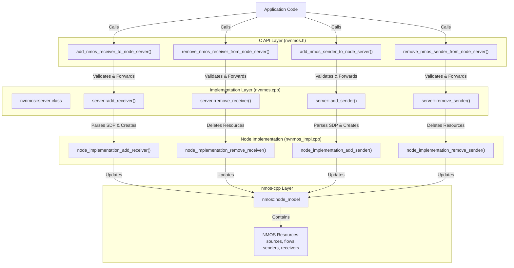
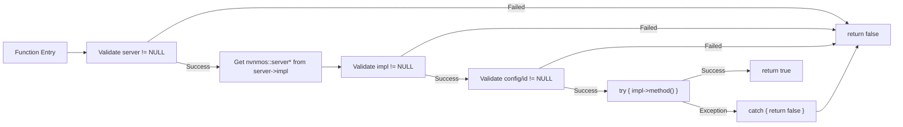
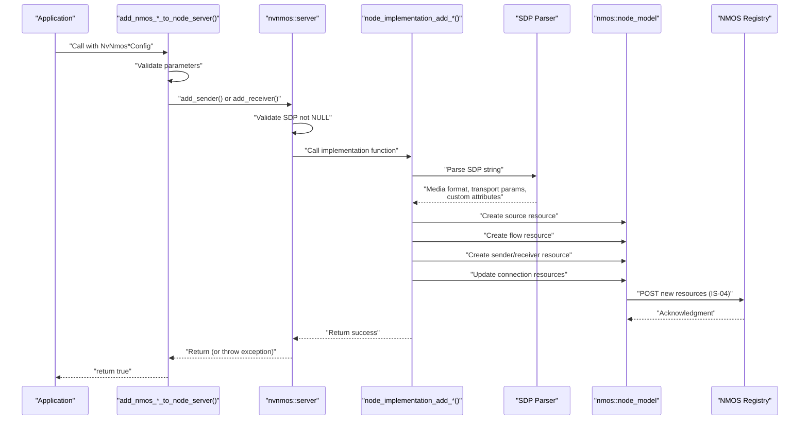

<!-- source: DeepWiki mcp.deepwiki.com · repo NVIDIA/nvnmos · page 4.2 Sender and Receiver Management · fetched 2026-10-26 -->

# Sender and Receiver Management

<details>
<summary>Relevant source files</summary>

The following files were used as context for generating this wiki page:

- [src/nvnmos.cpp](src/nvnmos.cpp)
- [src/nvnmos.h](src/nvnmos.h)

</details>


## Purpose and Scope

This page documents the API functions for dynamically adding and removing NMOS Senders and Receivers from a running Node Server. These functions enable applications to modify the available media inputs and outputs during runtime without restarting the server.

For creating the initial Node Server instance, see [Node Server Management](#4.1). For detailed configuration structure reference, see [Configuration Structures](#4.3). For understanding how SDP is used to configure senders and receivers, see [Session Description Protocol (SDP)](#3.2).

## Overview

The nvnmos library provides four primary functions for managing senders and receivers after the Node Server has been created:

- **Receiver Management**: `add_nmos_receiver_to_node_server()` and `remove_nmos_receiver_from_node_server()`
- **Sender Management**: `add_nmos_sender_to_node_server()` and `remove_nmos_sender_from_node_server()`

All senders and receivers are configured using Session Description Protocol (SDP) data that defines the media format, transport parameters, and custom nvnmos attributes. Each sender/receiver is identified by a unique ID specified in the SDP via the `x-nvnmos-id` session-level attribute.

Sources: [src/nvnmos.h:379-437]()

## Receiver Management

### Adding Receivers

```c
bool add_nmos_receiver_to_node_server(
    NvNmosNodeServer *server,
    const NvNmosReceiverConfig* config);
```

Adds a new NMOS Receiver to the running Node Server. The receiver is created based on the configuration provided in `NvNmosReceiverConfig`, which contains an SDP description of the receiver's capabilities.

**Parameters:**
- `server` - Pointer to the Node Server to update (must not be NULL)
- `config` - Pointer to receiver configuration settings (must not be NULL)

**Returns:** `true` if the receiver was successfully added, `false` otherwise

**SDP Requirements:**
The SDP string in the configuration must include:
- Valid SMPTE ST 2110 format specification
- `x-nvnmos-id` session-level attribute specifying the unique receiver ID
- `x-nvnmos-iface-ip` media-level attribute specifying the interface IP address
- Optional `x-nvnmos-group-hint` session-level attribute for grouping

Sources: [src/nvnmos.h:379-392](), [src/nvnmos.cpp:506-525]()

### Removing Receivers

```c
bool remove_nmos_receiver_from_node_server(
    NvNmosNodeServer *server,
    const char* id);
```

Removes an existing NMOS Receiver from the Node Server. The receiver is identified by its unique ID, which was specified during creation.

**Parameters:**
- `server` - Pointer to the Node Server to update (must not be NULL)
- `id` - The unique identifier for the receiver to remove (must not be NULL)

**Returns:** `true` if the receiver was successfully removed, `false` otherwise

**Notes:**
- The receiver may have been added via `create_nmos_node_server()` (as an initial receiver) or `add_nmos_receiver_to_node_server()`
- All associated NMOS resources (sources, flows) are also removed from the node model

Sources: [src/nvnmos.h:394-407](), [src/nvnmos.cpp:527-546]()

## Sender Management

### Adding Senders

```c
bool add_nmos_sender_to_node_server(
    NvNmosNodeServer *server,
    const NvNmosSenderConfig* config);
```

Adds a new NMOS Sender to the running Node Server. The sender is created based on the configuration provided in `NvNmosSenderConfig`, which contains an SDP description of the sender's output stream.

**Parameters:**
- `server` - Pointer to the Node Server to update (must not be NULL)
- `config` - Pointer to sender configuration settings (must not be NULL)

**Returns:** `true` if the sender was successfully added, `false` otherwise

**SDP Requirements:**
The SDP string in the configuration must include:
- Valid SMPTE ST 2110 format specification
- `ts-refclk` attributes specifying the node clock reference
- `x-nvnmos-id` session-level attribute specifying the unique sender ID
- `x-nvnmos-src-port` media-level attribute specifying the source port
- Optional `x-nvnmos-group-hint` session-level attribute for grouping

Sources: [src/nvnmos.h:409-422](), [src/nvnmos.cpp:548-567]()

### Removing Senders

```c
bool remove_nmos_sender_from_node_server(
    NvNmosNodeServer *server,
    const char* id);
```

Removes an existing NMOS Sender from the Node Server. The sender is identified by its unique ID, which was specified during creation.

**Parameters:**
- `server` - Pointer to the Node Server to update (must not be NULL)
- `id` - The unique identifier for the sender to remove (must not be NULL)

**Returns:** `true` if the sender was successfully removed, `false` otherwise

**Notes:**
- The sender may have been added via `create_nmos_node_server()` (as an initial sender) or `add_nmos_sender_to_node_server()`
- All associated NMOS resources (sources, flows) are also removed from the node model

Sources: [src/nvnmos.h:424-437](), [src/nvnmos.cpp:569-588]()

## Configuration Structures

### NvNmosReceiverConfig

```c
typedef struct _NvNmosReceiverConfig
{
    const char *sdp;
} NvNmosReceiverConfig;
```

Minimal configuration structure containing only the SDP description. The SDP must conform to SMPTE ST 2110 standards and include the required custom attributes.

Sources: [src/nvnmos.h:260-273]()

### NvNmosSenderConfig

```c
typedef struct _NvNmosSenderConfig
{
    const char *sdp;
} NvNmosSenderConfig;
```

Minimal configuration structure containing only the SDP description. The SDP must conform to SMPTE ST 2110 standards and include the required custom attributes.

For detailed information about these structures and their SDP requirements, see [Configuration Structures](#4.3).

Sources: [src/nvnmos.h:279-293]()

## Implementation Architecture

The following diagram shows how the API functions are implemented through the layered architecture:

**Diagram: Sender/Receiver Management Call Flow**



Sources: [src/nvnmos.h:379-437](), [src/nvnmos.cpp:403-459](), [src/nvnmos.cpp:506-588]()

## Function Implementation Details

### C API to C++ Translation

The C API functions follow a consistent pattern for translating from C to C++:

**Diagram: C API Function Structure**



Each C API function performs these validation steps:
1. Check that `server` pointer is not NULL
2. Extract the `impl` pointer cast to `nvnmos::server*`
3. Verify the `impl` pointer is valid
4. Validate the configuration or ID parameter
5. Call the corresponding C++ method within a try-catch block
6. Return `true` on success, `false` on any failure

Sources: [src/nvnmos.cpp:506-588]()

### nvnmos::server Class Methods

The `nvnmos::server` class provides the C++ implementation that bridges to the node implementation layer:

| Method | Responsibility | Exception Handling |
|--------|---------------|-------------------|
| `add_receiver()` | Validates SDP, calls `node_implementation_add_receiver()` | Logs exception via `log_current_exception()`, rethrows |
| `remove_receiver()` | Converts ID to wide string, calls `node_implementation_remove_receiver()` | Logs exception via `log_current_exception()`, rethrows |
| `add_sender()` | Validates SDP, calls `node_implementation_add_sender()` | Logs exception via `log_current_exception()`, rethrows |
| `remove_sender()` | Converts ID to wide string, calls `node_implementation_remove_sender()` | Logs exception via `log_current_exception()`, rethrows |

All methods verify that the SDP pointer is not NULL for add operations, throwing `std::logic_error` if the configuration is invalid.

Sources: [src/nvnmos.cpp:403-459]()

## Resource Creation Pipeline

When adding a sender or receiver, the library performs the following operations:

**Diagram: Add Sender/Receiver Pipeline**



Sources: [src/nvnmos.cpp:403-459]()

## Usage Patterns

### Adding a Receiver at Runtime

```c
NvNmosNodeServer server = {0};
// ... create and start server ...

// Define receiver configuration with SDP
const char* receiver_sdp = 
    "v=0\r\n"
    "o=- 0 0 IN IP4 192.168.1.10\r\n"
    "s=Example Receiver\r\n"
    "a=x-nvnmos-id:receiver-001\r\n"
    "t=0 0\r\n"
    "m=video 5004 RTP/AVP 96\r\n"
    "c=IN IP4 239.1.1.1/32\r\n"
    "a=x-nvnmos-iface-ip:192.168.1.10\r\n"
    // ... additional SDP attributes ...
    ;

NvNmosReceiverConfig config = {0};
config.sdp = receiver_sdp;

if (add_nmos_receiver_to_node_server(&server, &config)) {
    // Receiver successfully added and registered
} else {
    // Failed to add receiver
}
```

### Adding a Sender at Runtime

```c
// Define sender configuration with SDP
const char* sender_sdp = 
    "v=0\r\n"
    "o=- 0 0 IN IP4 192.168.1.10\r\n"
    "s=Example Sender\r\n"
    "a=x-nvnmos-id:sender-001\r\n"
    "a=ts-refclk:ptp=IEEE1588-2008:00-11-22-FF-FE-33-44-55\r\n"
    "t=0 0\r\n"
    "m=video 5004 RTP/AVP 96\r\n"
    "c=IN IP4 239.1.1.1/32\r\n"
    "a=x-nvnmos-src-port:5004\r\n"
    // ... additional SDP attributes ...
    ;

NvNmosSenderConfig config = {0};
config.sdp = sender_sdp;

if (add_nmos_sender_to_node_server(&server, &config)) {
    // Sender successfully added and registered
} else {
    // Failed to add sender
}
```

### Removing Resources

```c
// Remove a receiver by ID
if (remove_nmos_receiver_from_node_server(&server, "receiver-001")) {
    // Receiver successfully removed
}

// Remove a sender by ID
if (remove_nmos_sender_from_node_server(&server, "sender-001")) {
    // Sender successfully removed
}
```

## Error Handling

All sender and receiver management functions return `bool` to indicate success or failure:
- `true` - The operation completed successfully
- `false` - The operation failed due to validation error, invalid SDP, or internal exception

**Common Failure Scenarios:**

| Scenario | Detected At | Returned Value |
|----------|------------|----------------|
| NULL `server` pointer | C API layer | `false` |
| Invalid `server->impl` | C API layer | `false` |
| NULL configuration pointer | C API layer | `false` |
| NULL or empty SDP string | `nvnmos::server` layer | `false` (after logging) |
| Invalid SDP format | Node implementation layer | `false` (after logging) |
| Duplicate ID conflict | Node implementation layer | `false` (after logging) |
| Internal exception | Any layer | `false` (after logging) |

The library logs detailed error information via the `log_callback` configured in `NvNmosNodeConfig`. Applications should monitor these logs for diagnostic information when operations fail.

For detailed exception logging implementation, see the `log_current_exception()` method in [src/nvnmos.cpp:359-401]().

Sources: [src/nvnmos.h:379-437](), [src/nvnmos.cpp:359-401](), [src/nvnmos.cpp:403-459](), [src/nvnmos.cpp:506-588]()

## Thread Safety Considerations

The sender and receiver management functions modify the shared `nmos::node_model` state. The nmos-cpp library uses mutex protection for the node model, ensuring thread-safe access. However, applications should be aware that:

1. Multiple concurrent modifications to the node model are serialized
2. Add/remove operations may block briefly while updating the model
3. NMOS Registry updates occur asynchronously after the function returns

Applications using multiple threads should coordinate sender/receiver management operations to avoid race conditions at the application level.

Sources: [src/nvnmos.cpp:403-459]()

---

