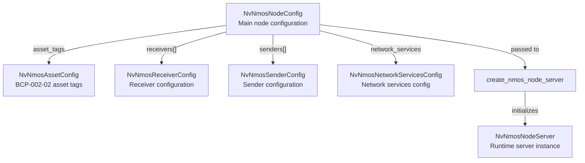
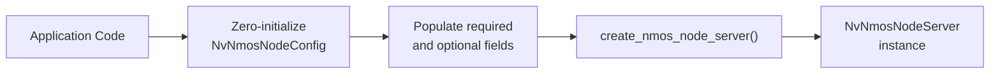
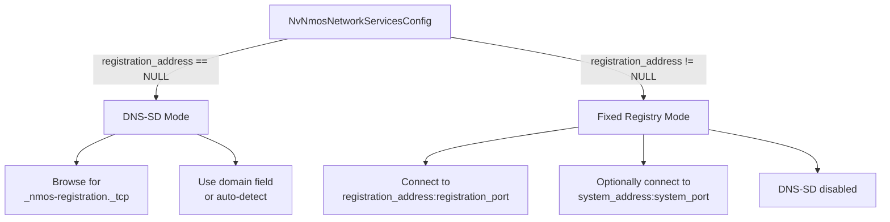
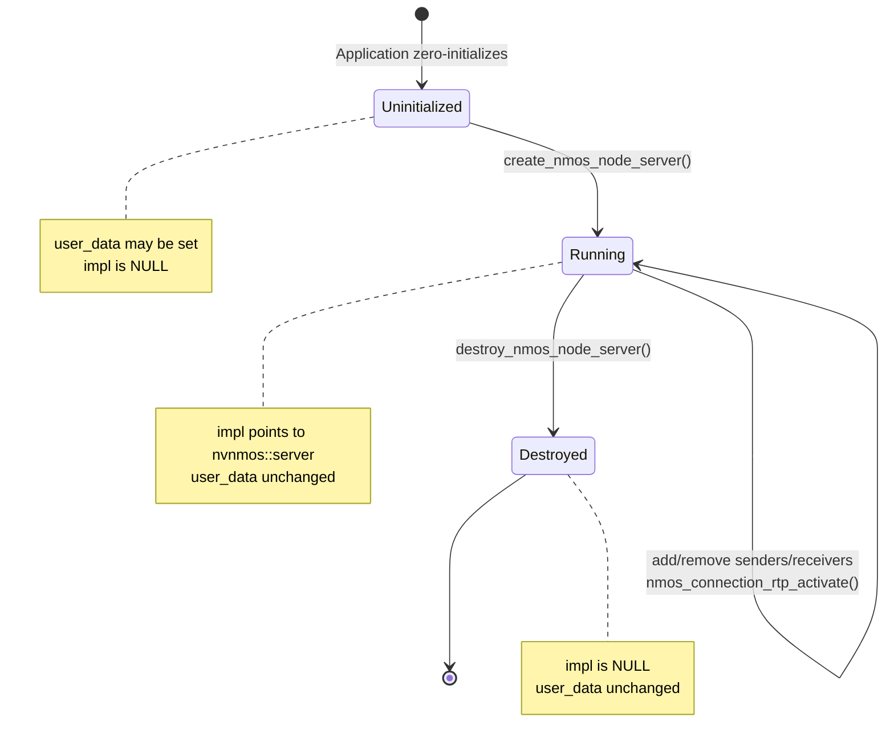
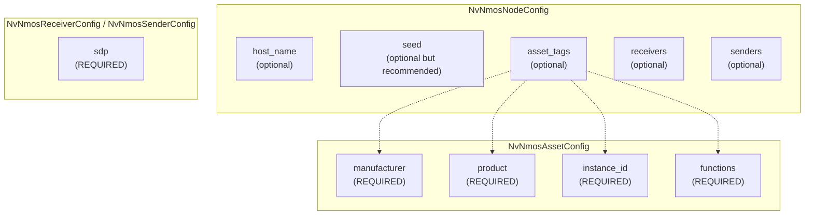
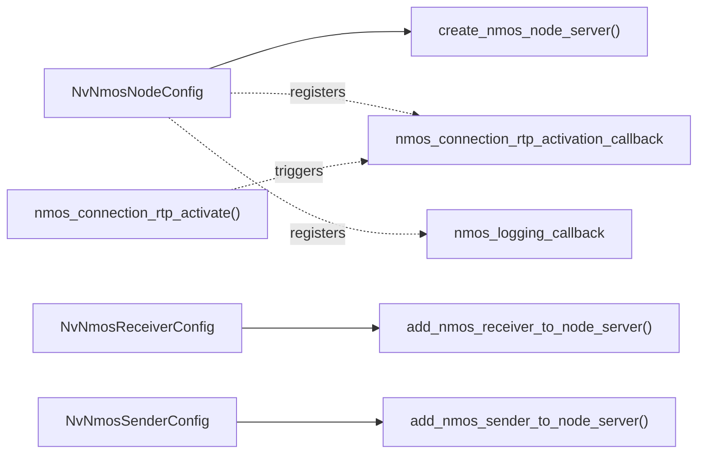

<!-- source: DeepWiki mcp.deepwiki.com · repo NVIDIA/nvnmos · page 4.3 Configuration Structures · fetched 2026-10-26 -->

# Configuration Structures

<details>
<summary>Relevant source files</summary>

The following files were used as context for generating this wiki page:

- [src/main.c](src/main.c)
- [src/nvnmos.h](src/nvnmos.h)

</details>


This page provides comprehensive reference documentation for all configuration structures in the nvnmos API. These structures are used to configure the NMOS Node Server and its resources (senders, receivers, and network services).

For information about how to use these structures to create and manage nodes, see [Node Server Management](#4.1). For details on the callback functions referenced in these structures, see [Callbacks and Event Handling](#4.4). For the underlying NMOS resource model concepts, see [NMOS Node Architecture](#3.1).

**Sources:** [src/nvnmos.h:1-478]()

## Overview

The nvnmos library uses a hierarchical configuration model where the main `NvNmosNodeConfig` structure aggregates several specialized configuration structures. All structures follow a zero-initialization pattern and use explicit field counts for array members.

**Configuration Structure Hierarchy**



**Sources:** [src/nvnmos.h:165-349]()

## NvNmosNodeConfig

The primary configuration structure for creating an NMOS Node Server via `create_nmos_node_server()`. This structure aggregates all configuration settings required to initialize a complete NMOS Node with its senders, receivers, and network services.

**Definition:** [src/nvnmos.h:174-234]()

### Field Reference

| Field | Type | Description | Constraints |
|-------|------|-------------|-------------|
| `host_name` | `const char*` | Fully-qualified host name (e.g., "nmos-node.local") | May be `NULL` for automatic detection |
| `host_addresses` | `const char**` | Array of host IP addresses | May be `NULL` for automatic detection; size must equal `num_host_addresses` |
| `num_host_addresses` | `unsigned int` | Number of entries in `host_addresses` | May be zero |
| `http_port` | `unsigned int` | Port number for HTTP APIs | May be zero for default ports (80/443) |
| `label` | `const char*` | Label for node and device | May be `NULL` to generate from `asset_tags` |
| `description` | `const char*` | Description of node and device | May be `NULL` to generate from `asset_tags` |
| `asset_tags` | `NvNmosAssetConfig*` | BCP-002-02 asset distinguishing information | May be `NULL` |
| `seed` | `const char*` | String for repeatable UUID generation | May be `NULL` (random seed); **not recommended** |
| `receivers` | `NvNmosReceiverConfig*` | Array of receiver configurations | May be `NULL`; size must equal `num_receivers` |
| `num_receivers` | `unsigned int` | Number of entries in `receivers` | May be zero |
| `senders` | `NvNmosSenderConfig*` | Array of sender configurations | May be `NULL`; size must equal `num_senders` |
| `num_senders` | `unsigned int` | Number of entries in `senders` | May be zero |
| `rtp_connection_activated` | `nmos_connection_rtp_activation_callback` | Callback for IS-05 connection activation | May be `NULL` |
| `log_callback` | `nmos_logging_callback` | Callback for log messages | May be `NULL` |
| `log_level` | `int` | Minimum severity level for log callbacks | See `NVNMOS_LOG_*` constants |
| `log_categories` | `const char**` | Array of topic strings for filtering logs | May be `NULL`; size must equal `num_log_categories` |
| `num_log_categories` | `unsigned int` | Number of entries in `log_categories` | May be zero |
| `network_services` | `NvNmosNetworkServicesConfig*` | Network services configuration | May be `NULL` for DNS-SD based discovery |

### Usage Pattern



**Sources:** [src/nvnmos.h:174-234](), [src/main.c:228-298]()

### Example from nvnmos-example

The example application demonstrates typical initialization:

[src/main.c:240-296]()

Key patterns:
- Structure is zero-initialized
- Asset tags are configured to populate node metadata
- A deterministic `seed` is generated from host name and port for repeatable UUIDs
- Initial receivers and senders are configured via arrays
- Callbacks are registered for connection activation and logging

**Sources:** [src/main.c:240-296]()

## NvNmosAssetConfig

Configuration structure for BCP-002-02 Asset Distinguishing Information. These tags provide standardized metadata about the manufacturer, product, and function of the NMOS Node.

**Definition:** [src/nvnmos.h:240-254]()

### Field Reference

| Field | Type | Description | Constraints |
|-------|------|-------------|-------------|
| `manufacturer` | `const char*` | Manufacturer name (e.g., "Acme") | **Must not be `NULL`** |
| `product` | `const char*` | Product name (e.g., "Widget Pro") | **Must not be `NULL`** |
| `instance_id` | `const char*` | Instance identifier (e.g., "XYZ123-456789") | **Must not be `NULL`** |
| `functions` | `const char**` | Array of function strings | **Must not be `NULL`**; size must equal `num_functions` |
| `num_functions` | `unsigned int` | Number of entries in `functions` | **Must not be zero** |

### Function Values

Common function values include:
- `"Encoder"` - Video/audio encoding
- `"Decoder"` - Video/audio decoding
- `"Converter"` - Format conversion
- `"Analyzer"` - Stream analysis
- `"Example"` - Demonstration/testing (as used in nvnmos-example)

### Example Configuration

[src/main.c:236-246]()

**Sources:** [src/nvnmos.h:240-254](), [src/main.c:236-246]()

## NvNmosReceiverConfig

Configuration structure for creating NMOS Receivers. Receivers represent ingress points for media streams in the NMOS Node.

**Definition:** [src/nvnmos.h:260-273]()

### Field Reference

| Field | Type | Description | Constraints |
|-------|------|-------------|-------------|
| `sdp` | `const char*` | Session Description Protocol data | **Must not be `NULL`**; must be valid SDP per IETF RFC and SMPTE standards |

### Required SDP Attributes

The SDP string must include standard attributes and custom nvnmos extensions:

**Standard SDP Attributes:**
- Protocol version (`v=`)
- Origin (`o=`)
- Session name (`s=`)
- Timing (`t=`)
- Media description (`m=`)
- Connection information (`c=`)

**Custom nvnmos Attributes:**

| Attribute | Scope | Description | Required |
|-----------|-------|-------------|----------|
| `a=x-nvnmos-id` | Session | Unique identifier for the receiver | **Yes** |
| `a=x-nvnmos-iface-ip` | Media | Interface IP address for receiving stream | **Yes** |
| `a=x-nvnmos-group-hint` | Session | Group hint tag for resource grouping | No |

For detailed SDP semantics, see [Session Description Protocol (SDP)](#3.2).

### Example Configuration

[src/main.c:264-278]()

The receiver SDP construction demonstrates:
- `x-nvnmos-id` specifies unique receiver ID
- `x-nvnmos-iface-ip` specifies the network interface
- `x-nvnmos-group-hint` enables logical grouping (e.g., "rx-0:video")
- Source IP in `source-filter` is for documentation; actual source is determined at connection time

**Sources:** [src/nvnmos.h:260-273](), [src/main.c:155-216](), [src/main.c:264-278]()

## NvNmosSenderConfig

Configuration structure for creating NMOS Senders. Senders represent egress points for media streams in the NMOS Node.

**Definition:** [src/nvnmos.h:279-293]()

### Field Reference

| Field | Type | Description | Constraints |
|-------|------|-------------|-------------|
| `sdp` | `const char*` | Session Description Protocol data | **Must not be `NULL`**; must be valid SDP per IETF RFC and SMPTE standards |

### Required SDP Attributes

Similar to receivers, with sender-specific requirements:

**Standard SDP Attributes:**
- All standard SDP fields (v=, o=, s=, t=, m=, c=)
- Timing and synchronization attributes (`a=ts-refclk`, `a=mediaclk`)

**Custom nvnmos Attributes:**

| Attribute | Scope | Description | Required |
|-----------|-------|-------------|----------|
| `a=x-nvnmos-id` | Session | Unique identifier for the sender | **Yes** |
| `a=x-nvnmos-src-port` | Media | Source port for transmitted stream | **Yes** |
| `a=x-nvnmos-group-hint` | Session | Group hint tag for resource grouping | No |

**Timing Reference Attributes:**
- `a=ts-refclk:ptp=IEEE1588-2008:...` - PTP reference clock
- `a=ts-refclk:localmac=...` - Local MAC reference clock

### Example Configuration

[src/main.c:268-286]()

The sender SDP construction demonstrates:
- `ts-refclk` attributes specify the timing reference (PTP or local MAC)
- `x-nvnmos-src-port` specifies the source port for RTP transmission
- Multiple `ts-refclk` attributes may be used to include all required NMOS parameters

**Sources:** [src/nvnmos.h:279-293](), [src/main.c:90-152](), [src/main.c:268-286]()

## NvNmosNetworkServicesConfig

Configuration structure for specifying fixed network service locations. This allows bypassing DNS-SD discovery for Registry and System API services.

**Definition:** [src/nvnmos.h:299-330]()

### Field Reference

| Field | Type | Description | Constraints |
|-------|------|-------------|-------------|
| `domain` | `const char*` | DNS domain for service discovery | May be `NULL` for automatic; use `"local"` to force mDNS |
| `registration_address` | `const char*` | Fixed IS-04 Registry IP/hostname | May be `NULL` for DNS-SD discovery; disables DNS-SD if set |
| `registration_port` | `unsigned int` | Port for fixed Registry | May be zero (defaults to 80); only used if `registration_address` is set |
| `registration_version` | `const char*` | IS-04 API version | May be `NULL` (defaults to "v1.3"); only used if `registration_address` is set |
| `system_address` | `const char*` | Fixed IS-09 System API IP/hostname | May be `NULL`; only used if `registration_address` is set |
| `system_port` | `unsigned int` | Port for fixed System API | May be zero (defaults to 80); only used if `system_address` is set |
| `system_version` | `const char*` | IS-09 API version | May be `NULL` (defaults to "v1.0"); only used if `system_address` is set |

### DNS-SD vs Fixed Configuration



**Sources:** [src/nvnmos.h:299-330]()

### Configuration Modes

**Mode 1: DNS-SD Discovery (Default)**
- Set `network_services` to `NULL` or leave `registration_address` as `NULL`
- Node discovers Registry via mDNS browsing for `_nmos-registration._tcp`
- Follows AMWA IS-04 specification for dynamic discovery

**Mode 2: Fixed Registry with DNS-SD Domain**
- Set `domain` to customize DNS-SD domain (e.g., `"local"` for mDNS)
- Leave `registration_address` as `NULL`
- Useful for controlling multicast DNS vs unicast DNS-SD

**Mode 3: Fixed Registry without DNS-SD**
- Set `registration_address` to Registry IP/hostname
- Optionally set `system_address` for IS-09 System API
- DNS-SD is completely disabled
- Useful for controlled environments or testing

For information on discovery mechanisms, see [Discovery and Registration](#3.4).

**Sources:** [src/nvnmos.h:299-330]()

## NvNmosNodeServer

Runtime structure representing a running NMOS Node Server instance. This structure is initialized by `create_nmos_node_server()` and should be zero-initialized by the application before creation.

**Definition:** [src/nvnmos.h:337-349]()

### Field Reference

| Field | Type | Description | Usage |
|-------|------|-------------|-------|
| `user_data` | `void*` | Application-specific data pointer | **Not used by nvnmos**; available for application use in callbacks |
| `impl` | `void*` | Opaque library implementation pointer | **Used internally by nvnmos**; must not be modified by application |

### Lifecycle



**Sources:** [src/nvnmos.h:337-349]()

### user_data Usage Pattern

The `user_data` field enables applications to access context-specific data within callbacks:

[src/main.c:293-295]()

In the callback:

[src/main.c:80-88]()

The callback checks `server->user_data` to conditionally print SDP data. This pattern allows the same callback to be reused with different behavior based on application state.

**Sources:** [src/nvnmos.h:337-349](), [src/main.c:80-88](), [src/main.c:293-295]()

## Structure Initialization Patterns

All nvnmos configuration structures follow consistent initialization patterns to ensure safe defaults and clear intent.

### Zero-Initialization Requirement

All structures **must** be zero-initialized before use:

```c
// Correct: Zero-initialize
NvNmosNodeConfig config = { 0 };

// Correct: Alternative syntax
NvNmosNodeConfig config;
memset(&config, 0, sizeof(config));

// Incorrect: Uninitialized
NvNmosNodeConfig config;  // Contains garbage values
```

Zero-initialization ensures:
- Optional pointer fields default to `NULL`
- Optional count fields default to zero
- Future structure extensions maintain backward compatibility

### Array Field Pattern

Array fields use a consistent pattern with separate pointer and count fields:

```c
// Pattern: array + num_array
const char* addresses[2] = { "192.0.2.1", "192.0.2.2" };
config.host_addresses = addresses;
config.num_host_addresses = 2;

// NULL array requires zero count
config.host_addresses = NULL;
config.num_host_addresses = 0;  // Must be zero when array is NULL
```

This pattern is used for:
- `host_addresses` / `num_host_addresses`
- `receivers` / `num_receivers`
- `senders` / `num_senders`
- `log_categories` / `num_log_categories`
- `functions` / `num_functions` (in `NvNmosAssetConfig`)

### Optional vs Required Fields

**Field Validation Summary:**



**Sources:** [src/nvnmos.h:174-330]()

### Complete Initialization Example

The nvnmos-example demonstrates a complete initialization workflow:

**Step 1: Asset Configuration**
[src/main.c:236-246]()

**Step 2: Main Node Configuration**
[src/main.c:248-296]()

**Step 3: Create Server**
[src/main.c:297-298]()

**Sources:** [src/main.c:236-298]()

## Field Constraints and Validation

Understanding field constraints prevents runtime errors and ensures proper NMOS Node operation.

### String Field Constraints

| Field | NULL Allowed | Empty String Allowed | Format Requirements |
|-------|--------------|---------------------|---------------------|
| `host_name` | Yes (auto-detect) | No | FQDN format (e.g., "host.domain") |
| `label` | Yes (generated) | No | UTF-8 string |
| `description` | Yes (generated) | No | UTF-8 string |
| `seed` | Yes (not recommended) | No | Any string (determines UUID) |
| `manufacturer` | **No** | No | UTF-8 string |
| `product` | **No** | No | UTF-8 string |
| `instance_id` | **No** | No | UTF-8 string |
| `sdp` (receiver/sender) | **No** | No | Valid SDP per RFC 4566 + SMPTE |

### Numeric Field Constraints

| Field | Zero Allowed | Special Zero Meaning |
|-------|--------------|---------------------|
| `http_port` | Yes | Use default ports (80 for HTTP) |
| `num_receivers` | Yes | No receivers configured |
| `num_senders` | Yes | No senders configured |
| `num_host_addresses` | Yes | Auto-detect addresses |
| `num_functions` | **No** | Must have at least one function |
| `log_level` | Yes | No filtering by level |
| `registration_port` | Yes | Default to port 80 |
| `system_port` | Yes | Default to port 80 |

### SDP Field Validation

The `sdp` field in `NvNmosReceiverConfig` and `NvNmosSenderConfig` must contain valid SDP data:

**Validation performed by nvnmos:**
1. SDP syntax must conform to RFC 4566
2. Required custom attributes must be present (`x-nvnmos-id`, etc.)
3. Media format must match supported SMPTE standards (ST 2110-20, -22, -30, -40)
4. Transport parameters must be valid for the media type

**Common validation failures:**
- Missing `x-nvnmos-id` attribute
- Malformed IP addresses in connection data
- Invalid RTP payload types
- Missing timing reference for senders

For SDP construction details, see [Session Description Protocol (SDP)](#3.2).

**Sources:** [src/nvnmos.h:174-330]()

## Configuration Cross-References

Understanding how configuration structures interact with other parts of the API:



**API Cross-Reference:**
- Configuration structures are passed to creation/addition functions: [Node Server Management](#4.1), [Sender and Receiver Management](#4.2)
- Callbacks registered in config are invoked during operation: [Callbacks and Event Handling](#4.4)
- SDP data in sender/receiver configs is parsed according to: [Session Description Protocol (SDP)](#3.2)
- Configuration affects resource lifecycle: [Resource Lifecycle Management](#5.2)

**Sources:** [src/nvnmos.h:1-478]()

---

