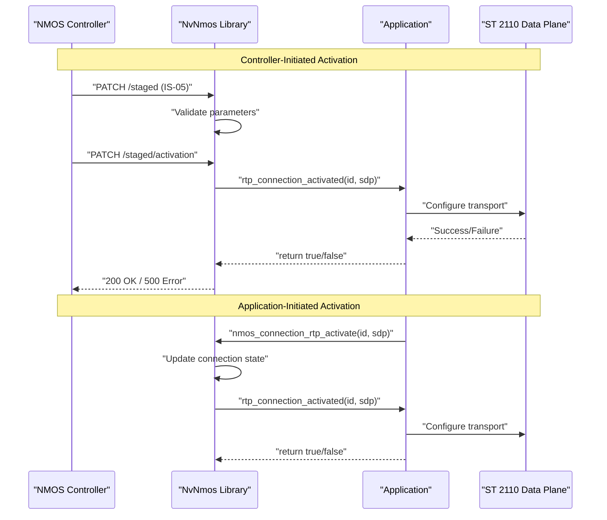
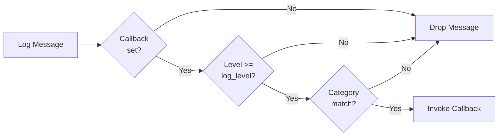
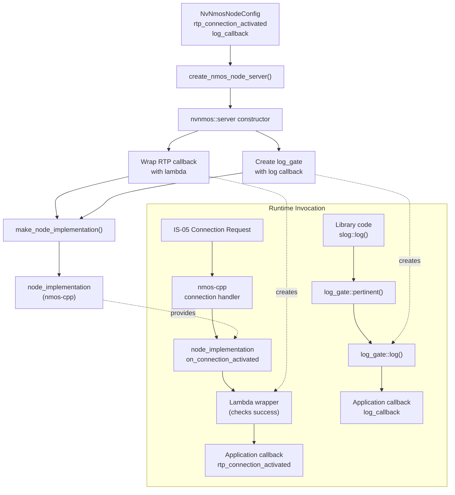

<!-- source: DeepWiki mcp.deepwiki.com · repo NVIDIA/nvnmos · page 4.4 Callbacks and Event Handling · fetched 2026-10-26 -->

# Callbacks and Event Handling

<details>
<summary>Relevant source files</summary>

The following files were used as context for generating this wiki page:

- [src/main.c](src/main.c)
- [src/nvnmos.cpp](src/nvnmos.cpp)
- [src/nvnmos.h](src/nvnmos.h)

</details>


This page documents the callback functions used by the NvNmos library to communicate events back to the application. The library provides two callback types: connection activation callbacks for handling IS-05 connection API requests, and logging callbacks for receiving diagnostic messages.

For architectural details on how callbacks are implemented internally, see [Callback Mechanism](#5.5). For information on configuring callbacks during node creation, see [Configuration Structures](#4.3).

---

## Callback Types Overview

The NvNmos library defines two callback function types that applications must implement:

| Callback Type | Purpose | Required |
|---------------|---------|----------|
| `nmos_connection_rtp_activation_callback` | Handle connection activation/deactivation requests | Optional |
| `nmos_logging_callback` | Receive log messages from the library | Optional |

Both callbacks are registered during node server creation through the `NvNmosNodeConfig` structure and can be `NULL` if not needed.

**Sources:** [src/nvnmos.h:122-163]()

---

## Connection Activation Callback

### Type Definition

```c
typedef bool (* nmos_connection_rtp_activation_callback)(
    NvNmosNodeServer *server,
    const char *id,
    const char *sdp);
```

This callback is invoked when a sender or receiver needs to be activated or deactivated, either through an IS-05 Connection API request from an NMOS Controller or through an application-initiated call to `nmos_connection_rtp_activate`.

**Sources:** [src/nvnmos.h:122-125]()

### Parameters

| Parameter | Type | Description |
|-----------|------|-------------|
| `server` | `NvNmosNodeServer *` | Pointer to the server issuing the callback. Provides access to `user_data`. |
| `id` | `const char *` | Unique identifier of the sender or receiver to activate/deactivate. |
| `sdp` | `const char *` | Session Description Protocol data for activation, or `NULL` for deactivation. |

### SDP Content

When `sdp` is non-NULL (activation), it contains updated transport parameters with the following characteristics:

- **Transport parameters only**: The SDP updates transport settings (IP addresses, ports) but not media format
- **Custom attributes**: Contains `x-nvnmos-*` attributes for NVIDIA-specific parameters:
  - `x-nvnmos-id`: Session-level attribute specifying the sender/receiver ID (matches `id` parameter)
  - `x-nvnmos-iface-ip`: Media-level attribute for receiver interface IP address
  - `x-nvnmos-src-port`: Media-level attribute for sender source port
- **Inactive legs**: The `inactive` media-level attribute indicates disabled legs in multi-leg configurations

When `sdp` is `NULL`, the sender or receiver is being deactivated.

**Sources:** [src/nvnmos.h:104-119]()

### Return Value

The callback must return `true` if the activation could be successfully applied to the media transport, or `false` if the activation failed. A `false` return value indicates to the NMOS Controller that the connection request was rejected.

### Invocation Pattern

The following diagram shows when this callback is invoked:



**Sources:** [src/nvnmos.cpp:131-141](), [src/nvnmos_impl.cpp]()

### Usage Example

```c
static bool handle_rtp_connection_activated(
    NvNmosNodeServer *server,
    const char *id,
    const char *sdp)
{
    printf("%s %s\n", id, sdp ? "activated via NMOS" : "deactivated via NMOS");
    
    if (sdp) {
        // Parse SDP and configure data plane
        // For example, extract multicast IP, port, etc.
        // Configure Rivermax or similar transport library
        printf("SDP: %s\n", sdp);
    } else {
        // Deactivate the connection
        // Stop the data plane transport for this sender/receiver
    }
    
    return true;  // Return false if configuration failed
}
```

**Sources:** [src/main.c:80-88]()

---

## Logging Callback

### Type Definition

```c
typedef void (* nmos_logging_callback)(
    NvNmosNodeServer *server,
    const char *categories,
    int level,
    const char *message);
```

This callback is invoked for log messages from the NvNmos library and the underlying nmos-cpp implementation, providing visibility into library operations and errors.

**Sources:** [src/nvnmos.h:159-163]()

### Parameters

| Parameter | Type | Description |
|-----------|------|-------------|
| `server` | `NvNmosNodeServer *` | Pointer to the server issuing the callback |
| `categories` | `const char *` | Comma-separated list of topics (e.g., submodules) |
| `level` | `int` | Severity/verbosity level of the message |
| `message` | `const char *` | The log message text |

### Logging Levels

The library defines standard logging levels as enumeration values:

| Level | Value | Description |
|-------|-------|-------------|
| `NVNMOS_LOG_DEVEL` | -40 | Low-level debugging information |
| `NVNMOS_LOG_VERBOSE` | -10 | Chatty messages, detailed API tracking |
| `NVNMOS_LOG_INFO` | 0 | Higher-level information about expected events |
| `NVNMOS_LOG_WARNING` | 10 | Minor recoverable problems |
| `NVNMOS_LOG_ERROR` | 20 | More serious recoverable errors |
| `NVNMOS_LOG_SEVERE` | 30 | Errors unlikely to be recoverable without restart |
| `NVNMOS_LOG_FATAL` | 40 | Errors likely to cause immediate termination |

Values greater than zero indicate warnings and errors. Values less than zero are debugging or trace messages.

**Sources:** [src/nvnmos.h:131-146]()

### Log Filtering

Log messages can be filtered by level and categories:

- **Level filtering**: Set `NvNmosNodeConfig.log_level` to the minimum severity to receive
- **Category filtering**: Set `NvNmosNodeConfig.log_categories` to an array of topic strings to filter by module

The `log_gate` class performs the filtering before invoking the callback:



**Sources:** [src/nvnmos.cpp:52-80](), [src/nvnmos.h:222-229]()

### Usage Example

```c
static void handle_log(
    NvNmosNodeServer *server,
    const char *categories,
    int level,
    const char *message)
{
    const char *level_str;
    if (level >= NVNMOS_LOG_FATAL) level_str = "FATAL";
    else if (level >= NVNMOS_LOG_SEVERE) level_str = "SEVERE";
    else if (level >= NVNMOS_LOG_ERROR) level_str = "ERROR";
    else if (level >= NVNMOS_LOG_WARNING) level_str = "WARNING";
    else if (level >= NVNMOS_LOG_INFO) level_str = "INFO";
    else level_str = "DEBUG";
    
    printf("[%s] %s [%s]\n", level_str, message, categories);
}
```

**Sources:** [src/main.c:71-78]()

---

## Configuring Callbacks

Callbacks are configured through the `NvNmosNodeConfig` structure before creating the node server:

```c
NvNmosNodeConfig config = { 0 };

// Set connection activation callback
config.rtp_connection_activated = &handle_rtp_connection_activated;

// Set logging callback and filtering
config.log_callback = &handle_log;
config.log_level = NVNMOS_LOG_WARNING;  // Only warnings and above

// Optionally filter by categories
const char *categories[] = { "nmos", "connection" };
config.log_categories = categories;
config.num_log_categories = 2;

// Create server with callbacks
NvNmosNodeServer server = { 0 };
create_nmos_node_server(&config, &server);
```

**Sources:** [src/nvnmos.h:216-229](), [src/main.c:288-291]()

---

## Using user_data for Context

The `NvNmosNodeServer` structure includes a `user_data` field that applications can use to pass context to callbacks:

```c
typedef struct _NvNmosNodeServer
{
    void *user_data;  // Application-specific context
    void *impl;       // Library internal data
} NvNmosNodeServer;
```

This allows callbacks to access application state without using global variables:

```c
typedef struct {
    void *rivermax_context;
    void *pipeline_state;
} AppContext;

// Set before creating node server
AppContext app_ctx;
node_server.user_data = &app_ctx;

// Access in callback
static bool handle_activation(NvNmosNodeServer *server, const char *id, const char *sdp)
{
    AppContext *ctx = (AppContext *)server->user_data;
    // Use ctx->rivermax_context, etc.
}
```

**Sources:** [src/nvnmos.h:337-349](), [src/main.c:294-295]()

---

## Callback Implementation Internals

The following diagram shows how callbacks flow from configuration to invocation:



**Sources:** [src/nvnmos.cpp:107-146](), [src/nvnmos.cpp:52-80]()

---

## Thread Safety Considerations

### Callback Invocation Context

- **Connection activation callbacks** are invoked from the nmos-cpp HTTP server thread handling IS-05 requests
- **Logging callbacks** may be invoked from multiple threads within the nmos-cpp library

### Best Practices

1. **Keep callbacks short**: Callbacks should complete quickly to avoid blocking NMOS protocol operations
2. **Thread-safe access**: If accessing shared application state, use proper synchronization
3. **Avoid blocking operations**: Do not perform long-running I/O or network operations in callbacks
4. **Queue work if needed**: For complex operations, enqueue work to a separate thread and return quickly
5. **Error handling**: Connection activation callbacks should catch and handle all exceptions, returning `false` on failure

### Example Pattern for Asynchronous Handling

```c
// In callback: queue work and return quickly
static bool handle_activation(NvNmosNodeServer *server, const char *id, const char *sdp)
{
    WorkItem *work = create_work_item(id, sdp);
    enqueue_to_worker_thread(work);
    return true;  // Return success, actual work happens asynchronously
}
```

**Sources:** [src/nvnmos.cpp:131-141]()

---

## Summary Table

| Aspect | Connection Activation Callback | Logging Callback |
|--------|-------------------------------|------------------|
| **Type** | `nmos_connection_rtp_activation_callback` | `nmos_logging_callback` |
| **Return** | `bool` (success/failure) | `void` |
| **Thread** | nmos-cpp HTTP server thread | Multiple threads |
| **Frequency** | On each connection change | Continuous during operation |
| **Filtering** | N/A | By level and categories |
| **Required** | Optional | Optional |

**Sources:** [src/nvnmos.h:122-163](), [src/nvnmos.cpp:52-141]()

---

