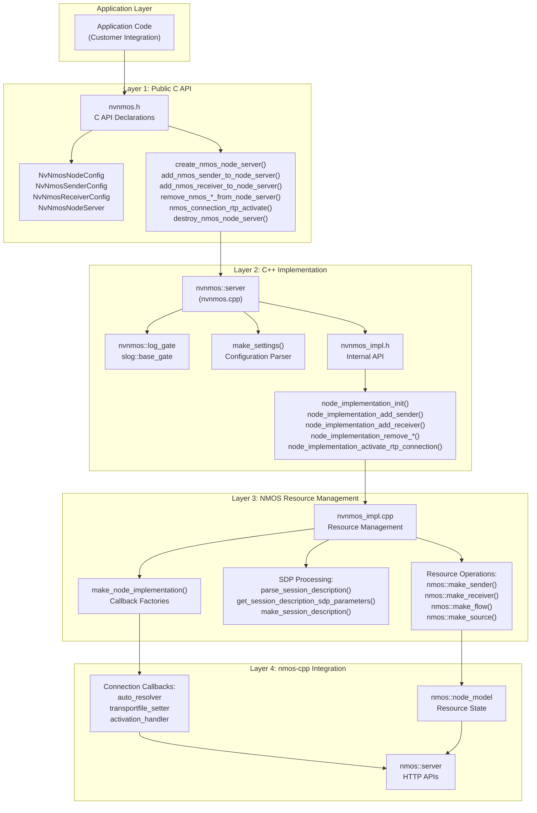
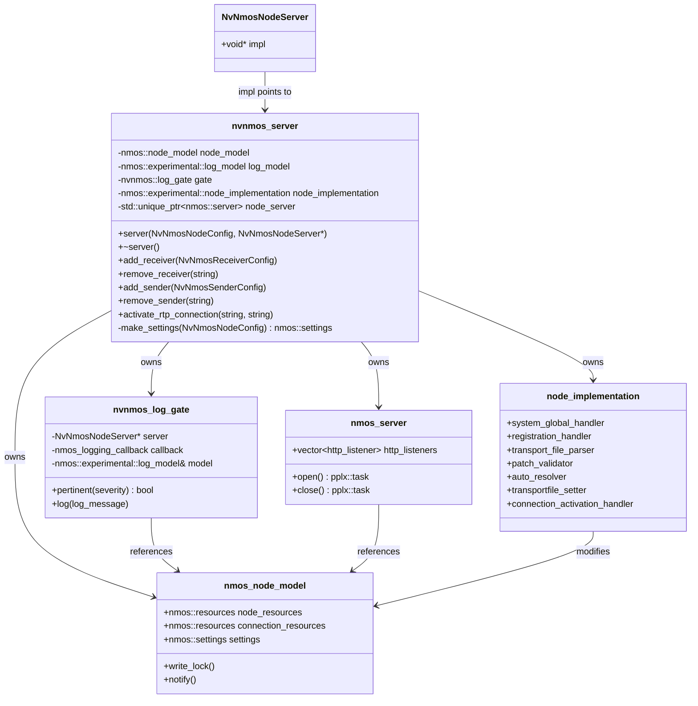
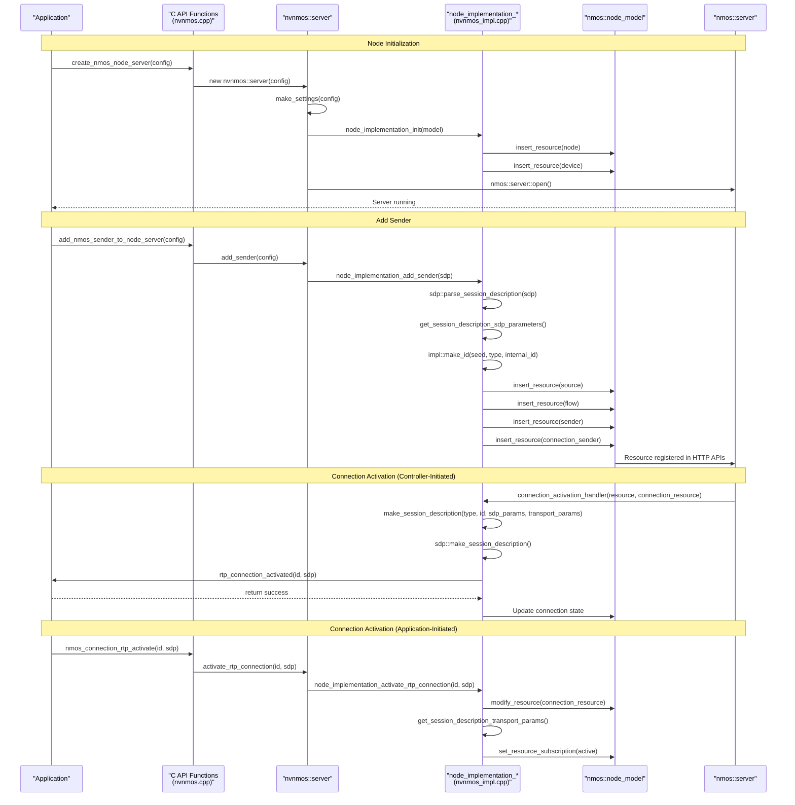
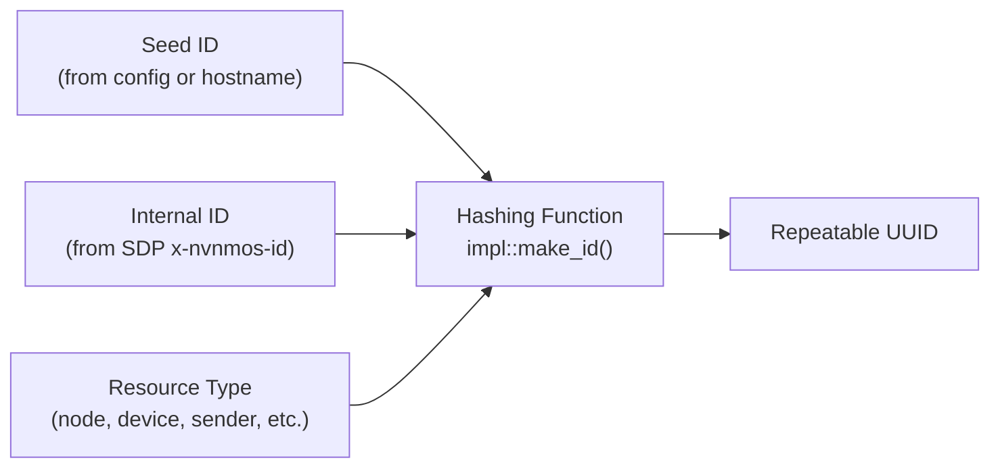
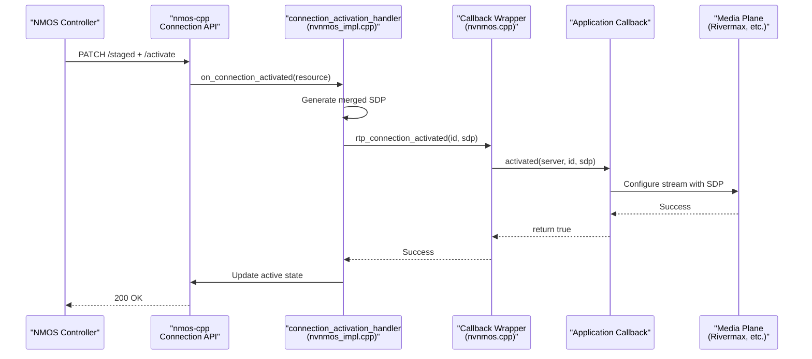

<!-- source: DeepWiki mcp.deepwiki.com · repo NVIDIA/nvnmos · page 5 Architecture and Design · fetched 2026-10-26 -->

# Architecture and Design

<details>
<summary>Relevant source files</summary>

The following files were used as context for generating this wiki page:

- [src/nvnmos.cpp](src/nvnmos.cpp)
- [src/nvnmos_impl.cpp](src/nvnmos_impl.cpp)
- [src/nvnmos_impl.h](src/nvnmos_impl.h)

</details>


This page provides a deep dive into the internal architecture of nvnmos, covering the implementation patterns, design decisions, and structural organization of the codebase. It explains how the library is organized into layers, how components interact, and the rationale behind key architectural choices.

For detailed information about specific subsystems, see:
- Layered architecture details: [#5.1](#5.1)
- Resource lifecycle management: [#5.2](#5.2)  
- SDP processing pipeline: [#5.3](#5.3)
- Integration with nmos-cpp: [#5.4](#5.4)
- Callback mechanism details: [#5.5](#5.5)

For build system architecture, see [#6](#6). For API usage patterns, see [#4](#4).

## Overview

The nvnmos library implements a **three-layer architecture** that separates concerns between the public API surface, internal resource management logic, and integration with the underlying nmos-cpp protocol implementation. This design enables a simplified C API for applications while leveraging the comprehensive NMOS protocol support provided by Sony's nmos-cpp library.

### Core Design Principles

| Principle | Implementation |
|-----------|----------------|
| **Separation of Concerns** | C API layer, implementation layer, and nmos-cpp integration are clearly delineated |
| **SDP-Driven Configuration** | All sender and receiver configuration is expressed through SDP files with custom attributes |
| **Callback-Based Integration** | Bidirectional communication between application and library through function pointers |
| **Resource Consistency** | NMOS resource model maintained through transactional updates with write locks |
| **Repeatable IDs** | Deterministic resource ID generation using seed-based hashing |

Sources: [src/nvnmos.cpp:1-612](), [src/nvnmos_impl.cpp:1-1500](), [src/nvnmos_impl.h:1-116]()

## Architectural Layers

The library is organized into three distinct layers, each with specific responsibilities:



**Figure 1: Layer Architecture with Code Entities**

Sources: [src/nvnmos.cpp:82-105](), [src/nvnmos_impl.h:26-115](), [src/nvnmos_impl.cpp:63-149]()

### Layer 1: Public C API

The outermost layer provides a C-compatible API surface defined in `nvnmos.h`. This layer consists of:

- **Configuration Structures**: `NvNmosNodeConfig`, `NvNmosSenderConfig`, `NvNmosReceiverConfig`
- **Server Handle**: `NvNmosNodeServer` (opaque pointer to internal implementation)
- **Lifecycle Functions**: `create_nmos_node_server()`, `destroy_nmos_node_server()`
- **Resource Management**: `add_nmos_sender_to_node_server()`, `remove_nmos_sender_from_node_server()`, etc.
- **Connection Control**: `nmos_connection_rtp_activate()`
- **Callback Types**: `nmos_rtp_connection_activation_callback`, `nmos_logging_callback`

The C API functions are thin wrappers that validate parameters, cast the opaque handle to the internal `nvnmos::server` instance, and forward calls to C++ methods.

Sources: [src/nvnmos.cpp:475-611]()

### Layer 2: C++ Implementation

The `nvnmos::server` class (in `nvnmos.cpp`) implements the core coordination logic:

- **Configuration Processing**: `make_settings()` transforms `NvNmosNodeConfig` into `nmos::settings`
- **Logging Integration**: `nvnmos::log_gate` bridges internal logging to application callbacks
- **Resource Management**: Methods like `add_sender()`, `remove_receiver()` that call implementation functions
- **Node Server Lifecycle**: Manages `nmos::server` instance and HTTP listeners

The implementation layer delegates NMOS-specific operations to functions in `nvnmos_impl.cpp`.

Sources: [src/nvnmos.cpp:82-473](), [src/nvnmos.cpp:216-357]()

### Layer 3: NMOS Resource Management

The `nvnmos_impl.cpp` file contains the core NMOS resource management logic:

- **Resource Creation**: Functions like `node_implementation_add_sender_()` that parse SDP and create NMOS resources
- **SDP Processing**: Custom SDP parsing with support for nvnmos-specific attributes
- **ID Generation**: Deterministic ID generation using `impl::make_id()` with seed-based hashing
- **Resource Lifecycle**: Transactional updates to `nmos::node_model` with write locks
- **Callback Factories**: `make_node_implementation_*()` functions that create callback handlers

This layer implements the `nvnmos::node_implementation` interface expected by nmos-cpp.

Sources: [src/nvnmos_impl.cpp:153-1072](), [src/nvnmos_impl.h:88-112]()

### Layer 4: nmos-cpp Integration

The library integrates with Sony's nmos-cpp through:

- **Node Model**: `nmos::node_model` stores all NMOS resources (node, device, sources, flows, senders, receivers)
- **Node Server**: `nmos::server` provides HTTP APIs for IS-04 (Discovery/Registration), IS-05 (Connection), IS-09 (System)
- **Callback Interface**: `nmos::experimental::node_implementation` with callbacks for system events, registration, connection activation, etc.

Sources: [src/nvnmos.cpp:99-104](), [src/nvnmos_impl.cpp:705-965]()

## Component Class Diagram



**Figure 2: Core Component Class Structure**

Sources: [src/nvnmos.cpp:52-105](), [src/nvnmos_impl.h:38-44]()

## Data Flow Architecture

The following diagram illustrates how data flows through the system during key operations:



**Figure 3: Data Flow for Key Operations**

Sources: [src/nvnmos.cpp:107-184](), [src/nvnmos_impl.cpp:153-188](), [src/nvnmos_impl.cpp:190-387](), [src/nvnmos_impl.cpp:875-965]()

## Key Design Patterns

### 1. Repeatable ID Generation

All NMOS resources require unique UUIDs. The library generates **deterministic, repeatable IDs** based on a seed and internal identifier:



**Figure 4: Deterministic ID Generation Pattern**

Implementation details:
- **Seed ID**: Derived from `config.seed` or hostname if not specified ([src/nvnmos.cpp:306-310]())
- **Internal ID**: Application-provided identifier in SDP `a=x-nvnmos-id` attribute ([src/nvnmos_impl.cpp:199-200]())
- **ID Function**: `impl::make_id(seed_id, type, internal_id)` ([src/nvnmos_impl.cpp:1497-1509]())

This pattern enables:
- Consistent resource IDs across restarts
- Predictable ID allocation for testing
- Correlation between application concepts and NMOS resources

Sources: [src/nvnmos_impl.cpp:1497-1509](), [src/nvnmos.cpp:203-214](), [src/nvnmos.cpp:306-310]()

### 2. Write Lock Transactionality

All modifications to the NMOS resource model are protected by write locks to ensure consistency:

```cpp
// Pattern used throughout nvnmos_impl.cpp
void node_implementation_add_sender(nmos::node_model& model, const std::string& sdp, slog::base_gate& gate)
{
    auto lock = model.write_lock(); // Acquire write lock
    
    // ... perform multiple resource insertions ...
    insert_resource(model.node_resources, source);
    insert_resource(model.node_resources, flow);
    insert_resource(model.node_resources, sender);
    
    model.notify(); // Notify observers after all changes complete
}
// Lock automatically released when scope exits
```

This ensures atomic updates even when creating complex resource hierarchies (source → flow → sender).

Sources: [src/nvnmos_impl.cpp:645-677]()

### 3. SDP as Configuration Language

Instead of requiring applications to understand NMOS resource structures, the library uses **SDP files as the primary configuration interface**:

| SDP Element | NMOS Mapping |
|-------------|--------------|
| Session name (`s=`) | `label` field of sender/receiver |
| Session information (`i=`) | `description` field |
| Media type (`m=video`, `m=audio`) | Determines source/flow type |
| Format parameters (`a=fmtp`) | Flow parameters (resolution, frame rate, bit depth, etc.) |
| Custom `a=x-nvnmos-id` | Internal identifier for resource correlation |
| Custom `a=x-nvnmos-group-hint` | Group hint for resource organization |
| Transport parameters (`c=`, port) | Connection transport_params |

This design:
- Leverages existing SDP knowledge in media applications
- Provides natural expression of ST 2110 stream parameters
- Allows incremental addition of custom attributes
- Simplifies integration with SDP-generating tools

Sources: [src/nvnmos_impl.cpp:190-387](), [src/nvnmos_impl.cpp:1076-1229]()

### 4. Callback Inversion for Integration

The library inverts control for media plane operations through callbacks:



**Figure 5: Callback Inversion Pattern**

The callback wrapper ([src/nvnmos.cpp:131-142]()) translates between C++ and C calling conventions:
- Converts `std::string` to `const char*`
- Passes opaque `NvNmosNodeServer*` handle to application
- Converts `bool` return value to indicate success/failure
- Logs warnings on activation failure

Sources: [src/nvnmos.cpp:131-142](), [src/nvnmos_impl.cpp:875-965]()

### 5. Settings-Based Resource State

The library maintains a parallel representation of resource state in `nmos::settings`:

```cpp
// Settings structure (simplified)
{
    "clocks": {
        "clk0": { "ptp_domain_number": 0 }
    },
    "senders": {
        "<sender-uuid>": { "sdp": "<original-sdp-data>" }
    },
    "receivers": {
        "<receiver-uuid>": { "sdp": "<original-sdp-data>" }
    }
}
```

This parallel state enables:
- **Transportfile Generation**: Recreate sender SDP with current transport parameters ([src/nvnmos_impl.cpp:814-872]())
- **Activation Defaults**: Fall back to original SDP when no transport file staged ([src/nvnmos_impl.cpp:907-911]())
- **Clock Tracking**: Maintain PTP domain mapping per clock ([src/nvnmos_impl.cpp:376-381]())

Sources: [src/nvnmos_impl.cpp:184-188](), [src/nvnmos_impl.cpp:383-386](), [src/nvnmos_impl.cpp:561-563](), [src/nvnmos_impl.cpp:814-872]()

## Custom SDP Attributes

The library defines custom SDP attributes in the `nvnmos::attributes` namespace to extend standard SDP:

| Attribute | Scope | Purpose |
|-----------|-------|---------|
| `x-nvnmos-id` | Session | Internal identifier for application correlation |
| `x-nvnmos-group-hint` | Session | Optional grouping hint (e.g., for BCP-002-01) |
| `x-nvnmos-caps` | Session | Disables automatic capability generation |
| `x-nvnmos-iface-ip` | Media | Interface IP address for receivers |
| `x-nvnmos-src-port` | Media | Source port for senders |
| `x-nvnmos-transport-bit-rate` | Format param | Total bit rate including overhead |
| `x-nvnmos-format-bit-rate` | Format param | Payload bit rate excluding overhead |

These attributes are processed during SDP parsing ([src/nvnmos_impl.cpp:1180-1229]()) and serialization ([src/nvnmos_impl.cpp:1076-1125]()).

Sources: [src/nvnmos_impl.h:66-84](), [src/nvnmos_impl.cpp:1076-1229]()

## Resource Model Mapping

The library maps SDP media descriptions to NMOS resource hierarchies:

```mermaid
graph TB
    SDP["SDP Media Description"]
    
    subgraph "For Senders"
        SDP_S[SDP] --> SOURCE_S["Source<br/>(video/audio/data/mux)"]
        SOURCE_S --> FLOW_S["Flow<br/>(raw-video/raw-audio/sdianc-data/mux)"]
        FLOW_S --> SENDER["Sender<br/>(transport=rtp)"]
        SENDER --> CONN_SENDER["Connection Sender<br/>(IS-05 /staged, /active)"]
    end
    
    subgraph "For Receivers"
        SDP_R[SDP] --> RECEIVER["Receiver<br/>(transport=rtp, caps)"]
        RECEIVER --> CONN_RECEIVER["Connection Receiver<br/>(IS-05 /staged, /active)"]
    end
    
    style SOURCE_S fill:#f9f9f9
    style FLOW_S fill:#f9f9f9
    style SENDER fill:#f9f9f9
    style CONN_SENDER fill:#f9f9f9
    style RECEIVER fill:#f9f9f9
    style CONN_RECEIVER fill:#f9f9f9
```



**Figure 6: SDP to NMOS Resource Mapping**

### Sender Resource Creation

When `node_implementation_add_sender_()` is called:

1. **Parse SDP**: Extract `sdp_parameters`, `transport_params`, metadata ([src/nvnmos_impl.cpp:195-202]())
2. **Determine Format**: Identify video/audio/data/mux from media type ([src/nvnmos_impl.cpp:214-215]())
3. **Create Source**: Media-type-specific source (e.g., `nmos::make_video_source()`) ([src/nvnmos_impl.cpp:236-305]())
4. **Create Flow**: Media-type-specific flow (e.g., `nmos::make_raw_video_flow()`) ([src/nvnmos_impl.cpp:241-265]())
5. **Create Sender**: `nmos::make_sender()` with interface bindings ([src/nvnmos_impl.cpp:308-334]())
6. **Create Connection Sender**: `nmos::make_connection_rtp_sender()` with constraints ([src/nvnmos_impl.cpp:336-347]())
7. **Update Device**: Add sender ID to device's senders array ([src/nvnmos_impl.cpp:364-368]())

Sources: [src/nvnmos_impl.cpp:190-387]()

### Receiver Resource Creation

When `node_implementation_add_receiver_()` is called:

1. **Parse SDP**: Extract `sdp_parameters`, `transport_params`, metadata ([src/nvnmos_impl.cpp:394-400]())
2. **Create Receiver**: Media-type-specific receiver with interface bindings ([src/nvnmos_impl.cpp:425-521]())
3. **Generate Capabilities**: If `x-nvnmos-caps` not present, auto-generate constraint sets ([src/nvnmos_impl.cpp:409](), [src/nvnmos_impl.cpp:431-473]())
4. **Create Connection Receiver**: `nmos::make_connection_rtp_receiver()` with constraints ([src/nvnmos_impl.cpp:523-534]())
5. **Update Device**: Add receiver ID to device's receivers array ([src/nvnmos_impl.cpp:549-553]())

Sources: [src/nvnmos_impl.cpp:389-564]()

## Error Handling Strategy

The library uses a multi-level error handling approach:

| Level | Mechanism | Example |
|-------|-----------|---------|
| **C API** | Return `bool`, log exception | [src/nvnmos.cpp:475-491]() |
| **C++ Server** | Catch and log, rethrow | [src/nvnmos.cpp:359-401]() |
| **Implementation** | Throw `node_implementation_exception` | [src/nvnmos_impl.cpp:172]() |
| **Callbacks** | Return false from application callback | [src/nvnmos.cpp:136-140]() |

Error propagation:
1. Internal operations throw exceptions with detailed logging
2. `nvnmos::server` catches, logs via `log_current_exception()`, and rethrows
3. C API wrappers catch all exceptions and return `false`
4. Application callback failures are logged as warnings but don't fail the operation

Sources: [src/nvnmos.cpp:359-401](), [src/nvnmos.cpp:475-491](), [src/nvnmos_impl.h:86]()

## Thread Safety Model

The library provides thread safety through:

- **Write Locks**: All model modifications acquire `model.write_lock()` ([src/nvnmos_impl.cpp:647]())
- **Notification**: `model.notify()` called after all changes in a transaction ([src/nvnmos_impl.cpp:653]())
- **Callback Serialization**: Connection activation callbacks run on nmos-cpp's callback thread
- **No Shared Mutable State**: `nvnmos::server` owns all state, no global variables

Applications must ensure:
- Callbacks can be invoked from any thread
- Callbacks should not block for extended periods
- Multiple concurrent calls to C API functions on the same server are not thread-safe

Sources: [src/nvnmos_impl.cpp:645-702]()

---

This architecture enables nvnmos to provide a simple, SDP-based interface for NMOS integration while maintaining full protocol compliance through the underlying nmos-cpp implementation. The layered design allows each component to focus on its specific responsibilities, from API translation to resource management to protocol implementation.

---

