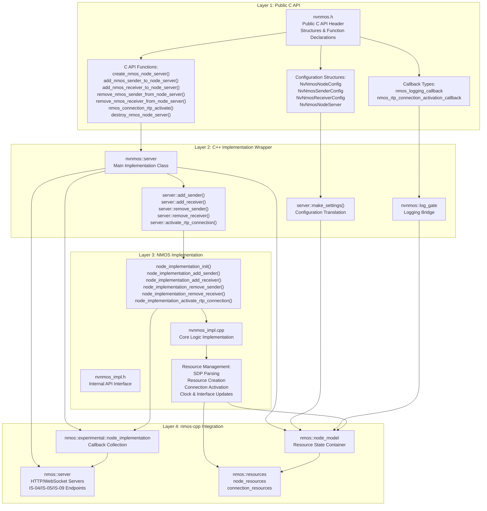
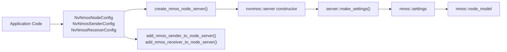
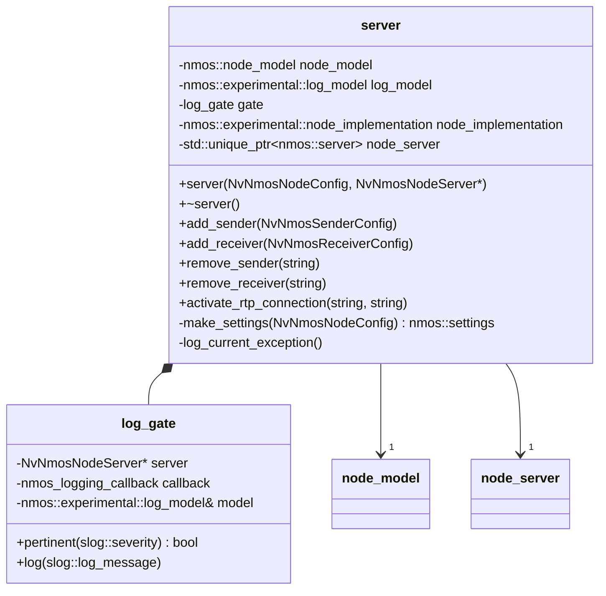
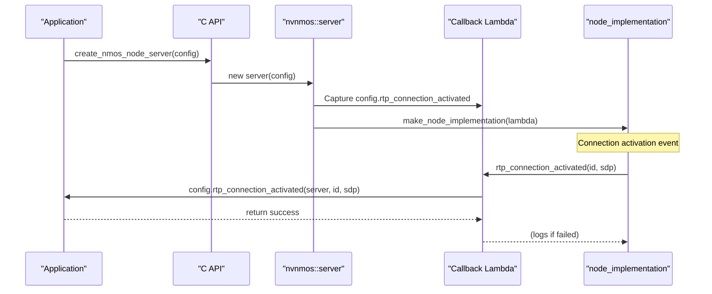
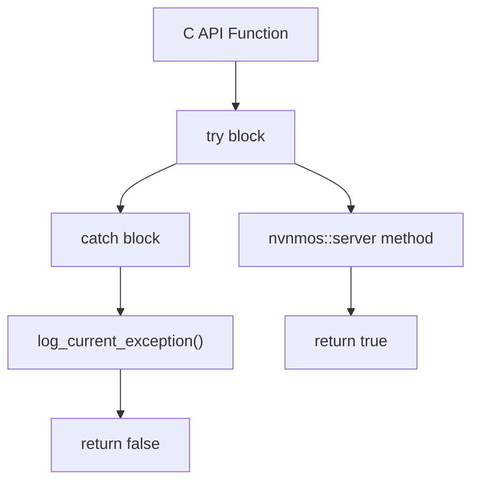
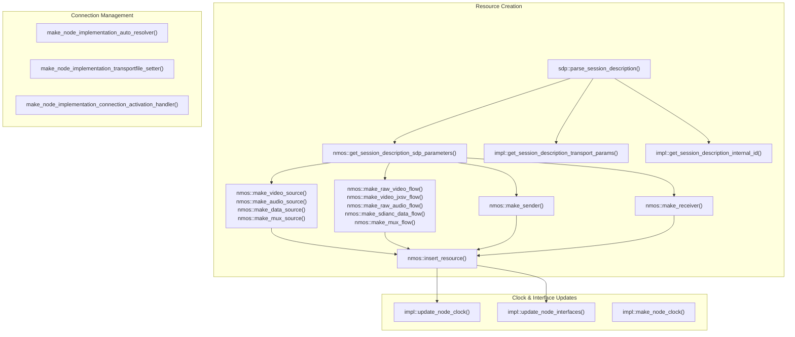
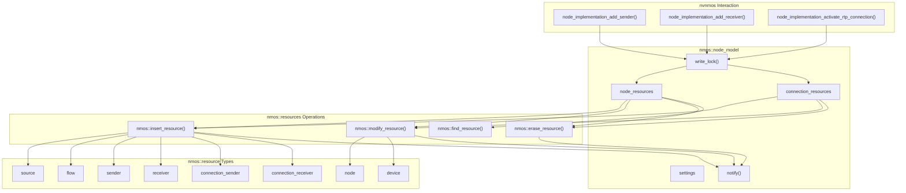
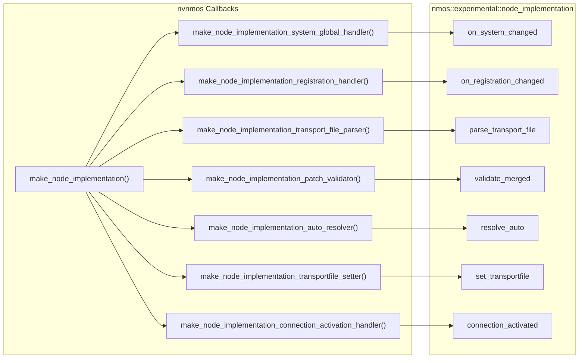
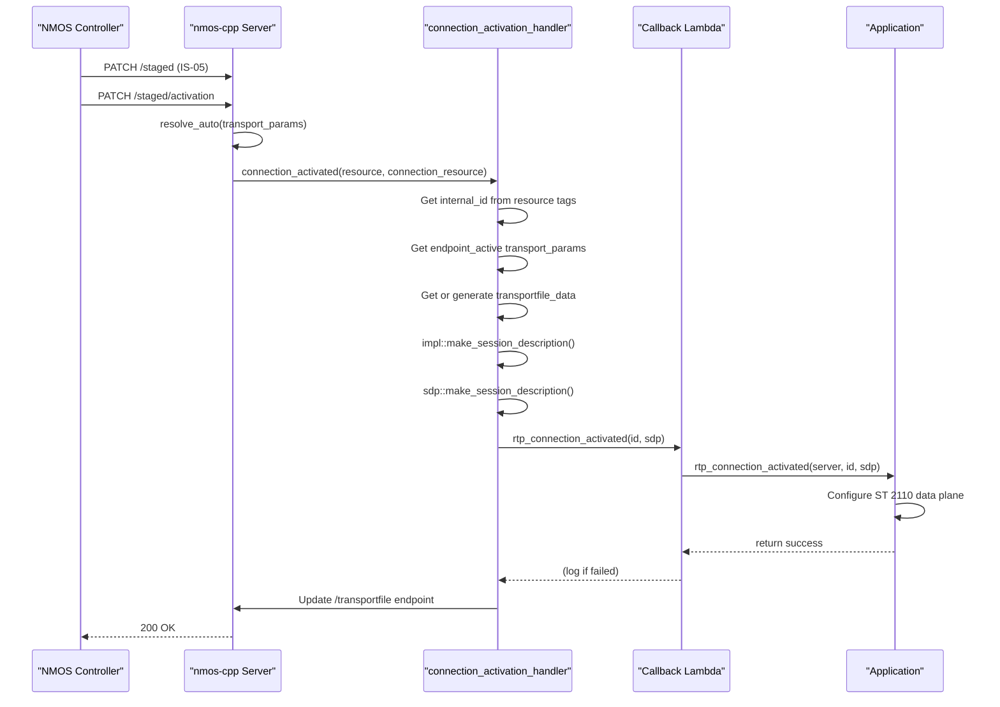

<!-- source: DeepWiki mcp.deepwiki.com · repo NVIDIA/nvnmos · page 5.1 Layered Architecture · fetched 2026-10-26 -->

# Layered Architecture

Relevant source files

The following files were used as context for generating this wiki page:

- [src/nvnmos.cpp](src/nvnmos.cpp)
- [src/nvnmos_impl.cpp](src/nvnmos_impl.cpp)
- [src/nvnmos_impl.h](src/nvnmos_impl.h)

This page describes the three-layer software architecture of the nvnmos library, explaining how responsibilities are separated between the public C API, the internal implementation, and the nmos-cpp integration layer. This architecture enables a clean separation of concerns while providing a simple C interface for external applications.

For details on specific implementation aspects covered by this architecture, see:
- Resource lifecycle operations: [Resource Lifecycle Management](#5.2)
- SDP processing details: [SDP Processing Pipeline](#5.3)
- Integration patterns with nmos-cpp: [Integration with nmos-cpp](#5.4)
- Callback mechanisms: [Callback Mechanism](#5.5)

## Architecture Overview

The nvnmos library implements a three-layer architecture that separates interface concerns from implementation concerns and isolates the dependency on the nmos-cpp library. Each layer has distinct responsibilities and communicates through well-defined interfaces.

### Layer Structure

**Sources:** [src/nvnmos.h](), [src/nvnmos.cpp:82-105](), [src/nvnmos_impl.h:26-115](), [src/nvnmos_impl.cpp:63-148]()

## Layer 1: Public C API

The top layer provides a pure C interface that external applications use to manage NMOS Nodes. This layer is defined entirely in `nvnmos.h` and has no C++ dependencies visible to the caller.

### API Surface

| Component | File | Purpose |
|-----------|------|---------|
| Function declarations | `nvnmos.h` | C API entry points for node lifecycle and resource management |
| Configuration structures | `nvnmos.h` | POD types for passing configuration data |
| Callback type definitions | `nvnmos.h` | Function pointer types for application callbacks |
| Opaque handle | `NvNmosNodeServer` | Encapsulates internal server state |

### Key API Functions

The C API exposes the following primary functions:

- **`create_nmos_node_server()`** - Initializes the NMOS node server with configuration
- **`add_nmos_sender_to_node_server()`** - Dynamically adds a sender resource
- **`add_nmos_receiver_to_node_server()`** - Dynamically adds a receiver resource
- **`remove_nmos_sender_from_node_server()`** - Removes a sender by internal ID
- **`remove_nmos_receiver_from_node_server()`** - Removes a receiver by internal ID
- **`nmos_connection_rtp_activate()`** - Application-initiated connection activation
- **`destroy_nmos_node_server()`** - Shuts down and cleans up the server

**Sources:** [src/nvnmos.cpp:475-611]()

### Configuration Data Flow

**Sources:** [src/nvnmos.cpp:107-183](), [src/nvnmos.cpp:216-357]()

## Layer 2: C++ Implementation Wrapper

The second layer implements the C API using C++ and bridges between the C interface and the internal implementation. This layer is responsible for:

- **Type conversion** - Translating C types to C++ types
- **Settings management** - Creating `nmos::settings` from configuration structures
- **Logging integration** - Routing internal logs to application callbacks
- **Exception handling** - Converting C++ exceptions to C return codes
- **Lifecycle management** - Managing the lifetime of C++ objects

### The `nvnmos::server` Class

The core of this layer is the `nvnmos::server` class, which owns all the C++ implementation objects:

**Sources:** [src/nvnmos.cpp:82-105](), [src/nvnmos.cpp:52-80]()

### Settings Translation

The `server::make_settings()` function translates C configuration structures into the `nmos::settings` format required by nmos-cpp. This function handles:

| Configuration Field | Settings Key | Processing |
|---------------------|-------------|------------|
| `host_name` | `nmos::fields::host_name` | Combined with domain to create FQDN |
| `label` | `nvnmos::fields::node_label`, `nvnmos::fields::device_label` | Direct mapping or derived from asset tags |
| `description` | `nvnmos::fields::node_description`, `nvnmos::fields::device_description` | Direct mapping or joined from functions |
| `asset_tags` | `nvnmos::fields::node_tags`, `nvnmos::fields::device_tags` | Converted to JSON objects with manufacturer, product, instance_id |
| `host_addresses` | `nmos::fields::host_addresses` | Converted to JSON array |
| `http_port` | `nmos::fields::http_port` | Direct integer mapping |
| `seed` | `nmos::experimental::fields::seed_id` | Converted to repeatable UUID |
| `network_services` | `nmos::fields::registry_address`, `nmos::fields::system_address` | DNS-SD configuration or static addresses |

**Sources:** [src/nvnmos.cpp:216-357]()

### Callback Wrapping

The layer wraps application-provided C callbacks to work with C++ internal implementations:

**Sources:** [src/nvnmos.cpp:131-142]()

### Exception Translation

All public methods catch C++ exceptions and translate them to boolean return codes:

**Sources:** [src/nvnmos.cpp:359-401](), [src/nvnmos.cpp:475-611]()

## Layer 3: NMOS Implementation

The third layer implements the core NMOS resource management logic. This layer is split between interface definitions in `nvnmos_impl.h` and implementations in `nvnmos_impl.cpp`.

### Internal API Interface

The `nvnmos_impl.h` header defines the internal API that bridges the wrapper layer to the implementation:

| Function | Purpose | Parameters |
|----------|---------|------------|
| `node_implementation_init()` | Creates initial node and device resources | `nmos::node_model&`, `slog::base_gate&` |
| `node_implementation_add_sender()` | Parses SDP and creates sender/flow/source | `nmos::node_model&`, `string sdp`, `slog::base_gate&` |
| `node_implementation_add_receiver()` | Parses SDP and creates receiver | `nmos::node_model&`, `string sdp`, `slog::base_gate&` |
| `node_implementation_remove_sender()` | Removes sender and associated resources | `nmos::node_model&`, `string id`, `slog::base_gate&` |
| `node_implementation_remove_receiver()` | Removes receiver resource | `nmos::node_model&`, `string id`, `slog::base_gate&` |
| `node_implementation_activate_rtp_connection()` | Updates connection state and transport file | `nmos::node_model&`, `string id`, `string sdp`, `slog::base_gate&` |
| `make_node_implementation()` | Creates callback collection for nmos-cpp | `nmos::node_model&`, `rtp_connection_activation_handler`, `slog::base_gate&` |

**Sources:** [src/nvnmos_impl.h:88-112]()

### Implementation Layer Responsibilities

The `nvnmos_impl.cpp` file implements complex NMOS-specific logic:

**Sources:** [src/nvnmos_impl.cpp:190-387](), [src/nvnmos_impl.cpp:389-564](), [src/nvnmos_impl.cpp:566-642]()

### Custom SDP Attributes

This layer defines and processes custom SDP attributes in the `nvnmos::attributes` namespace:

| Attribute | Usage | Purpose |
|-----------|-------|---------|
| `x-nvnmos-id` | Senders & Receivers | Internal identifier for application reference |
| `x-nvnmos-group-hint` | Senders & Receivers | Optional grouping hint for resource organization |
| `x-nvnmos-caps` | Receivers | Flag to suppress automatic capability generation |
| `x-nvnmos-iface-ip` | Senders & Receivers | Network interface IP address binding |
| `x-nvnmos-src-port` | Senders | Source port for RTP transmission |

These attributes are parsed from SDP during resource creation and used to configure NMOS resources appropriately.

**Sources:** [src/nvnmos_impl.h:66-77](), [src/nvnmos_impl.cpp:1180-1298]()

## Layer 4: nmos-cpp Integration

The bottom layer integrates with Sony's nmos-cpp library, which handles the actual NMOS protocol implementation. The nvnmos library interacts with nmos-cpp through several key interfaces:

### Data Model Integration

**Sources:** [src/nvnmos_impl.cpp:645-702]()

### Callback Integration

The library creates an `nmos::experimental::node_implementation` structure containing all callbacks needed by nmos-cpp:

**Sources:** [src/nvnmos_impl.cpp:704-965]()

### Server Integration

The `nmos::server` object created by `nmos::experimental::make_node_server()` manages:

| Component | Responsibility |
|-----------|---------------|
| HTTP listeners | Serve IS-04 Node API, IS-05 Connection API, IS-09 System API |
| Registration client | Register resources with NMOS Registry using IS-04 |
| System client | Discover system-wide configuration using IS-09 |
| Connection handler | Process IS-05 connection activation requests |
| mDNS advertisement | Advertise node services via DNS-SD |

**Sources:** [src/nvnmos.cpp:146-177]()

## Data Flow Through Layers

### Sender Addition Flow

```mermaid
sequenceDiagram
    participant App as "Application"
    participant C_API as "C API"
    participant Server as "nvnmos::server"
    participant Impl as "node_implementation_add_sender_()"
    participant Model as "nmos::node_model"
    participant Resources as "nmos::resources"
    
    App->>C_API: add_nmos_sender_to_node_server(config)
    C_API->>Server: add_sender(config)
    Server->>Impl: node_implementation_add_sender(model, sdp)
    
    Impl->>Impl: sdp::parse_session_description(sdp)
    Impl->>Impl: nmos::get_session_description_sdp_parameters()
    Impl->>Impl: impl::get_session_description_transport_params()
    Impl->>Impl: impl::get_session_description_internal_id()
    
    Impl->>Impl: nmos::make_video_source() / make_audio_source()
    Impl->>Impl: nmos::make_raw_video_flow() / make_raw_audio_flow()
    Impl->>Impl: nmos::make_sender()
    Impl->>Impl: nmos::make_connection_rtp_sender()
    
    Impl->>Model: write_lock()
    Impl->>Resources: insert_resource(source)
    Impl->>Resources: insert_resource(flow)
    Impl->>Resources: insert_resource(sender)
    Impl->>Resources: insert_resource(connection_sender)
    
    Impl->>Resources: modify_resource(device)
    Impl->>Impl: impl::update_node_interfaces()
    Impl->>Impl: impl::update_node_clock()
    
    Impl->>Model: notify()
    Model-->>Server: 
    Server-->>C_API: 
    C_API-->>App: return true
```

**Sources:** [src/nvnmos.cpp:432-445](), [src/nvnmos.cpp:549-567](), [src/nvnmos_impl.cpp:190-387]()

### Connection Activation Flow

**Sources:** [src/nvnmos_impl.cpp:874-965](), [src/nvnmos.cpp:131-142]()

## Responsibility Separation

The layered architecture achieves clean separation of concerns:

| Layer | Primary Responsibilities | Not Responsible For |
|-------|-------------------------|---------------------|
| **Public C API** | ABI stability, C compatibility, opaque handles | Type conversion, settings management, exception handling |
| **C++ Wrapper** | Settings translation, callback wrapping, exception conversion, lifecycle management | NMOS protocol logic, SDP parsing, resource state |
| **NMOS Implementation** | SDP processing, resource creation, connection activation, custom attributes | HTTP servers, protocol APIs, network communication |
| **nmos-cpp Integration** | IS-04/IS-05/IS-09 protocol implementation, HTTP/WebSocket servers, Registry communication | Application-specific configuration, SDP extensions |

This separation allows each layer to evolve independently while maintaining stable interfaces. The C API can remain constant while internal implementations improve, and the nmos-cpp library can be upgraded without affecting the public API.

**Sources:** [src/nvnmos.h](), [src/nvnmos.cpp:1-612](), [src/nvnmos_impl.h:1-115](), [src/nvnmos_impl.cpp:1-3330]()

---

