<!-- source: DeepWiki mcp.deepwiki.com · repo NVIDIA/nvnmos · page 5.2 Resource Lifecycle Management · fetched 2026-10-26 -->

# Resource Lifecycle Management

<details>
<summary>Relevant source files</summary>

The following files were used as context for generating this wiki page:

- [src/nvnmos_impl.cpp](src/nvnmos_impl.cpp)
- [src/nvnmos_impl.h](src/nvnmos_impl.h)

</details>


## Purpose and Scope

This page describes how NMOS resources are created, modified, and destroyed throughout the lifecycle of an nvnmos Node. It covers the internal implementation of resource management, including the creation of Node, Device, Source, Flow, Sender, and Receiver resources, their relationships, and how they transition through different states.

For information about the NMOS resource model itself, see [NMOS Node Architecture](#3.1). For details about the SDP processing that drives resource creation, see [SDP Processing Pipeline](#5.3). For the public API used to manage these resources, see [Node Server Management](#4.1) and [Sender and Receiver Management](#4.2).

## NMOS Resource Model

nvnmos manages a hierarchy of NMOS resources that conform to the IS-04 specification. The following diagram shows the relationships between resource types:

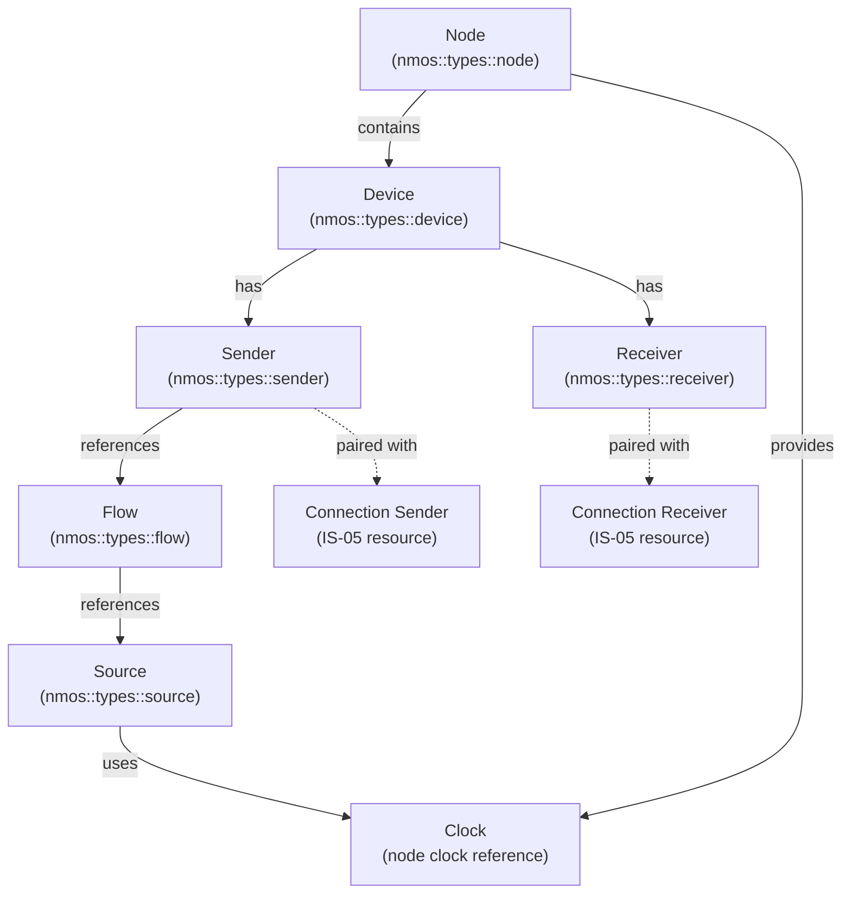

**Resource Cardinality:**
- One Node contains exactly one Device (in current implementation)
- One Device contains multiple Senders and Receivers
- Each Sender references one Flow
- Each Flow references one Source
- Each Receiver operates independently
- IS-05 Connection resources mirror each Sender/Receiver

Sources: [src/nvnmos_impl.cpp:153-188](), [src/nvnmos_impl.cpp:190-387](), [src/nvnmos_impl.cpp:389-564]()

## Lifecycle Phases

Resources in nvnmos progress through distinct lifecycle phases. The following state diagram illustrates the transitions:

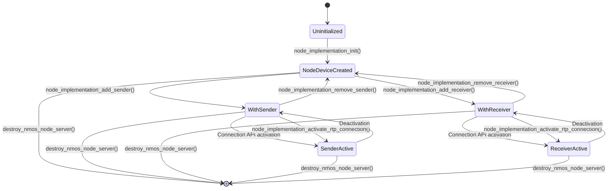

Sources: [src/nvnmos_impl.h:88-112](), [src/nvnmos_impl.cpp:645-702]()

## Initialization Phase

### Node and Device Creation

The initialization phase creates the foundational Node and Device resources. This occurs during `create_nmos_node_server()` via the `node_implementation_init()` function.

| Step | Action | Resource Created | Key Fields Set |
|------|--------|------------------|----------------|
| 1 | Generate IDs | Node ID, Device ID | Based on seed_id |
| 2 | Create default clock | Clock configuration | `clk0` (internal) |
| 3 | Create Node resource | Node | label, description, tags, clocks |
| 4 | Create Device resource | Device | label, description, tags, node_id |
| 5 | Initialize config storage | Settings entries | clocks, senders, receivers |

**ID Generation:**

Resource IDs are deterministically generated using `impl::make_id()`, which creates repeatable IDs based on a seed and resource type:

```
ID = make_repeatable_id(seed_id, "/x-nmos/node/" + type.name + "/" + internal_id)
```

This ensures that the same configuration always produces the same resource IDs, which is important for consistency across restarts.

Sources: [src/nvnmos_impl.cpp:153-188](), [src/nvnmos_impl.cpp:1365-1368]()

### Resource Storage

Resources are stored in two collections within `nmos::node_model`:

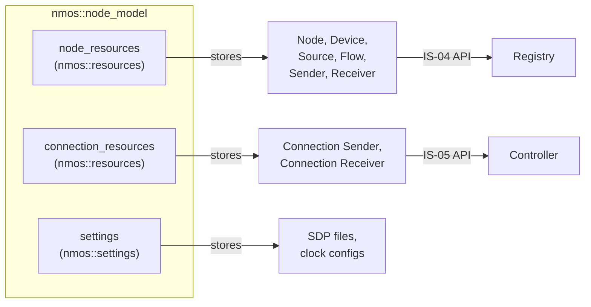

Sources: [src/nvnmos_impl.cpp:645-654]()

## Adding Resources

### Sender Resource Creation

When `node_implementation_add_sender()` is called with an SDP file, the following resources are created:

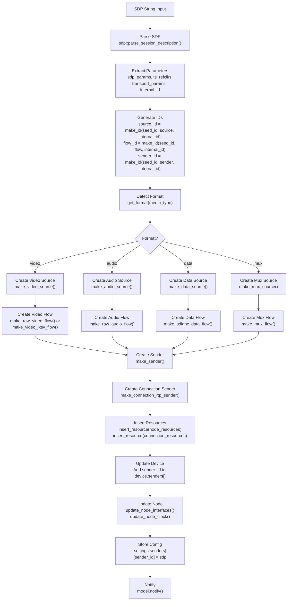

**Format-Specific Processing:**

Different media types create different Source and Flow types:

| Media Type | Source Type | Flow Type | Additional Processing |
|------------|-------------|-----------|----------------------|
| video/raw | Video Source | Raw Video Flow | Parse colorimetry, sampling, depth |
| video/jxsv | Video Source | JXSV Video Flow | Parse profile, level, bit_rate |
| audio/L24, audio/L16 | Audio Source | Raw Audio Flow | Parse channels, sample_rate, bit_depth |
| video/smpte291 | Data Source | SDIANC Data Flow | Parse DID/SDID pairs |
| video/SMPTE2022-6 | Mux Source | Mux Flow | Parse TS parameters |

Sources: [src/nvnmos_impl.cpp:190-387](), [src/nvnmos_impl.cpp:234-306]()

### Receiver Resource Creation

Receiver creation is simpler since receivers don't require Source and Flow resources:

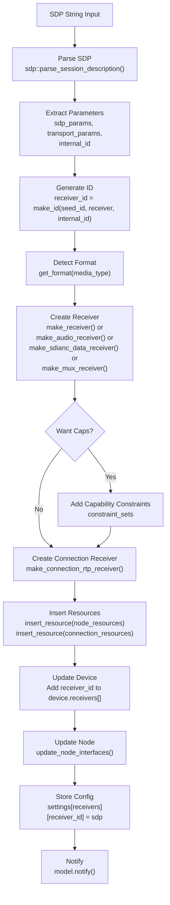

**Capability Constraints:**

If the SDP doesn't contain the custom `x-nvnmos-caps` attribute, nvnmos automatically generates capability constraints based on the SDP parameters. This allows Controllers to discover what the Receiver can accept.

Sources: [src/nvnmos_impl.cpp:389-564](), [src/nvnmos_impl.cpp:428-521]()

## Activation and Deactivation

### Connection Activation Flow

Resource activation occurs when a connection is established via the IS-05 Connection API or through the direct `node_implementation_activate_rtp_connection()` function:

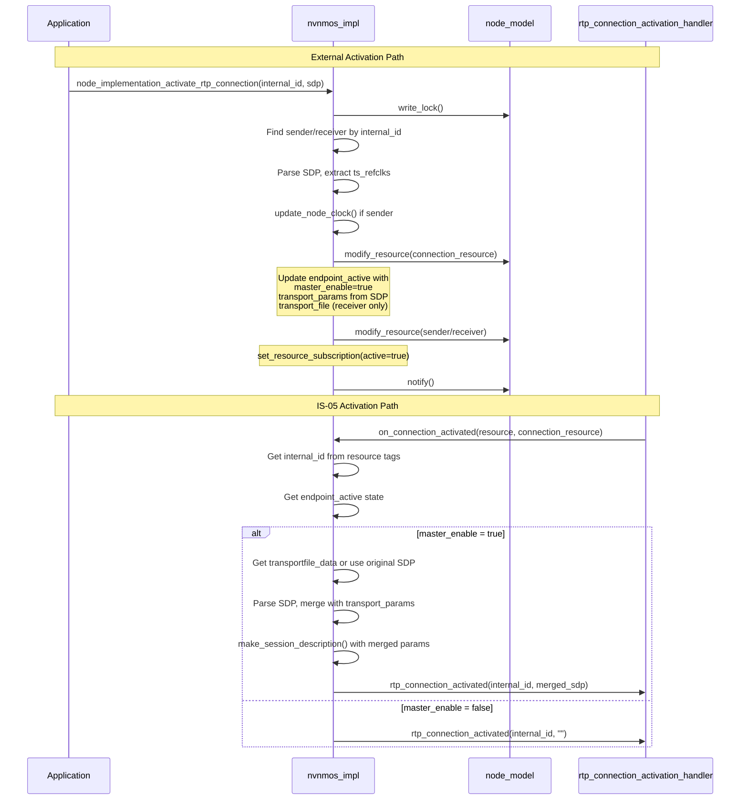

**Activation State Storage:**

The activation state is stored in multiple locations:

| Location | Purpose | Key Fields |
|----------|---------|------------|
| `connection_resource.endpoint_active` | IS-05 active endpoint | `master_enable`, `transport_params`, `transport_file` (receiver), `activation` |
| `connection_resource.endpoint_transportfile` | Sender transport file | `data` (SDP string), `type` |
| `resource.subscription` | IS-04 subscription state | `active`, `resource_id`, `updated` |
| `settings[senders/receivers][id]` | Original configuration | `sdp` (original SDP string) |

Sources: [src/nvnmos_impl.cpp:967-1072](), [src/nvnmos_impl.cpp:875-965]()

### Transport File Management

For senders, the `/transportfile` endpoint must be updated during activation to reflect the current transport parameters:

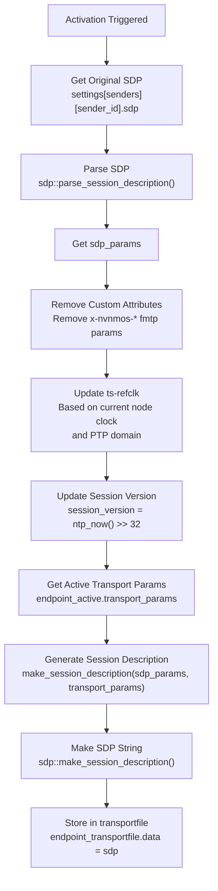

Note that custom nvnmos attributes are removed from the `/transportfile` because they are only for internal use.

Sources: [src/nvnmos_impl.cpp:814-872]()

## Removing Resources

### Resource Deletion

When `node_implementation_remove_sender()` or `node_implementation_remove_receiver()` is called, resources are removed in the correct dependency order:

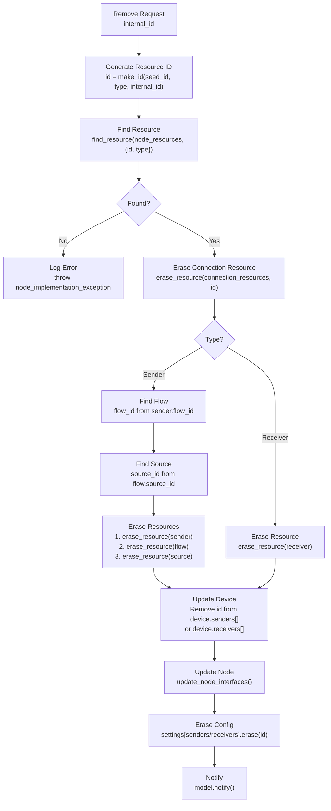

**Deletion Order:**

The deletion order is critical to maintain referential integrity:

1. Connection resource (no dependencies)
2. Sender (depends on Flow)
3. Flow (depends on Source)
4. Source (no IS-04 dependencies)

Receivers have no dependent resources, so they can be deleted directly.

Sources: [src/nvnmos_impl.cpp:566-642](), [src/nvnmos_impl.cpp:680-702]()

## Resource Identification and Tagging

### Internal ID System

nvnmos uses a dual-ID system for tracking resources:

| ID Type | Purpose | Scope | Generation |
|---------|---------|-------|------------|
| NMOS ID | IS-04 resource identifier | Global, UUIDs | `make_id(seed_id, type, internal_id)` |
| Internal ID | Application-level identifier | Application-specific | Specified in SDP `x-nvnmos-id` attribute |

**Internal ID Storage:**

The internal ID is stored as a resource tag, not in the core NMOS resource fields:

```
resource.data[nmos::fields::tags]["urn:x-nvnmos:id"] = [internal_id]
```

This allows applications to use their own naming scheme while maintaining NMOS compliance.

Sources: [src/nvnmos_impl.cpp:1384-1418](), [src/nvnmos_impl.h:67]()

### Group Hints

Resources can also carry a group hint, which is used for organizing related senders/receivers:

```
resource.data[nmos::fields::tags][nmos::fields::group_hint] = [group_hint]
```

The group hint is extracted from the SDP `x-nvnmos-group-hint` attribute and can be used by Controllers to display related resources together.

Sources: [src/nvnmos_impl.cpp:1402-1418](), [src/nvnmos_impl.h:71]()

## Node-Level Resource Management

### Interface Updates

The Node resource maintains a list of active network interfaces. This list is automatically updated whenever senders or receivers are added or removed:

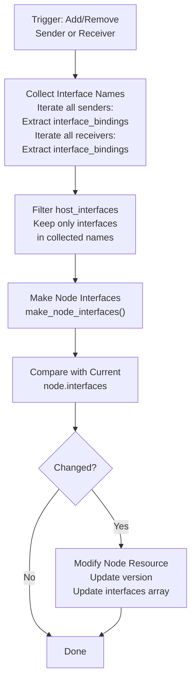

This ensures the Node advertises only the interfaces that are actually in use.

Sources: [src/nvnmos_impl.cpp:1517-1562]()

### Clock Management

The Node resource also tracks clock references. When a sender with PTP clock references is added or activated, the Node's clock configuration is updated:

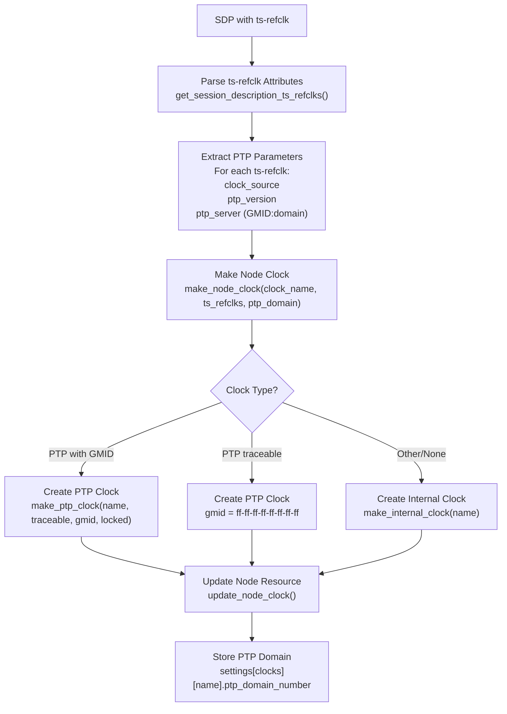

The PTP domain number is extracted from the `ts-refclk` attribute and stored in settings for use when generating the sender's `/transportfile`.

Sources: [src/nvnmos_impl.cpp:1432-1515](), [src/nvnmos_impl.cpp:375-380]()

## Version Management and Notifications

### Resource Versioning

Every NMOS resource has a version field that is updated whenever the resource is modified:

```
resource.data[nmos::fields::version] = nmos::make_version()
```

The version is a timestamp-based string that increases monotonically, allowing clients to detect changes.

**Automatic Version Updates:**

Versions are automatically updated when:
- Resource fields are modified via `nmos::modify_resource()`
- Capability constraint sets are added to receivers
- Device's sender/receiver arrays are updated
- Node's interfaces or clocks are updated
- Connection state transitions (staged → active)

Sources: [src/nvnmos_impl.cpp:366-368](), [src/nvnmos_impl.cpp:550-552](), [src/nvnmos_impl.cpp:1019-1021]()

### Model Notifications

After any resource modification, `model.notify()` must be called to wake up the nmos-cpp server threads:

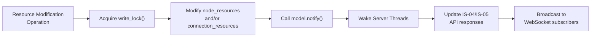

This notification mechanism ensures that:
- The Registration API sends updates to the Registry
- WebSocket clients receive resource change notifications
- Query API responses reflect the latest state

Sources: [src/nvnmos_impl.cpp:653](), [src/nvnmos_impl.cpp:665](), [src/nvnmos_impl.cpp:677](), [src/nvnmos_impl.cpp:689](), [src/nvnmos_impl.cpp:701](), [src/nvnmos_impl.cpp:1071]()

## Implementation Functions Reference

The following table summarizes the key functions involved in resource lifecycle management:

| Function | Purpose | Resources Modified | Notification |
|----------|---------|-------------------|--------------|
| `node_implementation_init()` | Initialize Node and Device | node_resources: Node, Device<br/>settings: clocks, senders, receivers | Yes |
| `node_implementation_add_sender()` | Add sender with Source and Flow | node_resources: Source, Flow, Sender<br/>connection_resources: Connection Sender<br/>settings: senders[id] | Yes |
| `node_implementation_add_receiver()` | Add receiver | node_resources: Receiver<br/>connection_resources: Connection Receiver<br/>settings: receivers[id] | Yes |
| `node_implementation_remove_sender()` | Remove sender and dependencies | node_resources: erase Sender, Flow, Source<br/>connection_resources: erase Connection Sender<br/>settings: erase senders[id] | Yes |
| `node_implementation_remove_receiver()` | Remove receiver | node_resources: erase Receiver<br/>connection_resources: erase Connection Receiver<br/>settings: erase receivers[id] | Yes |
| `node_implementation_activate_rtp_connection()` | Activate/deactivate connection | connection_resources: endpoint_active<br/>node_resources: subscription state | Yes |
| `impl::update_node_interfaces()` | Update Node interfaces | node_resources: Node.interfaces | Only if changed |
| `impl::update_node_clock()` | Update Node clock | node_resources: Node.clocks | Only if changed |
| `impl::make_id()` | Generate repeatable resource ID | N/A (utility) | No |
| `impl::set_internal_id()` | Tag resource with internal ID | resource.tags | No |
| `impl::get_internal_id()` | Retrieve internal ID from tags | N/A (query) | No |

Sources: [src/nvnmos_impl.h:88-112](), [src/nvnmos_impl.cpp:645-702](), [src/nvnmos_impl.cpp:1365-1418]()

---

