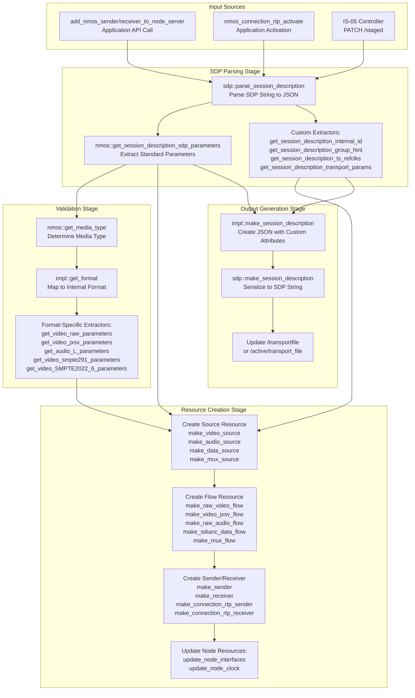
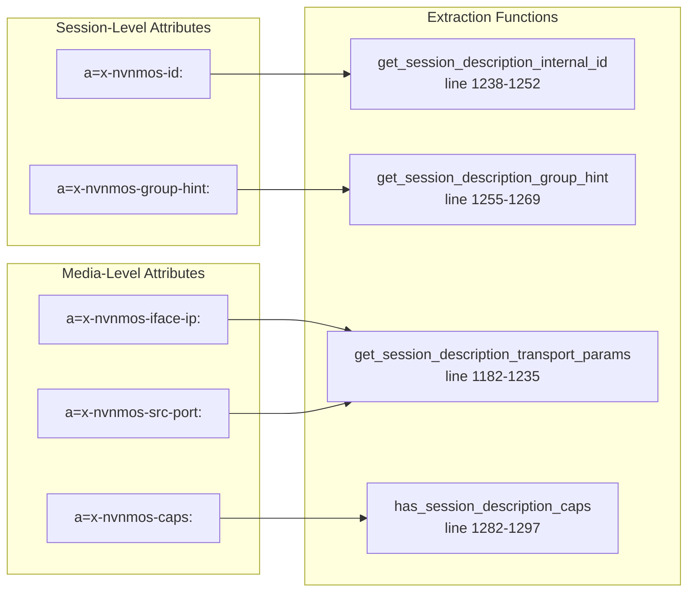
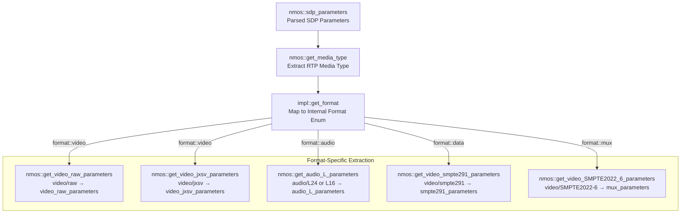
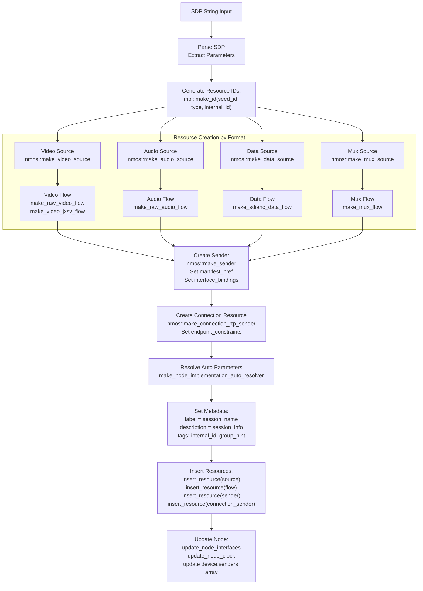
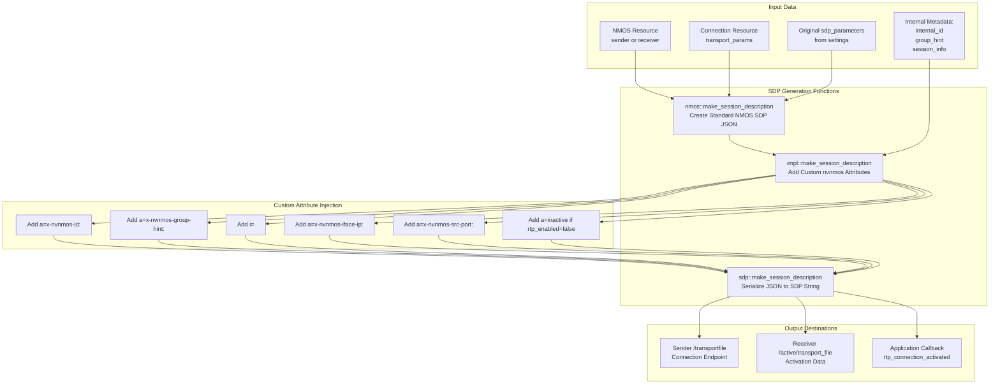

<!-- source: DeepWiki mcp.deepwiki.com · repo NVIDIA/nvnmos · page 5.3 SDP Processing Pipeline · fetched 2026-10-26 -->

# SDP Processing Pipeline

<details>
<summary>Relevant source files</summary>

The following files were used as context for generating this wiki page:

- [src/main.c](src/main.c)
- [src/nvnmos_impl.cpp](src/nvnmos_impl.cpp)

</details>


## Purpose and Scope

This document describes how nvnmos processes Session Description Protocol (SDP) data to configure NMOS senders and receivers. The SDP Processing Pipeline is responsible for parsing SDP strings, extracting both standard and custom parameters, validating media formats, and creating or updating NMOS resources based on the extracted information. This processing occurs during sender/receiver registration and connection activation.

For information about the overall resource lifecycle, see [Resource Lifecycle Management](#5.2). For details on connection activation workflows, see [Connection Activation](#3.3).

## Overview

The SDP Processing Pipeline transforms SDP strings into NMOS resources and vice versa. Applications provide SDP data to describe their media capabilities, and nvnmos parses this data to create appropriate IS-04 resources (sources, flows, senders, receivers) and IS-05 connection endpoints. The pipeline also generates SDP transport files during connection activation.

**Key Characteristics:**
- Supports ST 2110-20 (raw video), ST 2110-22 (JPEG XS), ST 2110-30 (audio), ST 2110-40 (ancillary data), and ST 2022-6 (mux)
- Extends standard SDP with custom `x-nvnmos-*` attributes for internal configuration
- Bidirectional: parses input SDP and generates output SDP for transport files
- Validates media parameters against supported formats
- Extracts timing reference clock information for PTP synchronization

Sources: [src/nvnmos_impl.cpp:1-1581]()

## SDP Processing Architecture



**SDP Processing Pipeline Overview**

The pipeline consists of five main stages: parsing, validation, resource creation, and output generation. Input SDP flows through parsing and extraction, validation of media parameters, creation of NMOS resources, and optionally generation of output SDP for transport files.

Sources: [src/nvnmos_impl.cpp:190-565](), [src/nvnmos_impl.cpp:967-1072]()

## SDP Parsing and Extraction

### Standard SDP Parsing

The pipeline uses the `sdp` library to parse SDP strings into structured JSON representations. Standard NMOS utilities then extract parameters defined by ST 2110 specifications.

| Function | Purpose | Returns |
|----------|---------|---------|
| `sdp::parse_session_description()` | Parse SDP string to JSON | `web::json::value` |
| `nmos::get_session_description_sdp_parameters()` | Extract standard parameters | `nmos::sdp_parameters` |
| `nmos::get_session_description_transport_params()` | Extract transport parameters | `web::json::value` |

The `nmos::sdp_parameters` structure contains:
- **Session information**: `session_name`, `origin`, timing
- **Media description**: `media_type`, `connection`, `port`
- **Format parameters**: `fmtp` attributes (width, height, sampling, etc.)
- **Timing**: `ts_refclk` for clock references
- **Grouping**: `group` semantics for redundant legs
- **Bandwidth**: `bandwidth` constraints

Sources: [src/nvnmos_impl.cpp:195-196](), [src/nvnmos_impl.cpp:394-395]()

### Custom Attribute Extraction

nvnmos extends standard SDP with custom attributes prefixed with `x-nvnmos-`. These attributes carry internal configuration not expressible in standard SDP.



**Custom SDP Attribute Extraction**

Custom attributes are extracted from the parsed SDP session description to provide nvnmos-specific configuration that standard NMOS does not define.

| Attribute | Level | Purpose | Extractor Function |
|-----------|-------|---------|-------------------|
| `x-nvnmos-id` | Session | Internal identifier for sender/receiver | `impl::get_session_description_internal_id()` |
| `x-nvnmos-group-hint` | Session | Grouping hint for UI organization | `impl::get_session_description_group_hint()` |
| `x-nvnmos-iface-ip` | Media | Network interface IP address | `impl::get_session_description_transport_params()` |
| `x-nvnmos-src-port` | Media | Source port (senders only) | `impl::get_session_description_transport_params()` |
| `x-nvnmos-caps` | Media | Capability constraints override | `impl::has_session_description_caps()` |

Sources: [src/nvnmos_impl.cpp:1237-1297](), [src/nvnmos_impl.cpp:1182-1235]()

### Timing Reference Clock Extraction

The pipeline extracts PTP and other timing references from `a=ts-refclk` attributes to configure node clocks. Unlike standard NMOS processing that expects a single clock reference, nvnmos supports multiple `ts-refclk` attributes per media description.

**Function**: `impl::get_session_description_ts_refclks()`  
**Location**: [src/nvnmos_impl.cpp:1160-1178]()

**Supported Clock Sources:**
- **PTP IEEE 1588-2008**: `a=ts-refclk:ptp=IEEE1588-2008:<gmid>[:<domain>]`
- **PTP Traceable**: `a=ts-refclk:ptp=IEEE1588-2008:traceable`
- **Local MAC**: `a=ts-refclk:localmac=<mac-address>`

The function returns a vector of vectors: one vector of clock references per media description (leg), allowing different clocks for redundant streams.

Sources: [src/nvnmos_impl.cpp:1127-1178](), [src/nvnmos_impl.cpp:1432-1484]()

## Media Format Processing

### Format Detection and Validation



**Media Format Detection and Parameter Extraction**

The `impl::get_format()` function maps NMOS media types to an internal format enumeration, then format-specific extractors parse the detailed parameters.

**Format Enumeration** ([src/nvnmos_impl.cpp:74-84]()):
```cpp
enum class format {
    video,  // video/raw or video/jxsv
    audio,  // audio/L24 or audio/L16
    data,   // video/smpte291
    mux     // video/SMPTE2022-6
}
```

Sources: [src/nvnmos_impl.cpp:74-84](), [src/nvnmos_impl.cpp:1330-1340](), [src/nvnmos_impl.cpp:214-215]()

### Video Format Processing

For video formats, the pipeline extracts resolution, frame rate, color space, and encoding parameters. JPEG XS requires additional bit rate information.

**Video Raw (ST 2110-20)** - [src/nvnmos_impl.cpp:236-247]():
- Width, height from `fmtp` parameters
- Exact frame rate (rational number)
- Interlace mode (progressive/interlaced)
- Color sampling (e.g., YCbCr-4:2:2)
- Bit depth
- Colorimetry and transfer characteristic

**Video JXSV (ST 2110-22)** - [src/nvnmos_impl.cpp:249-265]():
- All video/raw parameters plus:
- JPEG XS profile, level, sublevel
- Format bit rate (extracted via `impl::get_format_bit_rate()`)
- Transport bit rate (extracted via `impl::get_transport_bit_rate()`)
- Packet transmission mode

Sources: [src/nvnmos_impl.cpp:236-265](), [src/nvnmos_impl.cpp:1303-1328]()

### Audio Format Processing

Audio processing extracts channel count, sample rate, bit depth, and optional packet timing.

**Audio Parameters** - [src/nvnmos_impl.cpp:268-285]():
- Sample rate (e.g., 48000 Hz)
- Bit depth (16 or 24 bits)
- Channel count
- Channel order (from `fmtp` if present)
- Packet time (`ptime` attribute)

The pipeline creates a channel vector with placeholder symbols if the channel order is not specified in the SDP.

Sources: [src/nvnmos_impl.cpp:268-285]()

### Ancillary Data and Mux Processing

**Ancillary Data (ST 2110-40)** - [src/nvnmos_impl.cpp:286-295]():
- Frame rate for grain rate
- DID/SDID list for packet identification

**Mux (ST 2022-6)** - [src/nvnmos_impl.cpp:296-306]():
- Grain rate (currently hardcoded to 50 fps)
- MPEG-TS parameters

Sources: [src/nvnmos_impl.cpp:286-306]()

## Resource Creation from SDP

### Sender Resource Creation

The `node_implementation_add_sender_()` function orchestrates creation of source, flow, and sender resources from parsed SDP.



**Sender Resource Creation Pipeline**

Starting from parsed SDP, the pipeline generates deterministic resource IDs, creates format-specific source and flow resources, creates the sender and connection resources, resolves auto parameters, and updates the node model.

Sources: [src/nvnmos_impl.cpp:190-387]()

### Resource ID Generation

Resource IDs are deterministically generated using a seed ID and the internal ID from the SDP:

**Function**: `impl::make_id(seed_id, type, internal_id)`  
**Location**: [src/nvnmos_impl.cpp:1365-1368]()

```
resource_id = nmos::make_repeatable_id(seed_id, "/x-nmos/node/" + type.name + "/" + internal_id)
```

This ensures that resources can be consistently identified across application restarts and matched with their configuration data stored in settings.

| Resource Type | ID Pattern | Example |
|---------------|------------|---------|
| Source | `/x-nmos/node/source/<internal_id>` | `source-0` → deterministic UUID |
| Flow | `/x-nmos/node/flow/<internal_id>` | `source-0` → deterministic UUID |
| Sender | `/x-nmos/node/sender/<internal_id>` | `sink-0` → deterministic UUID |
| Receiver | `/x-nmos/node/receiver/<internal_id>` | `source-1` → deterministic UUID |

Sources: [src/nvnmos_impl.cpp:1365-1368](), [src/nvnmos_impl.cpp:207-209]()

### Interface Binding

The pipeline validates that the network interfaces specified in the SDP exist on the host system:

**Process**:
1. Extract `source_ip` (senders) or `interface_ip` (receivers) from transport parameters
2. Find matching interface: `impl::find_interface(host_interfaces, address)`
3. Set `interface_bindings` array on sender/receiver resource
4. Update node's `interfaces` array to include all bound interfaces

If an interface address is not found, the function logs an error and throws `node_implementation_exception`.

Sources: [src/nvnmos_impl.cpp:217-229](), [src/nvnmos_impl.cpp:1355-1362](), [src/nvnmos_impl.cpp:1517-1562]()

### Receiver Resource Creation

The `node_implementation_add_receiver_()` function creates receiver resources with capability constraints.

**Key Differences from Senders**:
- Creates only receiver resource (no source/flow)
- Generates capability constraint sets from SDP parameters
- Supports `x-nvnmos-caps` attribute to suppress auto-generated constraints

**Capability Generation** - [src/nvnmos_impl.cpp:409-473]():

For video/raw receivers:
- `grain_rate`: exact frame rate constraint
- `frame_width`, `frame_height`: resolution constraints
- `interlace_mode`: list of compatible modes
- `color_sampling`: sampling constraint

For video/jxsv receivers (BCP-006-01):
- `profile`, `level`, `sublevel`: JPEG XS constraints
- `bit_rate`: format and transport bit rate limits
- `packet_transmission_mode`: transmission mode constraint

For audio receivers:
- `channel_count`, `sample_rate`, `sample_depth`
- `packet_time`, `max_packet_time` (if specified)

Sources: [src/nvnmos_impl.cpp:389-564]()

## Transport Parameter Processing

### Transport Parameter Extraction

The `impl::get_session_description_transport_params()` function extends standard NMOS extraction with custom attributes.

**Standard Extraction** ([src/nvnmos_impl.cpp:1186]()):
- Calls `nmos::get_session_description_transport_params()` for base parameters
- Extracts `multicast_ip`, `interface_ip`, `destination_port`, `rtp_enabled`

**Custom Enhancements** ([src/nvnmos_impl.cpp:1189-1232]()):

For **senders**:
- Rename `multicast_ip`/`interface_ip` to `destination_ip`
- Extract `source_ip` from `a=x-nvnmos-iface-ip`
- Extract `source_port` from `a=x-nvnmos-src-port` (defaults to "auto")

For **receivers**:
- Extract `interface_ip` from `a=x-nvnmos-iface-ip`
- Keep `multicast_ip` and `destination_port` from standard extraction

For **both**:
- Detect `a=inactive` attribute to set `rtp_enabled: false`

Sources: [src/nvnmos_impl.cpp:1182-1235]()

### Connection Constraints

When creating connection resources, the pipeline adds endpoint constraints that limit the allowed transport parameters during IS-05 connections.

**Sender Constraints** - [src/nvnmos_impl.cpp:338-344]():
```json
{
  "endpoint_constraints": [
    {
      "source_ip": {
        "constraint_enum": ["<source_ip from SDP>"]
      }
    }
  ]
}
```

**Receiver Constraints** - [src/nvnmos_impl.cpp:525-531]():
```json
{
  "endpoint_constraints": [
    {
      "interface_ip": {
        "constraint_enum": ["<interface_ip from SDP>"]
      }
    }
  ]
}
```

These constraints prevent controllers from activating connections with incompatible network configurations.

Sources: [src/nvnmos_impl.cpp:336-344](), [src/nvnmos_impl.cpp:523-531]()

## SDP Generation Pipeline

### Session Description Generation

When activating connections or updating transport files, the pipeline generates SDP from NMOS resources and transport parameters.



**SDP Generation and Custom Attribute Injection**

The generation pipeline creates standard NMOS SDP, injects custom nvnmos attributes, serializes to SDP string, and delivers to appropriate destinations.

Sources: [src/nvnmos_impl.cpp:1076-1125]()

### Custom Attribute Injection

The `impl::make_session_description()` function adds nvnmos-specific attributes to the SDP:

**Session-Level Attributes** ([src/nvnmos_impl.cpp:1086-1093]()):
```
a=x-nvnmos-id:<internal_id>
a=x-nvnmos-group-hint:<group_hint>  // if not empty
i=<session_info>                     // if not empty
```

**Media-Level Attributes** ([src/nvnmos_impl.cpp:1096-1122]()):
```
a=x-nvnmos-src-port:<source_port>   // senders only, if not auto
a=x-nvnmos-iface-ip:<interface_ip>  // source_ip for senders, interface_ip for receivers
a=inactive                           // if rtp_enabled is false
```

Sources: [src/nvnmos_impl.cpp:1078-1125]()

### Transport File Updates

**Sender Transportfile** - [src/nvnmos_impl.cpp:815-872]():

The `make_node_implementation_transportfile_setter()` callback updates the sender's `/transportfile` endpoint during activation:

1. Retrieve original SDP from settings
2. Parse to extract `sdp_parameters`
3. Remove custom `x-nvnmos-*` fmtp parameters
4. Update `ts-refclk` based on current node clock
5. Update session version to NTP timestamp
6. Merge with active `transport_params`
7. Generate standard NMOS SDP (without custom attributes)
8. Set on `endpoint_transportfile`

**Receiver Transport File** - [src/nvnmos_impl.cpp:1032-1039]():

For receivers, the transport file is set on `/active/transport_file` with the SDP data and type:
```json
{
  "data": "<sdp_string>",
  "type": "application/sdp"
}
```

Sources: [src/nvnmos_impl.cpp:815-872](), [src/nvnmos_impl.cpp:1032-1039]()

### Activation SDP Merging

During connection activation, the pipeline merges the original SDP with active transport parameters to create the effective SDP for the application.

**Process** - [src/nvnmos_impl.cpp:899-963]():

1. Determine if activating or deactivating (`master_enable` flag)
2. Get transport file: sender's `/transportfile` or receiver's `/active/transport_file`
3. If no transport file staged, use original SDP from settings
4. Parse transport file to extract `sdp_parameters`
5. Handle multi-leg receivers with single-leg SDP:
   - Set `group.semantics` to duplication
   - Generate media stream IDs for each leg
   - Replicate `ts_refclk` across legs
6. Update session version to NTP timestamp
7. Call `impl::make_session_description()` to merge with transport params
8. Serialize to SDP string
9. Invoke `rtp_connection_activated()` callback with merged SDP

Sources: [src/nvnmos_impl.cpp:875-965]()

## Clock and Interface Updates

### Node Clock Updates

When processing sender SDP, the pipeline extracts timing references and updates the node's clock resources.

**Function**: `impl::update_node_clock()`  
**Location**: [src/nvnmos_impl.cpp:1486-1515]()

**Process**:
1. Parse `ts-refclk` attributes from SDP using `impl::get_session_description_ts_refclks()`
2. Create node clock using `impl::make_node_clock()` which:
   - Returns internal clock if no timing references
   - Returns PTP clock with GMID and domain if specified
   - Returns PTP traceable clock if only traceable reference
   - Returns local MAC clock if specified
3. Compare with existing clock in node resource
4. Update clock and increment version if changed

The PTP domain is extracted from the `ts-refclk` attribute and stored in settings for use when generating sender transport files.

Sources: [src/nvnmos_impl.cpp:1432-1515](), [src/nvnmos_impl.cpp:376-380]()

### Interface Updates

The pipeline updates the node's interfaces array to reflect all interfaces currently bound to senders or receivers.

**Function**: `impl::update_node_interfaces()`  
**Location**: [src/nvnmos_impl.cpp:1517-1562]()

**Process**:
1. Collect all `interface_bindings` from all senders
2. Collect all `interface_bindings` from all receivers
3. Filter host interfaces to those in the collected set
4. Generate NMOS interface resources using `nmos::make_node_interfaces()`
5. Compare with existing interfaces in node resource
6. Update interfaces and increment version if changed

This ensures the node advertises only the interfaces it actually uses, improving discovery efficiency.

Sources: [src/nvnmos_impl.cpp:1517-1562](), [src/nvnmos_impl.cpp:372](), [src/nvnmos_impl.cpp:557]()

## Error Handling and Validation

### Validation Points

The SDP Processing Pipeline includes multiple validation points where errors can be detected:

| Stage | Validation | Exception Type |
|-------|------------|----------------|
| Parse | SDP syntax validity | `sdp::parse_exception` |
| Format Detection | Supported media type | `node_implementation_exception` |
| Interface Lookup | Interface exists on host | `node_implementation_exception` |
| Resource Creation | Valid parameters for format | Various NMOS exceptions |
| ID Uniqueness | Internal ID not duplicate | Currently not validated |

When validation fails, the functions throw `node_implementation_exception` which propagates to the C API layer where it's caught and returns false to the application.

Sources: [src/nvnmos_impl.cpp:226](), [src/nvnmos_impl.cpp:420](), [src/nvnmos_impl.cpp:1339]()

### Logging

The pipeline logs errors and informational messages through the `slog::base_gate` interface:

**Error Logging** - [src/nvnmos_impl.cpp:224-226]():
```cpp
slog::log<slog::severities::severe>(gate, SLOG_FLF)
    << "No network interface corresponding to the connection address: " 
    << address << " for: " << internal_id;
```

**Info Logging** - [src/nvnmos_impl.cpp:883](), [src/nvnmos_impl.cpp:994]():
```cpp
slog::log<slog::severities::info>(gate, SLOG_FLF) 
    << "Activating " << id_type;
```

These logs are routed through the `log_gate` to the application's log callback for debugging and monitoring.

Sources: [src/nvnmos_impl.cpp:224-226](), [src/nvnmos_impl.cpp:883](), [src/nvnmos_impl.cpp:994]()

## Example SDP Processing

### Example Input SDP

The example application demonstrates SDP construction for various media types. Here's a video sender example:

[src/main.c:91-152]()

**Key Elements**:
- `a=x-nvnmos-id:sink-0` - Internal identifier
- `a=x-nvnmos-group-hint:tx-0:video` - Grouping hint
- `a=x-nvnmos-iface-ip:192.0.2.0` - Interface IP
- `a=x-nvnmos-src-port:5004` - Source port
- `a=ts-refclk:ptp=...` - Timing reference
- Standard ST 2110-20 or ST 2110-22 format parameters in `a=fmtp`

### Resource Creation Example

Given the SDP above, the pipeline creates:

**Source**: Video source with frame rate, linked to clock `clk0`  
**Flow**: Raw video flow or JXSV flow with resolution, color space, bit depth  
**Sender**: RTP sender with manifest URL, interface bindings  
**Connection**: Connection sender with constraints and active endpoint

The internal ID `sink-0` generates deterministic UUIDs:
- Source ID: `make_id(seed_id, "source", "sink-0")`
- Flow ID: `make_id(seed_id, "flow", "sink-0")`
- Sender ID: `make_id(seed_id, "sender", "sink-0")`

Sources: [src/main.c:91-152](), [src/nvnmos_impl.cpp:207-209]()

## Integration Points

The SDP Processing Pipeline integrates with other nvnmos subsystems:

| Subsystem | Integration Point | Description |
|-----------|------------------|-------------|
| C API Layer | `add_nmos_sender/receiver_to_node_server()` | Entry point for SDP input |
| Resource Lifecycle | `node_implementation_add_sender/receiver()` | Creates resources from SDP |
| Connection Activation | `make_node_implementation_connection_activation_handler()` | Generates activation SDP |
| Auto Resolver | `make_node_implementation_auto_resolver()` | Resolves "auto" values in transport params |
| Transportfile Setter | `make_node_implementation_transportfile_setter()` | Updates sender transport files |
| Settings Storage | `nvnmos::fields::senders/receivers` | Stores original SDP for later use |

For details on how these subsystems interact, see [Layered Architecture](#5.1) and [Integration with nmos-cpp](#5.4).

Sources: [src/nvnmos_impl.cpp:657-702](), [src/nvnmos_impl.cpp:1565-1579]()

---

