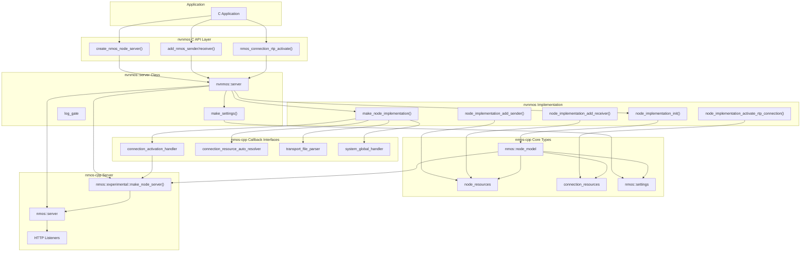
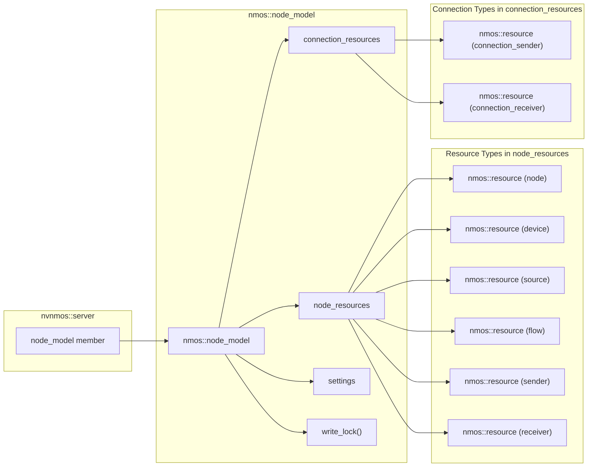
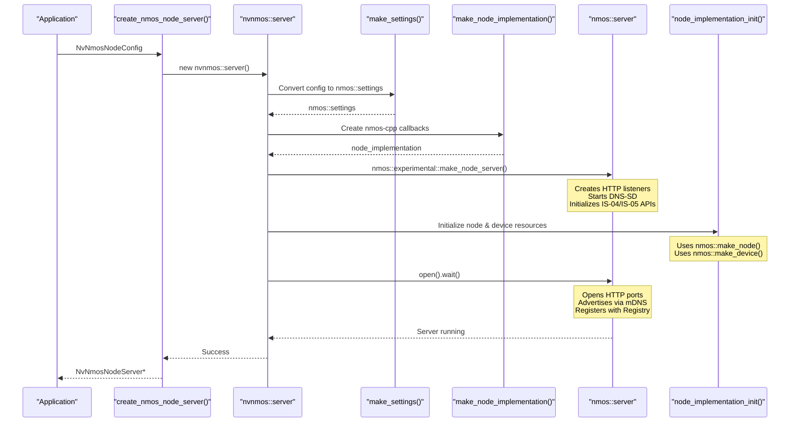
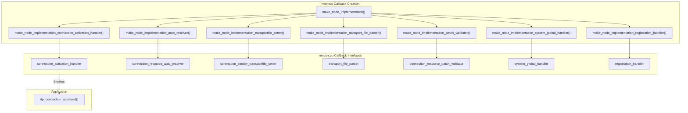
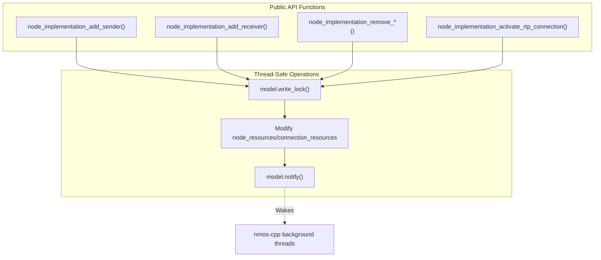

<!-- source: DeepWiki mcp.deepwiki.com · repo NVIDIA/nvnmos · page 5.4 Integration with nmos-cpp · fetched 2026-10-26 -->

# Integration with nmos-cpp

<details>
<summary>Relevant source files</summary>

The following files were used as context for generating this wiki page:

- [src/nvnmos.cpp](src/nvnmos.cpp)
- [src/nvnmos_impl.cpp](src/nvnmos_impl.cpp)
- [src/nvnmos_impl.h](src/nvnmos_impl.h)

</details>


This document explains how nvnmos extends and integrates with Sony's nmos-cpp library to provide NMOS functionality. The integration architecture wraps nmos-cpp's protocol implementation with a simplified C API while extending its capabilities with custom SDP attributes and resource management patterns.

For information about the overall layered architecture, see [Layered Architecture](#5.1). For details on the C API itself, see [API Reference](#4).

## Integration Architecture

nvnmos acts as a thin wrapper around nmos-cpp, leveraging its comprehensive NMOS protocol implementation (IS-04, IS-05, IS-09) while adding NVIDIA-specific functionality and a C API surface. The integration is primarily implemented in three layers:

| Layer | Files | Purpose |
|-------|-------|---------|
| **C API Wrapper** | [src/nvnmos.cpp]() | Translates C API calls to C++ operations, manages server lifecycle |
| **Implementation Layer** | [src/nvnmos_impl.cpp](), [src/nvnmos_impl.h]() | Implements NMOS resource management using nmos-cpp primitives |
| **Protocol Layer** | nmos-cpp library | Provides HTTP servers, DNS-SD, Registry/Controller communication |



**Diagram: Integration Architecture Overview**

Sources: [src/nvnmos.cpp:82-105](), [src/nvnmos.cpp:107-184](), [src/nvnmos_impl.h:37-44]()

## Core nmos-cpp Types

nvnmos directly uses several core nmos-cpp types to manage NMOS resources and state:

### nmos::node_model

The `nmos::node_model` is the central data structure that holds all NMOS resources and configuration:



**Diagram: nmos::node_model Structure**

The `nmos::node_model` object is owned by `nvnmos::server` and accessed through write locks for thread-safe modifications:

| Operation | Lock Usage | Example |
|-----------|------------|---------|
| Resource creation/modification | `model.write_lock()` | [src/nvnmos_impl.cpp:647-654]() |
| Resource query | Read access via nmos-cpp | [src/nvnmos_impl.cpp:846-850]() |
| Notification | `model.notify()` | [src/nvnmos_impl.cpp:653]() |

Sources: [src/nvnmos.cpp:99](), [src/nvnmos_impl.cpp:645-654]()

### nmos::settings

nvnmos extends `nmos::settings` with custom configuration fields while preserving all nmos-cpp settings:

```cpp
// Custom nvnmos settings fields
nvnmos::fields::node_label
nvnmos::fields::node_description
nvnmos::fields::node_tags
nvnmos::fields::device_label
nvnmos::fields::device_description
nvnmos::fields::device_tags
nvnmos::fields::senders      // object mapping sender IDs to configs
nvnmos::fields::receivers    // object mapping receiver IDs to configs
nvnmos::fields::clocks       // object mapping clock names to configs
```

These are defined in [src/nvnmos_impl.h:49-64]() and populated in [src/nvnmos.cpp:216-357]().

The settings object flows through the following path:

1. Application provides `NvNmosNodeConfig` to C API
2. `nvnmos::server::make_settings()` converts to `nmos::settings`
3. Custom fields added alongside standard nmos-cpp fields
4. Settings stored in `node_model.settings`
5. nmos-cpp uses settings for resource creation and server configuration

Sources: [src/nvnmos_impl.h:49-64](), [src/nvnmos.cpp:216-357]()

## Server Lifecycle Integration

The integration with nmos-cpp's server components follows this initialization sequence:



**Diagram: Server Initialization Sequence**

Sources: [src/nvnmos.cpp:107-184](), [src/nvnmos_impl.cpp:153-188]()

### Creating the nmos::server

The core nmos-cpp server is instantiated in the `nvnmos::server` constructor:

```cpp
// From nvnmos.cpp:146
node_server.reset(new nmos::server(
    nmos::experimental::make_node_server(
        node_model, 
        node_implementation, 
        log_model, 
        gate
    )
));
```

The `nmos::experimental::make_node_server()` function returns a configured `nmos::server` object that includes:
- HTTP listeners for Node API, Connection API, and other NMOS APIs
- Registration client for IS-04 Registry communication  
- Connection activation handlers for IS-05
- DNS-SD service advertisement and discovery
- WebSocket support for events (if enabled)

Sources: [src/nvnmos.cpp:146]()

### Server Opening and Closing

The nmos-cpp server lifecycle is managed through asynchronous operations:

| Operation | nvnmos Call | nmos-cpp Method | Purpose |
|-----------|-------------|-----------------|---------|
| **Start** | Constructor completion | `node_server->open().wait()` | Opens HTTP ports, starts mDNS |
| **Shutdown** | Destructor | `node_server->close().wait()` | Closes ports, deregisters resources |

Sources: [src/nvnmos.cpp:175](), [src/nvnmos.cpp:193]()

## Callback Integration

nvnmos implements several nmos-cpp callback interfaces to bridge protocol events with application logic. These callbacks are created by `make_node_implementation()` in [src/nvnmos_impl.cpp]().



**Diagram: Callback Implementation Architecture**

Sources: [src/nvnmos_impl.cpp:705-966]()

### Connection Activation Handler

The `connection_activation_handler` is the primary callback that bridges IS-05 activation events to application code:

**Function**: `make_node_implementation_connection_activation_handler()` [src/nvnmos_impl.cpp:875-965]()

**Purpose**: Invoked when an NMOS Controller activates or deactivates a connection

**Flow**:
1. nmos-cpp receives IS-05 PATCH request on `/staged` with activation
2. nmos-cpp validates request and resolves auto values
3. nmos-cpp invokes `connection_activation_handler`
4. Handler retrieves SDP from settings or transport file
5. Handler merges transport parameters into SDP
6. Handler calls application's `rtp_connection_activated` callback
7. Application configures media transport based on SDP

**Key Code**:
```cpp
// From nvnmos_impl.cpp:880
return [&settings, rtp_connection_activated, &gate]
       (const nmos::resource& resource, 
        const nmos::resource& connection_resource)
{
    // Get internal ID and active endpoint
    const auto internal_id = impl::get_internal_id(resource);
    const auto& endpoint_active = 
        nmos::fields::endpoint_active(connection_resource.data);
    
    // Determine if activating or deactivating
    const bool active = nmos::fields::master_enable(endpoint_active);
    
    if (active) {
        // Merge SDP with transport_params and invoke application
        rtp_connection_activated(utility::us2s(internal_id), sdp_data);
    } else {
        // Deactivate
        rtp_connection_activated(utility::us2s(internal_id), {});
    }
};
```

Sources: [src/nvnmos_impl.cpp:875-965]()

### Auto Resolver

The `connection_resource_auto_resolver` resolves "auto" values in transport parameters during activation:

**Function**: `make_node_implementation_auto_resolver()` [src/nvnmos_impl.cpp:778-812]()

**Purpose**: Replace "auto" values with concrete values when staging connection parameters

**Implementation Details**:
- For senders: Resolves `source_ip` from constraints, generates SSM `destination_ip`
- For receivers: Resolves `interface_ip` from constraints
- Delegates to nmos-cpp's `nmos::resolve_rtp_auto()` for remaining parameters

Example resolution logic:
```cpp
// From nvnmos_impl.cpp:796-798
nmos::details::resolve_auto(transport_params[leg], 
    nmos::fields::source_ip, 
    [&] { 
        return web::json::front(
            nmos::fields::constraint_enum(
                constraints.at(leg).at(nmos::fields::source_ip)
            )
        ); 
    }
);
```

Sources: [src/nvnmos_impl.cpp:778-812]()

### Transport File Parser

The `transport_file_parser` extends nmos-cpp's SDP parsing to support JPEG XS:

**Function**: `make_node_implementation_transport_file_parser()` [src/nvnmos_impl.cpp:746-767]()

**Extension**: Validates `video/jxsv` media type in addition to core media types

**Integration with nmos-cpp**:
```cpp
// From nvnmos_impl.cpp:753-763
const auto validate_sdp_parameters = 
    [](const web::json::value& receiver, 
       const nmos::sdp_parameters& sdp_params)
{
    if (nmos::media_types::video_jxsv == 
        nmos::get_media_type(sdp_params))
    {
        nmos::validate_video_jxsv_sdp_parameters(receiver, sdp_params);
    }
    else
    {
        nmos::validate_sdp_parameters(receiver, sdp_params);
    }
};
```

Sources: [src/nvnmos_impl.cpp:746-767]()

### Transportfile Setter

The `connection_sender_transportfile_setter` updates a sender's `/transportfile` endpoint during activation:

**Function**: `make_node_implementation_transportfile_setter()` [src/nvnmos_impl.cpp:815-872]()

**Purpose**: Generate SDP for sender's `/transportfile` based on active connection parameters

**Process**:
1. Retrieve original SDP from settings
2. Parse and extract SDP parameters
3. Remove custom nvnmos attributes (x-nvnmos-*)
4. Update ts-refclk based on current clock configuration
5. Update session version
6. Merge with active transport parameters
7. Generate final SDP using `nmos::make_session_description()`

Sources: [src/nvnmos_impl.cpp:815-872]()

## Resource Management Integration

nvnmos uses nmos-cpp's resource management functions to create and manipulate NMOS resources:

### Resource Creation Functions

| nmos-cpp Function | nvnmos Usage | Purpose |
|-------------------|--------------|---------|
| `nmos::make_node()` | [src/nvnmos_impl.cpp:168]() | Create node resource with clocks and interfaces |
| `nmos::make_device()` | [src/nvnmos_impl.cpp:177]() | Create device resource linked to node |
| `nmos::make_video_source()` | [src/nvnmos_impl.cpp:240](), [src/nvnmos_impl.cpp:254]() | Create video source with clock reference |
| `nmos::make_audio_source()` | [src/nvnmos_impl.cpp:282]() | Create audio source with channels |
| `nmos::make_data_source()` | [src/nvnmos_impl.cpp:292]() | Create ancillary data source |
| `nmos::make_mux_source()` | [src/nvnmos_impl.cpp:303]() | Create SMPTE 2022-6 mux source |
| `nmos::make_raw_video_flow()` | [src/nvnmos_impl.cpp:241-247]() | Create uncompressed video flow |
| `nmos::make_video_jxsv_flow()` | [src/nvnmos_impl.cpp:256-263]() | Create JPEG XS video flow |
| `nmos::make_raw_audio_flow()` | [src/nvnmos_impl.cpp:283]() | Create audio flow |
| `nmos::make_sender()` | [src/nvnmos_impl.cpp:309]() | Create sender with transport and interfaces |
| `nmos::make_receiver()` | [src/nvnmos_impl.cpp:429]() | Create receiver with capabilities |
| `nmos::make_connection_rtp_sender()` | [src/nvnmos_impl.cpp:336]() | Create IS-05 sender connection resource |
| `nmos::make_connection_rtp_receiver()` | [src/nvnmos_impl.cpp:523]() | Create IS-05 receiver connection resource |

### Resource Insertion and Modification

Resources are managed through nmos-cpp's resource collection APIs:

```cpp
// Insert new resource
nmos::insert_resource(node_resources, std::move(resource))

// Modify existing resource
nmos::modify_resource(node_resources, resource_id, 
    [&](nmos::resource& resource) {
        // Mutation logic
        resource.data[nmos::fields::version] = 
            value::string(nmos::make_version());
    }
)

// Find resource
auto resource = nmos::find_resource(node_resources, 
    {resource_id, resource_type})

// Erase resource
nmos::erase_resource(node_resources, resource_id)
```

Sources: [src/nvnmos_impl.cpp:357-360](), [src/nvnmos_impl.cpp:364-368](), [src/nvnmos_impl.cpp:576-641]()

### Resource Lifecycle Example: Adding a Sender

```mermaid
sequenceDiagram
    participant App as "Application"
    participant API as "add_nmos_sender_to_node_server()"
    participant Impl as "node_implementation_add_sender_()"
    participant Parse as "SDP Parsing"
    participant Create as "Resource Creation"
    participant Insert as "nmos::insert_resource()"
    participant Update as "Update Node/Device"
    
    App->>API: NvNmosSenderConfig with SDP
    API->>Impl: Call implementation
    
    Impl->>Parse: sdp::parse_session_description()
    Parse->>Impl: session_description
    
    Impl->>Parse: nmos::get_session_description_sdp_parameters()
    Parse->>Impl: sdp_parameters
    
    Impl->>Create: nmos::make_video_source()
    Create->>Impl: source resource
    
    Impl->>Create: nmos::make_raw_video_flow()
    Create->>Impl: flow resource
    
    Impl->>Create: nmos::make_sender()
    Create->>Impl: sender resource
    
    Impl->>Create: nmos::make_connection_rtp_sender()
    Create->>Impl: connection_sender resource
    
    Impl->>Insert: insert source into node_resources
    Impl->>Insert: insert flow into node_resources
    Impl->>Insert: insert sender into node_resources
    Impl->>Insert: insert connection_sender into connection_resources
    
    Impl->>Update: Update device.senders array
    Impl->>Update: Update node.interfaces
    Impl->>Update: Update node.clocks
    
    Impl->>Impl: Store SDP in settings
    
    Impl-->>API: Success
    API-->>App: true
```

**Diagram: Sender Creation Flow Using nmos-cpp APIs**

Sources: [src/nvnmos_impl.cpp:190-387]()

## Extended SDP Functionality

nvnmos extends nmos-cpp's SDP processing with custom attributes and enhanced handling:

### Custom SDP Attributes

nvnmos defines several custom SDP attributes for internal resource tracking:

```cpp
// Session-level attributes
nvnmos::attributes::internal_id       // "x-nvnmos-id"
nvnmos::attributes::group_hint        // "x-nvnmos-group-hint"
nvnmos::attributes::caps              // "x-nvnmos-caps"

// Media-level attributes (receivers)
nvnmos::attributes::interface_ip      // "x-nvnmos-iface-ip"

// Media-level attributes (senders)
nvnmos::attributes::source_port       // "x-nvnmos-src-port"

// Format-specific parameters (fmtp)
nvnmos::fields::transport_bit_rate    // "x-nvnmos-transport-bit-rate"
nvnmos::fields::format_bit_rate       // "x-nvnmos-format-bit-rate"
```

Defined in [src/nvnmos_impl.h:66-84]()

### Extended Session Description Generation

nvnmos provides `impl::make_session_description()` which wraps nmos-cpp's version with additional attributes:

**Function**: [src/nvnmos_impl.cpp:1078-1125]()

**Extensions over nmos-cpp**:
1. Adds `x-nvnmos-id` session attribute for internal ID tracking
2. Adds `x-nvnmos-group-hint` for resource grouping
3. Adds `x-nvnmos-src-port` for sender source port
4. Adds `x-nvnmos-iface-ip` for interface binding
5. Adds `a=inactive` for disabled legs (rtp_enabled=false)

**Implementation**:
```cpp
auto session_description = 
    nmos::make_session_description(sdp_params, transport_params);

// Add custom session attributes
auto& session_attributes = session_description[sdp::fields::attributes];
web::json::push_back(session_attributes, 
    sdp::named_value(nvnmos::attributes::internal_id, internal_id));

// Add custom media attributes per leg
auto& media_descriptions = 
    session_description[sdp::fields::media_descriptions];
for (int leg = 0; leg < transport_params.size(); ++leg) {
    auto& media_attributes = 
        media_descriptions.at(leg).at(sdp::fields::attributes);
    web::json::push_back(media_attributes, 
        sdp::named_value(nvnmos::attributes::interface_ip, address));
}
```

Sources: [src/nvnmos_impl.cpp:1078-1125]()

### Multi-Clock Support via ts-refclk

nvnmos extends nmos-cpp's single ts-refclk handling to support multiple PTP clocks:

**Function**: `impl::get_session_description_ts_refclks()` [src/nvnmos_impl.cpp:1160-1178]()

**Extension**: Returns a vector of vectors (one per media description) of ts-refclk attributes, whereas nmos-cpp assumes a single clock per session

**Usage**: Allows different legs to reference different PTP domains or clock sources

```cpp
// Parse multiple ts-refclk per media description
std::vector<std::vector<nmos::sdp_parameters::ts_refclk_t>> 
    ts_refclks = impl::get_session_description_ts_refclks(sdp);

// Create node clock from first leg's clocks
auto ptp_domain = nmos::fields::ptp_domain_number(clock_settings);
impl::update_node_clock(node_resources, node_id, 
    impl::make_node_clock(clock, ts_refclks, ptp_domain));
```

Sources: [src/nvnmos_impl.cpp:1127-1156](), [src/nvnmos_impl.cpp:1160-1178]()

### Transport Parameters with Custom Attributes

nvnmos's `impl::get_session_description_transport_params()` extracts both standard IS-05 parameters and custom nvnmos attributes:

**Function**: [src/nvnmos_impl.cpp:1180-1328]()

**Extracted Parameters**:

| Parameter | Source | Notes |
|-----------|--------|-------|
| `source_ip` / `interface_ip` | Standard SDP c= line | Standard nmos-cpp |
| `destination_ip` | Standard SDP c= line | Standard nmos-cpp |
| `source_port` | `x-nvnmos-src-port` attribute | Custom nvnmos extension |
| `destination_port` | Standard SDP m= line | Standard nmos-cpp |
| `rtp_enabled` | Presence of `a=inactive` | Custom nvnmos extension |

**Integration**: Results are used to populate IS-05 `/staged` and `/active` endpoints

Sources: [src/nvnmos_impl.cpp:1180-1328]()

## Thread Safety and Locking

All resource modifications through nmos-cpp use proper locking:



**Diagram: Thread-Safe Resource Access Pattern**

All public functions in [src/nvnmos_impl.cpp]() follow this pattern:
1. Acquire write lock via `model.write_lock()`
2. Perform modifications to `node_resources` or `connection_resources`
3. Call `model.notify()` to wake nmos-cpp background threads
4. Lock released automatically at scope exit

Sources: [src/nvnmos_impl.cpp:647-653](), [src/nvnmos_impl.cpp:659-665](), [src/nvnmos_impl.cpp:695-701]()

## Logging Integration

nvnmos integrates with nmos-cpp's `slog` logging system through a custom gate:

```cpp
class log_gate : public slog::base_gate
{
public:
    virtual bool pertinent(slog::severity level) const {
        return callback && model.level <= level;
    }
    
    virtual void log(const slog::log_message& message) const {
        if (callback) {
            auto categories = nmos::get_categories_stash(message.stream());
            auto csv = boost::join(categories, ",");
            callback(server, csv.c_str(), message.level(), 
                    message.str().c_str());
        }
    }
};
```

**Flow**:
1. nmos-cpp internal code calls `slog::log<severity>(gate, ...)`
2. `log_gate::pertinent()` checks if message should be logged
3. `log_gate::log()` invokes application's `log_callback`
4. Application receives structured log with category and severity

Sources: [src/nvnmos.cpp:52-80]()

## Summary of Integration Points

| Component | nvnmos Extension | nmos-cpp Base |
|-----------|------------------|---------------|
| **Data Model** | Custom settings fields, internal ID tracking | `nmos::node_model`, `nmos::resources` |
| **Resource Creation** | SDP-driven creation, custom attributes | `nmos::make_*()` factory functions |
| **SDP Processing** | Multi-clock support, custom attributes, JPEG XS | `nmos::get_session_description_sdp_parameters()` |
| **Callbacks** | Application activation callback bridge | `connection_activation_handler`, etc. |
| **Server** | C API wrapper, lifecycle management | `nmos::server`, `nmos::experimental::make_node_server()` |
| **Logging** | Application callback routing | `slog::base_gate` |
| **Settings** | Asset tags, network configuration | `nmos::settings` |

This integration approach allows nvnmos to provide a simplified, application-friendly API while leveraging nmos-cpp's robust implementation of NMOS protocols and best practices.

---

