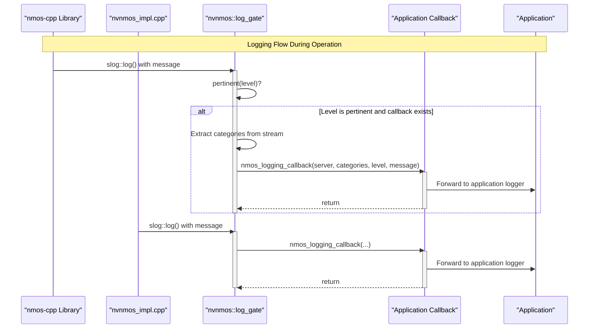
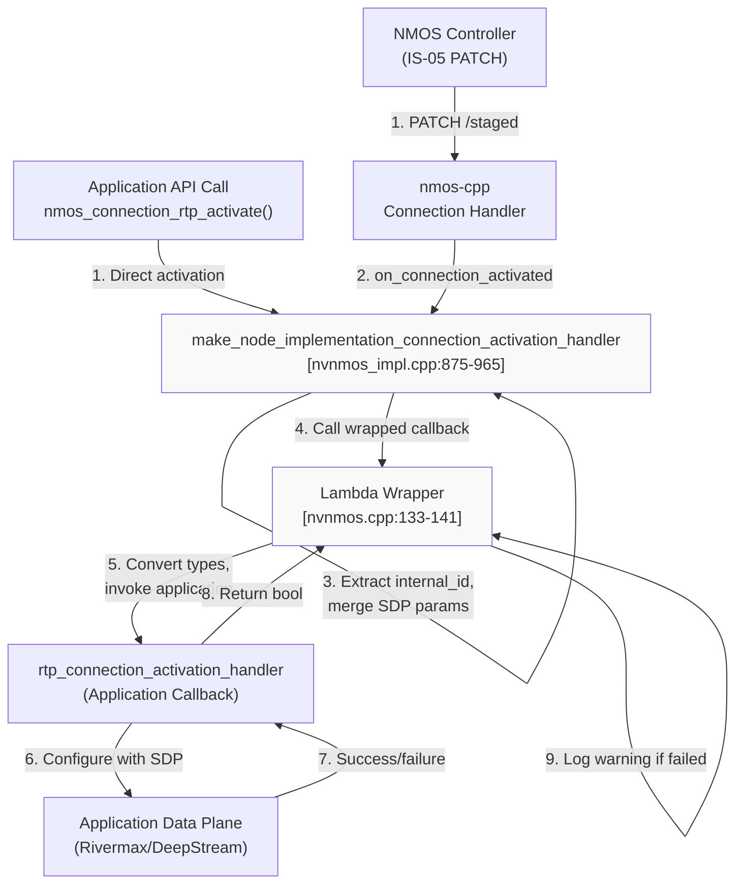
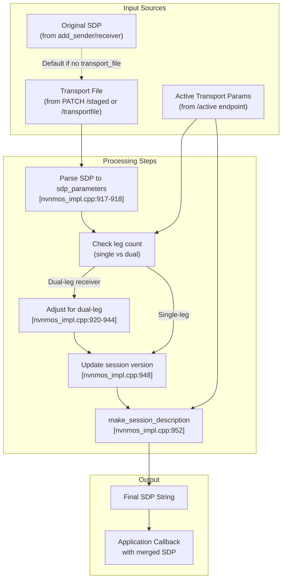
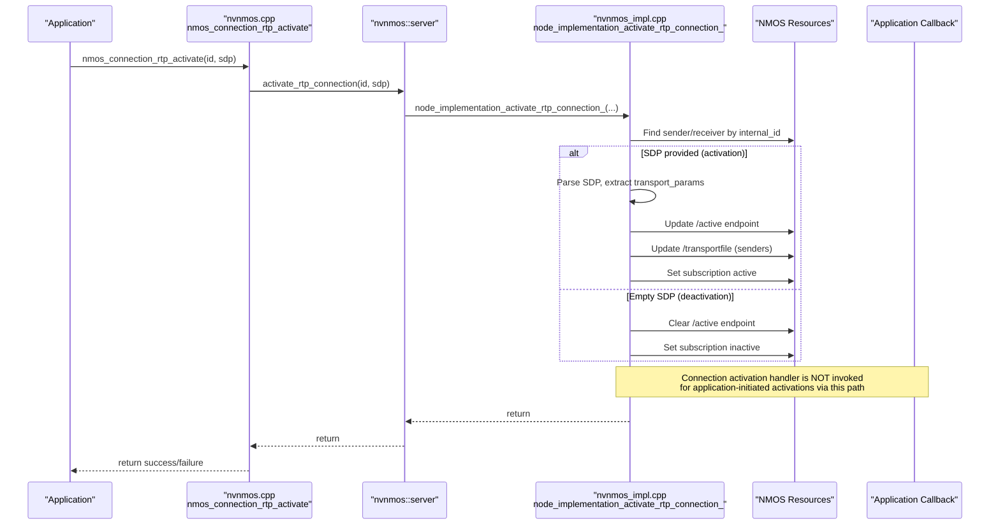
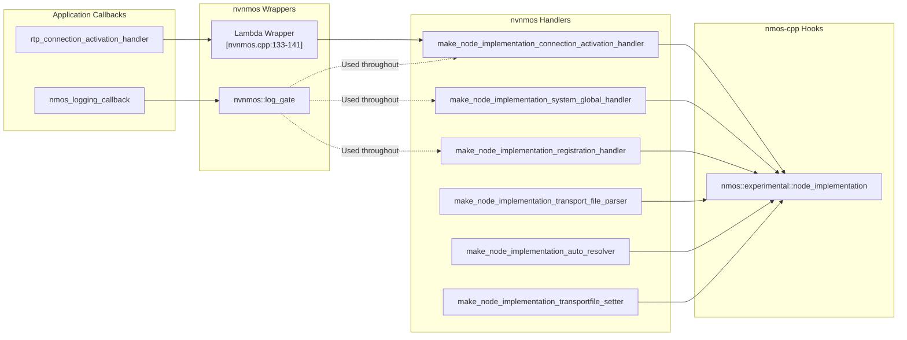

<!-- source: DeepWiki mcp.deepwiki.com · repo NVIDIA/nvnmos · page 5.5 Callback Mechanism · fetched 2026-10-26 -->

# Callback Mechanism

<details>
<summary>Relevant source files</summary>

The following files were used as context for generating this wiki page:

- [src/nvnmos.cpp](src/nvnmos.cpp)
- [src/nvnmos_impl.cpp](src/nvnmos_impl.cpp)

</details>


## Purpose and Scope

This page describes the callback architecture that enables bidirectional communication between the application and the nvnmos library. The callback mechanism allows the application to respond to NMOS connection activation requests and receive logging events from the library. For information about the overall system architecture and how callbacks fit into the layered design, see [Layered Architecture](#5.1). For details about connection activation workflows, see [Connection Activation](#3.3).

---

## Overview

The nvnmos library implements two primary callback types that allow external applications to integrate with NMOS control plane operations:

| Callback Type | Purpose | Direction | Configuration Field |
|--------------|---------|-----------|-------------------|
| `rtp_connection_activation_handler` | Notify application of connection activation/deactivation | Library → Application | `NvNmosNodeConfig::rtp_connection_activated` |
| `nmos_logging_callback` | Route internal log messages to application | Library → Application | `NvNmosNodeConfig::log_callback` |

Both callbacks are provided during node server creation via the `NvNmosNodeConfig` structure and remain active for the lifetime of the node server.

**Sources:** [include/nvnmos.h:80-95](), [src/nvnmos.cpp:107-142]()

---

## Callback Types and Signatures

### RTP Connection Activation Handler

```c
typedef bool (*rtp_connection_activation_handler)(
    NvNmosNodeServer* server,
    const char* id,
    const char* sdp);
```

This callback is invoked whenever a sender or receiver needs to be activated or deactivated:
- **Parameters:**
  - `server`: Pointer to the node server instance
  - `id`: Internal identifier for the sender/receiver being activated
  - `sdp`: SDP file describing the active connection parameters, or `NULL` for deactivation
- **Return Value:** `true` if the application successfully configured the data plane, `false` otherwise

### Logging Callback

```c
typedef void (*nmos_logging_callback)(
    NvNmosNodeServer* server,
    const char* categories,
    int level,
    const char* message);
```

This callback is invoked for all log messages generated by the library:
- **Parameters:**
  - `server`: Pointer to the node server instance
  - `categories`: Comma-separated list of log categories (e.g., "node_implementation,sdp")
  - `level`: Severity level (40=error, 30=warning, 20=info, 10=more_info, 0=all)
  - `message`: The log message text

**Sources:** [include/nvnmos.h:80-95]()

---

## Logging Callback Flow

The logging callback mechanism routes all internal log messages from nmos-cpp and nvnmos to the application through a custom gate implementation.



### Log Gate Implementation

The `nvnmos::log_gate` class implements the `slog::base_gate` interface to intercept all log messages:

- **Filtering:** The `pertinent()` method checks if the callback exists and if the message severity meets the configured threshold [src/nvnmos.cpp:61-64]()
- **Category Extraction:** Categories are extracted from the log stream's stash and formatted as a comma-separated string [src/nvnmos.cpp:70-71]()
- **Callback Invocation:** If the message is pertinent, the application callback is invoked with the formatted information [src/nvnmos.cpp:72]()

**Sources:** [src/nvnmos.cpp:52-80](), [src/nvnmos.cpp:108](), [src/nvnmos.cpp:146]()

---

## Connection Activation Callback Flow

The connection activation callback notifies the application when an NMOS Controller requests a connection to be activated or when the application itself initiates activation.



### Activation Handler Creation

The connection activation callback is wrapped in multiple layers to adapt between different interfaces:

1. **Application Provides Callback:** The application provides `rtp_connection_activation_handler` in `NvNmosNodeConfig` [include/nvnmos.h:118]()

2. **Type Conversion Wrapper:** `nvnmos::server` constructor creates a lambda that converts between C++ and C types [src/nvnmos.cpp:131-141]():
   - Converts `std::string` to `const char*`
   - Converts empty SDP to `NULL` pointer for deactivation
   - Logs warnings if activation fails

3. **NMOS Integration Handler:** The wrapper is passed to `make_node_implementation_connection_activation_handler()` which creates the handler that nmos-cpp will invoke [src/nvnmos_impl.cpp:875-965]()

**Sources:** [src/nvnmos.cpp:131-142](), [src/nvnmos_impl.cpp:875-965](), [src/nvnmos_impl.cpp:1566-1579]()

---

## Connection Activation Handler Implementation

### Handler Responsibilities

The `make_node_implementation_connection_activation_handler()` function [src/nvnmos_impl.cpp:875-965]() creates a handler with the following responsibilities:

| Step | Operation | Code Reference |
|------|-----------|----------------|
| 1 | Determine activation state | [src/nvnmos_impl.cpp:897]() |
| 2 | Retrieve transport file or use defaults | [src/nvnmos_impl.cpp:901-911]() |
| 3 | Parse and merge SDP parameters | [src/nvnmos_impl.cpp:917-948]() |
| 4 | Handle dual-leg receivers | [src/nvnmos_impl.cpp:920-944]() |
| 5 | Create final session description | [src/nvnmos_impl.cpp:952-953]() |
| 6 | Invoke application callback | [src/nvnmos_impl.cpp:955]() |

### SDP Parameter Merging

When a connection is activated, the handler merges multiple sources of information:



The merging process ensures that:
- Custom nvnmos attributes (`x-nvnmos-*`) are preserved [src/nvnmos_impl.cpp:1078-1125]()
- Dual-leg receivers handle single-leg SDP files correctly [src/nvnmos_impl.cpp:920-944]()
- The `rtp_enabled` flag from transport parameters is reflected in the SDP [src/nvnmos_impl.cpp:1118-1122]()
- Session version is updated to indicate modifications [src/nvnmos_impl.cpp:948]()

**Sources:** [src/nvnmos_impl.cpp:875-965](), [src/nvnmos_impl.cpp:1078-1125]()

---

## Callback Context and Threading

### Execution Context

Both callbacks are invoked from within the nmos-cpp server's internal threads:

- **Logging Callback:** Invoked synchronously from any thread that generates log messages (HTTP handlers, registration threads, etc.)
- **Connection Activation Callback:** Invoked from the nmos-cpp connection activation thread when processing IS-05 requests or from the calling thread when using `nmos_connection_rtp_activate()`

### Thread Safety Requirements

Applications must ensure their callback implementations are thread-safe:

| Requirement | Rationale |
|-------------|-----------|
| Non-blocking | Callbacks are invoked from nmos-cpp threads; blocking will stall NMOS operations |
| Reentrant | Multiple threads may invoke callbacks concurrently |
| Exception-safe | Exceptions must not propagate to the library (C ABI boundary) |

The library protects against callback exceptions by wrapping invocations in try-catch blocks [src/nvnmos.cpp:179-183](), [src/nvnmos.cpp:407-416]().

**Sources:** [src/nvnmos.cpp:52-80](), [src/nvnmos.cpp:131-141]()

---

## Application-Initiated Activation

In addition to responding to Controller-initiated activations, applications can directly activate connections using `nmos_connection_rtp_activate()` [include/nvnmos.h:191-202]().



**Important:** When using `nmos_connection_rtp_activate()`, the connection activation callback is **not** invoked. This function directly updates the NMOS resource state and assumes the application is configuring the data plane separately. The callback is only invoked for Controller-initiated activations through the IS-05 Connection API.

**Sources:** [src/nvnmos.cpp:590-611](), [src/nvnmos.cpp:461-472](), [src/nvnmos_impl.cpp:967-1072]()

---

## Callback Error Handling

### Return Values and Error Reporting

The connection activation callback's return value indicates whether the application successfully configured the data plane:

- **`true`:** Data plane configured successfully; NMOS reports activation success
- **`false`:** Data plane configuration failed; library logs a warning but still reports activation success to NMOS Controller

**Note:** The current implementation does not propagate activation failures back to the Controller [src/nvnmos.cpp:136-140](). This design assumes the application will handle retries or error recovery internally.

### Exception Handling

All callback invocations are protected by exception handlers:

```c++
try
{
    impl->add_receiver(*config);
    return true;
}
catch (...)
{
    return false;
}
```

Exceptions thrown by application callbacks or library code are caught and converted to boolean return values, preventing crashes but potentially losing error context [src/nvnmos.cpp:407-416](), [src/nvnmos.cpp:516-524]().

**Sources:** [src/nvnmos.cpp:131-141](), [src/nvnmos.cpp:359-401](), [src/nvnmos.cpp:407-416]()

---

## Integration with nmos-cpp Callback System

The nvnmos library integrates with the nmos-cpp callback system by implementing handlers for various lifecycle events:



The `make_node_implementation()` function [src/nvnmos_impl.cpp:1566-1579]() constructs a `nmos::experimental::node_implementation` object with all required handlers:

- `on_connection_activated`: Wraps the application's connection activation callback
- `on_system_changed`: Logs system configuration changes (optional)
- `on_registration_changed`: Logs registration state changes (optional)
- `on_parse_transport_file`: Validates transport files including JPEG XS
- `on_validate_connection_resource_patch`: Currently empty (validation done by schemas)
- `on_resolve_auto`: Resolves "auto" values in transport parameters
- `on_set_transportfile`: Updates sender transportfile endpoints

Only the connection activation handler directly invokes application code; the others are internal to the library.

**Sources:** [src/nvnmos_impl.cpp:1566-1579](), [src/nvnmos_impl.cpp:705-727](), [src/nvnmos_impl.cpp:730-743](), [src/nvnmos_impl.cpp:746-767]()

---

