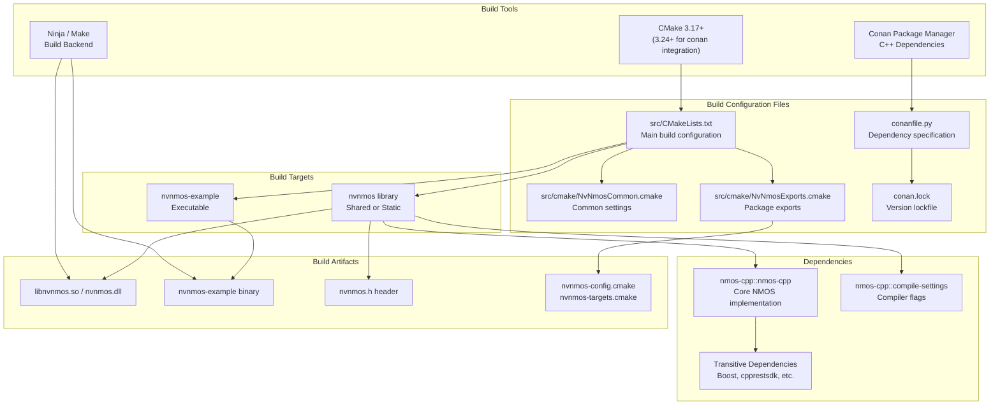
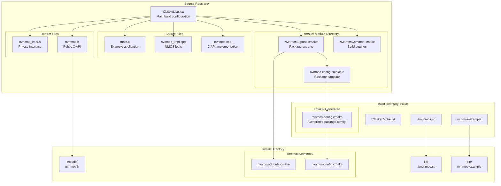
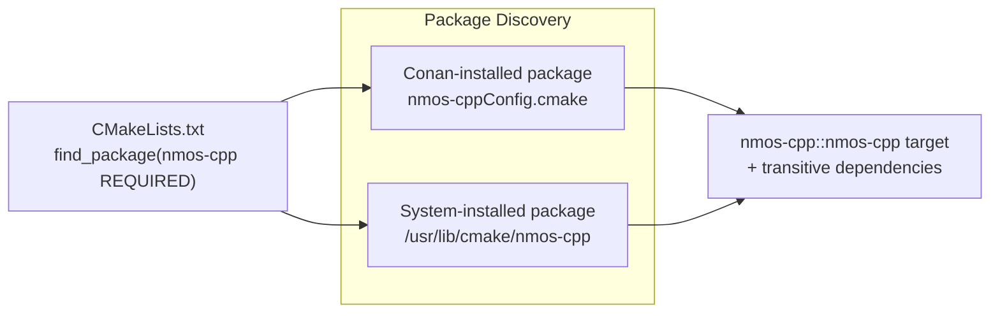
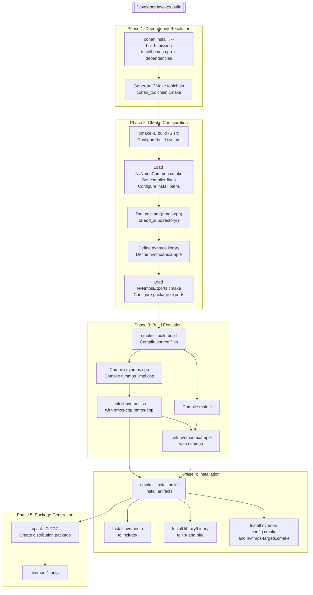
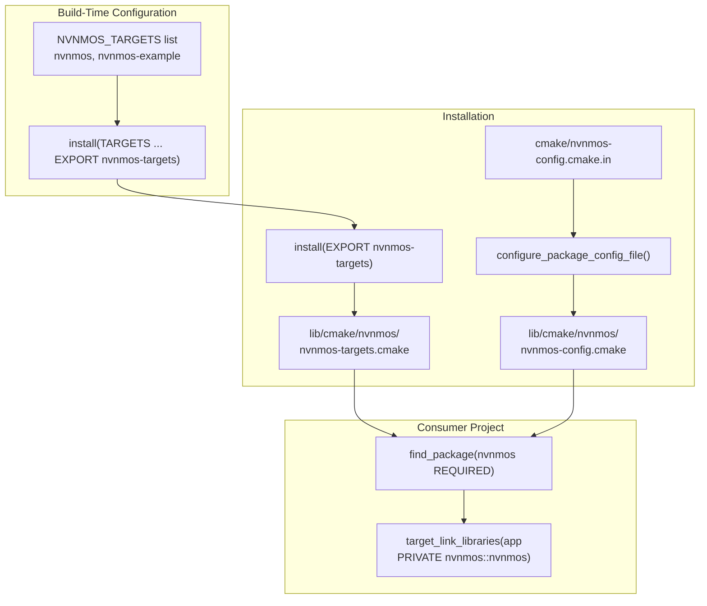

<!-- source: DeepWiki mcp.deepwiki.com · repo NVIDIA/nvnmos · page 6 Build System · fetched 2026-10-26 -->

# Build System

Relevant source files

The following files were used as context for generating this wiki page:

- [src/CMakeLists.txt](src/CMakeLists.txt)
- [src/cmake/NvNmosCommon.cmake](src/cmake/NvNmosCommon.cmake)
- [src/cmake/NvNmosExports.cmake](src/cmake/NvNmosExports.cmake)

## Purpose and Scope

This document provides a comprehensive overview of the nvnmos build system, covering the CMake-based build configuration, dependency management, build targets, and integration with continuous integration pipelines. It explains how the library and example application are compiled, linked, and packaged for distribution.

For detailed information about specific build system components, see:
- CMake configuration details: [CMake Configuration](#6.1)
- Package export mechanisms: [Package Configuration and Exports](#6.2)
- Conan dependency management: [Dependency Management with Conan](#6.3)
- Docker containerization: [Docker Build Process](#6.4)

---

## Build System Overview

The nvnmos build system uses CMake as the primary build orchestrator, Conan for C++ dependency management, and supports both native and containerized builds. The system is designed to produce shared or static libraries, example applications, and distribution packages.

**Build Technology Stack**

**Sources:** [src/CMakeLists.txt:1-145](), [src/cmake/NvNmosCommon.cmake:1-65](), [src/cmake/NvNmosExports.cmake:1-39]()

---

## Build Targets

The build system defines two primary targets:

| Target | Type | Description | Build Option |
|--------|------|-------------|--------------|
| `nvnmos` | Library | Core NMOS control plane library (shared or static) | `BUILD_SHARED_LIBS` |
| `nvnmos-example` | Executable | Example application demonstrating library usage | `NVNMOS_BUILD_EXAMPLES` |

**nvnmos Library Target**

The `nvnmos` library target is created at [src/CMakeLists.txt:71-110]() and includes:

- **Source Files**: `nvnmos.cpp`, `nvnmos_impl.cpp` [src/CMakeLists.txt:56-59]()
- **Public Headers**: `nvnmos.h` [src/CMakeLists.txt:60-62]()
- **Private Headers**: `nvnmos_impl.h` [src/CMakeLists.txt:63-65]()
- **Link Dependencies**: `nmos-cpp::nmos-cpp`, `nmos-cpp::compile-settings` [src/CMakeLists.txt:85-99]()
- **Compile Definitions**: `NVNMOS_EXPORTS` (shared), `NVNMOS_STATIC` (static) [src/CMakeLists.txt:80-100]()
- **Installed Headers**: Only public interface headers are installed [src/CMakeLists.txt:107]()

The library can be referenced by consumers as `nvnmos::nvnmos` via the namespace alias [src/CMakeLists.txt:110]().

**nvnmos-example Target**

The example executable is created at [src/CMakeLists.txt:121-133]() when `NVNMOS_BUILD_EXAMPLES` is enabled:

- **Source Files**: `main.c` [src/CMakeLists.txt:115-117]()
- **Link Dependencies**: `nvnmos` library [src/CMakeLists.txt:130-133]()
- **Language**: Pure C application demonstrating C API usage

**Sources:** [src/CMakeLists.txt:56-140]()

---

## Build Options and Configuration

**CMake Options**

| Option | Default | Description |
|--------|---------|-------------|
| `BUILD_SHARED_LIBS` | `ON` | Build nvnmos as shared library (`.so`/`.dll`) instead of static (`.a`/`.lib`) |
| `NVNMOS_BUILD_EXAMPLES` | `ON` | Build the nvnmos-example application |
| `USE_ADD_SUBDIRECTORY` | `OFF` | Use nmos-cpp as subdirectory instead of via `find_package()` |
| `NMOS_CPP_DIRECTORY` | `../../nmos-cpp/Development` | Path to nmos-cpp when using subdirectory mode |

**CMake Version Requirements**

The build system supports two CMake usage patterns [src/CMakeLists.txt:16-24]():

- **Standard Mode**: CMake 3.17+ required, must run `conan install` separately
- **Injection Point Mode**: CMake 3.24+ required, can use `CMAKE_PROJECT_TOP_LEVEL_INCLUDES` for automatic Conan integration

**C++ Standard Requirements**

The build enforces C++11 or higher [src/cmake/NvNmosCommon.cmake:28-39]():
- Rejects C++98 with fatal error
- Sets `CMAKE_CXX_STANDARD_REQUIRED` to `ON`
- Sets `CMAKE_CXX_EXTENSIONS` to `OFF` (disable compiler-specific extensions)

**Sources:** [src/CMakeLists.txt:20-52](), [src/cmake/NvNmosCommon.cmake:28-39]()

---

## File Organization

**CMake Module Structure**

**Install Directory Layout**

The build uses platform-specific install paths via `GNUInstallDirs` [src/cmake/NvNmosCommon.cmake:16]():

- **Headers**: `${CMAKE_INSTALL_INCLUDEDIR}/${NVNMOS_INCLUDE_PREFIX}` [src/cmake/NvNmosCommon.cmake:19]()
- **Libraries**: `${CMAKE_INSTALL_LIBDIR}` with Debug/Release subdirs on Windows [src/cmake/NvNmosCommon.cmake:21-26]()
- **Binaries**: `${CMAKE_INSTALL_BINDIR}` with Debug/Release subdirs on Windows [src/cmake/NvNmosCommon.cmake:22-26]()
- **CMake Package**: `${CMAKE_INSTALL_LIBDIR}/cmake/nvnmos` [src/cmake/NvNmosExports.cmake:28]()

**Sources:** [src/CMakeLists.txt:1-145](), [src/cmake/NvNmosCommon.cmake:16-26]()

---

## Dependency Resolution

**nmos-cpp Dependency**

The build supports two methods for resolving the nmos-cpp dependency:

**Method 1: find_package() (Default)**

This method requires nmos-cpp and all its dependencies (Boost, cpprestsdk, WebSocket++, OpenSSL, etc.) to be pre-installed and discoverable via CMake's package mechanism. Conan handles this automatically when `conan install` is run [src/CMakeLists.txt:40-46]().

**Method 2: add_subdirectory() (Optional)**

When `USE_ADD_SUBDIRECTORY` is enabled, nmos-cpp is built as part of the nvnmos build [src/CMakeLists.txt:47-52](). The path is specified via `NMOS_CPP_DIRECTORY`, defaulting to `../../nmos-cpp/Development`. The subdirectory is excluded from installation via `EXCLUDE_FROM_ALL`.

**Sources:** [src/CMakeLists.txt:36-52]()

---

## Build Process Flow

**Complete Build Workflow**

**Sources:** [src/CMakeLists.txt:1-145](), [src/cmake/NvNmosCommon.cmake:1-65](), [src/cmake/NvNmosExports.cmake:1-39]()

---

## Build Configuration Details

**Shared vs Static Library Configuration**

The `BUILD_SHARED_LIBS` option controls library type and affects linking behavior:

**Shared Library Mode** (`BUILD_SHARED_LIBS=ON`, default) [src/CMakeLists.txt:80-89]():
- Defines `NVNMOS_EXPORTS` as private compile definition
- Links nmos-cpp dependencies as `PRIVATE` (not exposed to consumers)
- Produces platform-specific shared library (`.so`, `.dll`, `.dylib`)

**Static Library Mode** (`BUILD_SHARED_LIBS=OFF`) [src/CMakeLists.txt:90-100]():
- Defines `NVNMOS_STATIC` as public compile definition
- Links nmos-cpp dependencies as `PUBLIC` (exposed to consumers)
- Produces static library (`.a`, `.lib`)
- Consumers must link against nmos-cpp transitively

**Build Type Validation**

The build system validates `CMAKE_BUILD_TYPE` and provides a default [src/cmake/NvNmosCommon.cmake:46-64]():

- **Default**: `Debug` if not specified
- **Allowed Values**: `Debug`, `Release`, `RelWithDebInfo`, `MinSizeRel` (case-insensitive)
- **Fatal Error**: Triggered for any other value

**Build Safeguards**

Additional build safety checks [src/cmake/NvNmosCommon.cmake:52-54]():
- **Warning**: In-source builds are discouraged but not fatal
- Build directory should be separate from source directory

**Sources:** [src/CMakeLists.txt:80-100](), [src/cmake/NvNmosCommon.cmake:46-64]()

---

## Target Export Configuration

The build system exports CMake targets for consumption by downstream projects via the modern config-file package mechanism.

**Export Workflow**

**Installation Specification** [src/cmake/NvNmosExports.cmake:18-29]():

- Targets are installed to platform-specific directories (`NVNMOS_INSTALL_LIBDIR`, `NVNMOS_INSTALL_BINDIR`)
- Export name: `nvnmos-targets`
- Target namespace: `nvnmos::`
- CMake package location: `${CMAKE_INSTALL_LIBDIR}/cmake/nvnmos`

**Generated Files**:

- `nvnmos-targets.cmake`: Contains imported target definitions with full paths
- `nvnmos-config.cmake`: Package configuration file for `find_package()` [src/cmake/NvNmosExports.cmake:31-38]()

**Sources:** [src/cmake/NvNmosExports.cmake:16-39]()

---

## Integration with CI/CD

The build system integrates with GitHub Actions for continuous integration. The CI pipeline executes the build on multiple platforms (Ubuntu, Windows) and configurations (Release). Build artifacts are validated, and the system ensures reproducible builds via locked Conan dependencies.

For detailed CI/CD workflow information, see [CI/CD Pipeline](#8.1).

**Sources:** [src/CMakeLists.txt:1-145]()

---

