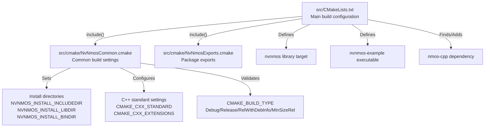
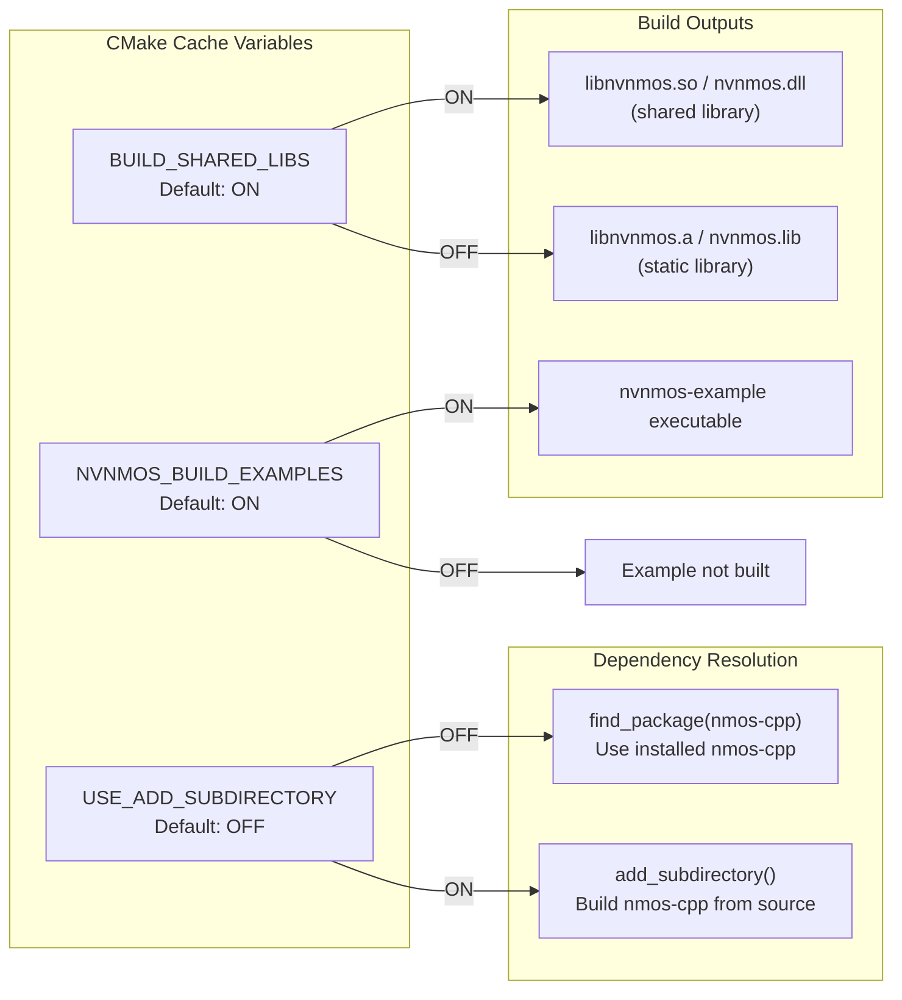
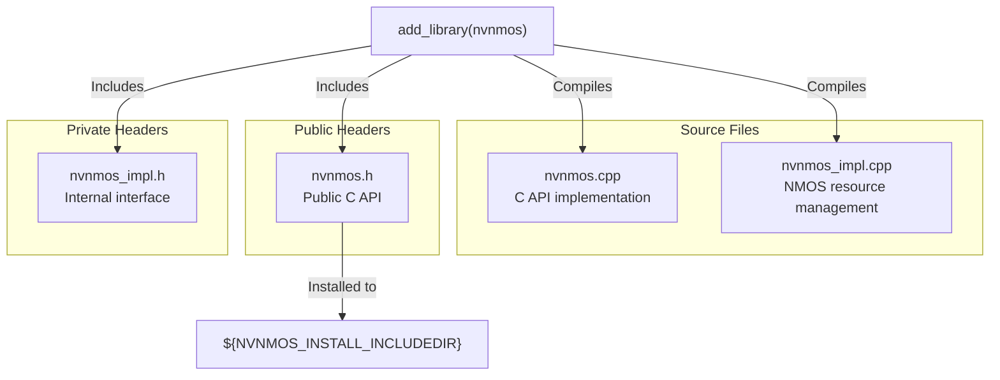
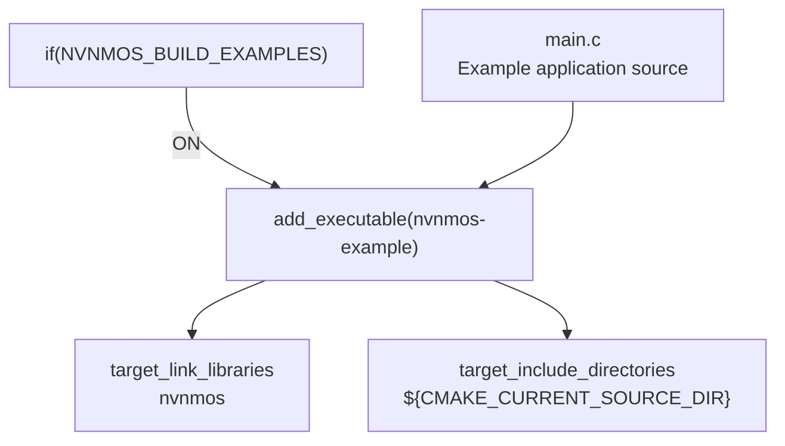
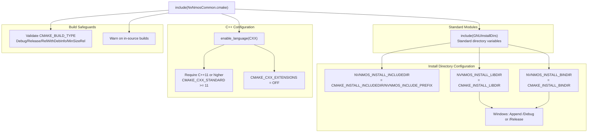
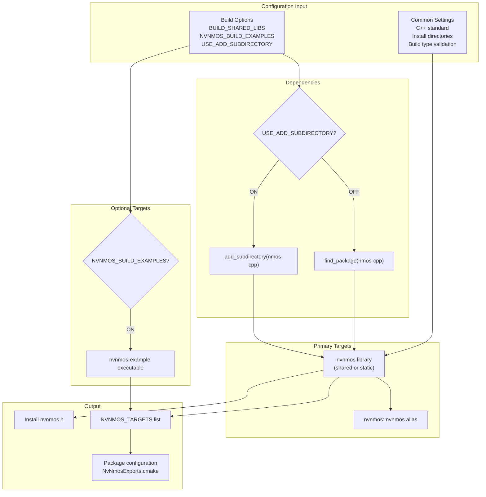

<!-- source: DeepWiki mcp.deepwiki.com · repo NVIDIA/nvnmos · page 6.1 CMake Configuration · fetched 2026-10-26 -->

# CMake Configuration

<details>
<summary>Relevant source files</summary>

The following files were used as context for generating this wiki page:

- [src/CMakeLists.txt](src/CMakeLists.txt)
- [src/cmake/NvNmosCommon.cmake](src/cmake/NvNmosCommon.cmake)

</details>


## Purpose and Scope

This document describes the CMake build configuration for the nvnmos library, including build options, target definitions, compiler settings, and installation rules. It covers the structure and content of the main `CMakeLists.txt` file and the common configuration module `NvNmosCommon.cmake`.

For information about how nvnmos is packaged and exported for consumption by other CMake projects, see [Package Configuration and Exports](#6.2). For details on dependency management, see [Dependency Management with Conan](#6.3). For practical build instructions, see [Building from Source](#2.1).

---

## CMake File Structure

The build system is organized into modular CMake files that separate concerns and enable reuse:

**CMake File Organization**


Sources: [src/CMakeLists.txt:1-145](), [src/cmake/NvNmosCommon.cmake:1-65]()

---

## CMake Version Requirements

The project supports two CMake usage patterns with different version requirements:

| Usage Pattern | Minimum Version | Conditional Check |
|---------------|----------------|-------------------|
| Standard invocation | 3.17 | Default |
| With `CMAKE_PROJECT_TOP_LEVEL_INCLUDES` | 3.24 | For Conan injection point |

The version requirement is conditionally enforced at [src/CMakeLists.txt:20-24]():

```cmake
if(CMAKE_PROJECT_TOP_LEVEL_INCLUDES)
    cmake_minimum_required(VERSION 3.24 FATAL_ERROR)
else()
    cmake_minimum_required(VERSION 3.17 FATAL_ERROR)
endif()
```

The higher version requirement (3.24) is needed when using the dependency provider injection point to configure Conan automatically. For earlier CMake versions, run `conan install` separately before invoking CMake.

Sources: [src/CMakeLists.txt:16-24]()

---

## Build Options

The build system exposes several cache variables that control what gets built and how:

**Build Options and Their Effects**


### BUILD_SHARED_LIBS

Controls whether the nvnmos library is built as a shared or static library. Defined at [src/CMakeLists.txt:28]():

- **ON (default)**: Builds `libnvnmos.so` (Linux) or `nvnmos.dll` (Windows)
- **OFF**: Builds `libnvnmos.a` (Linux) or `nvnmos.lib` (Windows)

This option affects compile definitions and link visibility:
- Shared builds define `NVNMOS_EXPORTS` privately and link nmos-cpp privately [src/CMakeLists.txt:80-89]()
- Static builds define `NVNMOS_STATIC` publicly and link nmos-cpp publicly [src/CMakeLists.txt:91-99]()

### NVNMOS_BUILD_EXAMPLES

Controls whether the example application is built. Defined at [src/CMakeLists.txt:29]():

- **ON (default)**: Builds the `nvnmos-example` executable from `main.c`
- **OFF**: Skips example application build

The example build is conditional on this option at [src/CMakeLists.txt:112-140]().

### USE_ADD_SUBDIRECTORY

Controls how the nmos-cpp dependency is resolved. Defined at [src/CMakeLists.txt:38]():

- **OFF (default)**: Uses `find_package(nmos-cpp)` to locate an installed nmos-cpp [src/CMakeLists.txt:40-46]()
- **ON**: Uses `add_subdirectory()` to build nmos-cpp from source [src/CMakeLists.txt:47-52]()

When enabled, the `NMOS_CPP_DIRECTORY` cache variable specifies the path to the nmos-cpp source directory (default: `../../nmos-cpp/Development`).

Sources: [src/CMakeLists.txt:28-52]()

---

## nvnmos Library Target

The core library target is defined with the following source structure:

**Library Source Organization**


The library target is created at [src/CMakeLists.txt:71-75]() with source files defined at [src/CMakeLists.txt:56-69](). Source groups are configured for IDE organization at [src/CMakeLists.txt:77-78]().

### Compile Definitions

Build-type-specific compile definitions are set conditionally:

| Build Type | Scope | Definition | Purpose |
|------------|-------|------------|---------|
| Shared | PRIVATE | `NVNMOS_EXPORTS` | Export symbols from DLL |
| Static | PUBLIC | `NVNMOS_STATIC` | Disable DLL import/export |

These are configured at [src/CMakeLists.txt:80-99]().

### Link Dependencies

The library links against nmos-cpp and its compile settings:

```cmake
target_link_libraries(
    nvnmos [PRIVATE|PUBLIC]
    nmos-cpp::compile-settings
    nmos-cpp::nmos-cpp
)
```

Link visibility is PRIVATE for shared builds and PUBLIC for static builds, matching the compile definition visibility [src/CMakeLists.txt:85-99]().

### Include Directories

Include directories are configured with generator expressions to support both build-tree and install-tree usage:

- **Build interface**: `${CMAKE_CURRENT_SOURCE_DIR}` - the src directory
- **Install interface**: `${NVNMOS_INSTALL_INCLUDEDIR}` - the installation include directory

Configured at [src/CMakeLists.txt:102-105]().

### Installation

Public headers (only `nvnmos.h`) are installed to the include directory at [src/CMakeLists.txt:107]().

An alias target `nvnmos::nvnmos` is created at [src/CMakeLists.txt:110]() to provide a namespaced target for use in parent projects.

Sources: [src/CMakeLists.txt:56-110]()

---

## nvnmos-example Target

The example application demonstrates library usage and is conditionally built based on `NVNMOS_BUILD_EXAMPLES`:

**Example Application Configuration**


The executable is defined at [src/CMakeLists.txt:121-125]() with source files specified at [src/CMakeLists.txt:115-119]().

It links against the nvnmos library at [src/CMakeLists.txt:130-133]() and includes the source directory at [src/CMakeLists.txt:135-137]().

Both the library and example are added to the `NVNMOS_TARGETS` list for export configuration at [src/CMakeLists.txt:109]() and [src/CMakeLists.txt:139]().

Sources: [src/CMakeLists.txt:112-140]()

---

## Common Build Settings

The `NvNmosCommon.cmake` module provides shared configuration used across the build system:

**Common Settings Configuration Flow**


### Install Directories

The module configures platform-specific installation paths using GNUInstallDirs at [src/cmake/NvNmosCommon.cmake:16-26]():

**Include Directory** (`NVNMOS_INSTALL_INCLUDEDIR`):
- Joins `CMAKE_INSTALL_INCLUDEDIR` with `NVNMOS_INCLUDE_PREFIX` if both are non-empty
- Allows optional subdirectory within the include tree

**Library and Binary Directories** (Windows-specific):
- Base paths: `CMAKE_INSTALL_LIBDIR` and `CMAKE_INSTALL_BINDIR`
- Windows appends configuration-specific subdirectory: `/Debug` or `/Release`
- Linux uses the base paths directly

### C++ Standard Configuration

C++ language settings are enforced at [src/cmake/NvNmosCommon.cmake:28-39]():

| Setting | Value | Purpose |
|---------|-------|---------|
| Language enabled | CXX | Enable C++ compiler |
| Minimum standard | C++11 | Reject C++98 (not supported) |
| `CMAKE_CXX_STANDARD_REQUIRED` | ON | Enforce minimum standard |
| `CMAKE_CXX_EXTENSIONS` | OFF | Disable compiler-specific extensions |

The C++98 check is performed at [src/cmake/NvNmosCommon.cmake:31-33]() with a fatal error if detected.

### Module Path Configuration

Additional CMake module directories are added at [src/cmake/NvNmosCommon.cmake:41-44]():

```cmake
list(APPEND CMAKE_MODULE_PATH
    ${CMAKE_CURRENT_SOURCE_DIR}/cmake
)
```

This allows the main CMakeLists.txt to include other modules like `NvNmosExports.cmake`.

### Build Type Validation

The module validates the build type configuration at [src/cmake/NvNmosCommon.cmake:46-64]():

1. **Default Build Type**: Set to "Debug" if not specified [src/cmake/NvNmosCommon.cmake:48-50]()
2. **In-Source Build Warning**: Warns if building in the source directory [src/cmake/NvNmosCommon.cmake:52-54]()
3. **Valid Build Type Check**: Ensures the build type is one of:
   - Debug
   - Release
   - RelWithDebInfo
   - MinSizeRel
   
   Case-insensitive validation occurs at [src/cmake/NvNmosCommon.cmake:56-64]().

Sources: [src/cmake/NvNmosCommon.cmake:1-65]()

---

## Target Export Configuration

The build concludes by including the exports module at [src/CMakeLists.txt:144]():

```cmake
include(cmake/NvNmosExports.cmake)
```

This module handles the generation of CMake package configuration files, enabling other projects to consume nvnmos using `find_package(NvNmos)`. Details are covered in [Package Configuration and Exports](#6.2).

Sources: [src/CMakeLists.txt:142-145]()

---

## Build Configuration Summary

The complete build configuration can be visualized as a dependency graph of targets, options, and outputs:

**Complete Build Configuration Graph**


Sources: [src/CMakeLists.txt:1-145](), [src/cmake/NvNmosCommon.cmake:1-65]()

---

