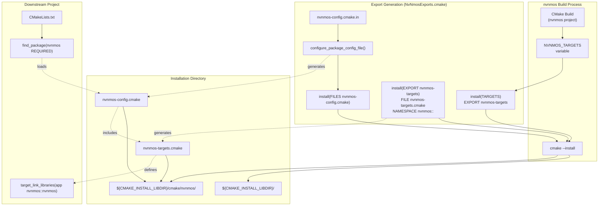
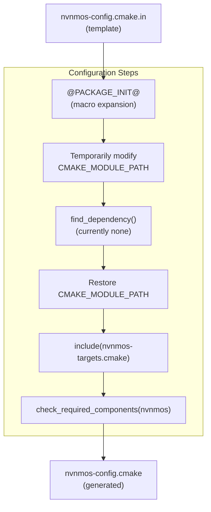
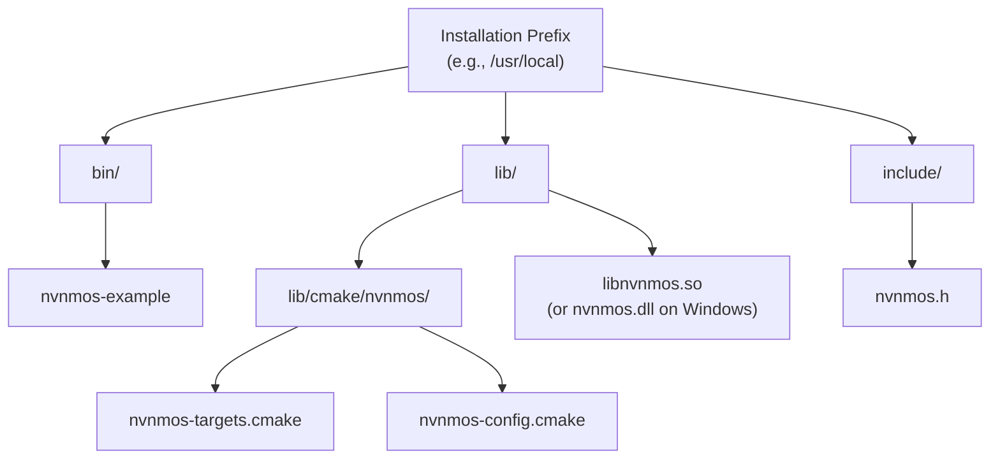
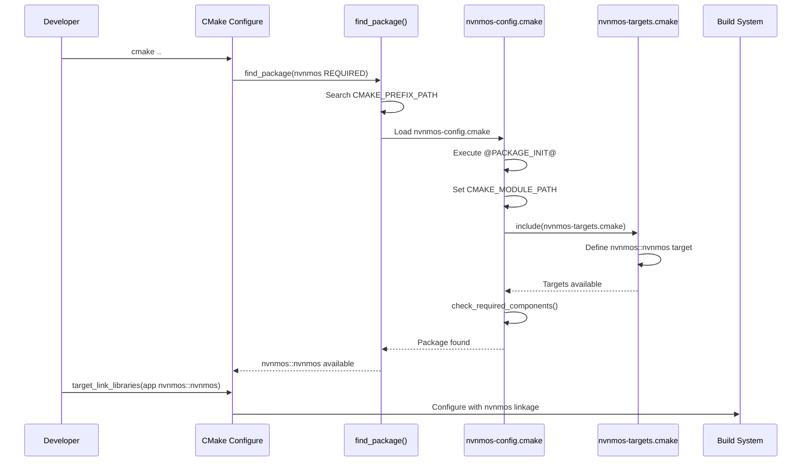

<!-- source: DeepWiki mcp.deepwiki.com · repo NVIDIA/nvnmos · page 6.2 Package Configuration and Exports · fetched 2026-10-26 -->

# Package Configuration and Exports

<details>
<summary>Relevant source files</summary>

The following files were used as context for generating this wiki page:

- [src/cmake/NvNmosExports.cmake](src/cmake/NvNmosExports.cmake)
- [src/cmake/nvnmos-config.cmake.in](src/cmake/nvnmos-config.cmake.in)

</details>


## Purpose and Scope

This document describes how nvnmos is packaged and exported for consumption by downstream CMake projects. It covers the CMake export mechanism, the generated package configuration files, target namespacing, and installation layout. This enables external applications to integrate nvnmos using the standard `find_package(nvnmos)` command.

For information about building nvnmos itself, see [CMake Configuration](#6.1). For guidance on integrating nvnmos into media applications, see [Integration Patterns](#7.1).

---

## CMake Export System Overview

nvnmos uses CMake's standard export and package configuration mechanism to enable downstream projects to import the library. This system consists of three key components:

1. **Target Export**: The `install(EXPORT)` command generates a `nvnmos-targets.cmake` file containing imported target definitions
2. **Package Configuration**: A `nvnmos-config.cmake` file that downstream projects load via `find_package()`
3. **Namespace Isolation**: All exported targets use the `nvnmos::` namespace to avoid naming conflicts

**Diagram: CMake Export and Import Flow**



**Sources:** [src/cmake/NvNmosExports.cmake:18-38](), [src/cmake/nvnmos-config.cmake.in:16-34]()

---

## Target Export Configuration

The target export is configured in `NvNmosExports.cmake` and specifies which targets are exported and where they are installed.

### Exported Targets

The `install(TARGETS)` command at [src/cmake/NvNmosExports.cmake:18-23]() exports all targets listed in the `${NVNMOS_TARGETS}` variable. This variable is populated by the main `CMakeLists.txt` and typically includes:

- `nvnmos` - The shared library target
- `nvnmos-example` - The example application (when built)

### Installation Destinations

Each component type is installed to a specific directory:

| Component Type | CMake Property | Installation Variable | Typical Path |
|---------------|----------------|----------------------|--------------|
| Shared libraries | `LIBRARY` | `${NVNMOS_INSTALL_LIBDIR}` | `lib/` |
| Static libraries | `ARCHIVE` | `${NVNMOS_INSTALL_LIBDIR}` | `lib/` |
| Executables | `RUNTIME` | `${NVNMOS_INSTALL_BINDIR}` | `bin/` |

### Export File Generation

The `install(EXPORT)` command at [src/cmake/NvNmosExports.cmake:25-29]() generates the target export file:

```cmake
install(EXPORT nvnmos-targets
    FILE nvnmos-targets.cmake
    NAMESPACE nvnmos::
    DESTINATION ${CMAKE_INSTALL_LIBDIR}/cmake/nvnmos
    )
```

Key properties:
- **Export name**: `nvnmos-targets` (referenced by `install(TARGETS ... EXPORT nvnmos-targets)`)
- **File name**: `nvnmos-targets.cmake`
- **Namespace**: `nvnmos::` (all imported targets will be prefixed with this)
- **Installation location**: `${CMAKE_INSTALL_LIBDIR}/cmake/nvnmos/`

**Sources:** [src/cmake/NvNmosExports.cmake:18-29]()

---

## Package Configuration File

The package configuration file (`nvnmos-config.cmake`) is generated from a template at [src/cmake/nvnmos-config.cmake.in]() using CMake's `configure_package_config_file()` function.

**Diagram: Package Configuration File Structure**



### Template Processing

At [src/cmake/NvNmosExports.cmake:33-36](), the template is processed:

```cmake
configure_package_config_file(cmake/nvnmos-config.cmake.in
    "${CMAKE_CURRENT_BINARY_DIR}/cmake/nvnmos-config.cmake"
    INSTALL_DESTINATION ${CMAKE_INSTALL_LIBDIR}/cmake/nvnmos
    )
```

The `@PACKAGE_INIT@` placeholder at [src/cmake/nvnmos-config.cmake.in:16]() is replaced with initialization code that handles relocatable package installations.

### Dependency Management

The configuration file uses `CMakeFindDependencyMacro` to locate dependencies. However, as noted in the comment at [src/cmake/nvnmos-config.cmake.in:24-25](), `nmos-cpp` is explicitly **not** listed as a public dependency:

```cmake
# nmos-cpp is not a public dependency (no headers or linking) so is not required
#find_dependency(nmos-cpp)
```

This design decision means:
- Downstream projects do not need to explicitly find `nmos-cpp`
- `nmos-cpp` symbols are not exposed in the public API
- The nvnmos library encapsulates all `nmos-cpp` usage

### Target Import

The generated `nvnmos-targets.cmake` file is included at [src/cmake/nvnmos-config.cmake.in:32]():

```cmake
include("${CMAKE_CURRENT_LIST_DIR}/nvnmos-targets.cmake")
```

This makes the imported targets available to the downstream project.

**Sources:** [src/cmake/nvnmos-config.cmake.in:16-34](), [src/cmake/NvNmosExports.cmake:33-38]()

---

## Target Namespacing

All exported targets are placed in the `nvnmos::` namespace to prevent naming conflicts with other libraries. This is configured via the `NAMESPACE` argument at [src/cmake/NvNmosExports.cmake:27]().

**Namespace Resolution Table**

| Build Target Name | Exported Target Name | Usage in Downstream Project |
|------------------|---------------------|----------------------------|
| `nvnmos` | `nvnmos::nvnmos` | `target_link_libraries(app nvnmos::nvnmos)` |
| `nvnmos-example` | `nvnmos::nvnmos-example` | `target_link_libraries(test nvnmos::nvnmos-example)` |

The namespace serves several purposes:
- **Clarity**: Makes it obvious which targets come from nvnmos
- **Conflict prevention**: Avoids collisions if another library also has a target named `nvnmos`
- **CMake best practice**: Follows modern CMake conventions for exported packages

**Sources:** [src/cmake/NvNmosExports.cmake:27]()

---

## Installation Directory Layout

When `cmake --install` is executed, files are installed into a structured directory hierarchy:

**Diagram: Installed Directory Structure**



The installation paths are controlled by CMake standard variables:

| Variable | Typical Value | Description |
|----------|--------------|-------------|
| `CMAKE_INSTALL_PREFIX` | `/usr/local` | Root installation directory |
| `CMAKE_INSTALL_BINDIR` | `bin` | Executable installation directory |
| `CMAKE_INSTALL_LIBDIR` | `lib` or `lib64` | Library installation directory |
| `CMAKE_INSTALL_INCLUDEDIR` | `include` | Header installation directory |

CMake package configuration files are always installed to `${CMAKE_INSTALL_LIBDIR}/cmake/nvnmos/` as per CMake conventions.

**Sources:** [src/cmake/NvNmosExports.cmake:18-38]()

---

## Consuming the Package

Downstream CMake projects can import nvnmos using standard CMake commands. Here's the typical workflow:

**Diagram: Downstream Project Integration Sequence**



### Example Downstream CMakeLists.txt

```cmake
cmake_minimum_required(VERSION 3.17)
project(my_media_application)

# Find the nvnmos package
find_package(nvnmos REQUIRED)

# Create your application
add_executable(my_app main.c)

# Link against the nvnmos library
target_link_libraries(my_app PRIVATE nvnmos::nvnmos)
```

### Package Search Path

CMake searches for `nvnmos-config.cmake` in these locations (in order):
1. `${nvnmos_DIR}` - If explicitly set by the user
2. `${CMAKE_PREFIX_PATH}/lib/cmake/nvnmos/` - Standard location for installed packages
3. System package directories (e.g., `/usr/local/lib/cmake/nvnmos/`)

### Imported Target Properties

When `find_package(nvnmos)` succeeds, the `nvnmos::nvnmos` imported target is available with these properties automatically configured:

- **Include directories**: Path to `nvnmos.h`
- **Link libraries**: The compiled `libnvnmos.so` or `nvnmos.dll`
- **Compile definitions**: Any required preprocessor macros
- **Interface dependencies**: Transitive dependencies (though nvnmos has none in its public interface)

**Sources:** [src/cmake/nvnmos-config.cmake.in:16-34]()

---

## CMake Variables Set by Package

When `find_package(nvnmos)` succeeds, these standard CMake variables are set:

| Variable | Value | Description |
|----------|-------|-------------|
| `nvnmos_FOUND` | `TRUE` | Indicates package was found |
| `nvnmos_VERSION` | Version string | Package version (if specified) |
| `nvnmos_DIR` | Path | Directory containing `nvnmos-config.cmake` |

Additionally, imported targets are available:
- `nvnmos::nvnmos` - The main library target
- `nvnmos::nvnmos-example` - The example application (if installed)

---

## Relocatable Installation

The use of `configure_package_config_file()` at [src/cmake/NvNmosExports.cmake:33-36]() ensures that the package configuration is relocatable. This means:

- The installation can be moved to a different directory after installation
- The package can be bundled with an application
- The configuration will automatically adjust paths based on the actual installation location

The `@PACKAGE_INIT@` macro at [src/cmake/nvnmos-config.cmake.in:16]() expands to code that computes relative paths from the config file location to the installed libraries and headers.

**Sources:** [src/cmake/NvNmosExports.cmake:33-36](), [src/cmake/nvnmos-config.cmake.in:16]()

---

## Build vs. Install Tree Usage

CMake supports two usage modes:
1. **Install tree**: Using the installed package (covered in this document)
2. **Build tree**: Using nvnmos directly from its build directory without installation

nvnmos currently only supports install tree usage. Downstream projects must install nvnmos before using it via `find_package()`. This is the recommended approach for production deployments.

**Sources:** [src/cmake/NvNmosExports.cmake:18-38]()

---

