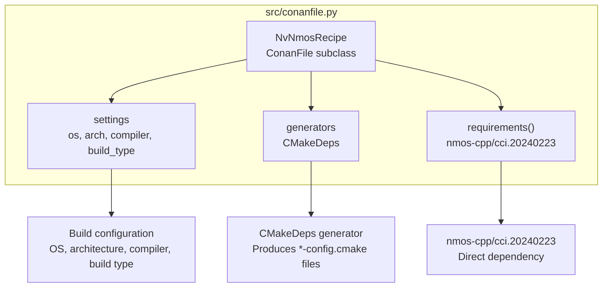
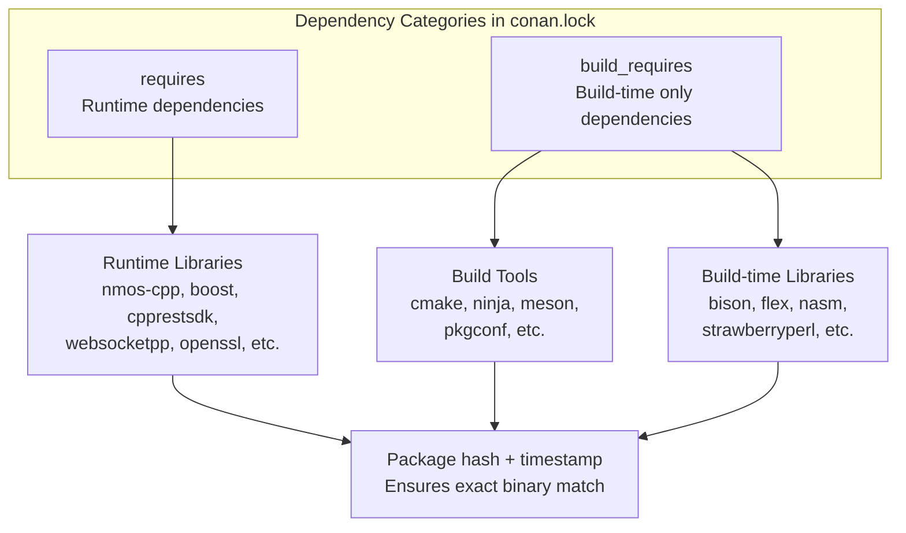
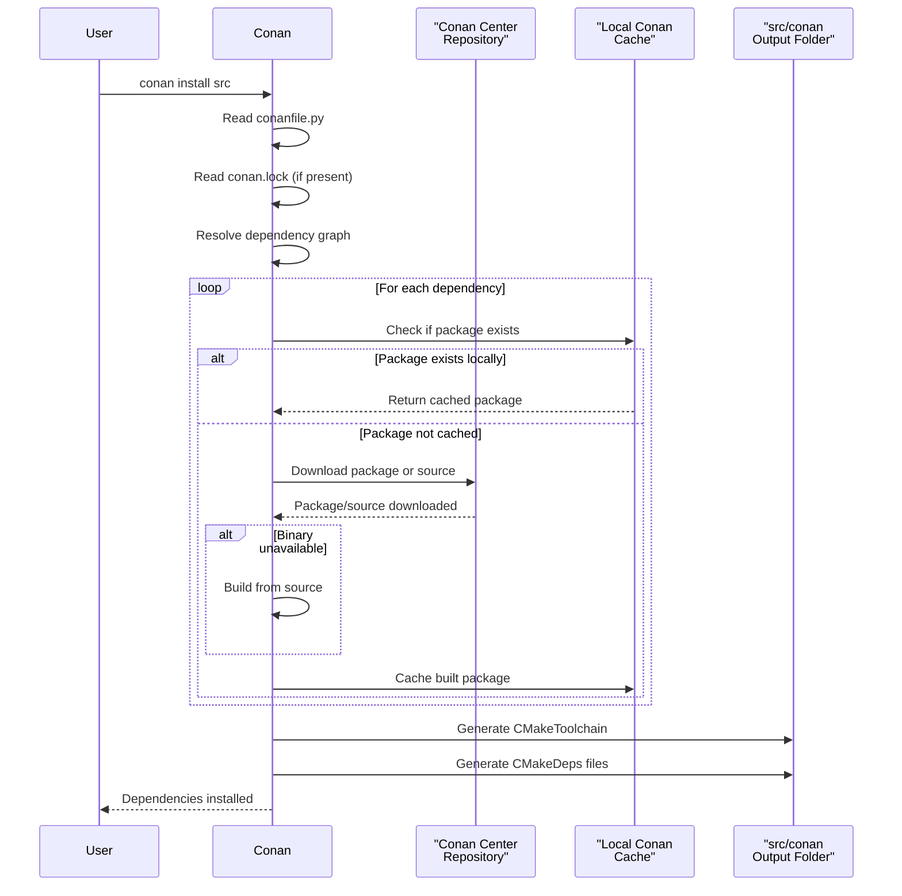
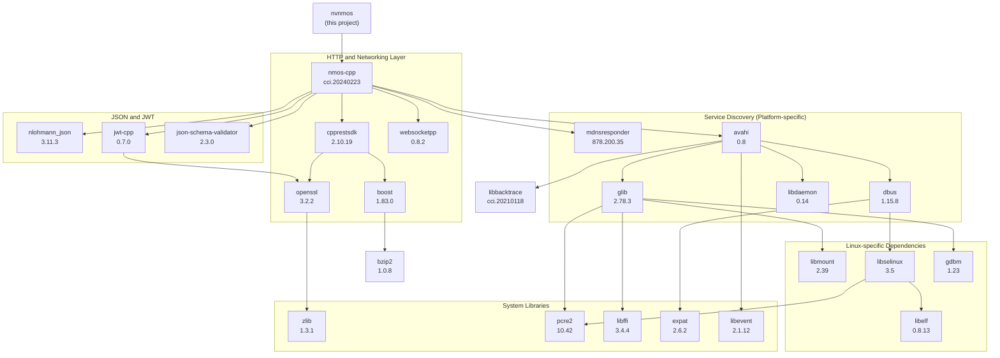
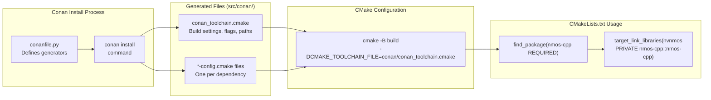
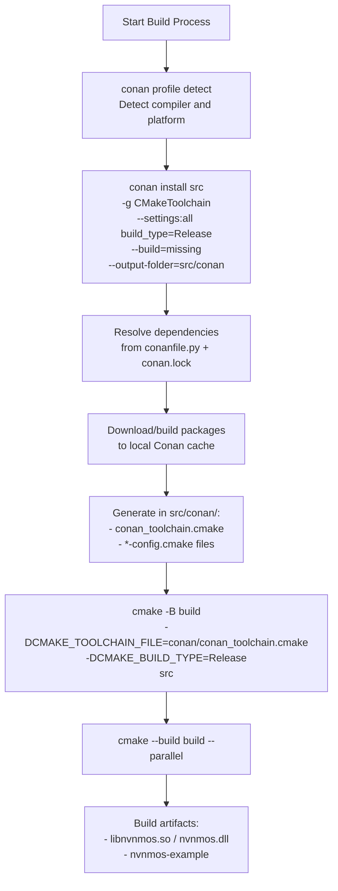

<!-- source: DeepWiki mcp.deepwiki.com · repo NVIDIA/nvnmos · page 6.3 Dependency Management with Conan · fetched 2026-10-26 -->

# Dependency Management with Conan

<details>
<summary>Relevant source files</summary>

The following files were used as context for generating this wiki page:

- [README.md](README.md)
- [src/conan.lock](src/conan.lock)
- [src/conanfile.py](src/conanfile.py)

</details>


## Purpose and Scope

This document explains how the nvnmos library uses Conan 2.x to manage its C++ dependencies, particularly the Sony nmos-cpp library and its transitive dependencies. It covers the Conan configuration files, dependency resolution process, lock file mechanism for reproducible builds, and integration with the CMake build system.

For information about the overall build system configuration and CMake usage, see [CMake Configuration](#6.1). For details on how the library is packaged for distribution, see [Package Configuration and Exports](#6.2).

## Conan Configuration Overview

The nvnmos project uses Conan as its primary C++ package manager to resolve, download, and build dependencies. Conan is configured through two files in the `src` directory:

| File | Purpose |
|------|---------|
| `conanfile.py` | Defines the project's direct dependencies and build settings |
| `conan.lock` | Locks specific versions and revisions for reproducible builds |

The project requires Conan 2.2 or higher, with version 2.5.0 tested and verified. Conan 1.x is not supported.

**Sources:** [README.md:159-183](), [src/conanfile.py:1-25](), [src/conan.lock:1-56]()

## Conanfile Structure

The `conanfile.py` file defines a minimal Conan recipe for the nvnmos project. It specifies the core dependency on nmos-cpp and configures how Conan generates files for CMake integration.



**Conanfile Components**

The recipe consists of the following elements:

- **Class Definition**: `NvNmosRecipe` inherits from `ConanFile` [src/conanfile.py:19]()
- **Settings**: Declares required build settings (OS, architecture, compiler, build type) [src/conanfile.py:20]()
- **Generators**: Specifies `CMakeDeps` to generate CMake package configuration files [src/conanfile.py:21]()
- **Requirements**: Declares the direct dependency on `nmos-cpp/cci.20240223` [src/conanfile.py:23-24]()

The `CMakeDeps` generator produces CMake `find_package()` compatible configuration files for all dependencies, enabling seamless integration with the CMake build system.

**Sources:** [src/conanfile.py:16-25]()

## Dependency Lock File

The `conan.lock` file pins exact versions and revisions of all dependencies (direct and transitive) to ensure reproducible builds. This prevents unexpected build failures when new versions of dependencies are published to Conan Center.



**Lock File Structure**

The lock file contains four main sections:

| Section | Purpose | Example Count |
|---------|---------|---------------|
| `version` | Lock file format version | "0.5" |
| `requires` | Runtime dependencies with hashes | 27 entries |
| `build_requires` | Build-time dependencies with hashes | 25 entries |
| `python_requires` / `config_requires` | Python and configuration dependencies | Empty |

**Key Runtime Dependencies**

Major runtime dependencies locked in the file include:

- **nmos-cpp** (cci.20240223): The primary dependency providing NMOS protocol implementation [src/conan.lock:8]()
- **boost** (1.83.0): C++ utility libraries [src/conan.lock:26]()
- **cpprestsdk** (2.10.19): HTTP/REST client and server [src/conan.lock:24]()
- **websocketpp** (0.8.2): WebSocket protocol implementation [src/conan.lock:5]()
- **openssl** (3.2.2): TLS/SSL cryptographic library [src/conan.lock:7]()
- **jwt-cpp** (0.7.0): JSON Web Token implementation [src/conan.lock:18]()
- **avahi** (0.8): mDNS/DNS-SD service discovery (Linux only) [src/conan.lock:27]()
- **mdnsresponder** (878.200.35): mDNS/DNS-SD service (Windows/other platforms) [src/conan.lock:10]()

Each dependency entry includes a package hash and timestamp to ensure exact reproducibility [src/conan.lock:4-27]().

**Using or Bypassing the Lock File**

The Dockerfile provides a `USE_CONAN_LOCK` build argument (default: `1`) to control whether the lock file is used [README.md:89](). When enabled, Conan uses the locked versions. When disabled, Conan resolves the latest compatible versions, useful for testing updates.

**Sources:** [src/conan.lock:1-56](), [README.md:82-90]()

## Installing Dependencies

Conan dependencies are installed using the `conan install` command, which downloads prebuilt binaries or builds packages from source as needed.



**Installation Command Structure**

The standard installation command follows this pattern:

**Linux:**
```bash
conan install src \
  -g CMakeToolchain \
  --settings:all build_type=<Release-or-Debug> \
  --build=missing \
  --output-folder=src/conan
```

**Windows:**
```powershell
conan install src `
  -g CMakeToolchain `
  --settings:all build_type=<Release-or-Debug> `
  --build=missing `
  --output-folder=src/conan
```

**Command Line Arguments**

| Argument | Purpose |
|----------|---------|
| `src` | Path to directory containing conanfile.py |
| `-g CMakeToolchain` | Generate CMake toolchain file for cross-compilation support |
| `--settings:all build_type=<Release-or-Debug>` | Specify build configuration for all dependencies |
| `--build=missing` | Build packages from source if binary not available |
| `--output-folder=src/conan` | Directory for generated files |

The `CMakeToolchain` generator produces `conan_toolchain.cmake`, which is passed to CMake via the `-DCMAKE_TOOLCHAIN_FILE` option [README.md:215-217]().

**Multi-Configuration Support (Windows)**

On Windows with Visual Studio, both Debug and Release configurations must be installed separately:

```powershell
conan install src -g CMakeToolchain --settings:all build_type=Debug --build=missing --output-folder=src/conan
conan install src -g CMakeToolchain --settings:all build_type=Release --build=missing --output-folder=src/conan
```

This allows the Visual Studio solution to build both configurations without reconfiguring [README.md:248]().

**Sources:** [README.md:195-267]()

## Dependency Tree

The nvnmos project has a single direct dependency (`nmos-cpp`), but this brings in a substantial tree of transitive dependencies. The following diagram shows the complete dependency structure based on the lock file.



**Dependency Categories**

The transitive dependencies fall into several functional categories:

| Category | Dependencies | Purpose |
|----------|-------------|---------|
| HTTP/REST | cpprestsdk, boost, openssl | HTTP server and client functionality |
| WebSocket | websocketpp, boost | Real-time communication for NMOS events |
| JSON Processing | nlohmann_json, json-schema-validator | Parse and validate NMOS resource definitions |
| Authentication | jwt-cpp, openssl | JSON Web Token support for security |
| Service Discovery (Linux) | avahi, dbus, glib, libdaemon, libevent | mDNS/DNS-SD via Avahi daemon |
| Service Discovery (Other) | mdnsresponder | mDNS/DNS-SD via Apple Bonjour |
| System Libraries | zlib, bzip2, expat, pcre2, libffi | Low-level utilities and compression |
| Linux-specific | libmount, libselinux, libelf, gdbm | Platform-specific system integration |

**Platform Differences**

The dependency tree varies by platform:

- **Linux**: Uses `avahi` (0.8) for DNS-SD, which requires `dbus`, `glib`, and related system libraries [src/conan.lock:27,23,20]()
- **Windows/Other**: Uses `mdnsresponder` (Apple Bonjour) for DNS-SD, which has minimal dependencies [src/conan.lock:10]()

**Sources:** [src/conan.lock:3-27]()

## Integration with CMake

Conan integrates with the CMake build system through two generator mechanisms: `CMakeToolchain` and `CMakeDeps`. These generators produce CMake files that configure the build environment and make dependencies discoverable.



**CMakeToolchain Generator**

The `CMakeToolchain` generator (specified with `-g CMakeToolchain` on the command line) produces `conan_toolchain.cmake`, which contains:

- Compiler and linker flags for the specified build type
- Include and library search paths for all dependencies
- Build system configuration (generator, architecture)
- Conan-specific CMake variables and functions

This file is passed to CMake via the `CMAKE_TOOLCHAIN_FILE` variable:

**Linux:**
```bash
cmake -B build \
  -DCMAKE_TOOLCHAIN_FILE=conan/conan_toolchain.cmake \
  -DCMAKE_BUILD_TYPE=<Release-or-Debug> \
  src
```

**Windows:**
```powershell
cmake -B build `
  -G "Visual Studio 17 2022" `
  -DCMAKE_TOOLCHAIN_FILE=conan/conan_toolchain.cmake `
  -DCMAKE_CONFIGURATION_TYPES="Debug;Release" `
  src
```

**CMakeDeps Generator**

The `CMakeDeps` generator (specified in `conanfile.py` [src/conanfile.py:21]()) produces standard CMake package configuration files for each dependency. These files allow CMake's `find_package()` command to locate and import dependency targets.

For example, after running `conan install`, the following files are generated in `src/conan/`:
- `nmos-cpp-config.cmake`
- `boost-config.cmake`
- `cpprestsdk-config.cmake`
- And configuration files for all other dependencies

The CMake build can then use:
```cmake
find_package(nmos-cpp REQUIRED)
target_link_libraries(nvnmos PRIVATE nmos-cpp::nmos-cpp)
```

The toolchain file automatically configures CMake's search paths to find these generated configuration files.

**Build Workflow Integration**

The complete workflow showing Conan and CMake integration:



**Docker Build Integration**

The Dockerfile demonstrates the complete integration, optionally using the lock file via the `USE_CONAN_LOCK` build argument [README.md:89]():

```bash
docker build -t nvnmos --build-arg USE_CONAN_LOCK=1 .
```

When `USE_CONAN_LOCK=0`, the build uses the latest compatible versions, which is useful for testing dependency updates before committing a new lock file.

**Sources:** [README.md:195-267](), [src/conanfile.py:21]()

---

