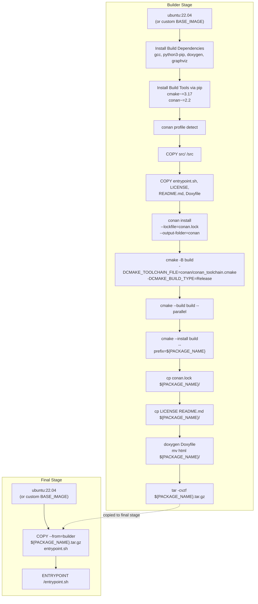
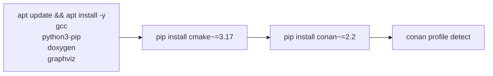
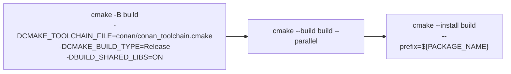
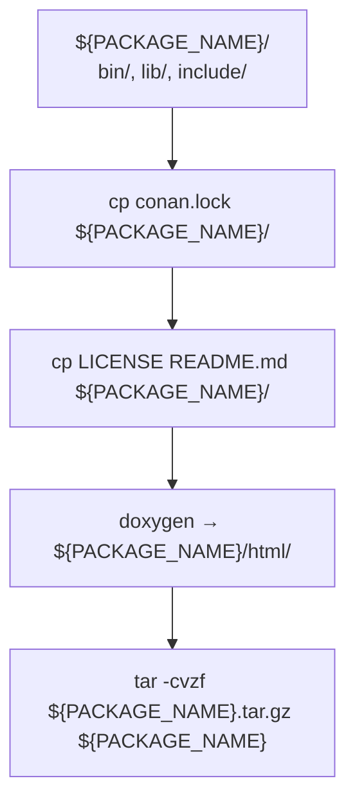
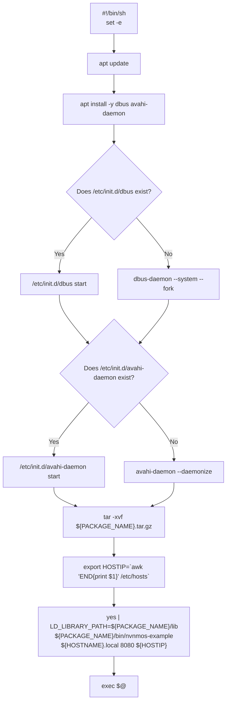

<!-- source: DeepWiki mcp.deepwiki.com · repo NVIDIA/nvnmos · page 6.4 Docker Build Process · fetched 2026-10-26 -->

# Docker Build Process

<details>
<summary>Relevant source files</summary>

The following files were used as context for generating this wiki page:

- [Dockerfile](Dockerfile)
- [README.md](README.md)
- [entrypoint.sh](entrypoint.sh)

</details>


## Purpose and Scope

This document details the Docker-based build system for the nvnmos library, including the multi-stage Dockerfile, build arguments, package generation, and container runtime configuration. The Docker build provides a self-contained environment for building, packaging, and testing nvnmos without requiring manual installation of build dependencies on the host system.

For information about the underlying CMake build configuration, see [CMake Configuration](#6.1). For details on Conan dependency management, see [Dependency Management with Conan](#6.3). For instructions on running the packaged example application, see [Running the Example Application](#2.3).

---

## Multi-Stage Build Architecture

The nvnmos Docker build uses a multi-stage pattern with two distinct stages: a `builder` stage that compiles the library and generates the distribution package, and a minimal final stage that contains only the runtime environment and packaged artifacts.

### Build Stage Flow



**Sources:** [Dockerfile:1-88]()

---

## Build Arguments

The Dockerfile accepts several build arguments that control the base image, package naming, and dependency locking behavior.

| Argument | Default Value | Purpose | Line Reference |
|----------|---------------|---------|----------------|
| `BASE_IMAGE` | `ubuntu:22.04` | Controls the base container image and OS compatibility | [Dockerfile:16]() |
| `PACKAGE_SUFFIX` | Derived from `BASE_IMAGE` | Custom suffix for package filename; defaults to `-ubuntu-22-04` | [Dockerfile:18]() |
| `USE_CONAN_LOCK` | `1` | Whether to use `conan.lock` for reproducible builds | [Dockerfile:20]() |
| `DEBIAN_FRONTEND` | `noninteractive` | Prevents interactive prompts during apt installations | [Dockerfile:17]() |
| `PIP_BREAK_SYSTEM_PACKAGES` | `1` | Allows pip to install packages system-wide | [Dockerfile:19]() |

### Package Naming Logic

The `PACKAGE_NAME` environment variable is constructed from `PACKAGE_SUFFIX` and `BASE_IMAGE`:

```bash
# Pattern replacement: '/' -> '-', ':' -> '-'
_BASE_IMAGE=${BASE_IMAGE//\//-}
PACKAGE_NAME=nvnmos${PACKAGE_SUFFIX:--${_BASE_IMAGE//:/-}}
```

For example, with `BASE_IMAGE=ubuntu:22.04` and no `PACKAGE_SUFFIX`, the result is `nvnmos-ubuntu-22-04`.

**Sources:** [Dockerfile:16-32](), [README.md:82-90]()

---

## Builder Stage Implementation

### Dependency Installation

The builder stage begins by installing system packages and Python-based build tools:



| Package | Purpose | Installation Method |
|---------|---------|---------------------|
| `gcc` | C++ compiler for building nvnmos and dependencies | apt |
| `python3-pip` | Python package manager | apt |
| `doxygen` | API documentation generator | apt |
| `graphviz` | Diagram generation for Doxygen | apt |
| `cmake~=3.17` | Build system generator | pip |
| `conan~=2.2` | C++ dependency manager | pip |

**Sources:** [Dockerfile:34-36]()

### Source Code and Auxiliary Files

The build copies source code and auxiliary files into the container:

```dockerfile
COPY src/ .                                    # Source code -> /src
COPY entrypoint.sh LICENSE README.md Doxyfile / # Auxiliary files -> /
```

The `entrypoint.sh` script is made executable at [Dockerfile:44]().

**Sources:** [Dockerfile:38-44]()

### Conan Dependency Resolution

The `conan install` command resolves and builds dependencies with lockfile support:

```bash
conan install . \
    -g CMakeToolchain \
    --settings:all build_type=Release \
    --build=missing \
    --output-folder=conan \
    --lockfile=${USE_CONAN_LOCK:+conan.lock} \
    --lockfile-partial \
    --lockfile-out=conan.lock
```

| Flag | Purpose |
|------|---------|
| `-g CMakeToolchain` | Generate `conan_toolchain.cmake` for CMake integration |
| `--settings:all build_type=Release` | Build all dependencies in Release mode |
| `--build=missing` | Build dependencies from source if binary packages unavailable |
| `--output-folder=conan` | Output dependencies to `/src/conan` |
| `--lockfile=${USE_CONAN_LOCK:+conan.lock}` | Use existing lockfile if `USE_CONAN_LOCK=1` |
| `--lockfile-partial` | Allow partial lockfile updates |
| `--lockfile-out=conan.lock` | Generate updated lockfile |

**Sources:** [Dockerfile:46-53]()

### CMake Build Process



The CMake configuration:
- Uses the Conan-generated toolchain at `conan/conan_toolchain.cmake`
- Sets build type to `Release`
- Enables shared library builds (`DBUILD_SHARED_LIBS=ON`)
- Installs to a directory named after `PACKAGE_NAME`

**Sources:** [Dockerfile:55-63]()

### Documentation Generation

Doxygen generates HTML documentation from the source code:

```bash
doxygen ../Doxyfile && mv html ${PACKAGE_NAME}/
```

The `Doxyfile` is copied from the repository root at [Dockerfile:42]() and executed from `/src`.

**Sources:** [Dockerfile:69]()

### Package Assembly



The final package directory structure:

```
${PACKAGE_NAME}/
├── bin/
│   └── nvnmos-example
├── lib/
│   └── libnvnmos.so (or nvnmos.dll)
├── include/
│   └── nvnmos.h
├── html/           (Doxygen documentation)
├── conan.lock
├── LICENSE
└── README.md
```

**Sources:** [Dockerfile:63-71]()

---

## Final Stage Implementation

The final stage creates a minimal runtime image containing only the packaged artifacts:

```dockerfile
FROM ${BASE_IMAGE}

ENV _BASE_IMAGE=${BASE_IMAGE//\//-}
ENV PACKAGE_NAME=nvnmos${PACKAGE_SUFFIX:--${_BASE_IMAGE//:/-}}

COPY --from=builder \
    /src/${PACKAGE_NAME}.tar.gz \
    /entrypoint.sh \
    .

ENTRYPOINT ["/entrypoint.sh"]
```

This stage:
1. Starts from a fresh base image (no build tools)
2. Copies only the tarball and entrypoint script from the builder
3. Sets `entrypoint.sh` as the container entrypoint

**Sources:** [Dockerfile:73-88]()

---

## Entrypoint Script Execution Flow

The `entrypoint.sh` script configures the runtime environment and executes the example application:



### Runtime Dependencies

The script installs DNS-SD services required by nvnmos:

| Package | Purpose |
|---------|---------|
| `dbus` | D-Bus message bus for inter-process communication |
| `avahi-daemon` | mDNS/DNS-SD service discovery daemon |

**Sources:** [entrypoint.sh:18-24]()

### Service Initialization

The script handles both traditional init systems and systemd-based systems:

```bash
[ -e "/etc/init.d/dbus" ] && /etc/init.d/dbus start || dbus-daemon --system --fork
[ -e "/etc/init.d/avahi-daemon" ] && /etc/init.d/avahi-daemon start || avahi-daemon --daemonize
```

This provides compatibility with Ubuntu 22.04 (init scripts) and Ubuntu 24.04+ (systemd).

**Sources:** [entrypoint.sh:23-24](), [README.md:283-285]()

### Example Application Execution

The script automatically runs `nvnmos-example` with parameters derived from the container environment:

```bash
export HOSTIP=`awk 'END{print $1}' /etc/hosts`
yes | LD_LIBRARY_PATH=${PACKAGE_NAME}/lib ${PACKAGE_NAME}/bin/nvnmos-example ${HOSTNAME}.local 8080 ${HOSTIP}
```

| Parameter | Value | Source |
|-----------|-------|--------|
| Host name | `${HOSTNAME}.local` | Container hostname |
| Port | `8080` | Hardcoded |
| IP address | `${HOSTIP}` | Last line of `/etc/hosts` |
| Responses | `yes` (automated) | Piped to stdin |

The `LD_LIBRARY_PATH` is set to locate `libnvnmos.so` in the extracted package.

**Sources:** [entrypoint.sh:26-30]()

---

## Building and Using the Docker Image

### Building the Image

```bash
docker build -t nvnmos .
```

With custom build arguments:

```bash
docker build \
  --build-arg BASE_IMAGE=ubuntu:24.04 \
  --build-arg PACKAGE_SUFFIX=-custom \
  --build-arg USE_CONAN_LOCK=0 \
  -t nvnmos-custom .
```

**Sources:** [README.md:59-65]()

### Extracting the Package

Create a temporary container to copy the package to the host:

```bash
docker create --name nvnmos-test nvnmos
docker cp nvnmos-test:/nvnmos-ubuntu-22.04.tar.gz .
docker rm nvnmos-test
```

The package filename matches the `PACKAGE_NAME` environment variable defined in the Dockerfile.

**Sources:** [README.md:67-73]()

### Running the Container

Execute the container interactively to explore the runtime environment:

```bash
docker run -it nvnmos /bin/bash
```

The entrypoint script automatically:
1. Installs runtime dependencies
2. Starts DNS-SD services
3. Extracts the package
4. Runs `nvnmos-example`

**Sources:** [README.md:75-79]()

---

## Build Artifact Summary

The Docker build produces the following artifacts:

### Container Layers

| Layer | Size Impact | Contents |
|-------|-------------|----------|
| Base image | ~77 MB (ubuntu:22.04) | Operating system |
| Runtime dependencies | ~15 MB | dbus, avahi-daemon |
| Package tarball | ~5-10 MB | Compiled binaries, docs |
| Entrypoint script | ~1 KB | Startup script |

### Tarball Contents

The `${PACKAGE_NAME}.tar.gz` contains:

| Directory/File | Contents | Generated By |
|----------------|----------|--------------|
| `bin/` | `nvnmos-example` executable | [Dockerfile:61]() |
| `lib/` | `libnvnmos.so` shared library | [Dockerfile:61]() |
| `include/` | `nvnmos.h` public header | [Dockerfile:61]() |
| `html/` | API documentation (HTML) | [Dockerfile:69]() |
| `conan.lock` | Locked dependency versions | [Dockerfile:65]() |
| `LICENSE` | Apache 2.0 license | [Dockerfile:67]() |
| `README.md` | Usage documentation | [Dockerfile:67]() |

**Sources:** [Dockerfile:61-71]()

---

