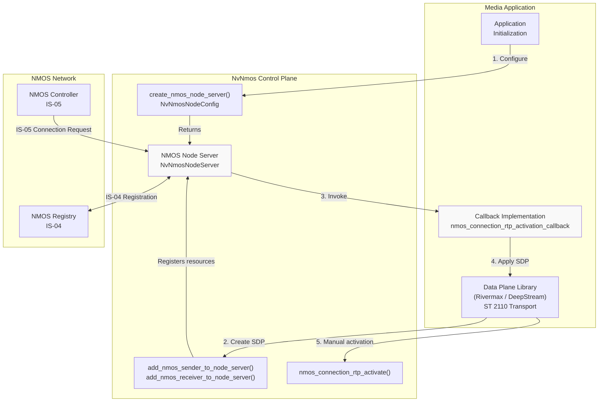
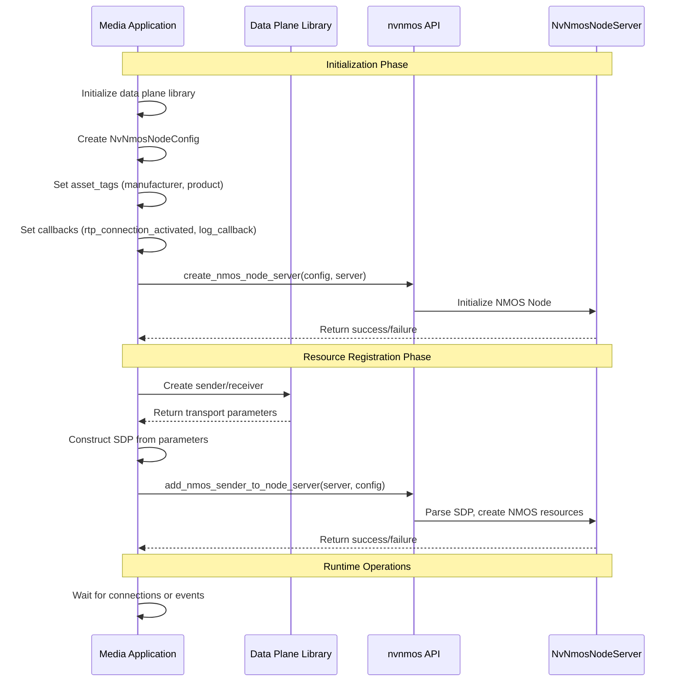
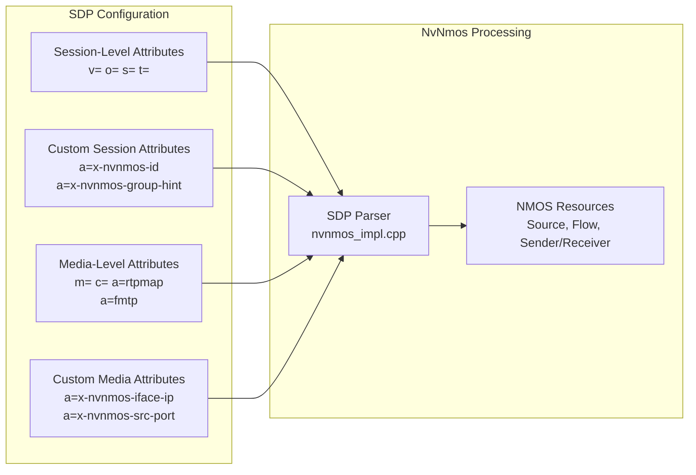
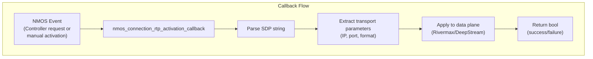
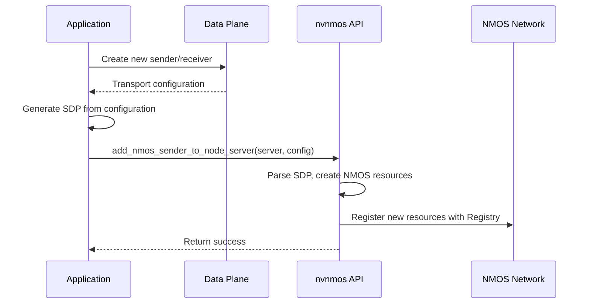
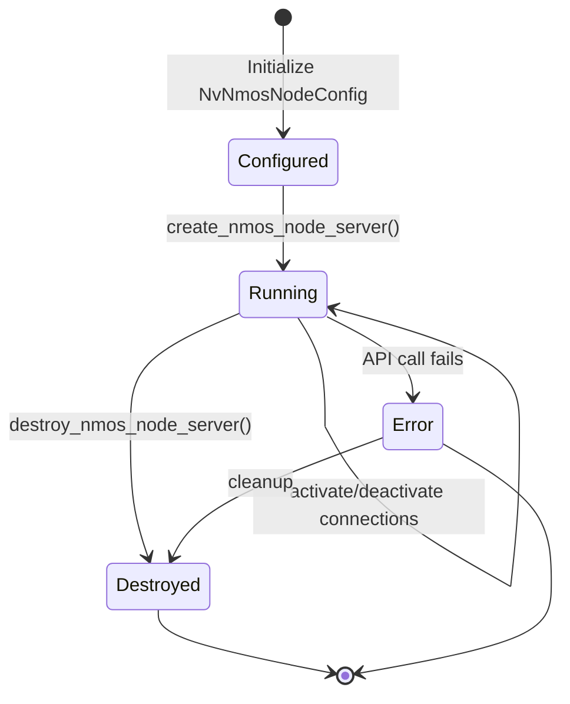

<!-- source: DeepWiki mcp.deepwiki.com · repo NVIDIA/nvnmos · page 7 Integration Guide · fetched 2026-10-26 -->

# Integration Guide

<details>
<summary>Relevant source files</summary>

The following files were used as context for generating this wiki page:

- [README.md](README.md)
- [src/main.c](src/main.c)
- [src/nvnmos.h](src/nvnmos.h)

</details>


This guide describes how to integrate the nvnmos library into media applications that use ST 2110 data plane transport libraries such as NVIDIA Rivermax or NVIDIA DeepStream. The nvnmos library provides NMOS control plane functionality, while the data plane library handles actual media transport. This document explains the integration architecture, workflow, and implementation patterns required to connect these two layers.

For detailed information about specific integration patterns, see [Integration Patterns](#7.1). For custom SDP attribute reference, see [Custom SDP Attributes](#7.2). For error handling best practices, see [Error Handling and Logging](#7.3).

## Architecture Overview

The nvnmos library operates as a control plane layer that manages NMOS protocol interactions while delegating actual media transport to external data plane libraries. This separation allows media applications to gain NMOS discovery, registration, and connection management capabilities without modifying their existing transport implementations.

### Integration Architecture



**Diagram: Integration architecture showing control flow between application, nvnmos, and NMOS network**

Sources: [src/nvnmos.h:95-349](), [README.md:24-30]()

### Responsibilities

| Component | Responsibilities |
|-----------|------------------|
| **Media Application** | Media pipeline management, buffer allocation, transport configuration, SDP generation |
| **Data Plane Library** | ST 2110 packet transmission/reception, timing synchronization, hardware acceleration |
| **NvNmos Library** | NMOS protocol implementation, resource registration, connection state management |
| **NMOS Registry** | Service discovery, resource catalog, node registration |
| **NMOS Controller** | Connection orchestration, parameter distribution, activation coordination |

Sources: [src/nvnmos.h:18-56](), [README.md:22-42]()

## Integration Workflow

### Initialization Sequence



**Diagram: Typical initialization sequence for integrating nvnmos**

Sources: [src/main.c:228-298](), [src/nvnmos.h:351-393]()

### Step-by-Step Integration Process

1. **Initialize Data Plane Library**: Set up the media transport library (Rivermax, DeepStream, etc.) with necessary resources and buffers.

2. **Configure NMOS Node**: Create and populate `NvNmosNodeConfig` structure:
   - Set `host_name` and `http_port` for network identity
   - Configure `asset_tags` with `NvNmosAssetConfig` for device identification
   - Register callback functions for connection activation and logging
   - Optionally specify initial senders and receivers

3. **Create NMOS Node Server**: Call `create_nmos_node_server()` to initialize the NMOS control plane. This starts HTTP APIs and begins registry discovery/registration.

4. **Generate SDP for Resources**: For each sender or receiver in the data plane:
   - Extract transport parameters (IP addresses, ports, media formats)
   - Construct Session Description Protocol (SDP) strings
   - Include required custom attributes (`x-nvnmos-id`, `x-nvnmos-iface-ip`, etc.)

5. **Register Resources**: Call `add_nmos_sender_to_node_server()` or `add_nmos_receiver_to_node_server()` with SDP-based configuration. The library parses SDP and creates corresponding NMOS resources.

6. **Implement Activation Callback**: Handle `nmos_connection_rtp_activation_callback` invocations:
   - Parse received SDP to extract updated transport parameters
   - Apply parameters to data plane library
   - Return success/failure status

7. **Handle Runtime Operations**: Respond to dynamic events such as adding/removing resources or manual activation requests.

Sources: [src/nvnmos.h:174-234](), [src/main.c:240-298]()

## SDP as Configuration Interface

Session Description Protocol (SDP) serves as the primary configuration interface between the media application and nvnmos. All sender and receiver configuration flows through SDP strings that encode both standard NMOS parameters and custom nvnmos-specific attributes.

### SDP Structure and Required Elements



**Diagram: SDP processing flow in nvnmos**

Sources: [src/nvnmos.h:261-293](), [src/main.c:90-216]()

### Essential SDP Attributes

The following table lists the SDP attributes required for nvnmos integration:

| Attribute | Level | Required | Purpose | Example |
|-----------|-------|----------|---------|---------|
| `v=` | Session | Yes | Protocol version | `v=0` |
| `o=` | Session | Yes | Origin/session identifier | `o=- 1234 5678 IN IP4 192.0.2.0` |
| `s=` | Session | Yes | Session name/label | `s=NvNmos Video Sender` |
| `t=` | Session | Yes | Timing information | `t=0 0` |
| `a=x-nvnmos-id` | Session | Yes | Unique sender/receiver ID | `a=x-nvnmos-id:source-0` |
| `a=x-nvnmos-group-hint` | Session | No | Grouping tag | `a=x-nvnmos-group-hint:rx-0:video` |
| `m=` | Media | Yes | Media description | `m=video 5020 RTP/AVP 96` |
| `c=` | Media | Yes | Connection information | `c=IN IP4 233.252.0.0/64` |
| `a=rtpmap` | Media | Yes | RTP payload mapping | `a=rtpmap:96 raw/90000` |
| `a=fmtp` | Media | Yes | Format-specific parameters | `a=fmtp:96 sampling=YCbCr-4:2:2; ...` |
| `a=x-nvnmos-iface-ip` | Media | Yes | Interface IP address | `a=x-nvnmos-iface-ip:192.0.2.0` |
| `a=x-nvnmos-src-port` | Media | Sender only | Source port | `a=x-nvnmos-src-port:5004` |
| `a=ts-refclk` | Media | Sender only | Timing reference | `a=ts-refclk:ptp=IEEE1588-2008:...` |

Sources: [src/nvnmos.h:261-293](), [src/main.c:110-149]()

### Example SDP Construction

The following pattern from [src/main.c:90-152]() demonstrates SDP construction for a video sender:

```c
// Extract from application's data plane configuration
const char* interface_ip = "192.0.2.0";
const char* id = "sink-0";
const char* label = "NvNmos Video Sender";
const char* group_hint = "tx-0:video";

// Construct SDP string
snprintf(sdp, sdp_size,
    "v=0\r\n"
    "o=- %d %d IN IP4 %s\r\n"
    "s=%s\r\n"
    "t=0 0\r\n"
    "a=x-nvnmos-id:%s\r\n"
    "a=x-nvnmos-group-hint:%s\r\n"
    "m=video %d RTP/AVP %d\r\n"
    "c=IN IP4 %s/64\r\n"
    "a=x-nvnmos-iface-ip:%s\r\n"
    "a=x-nvnmos-src-port:%d\r\n"
    "a=rtpmap:%d %s\r\n"
    "a=fmtp:%d %s\r\n"
    "a=ts-refclk:ptp=IEEE1588-2008:...\r\n"
    "a=mediaclk:direct=0\r\n",
    ntp_time, ntp_time, interface_ip,
    label,
    id, group_hint,
    destination_port, payload_type,
    multicast_ip,
    interface_ip,
    source_port,
    payload_type, encoding_parameters,
    payload_type, format_specific_parameters
);
```

Sources: [src/main.c:90-152]()

## Callback Implementation

The `nmos_connection_rtp_activation_callback` is the primary mechanism for the NMOS network to control the data plane. This callback is invoked when an NMOS Controller requests connection activation or when transport parameters change.

### Callback Function Signature



**Diagram: Callback execution flow for connection activation**

Sources: [src/nvnmos.h:98-125](), [src/main.c:80-88]()

### Callback Parameters and Behavior

The callback signature is defined in [src/nvnmos.h:122-125]():

```c
typedef bool (* nmos_connection_rtp_activation_callback)(
    NvNmosNodeServer *server,
    const char *id,
    const char *sdp);
```

| Parameter | Description |
|-----------|-------------|
| `server` | Pointer to the `NvNmosNodeServer` instance. Access `server->user_data` for application context. |
| `id` | Unique identifier of the sender or receiver being activated (matches `x-nvnmos-id` in SDP). |
| `sdp` | Updated SDP string with new transport parameters, or `NULL` to deactivate. |
| **Return** | `true` if activation succeeded, `false` if it failed. |

**Key behaviors:**

- **Activation**: When `sdp` is non-NULL, parse it to extract transport parameters and apply them to the data plane library.
- **Deactivation**: When `sdp` is NULL, stop the corresponding sender or receiver.
- **Transport-only updates**: The callback provides transport parameter updates only. Media format changes are not permitted after initial configuration.
- **Inactive legs**: For multi-leg configurations, the `a=inactive` attribute indicates disabled legs.

Sources: [src/nvnmos.h:98-125]()

### Example Callback Implementation

From [src/main.c:80-88]():

```c
static bool handle_rtp_connection_activated(
    NvNmosNodeServer *server,
    const char *id,
    const char *sdp)
{
    printf("%s %s\n", id, sdp ? "activated via NMOS" : "deactivated via NMOS");
    
    if (sdp) {
        // Parse SDP to extract parameters
        // Example: extract multicast IP, port, source filter
        // Apply to data plane library (Rivermax/DeepStream)
        
        // Pseudo-code for data plane integration:
        // rivermax_update_stream(id, parsed_params);
        // or
        // gst_element_set_state(pipeline, GST_STATE_PLAYING);
    } else {
        // Deactivate stream in data plane
        // rivermax_stop_stream(id);
    }
    
    return true;  // Return false if configuration failed
}
```

Sources: [src/main.c:80-88]()

### Accessing Application Context

Use the `user_data` field in `NvNmosNodeServer` to access application-specific state:

```c
typedef struct _NvNmosNodeServer {
    void *user_data;  // Application-defined pointer
    void *impl;       // nvnmos internal use only
} NvNmosNodeServer;
```

Example from [src/main.c:293-295]():

```c
NvNmosNodeServer node_server = { 0 };
node_server.user_data = (void*)my_application_context;

// In callback:
MyAppContext* ctx = (MyAppContext*)server->user_data;
ctx->configure_stream(id, sdp);
```

Sources: [src/nvnmos.h:337-349](), [src/main.c:293-295]()

## Dynamic Resource Management

Applications can add or remove senders and receivers at runtime to reflect changes in the data plane configuration.

### Adding Resources



**Diagram: Dynamic sender/receiver addition flow**

The process for adding resources at runtime follows [src/nvnmos.h:379-422]():

```c
// Create configuration with SDP
NvNmosSenderConfig sender_config = { 0 };
sender_config.sdp = generated_sdp_string;

// Add to running node server
bool success = add_nmos_sender_to_node_server(&node_server, &sender_config);
```

Sources: [src/nvnmos.h:379-422](), [src/main.c:304-306]()

### Removing Resources

Resources can be removed by their unique identifier from [src/nvnmos.h:394-437]():

```c
// Remove by ID (matches x-nvnmos-id in SDP)
bool success = remove_nmos_sender_from_node_server(&node_server, "sink-0");
```

The library automatically unregisters the resources from the NMOS Registry and updates the node's resource catalog.

Sources: [src/nvnmos.h:394-437](), [src/main.c:301-302]()

## Manual Activation

Applications can programmatically activate or deactivate connections using `nmos_connection_rtp_activate()` without waiting for NMOS Controller requests. This is useful for testing or application-driven connection management.

The function signature from [src/nvnmos.h:439-469]():

```c
bool nmos_connection_rtp_activate(
    NvNmosNodeServer *server,
    const char *id,
    const char *sdp);  // NULL to deactivate
```

**Important note:** When using manual activation, the same `nmos_connection_rtp_activation_callback` is invoked as if the request came from an NMOS Controller. This ensures consistent behavior regardless of activation source.

Example from [src/main.c:309-318]():

```c
// Activate with updated transport parameters
nmos_connection_rtp_activate(&node_server, "source-0", updated_sdp);

// Deactivate
nmos_connection_rtp_activate(&node_server, "source-0", NULL);
```

Sources: [src/nvnmos.h:439-469](), [src/main.c:309-318]()

## Configuration Structure Reference

### NvNmosNodeConfig

The primary configuration structure defined in [src/nvnmos.h:174-234]():

```c
typedef struct _NvNmosNodeConfig {
    const char *host_name;
    const char **host_addresses;
    unsigned int num_host_addresses;
    unsigned int http_port;
    
    const char* label;
    const char* description;
    NvNmosAssetConfig* asset_tags;
    
    const char *seed;  // For repeatable UUID generation
    
    NvNmosReceiverConfig *receivers;
    unsigned int num_receivers;
    NvNmosSenderConfig *senders;
    unsigned int num_senders;
    
    nmos_connection_rtp_activation_callback rtp_connection_activated;
    
    nmos_logging_callback log_callback;
    int log_level;
    const char **log_categories;
    unsigned int num_log_categories;
    
    NvNmosNetworkServicesConfig* network_services;
} NvNmosNodeConfig;
```

**Key configuration points:**

- **Network Identity**: `host_name` and `http_port` define how the node is discovered and accessed
- **Asset Tags**: `asset_tags` provides BCP-002-02 compliant device identification
- **Initial Resources**: `receivers` and `senders` arrays specify resources created at startup
- **Callbacks**: `rtp_connection_activated` and `log_callback` integrate with application logic
- **Network Services**: `network_services` allows override of default DNS-SD behavior

Sources: [src/nvnmos.h:174-234]()

### NvNmosAssetConfig

Asset distinguishing information from [src/nvnmos.h:240-254]():

```c
typedef struct _NvNmosAssetConfig {
    const char* manufacturer;
    const char* product;
    const char* instance_id;
    const char** functions;
    unsigned int num_functions;
} NvNmosAssetConfig;
```

Example from [src/main.c:236-246]():

```c
const char* functions[1] = { "Encoder" };  // or "Decoder", "Converter", etc.

NvNmosAssetConfig asset_config = { 0 };
asset_config.manufacturer = "Acme";
asset_config.product = "Widget Pro";
asset_config.instance_id = "XYZ123-456789";
asset_config.functions = &functions[0];
asset_config.num_functions = 1;
```

Sources: [src/nvnmos.h:240-254](), [src/main.c:236-246]()

## Lifecycle Management

### Server Lifecycle



**Diagram: NMOS Node Server lifecycle states**

The server must be properly initialized and destroyed:

```c
NvNmosNodeServer node_server = { 0 };

// Initialize
if (!create_nmos_node_server(&node_config, &node_server)) {
    // Handle error
    return 1;
}

// Use server...

// Cleanup
if (!destroy_nmos_node_server(&node_server)) {
    // Handle error
    return 1;
}
```

**Critical considerations:**

1. **Zero-initialize structures**: Always zero-initialize `NvNmosNodeServer` and config structures
2. **Check return values**: All API functions return `bool` indicating success/failure
3. **Cleanup on failure**: Call `destroy_nmos_node_server()` even if later operations fail
4. **No re-initialization**: Do not reuse a `NvNmosNodeServer` after destruction

Sources: [src/nvnmos.h:351-377](), [src/main.c:293-327]()

### Threading Considerations

The nvnmos library uses internal threading for NMOS protocol operations. Applications must consider:

- **Callback thread**: The `nmos_connection_rtp_activation_callback` is invoked on an internal nvnmos thread. If the data plane library requires thread-safe access, implement appropriate locking or message passing.

- **API thread safety**: Most nvnmos API functions are thread-safe and can be called from any thread. However, concurrent calls to `create_nmos_node_server()` or `destroy_nmos_node_server()` on the same `NvNmosNodeServer` are not supported.

- **Blocking operations**: Callbacks should complete quickly to avoid blocking NMOS protocol operations. For time-consuming data plane reconfiguration, consider queuing work items for a separate worker thread.

Sources: [src/nvnmos.h:98-125]()

## Logging Integration

Applications should implement `nmos_logging_callback` to integrate nvnmos logs with their logging infrastructure.

### Log Callback Signature

From [src/nvnmos.h:149-163]():

```c
typedef void (* nmos_logging_callback)(
    NvNmosNodeServer *server,
    const char *categories,
    int level,
    const char *message);
```

### Log Levels

Defined in [src/nvnmos.h:131-146]():

| Level | Value | Description |
|-------|-------|-------------|
| `NVNMOS_LOG_DEVEL` | -40 | Low-level debugging information |
| `NVNMOS_LOG_VERBOSE` | -10 | Detailed API tracking |
| `NVNMOS_LOG_INFO` | 0 | Expected API events |
| `NVNMOS_LOG_WARNING` | 10 | Minor recoverable problems |
| `NVNMOS_LOG_ERROR` | 20 | Recoverable errors |
| `NVNMOS_LOG_SEVERE` | 30 | Serious errors requiring restart |
| `NVNMOS_LOG_FATAL` | 40 | Critical errors causing termination |

Example from [src/main.c:71-78]():

```c
static void handle_log(
    NvNmosNodeServer *server,
    const char *categories,
    int level,
    const char *message)
{
    printf("%s [%d:%s]\n", message, level, categories);
    // Production: route to application logger (syslog, log4c, etc.)
}

// In configuration:
node_config.log_callback = &handle_log;
node_config.log_level = NVNMOS_LOG_ERROR;  // Minimum level to report
```

Sources: [src/nvnmos.h:131-163](), [src/main.c:71-78](), [src/main.c:290-291]()

## Integration Checklist

Use this checklist to verify proper nvnmos integration:

- [ ] Data plane library initialized before creating NMOS node server
- [ ] `NvNmosAssetConfig` populated with manufacturer, product, and instance ID
- [ ] `seed` configured for repeatable UUID generation (production systems)
- [ ] `nmos_connection_rtp_activation_callback` implemented and tested
- [ ] Callback correctly parses SDP and applies parameters to data plane
- [ ] Callback handles NULL SDP for deactivation
- [ ] `nmos_logging_callback` implemented to route logs to application logger
- [ ] SDP strings include all required attributes (`x-nvnmos-id`, `x-nvnmos-iface-ip`, etc.)
- [ ] SDP media format parameters match data plane configuration
- [ ] `user_data` in `NvNmosNodeServer` set if needed for callback context
- [ ] All API return values checked and errors handled
- [ ] `destroy_nmos_node_server()` called during application shutdown
- [ ] DNS-SD service (avahi-daemon or Bonjour) running at runtime
- [ ] Unique port numbers used for each NMOS node instance

Sources: [src/nvnmos.h:174-234](), [src/main.c:228-327]()

---

