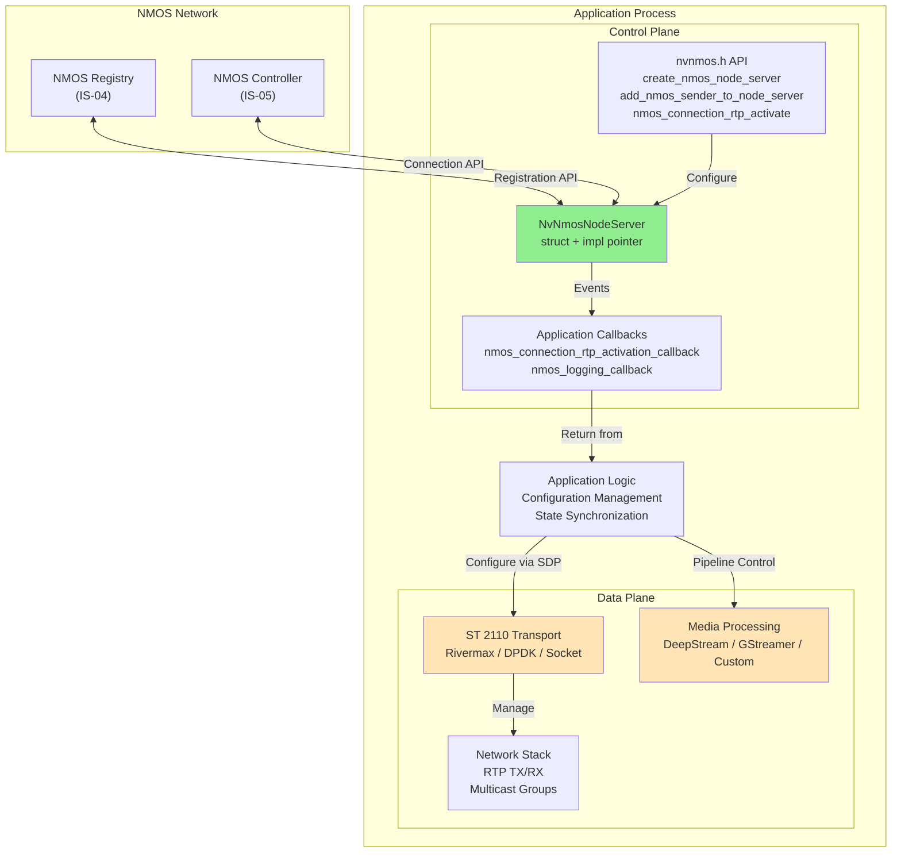
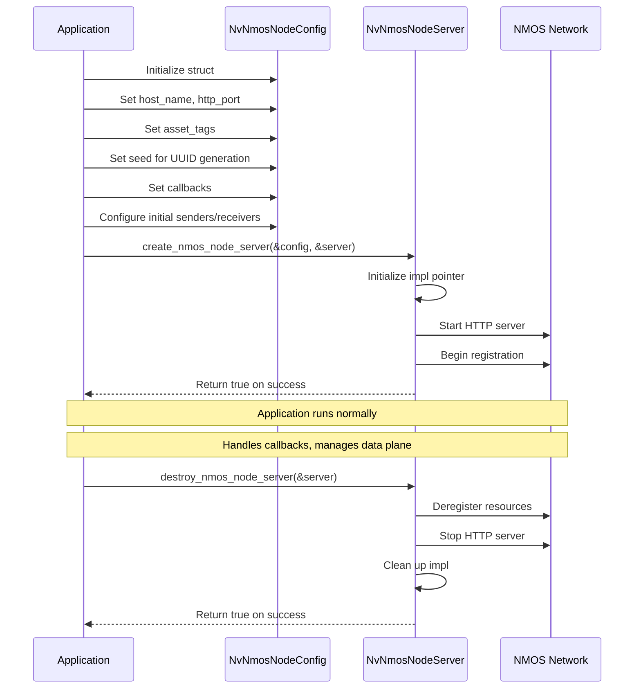
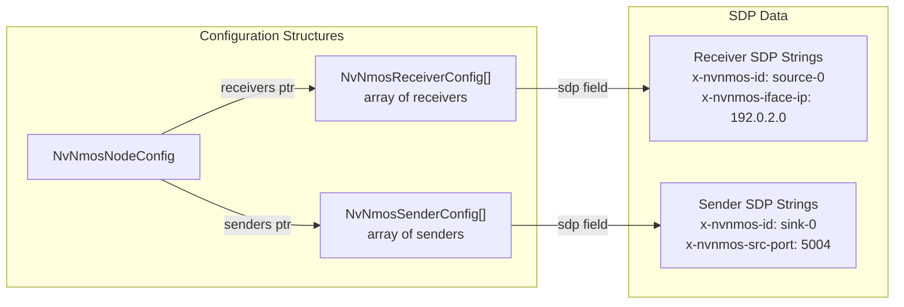
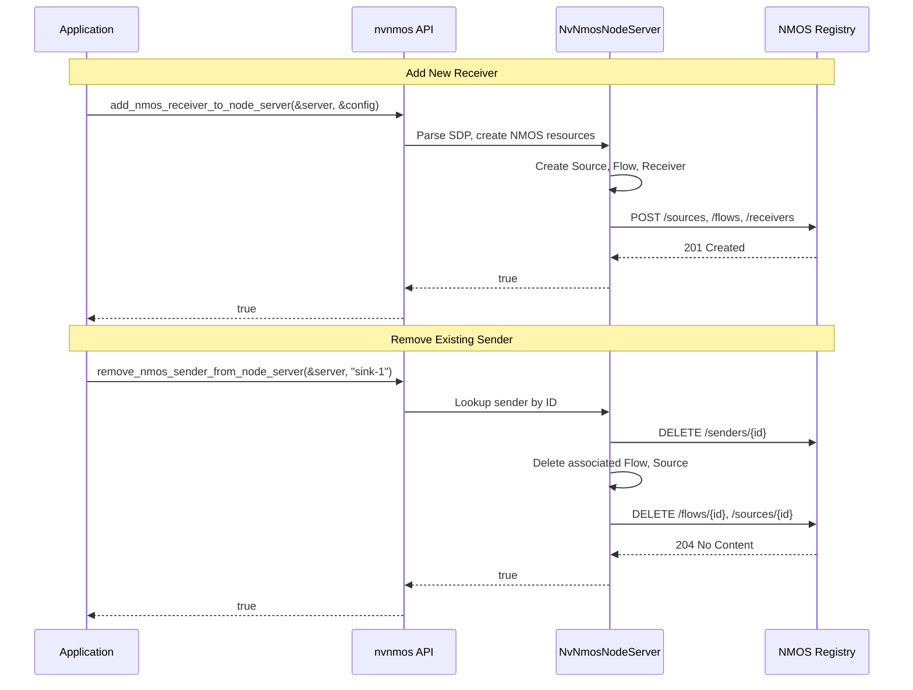
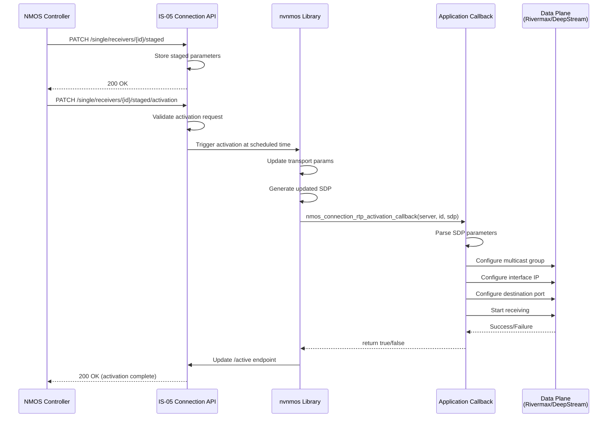
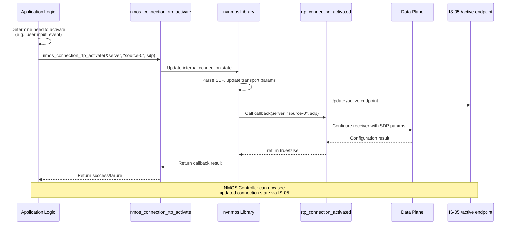
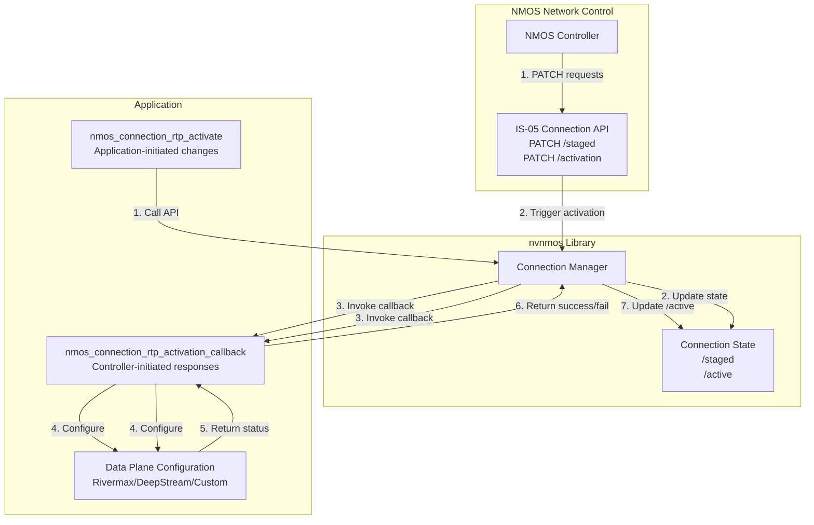
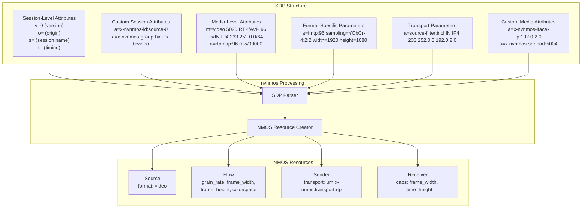
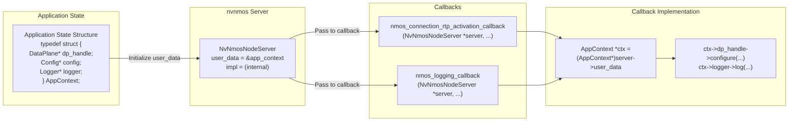

<!-- source: DeepWiki mcp.deepwiki.com · repo NVIDIA/nvnmos · page 7.1 Integration Patterns · fetched 2026-10-26 -->

# Integration Patterns

<details>
<summary>Relevant source files</summary>

The following files were used as context for generating this wiki page:

- [README.md](README.md)
- [src/main.c](src/main.c)
- [src/nvnmos.h](src/nvnmos.h)

</details>


## Purpose and Scope

This document describes common architectural patterns for integrating the nvnmos library with media transport and processing applications. It focuses on the practical implementation approaches that connect the NMOS control plane (managed by nvnmos) with the ST 2110 data plane (managed by libraries like Rivermax or DeepStream).

For detailed information about the nvnmos API functions, see [API Reference](#4). For information about custom SDP attributes used in integration, see [Custom SDP Attributes](#7.2). For error handling strategies, see [Error Handling and Logging](#7.3).

Sources: [src/nvnmos.h:1-478](), [README.md:20-42]()

---

## Component Integration Architecture

The nvnmos library operates as a control plane layer that sits between the NMOS network and your media application's data plane. Understanding this separation is fundamental to successful integration.

### Control Plane vs Data Plane Separation



**Key Principle**: nvnmos handles all NMOS protocol operations (discovery, registration, connection management) but never touches actual media data. The application is responsible for configuring the data plane based on parameters received through nvnmos callbacks.

Sources: [src/nvnmos.h:18-57](), [README.md:20-32]()

---

## Pattern 1: Initialization and Lifecycle Management

### Basic Initialization Pattern

The fundamental pattern for integrating nvnmos involves creating a server instance, running it for the application's lifetime, and properly destroying it on shutdown.



### Implementation Example

The example application demonstrates this pattern:

| Step | Code Location | Description |
|------|---------------|-------------|
| **Configuration Setup** | [src/main.c:240-256]() | Initialize `NvNmosNodeConfig` and `NvNmosAssetConfig` structures |
| **Callback Registration** | [src/main.c:288-291]() | Assign function pointers for `rtp_connection_activated` and `log_callback` |
| **Initial Resources** | [src/main.c:264-286]() | Configure initial senders and receivers via SDP |
| **Server Creation** | [src/main.c:297-298]() | Call `create_nmos_node_server()` |
| **Server Destruction** | [src/main.c:321]() | Call `destroy_nmos_node_server()` |

### Server Structure Usage

```c
typedef struct _NvNmosNodeServer
{
    void *user_data;  // Application-managed context pointer
    void *impl;       // Library-managed implementation pointer
} NvNmosNodeServer;
```

The `user_data` field enables passing application context to callbacks. The example demonstrates this at [src/main.c:293-295]().

Sources: [src/nvnmos.h:337-349](), [src/nvnmos.h:352-377](), [src/main.c:228-328]()

---

## Pattern 2: Static Resource Configuration

### Configuration at Initialization

Applications can define senders and receivers at node creation time by including them in the `NvNmosNodeConfig` structure.



### Configuration Structure Hierarchy

| Structure | Field | Purpose |
|-----------|-------|---------|
| `NvNmosNodeConfig` | `receivers` | Pointer to array of receiver configurations |
| `NvNmosNodeConfig` | `num_receivers` | Number of receivers in array |
| `NvNmosNodeConfig` | `senders` | Pointer to array of sender configurations |
| `NvNmosNodeConfig` | `num_senders` | Number of senders in array |
| `NvNmosReceiverConfig` | `sdp` | SDP string with x-nvnmos-* attributes |
| `NvNmosSenderConfig` | `sdp` | SDP string with x-nvnmos-* attributes |

### Example Implementation

The example application constructs SDP strings for initial resources:

```c
// Receiver configuration
NvNmosReceiverConfig source_config[2] = { 0 };
source_config[0].sdp = source_sdp[0];  // Video receiver
source_config[1].sdp = source_sdp[1];  // Audio receiver

node_config.receivers = &source_config[0];
node_config.num_receivers = 2;

// Sender configuration
NvNmosSenderConfig sink_config[2] = { 0 };
sink_config[0].sdp = sink_sdp[0];  // Video sender
sink_config[1].sdp = sink_sdp[1];  // Audio sender

node_config.senders = &sink_config[0];
node_config.num_senders = 2;
```

Sources: [src/nvnmos.h:174-234](), [src/nvnmos.h:260-273](), [src/nvnmos.h:279-293](), [src/main.c:272-286]()

---

## Pattern 3: Dynamic Resource Management

### Runtime Resource Modification

Applications can add and remove senders and receivers dynamically during operation without restarting the node server.



### API Functions for Dynamic Management

| Function | Parameters | Use Case |
|----------|-----------|----------|
| `add_nmos_receiver_to_node_server` | `server`, `config` | Add new receiver to running node |
| `remove_nmos_receiver_from_node_server` | `server`, `id` | Remove receiver by unique identifier |
| `add_nmos_sender_to_node_server` | `server`, `config` | Add new sender to running node |
| `remove_nmos_sender_from_node_server` | `server`, `id` | Remove sender by unique identifier |

### Example Usage

The example application demonstrates dynamic resource management:

```c
// Remove resources
printf("Removing some senders and receivers...\n");
if (!remove_nmos_receiver_from_node_server(&node_server, "source-0")) goto cleanup;
if (!remove_nmos_sender_from_node_server(&node_server, "sink-1")) goto cleanup;

// Add resources back
printf("Adding back some senders and receivers...\n");
if (!add_nmos_receiver_to_node_server(&node_server, &source_config[0])) goto cleanup;
if (!add_nmos_sender_to_node_server(&node_server, &sink_config[1])) goto cleanup;
```

**Important**: The ID used in remove operations must match the `x-nvnmos-id` attribute in the SDP that was used to create the resource.

Sources: [src/nvnmos.h:379-437](), [src/main.c:300-306]()

---

## Pattern 4: Controller-Initiated Connection Management

### IS-05 Connection API Flow

When an NMOS Controller initiates a connection, the application receives a callback and must configure the data plane accordingly.



### Callback Function Signature

```c
typedef bool (* nmos_connection_rtp_activation_callback)(
    NvNmosNodeServer *server,
    const char *id,
    const char *sdp);
```

### Callback Parameters and Responsibilities

| Parameter | Type | Description |
|-----------|------|-------------|
| `server` | `NvNmosNodeServer*` | Server instance (use `user_data` for context) |
| `id` | `const char*` | Unique identifier of sender/receiver being activated |
| `sdp` | `const char*` | Updated SDP with transport parameters (or `NULL` for deactivation) |
| **Return** | `bool` | `true` if data plane was successfully configured, `false` otherwise |

### Implementation Example

```c
static bool handle_rtp_connection_activated(
    NvNmosNodeServer *server,
    const char *id,
    const char *sdp)
{
    printf("%s %s\n", id, sdp ? "activated via NMOS" : "deactivated via NMOS");
    
    if (sdp) {
        // Parse SDP to extract transport parameters
        // Extract: destination IP, port, interface IP, source filter
        // Configure data plane library (Rivermax, DeepStream, etc.)
        // Example: rivermax_configure_receiver(id, sdp_params);
        
        printf("%s\n", sdp);  // Log full SDP in this example
    } else {
        // Deactivation: stop data plane receiver/sender
        // Example: rivermax_stop_stream(id);
    }
    
    return true;  // Indicate successful configuration
}
```

### Critical Implementation Points

1. **Synchronous Operation**: The callback should complete data plane configuration synchronously. The IS-05 activation response is sent based on the return value.

2. **SDP Parsing**: Applications must extract relevant transport parameters from the SDP string. Common parameters include:
   - Connection address (`c=` line)
   - Port number (`m=` line)
   - Source filter (`a=source-filter:`)
   - Interface IP (`a=x-nvnmos-iface-ip:`)
   - Source port (`a=x-nvnmos-src-port:` for senders)

3. **Error Handling**: Return `false` if data plane configuration fails. This causes the NMOS activation to fail, maintaining consistency between control and data planes.

Sources: [src/nvnmos.h:98-125](), [src/main.c:80-88]()

---

## Pattern 5: Application-Initiated Connection Management

### Direct Activation API

Applications can directly control connection state by calling `nmos_connection_rtp_activate()`, which updates both the NMOS state and triggers the data plane configuration callback.



### Function Signature

```c
bool nmos_connection_rtp_activate(
    NvNmosNodeServer *server,
    const char *id,
    const char *sdp);
```

### Parameters and Usage

| Parameter | Description | Special Values |
|-----------|-------------|----------------|
| `server` | Pointer to the node server instance | Must be valid initialized server |
| `id` | Unique identifier for sender or receiver | Must match `x-nvnmos-id` in SDP |
| `sdp` | Updated SDP with transport parameters | `NULL` to deactivate |

### Example: Programmatic Activation

```c
// Activate receivers and senders programmatically
printf("Activating senders and receivers...\n");

// Activate receiver with initial SDP
if (!nmos_connection_rtp_activate(&node_server, "source-0", source_config[0].sdp)) 
    goto cleanup;
if (!nmos_connection_rtp_activate(&node_server, "source-1", source_config[1].sdp)) 
    goto cleanup;

// Activate senders with initial SDP
if (!nmos_connection_rtp_activate(&node_server, "sink-0", sink_config[0].sdp)) 
    goto cleanup;
if (!nmos_connection_rtp_activate(&node_server, "sink-1", sink_config[1].sdp)) 
    goto cleanup;
```

### Example: Programmatic Deactivation

```c
// Deactivate by passing NULL for sdp parameter
printf("Deactivating senders and receivers...\n");

if (!nmos_connection_rtp_activate(&node_server, "source-0", NULL)) 
    goto cleanup;
if (!nmos_connection_rtp_activate(&node_server, "source-1", NULL)) 
    goto cleanup;
if (!nmos_connection_rtp_activate(&node_server, "sink-0", NULL)) 
    goto cleanup;
if (!nmos_connection_rtp_activate(&node_server, "sink-1", NULL)) 
    goto cleanup;
```

### Use Cases for Application-Initiated Activation

1. **Initial Stream Startup**: Activate senders/receivers when the application starts or loads a configuration
2. **User Interface Control**: Allow operators to manually activate/deactivate streams
3. **Automated Workflows**: Trigger activations based on application logic or external events
4. **Testing and Development**: Programmatically test connection scenarios
5. **Failover Scenarios**: Switch to backup streams based on monitoring

Sources: [src/nvnmos.h:439-469](), [src/main.c:308-318]()

---

## Pattern 6: Bidirectional Control Flow

### Handling Both Control Directions

A complete integration must handle connection management from both directions: NMOS Controllers (via IS-05) and application logic (via direct API calls).



### State Consistency Guarantees

Both activation paths (controller-initiated and application-initiated) converge on the same callback and state update mechanisms, ensuring:

1. **Single Source of Truth**: Connection state in nvnmos library reflects actual data plane configuration
2. **Consistent Callback Invocation**: Both paths invoke `nmos_connection_rtp_activation_callback`
3. **Atomic Updates**: State updates are synchronized between NMOS API and data plane
4. **Failure Handling**: Callback returning `false` prevents state updates in both directions

### Implementation Pattern

```c
// Application initialization
node_config.rtp_connection_activated = &handle_rtp_connection_activated;

// Callback implementation handles both directions transparently
static bool handle_rtp_connection_activated(
    NvNmosNodeServer *server,
    const char *id,
    const char *sdp)
{
    // This callback is invoked for BOTH:
    // 1. Controller-initiated activations (via IS-05)
    // 2. Application-initiated activations (via nmos_connection_rtp_activate)
    
    printf("%s %s\n", id, 
           sdp ? "activated via NMOS" : "deactivated via NMOS");
    
    // Single data plane configuration logic handles both cases
    if (sdp) {
        // Configure data plane from SDP
        configure_data_plane_receiver_or_sender(id, sdp);
    } else {
        // Deactivate data plane
        stop_data_plane_receiver_or_sender(id);
    }
    
    return true;  // Same return semantics for both directions
}
```

### Identifying Control Source

Applications that need to distinguish between control sources can use logging or the message content, but typically don't need to:

- The example logs "activated via NMOS" for both directions at [src/main.c:85]()
- Data plane configuration logic is identical regardless of source
- The callback abstraction is designed to hide this distinction

Sources: [src/nvnmos.h:98-125](), [src/nvnmos.h:439-469](), [src/main.c:80-88]()

---

## Pattern 7: SDP-Based Configuration

### SDP as Configuration Format

nvnmos uses Session Description Protocol (SDP) strings as the universal configuration format for senders and receivers. This provides a standardized way to specify media formats and transport parameters.



### Critical SDP Attributes for Integration

| Attribute Category | SDP Attribute | Purpose | Sender/Receiver |
|-------------------|---------------|---------|-----------------|
| **Identity** | `a=x-nvnmos-id:<uuid>` | Unique identifier for resource | Both |
| **Grouping** | `a=x-nvnmos-group-hint:<tag>` | BCP-002-01 group hint | Both |
| **Interface** | `a=x-nvnmos-iface-ip:<ip>` | Network interface for RX/TX | Both |
| **Source Port** | `a=x-nvnmos-src-port:<port>` | Source port for transmission | Sender only |
| **Clock Reference** | `a=ts-refclk:ptp=IEEE1588-2008:...` | PTP clock reference | Sender only |
| **Connection** | `c=IN IP4 <ip>/<ttl>` | Destination multicast address | Both |
| **Port** | `m=<media> <port> <proto> <fmt>` | Destination port | Both |
| **Source Filter** | `a=source-filter:incl IN IP4 <dst> <src>` | Source-specific multicast | Both |

### Example: Constructing Receiver SDP

The example application constructs receiver SDP at [src/main.c:91-152]():

```c
static bool init_video_sdp(char* sdp, size_t sdp_size, bool sender, 
                            const char* id, const char* interface_ip, 
                            const char* label, const char* group_hint)
{
    int result = snprintf(sdp, sdp_size,
        "v=0\r\n"
        "o=- %d %d IN IP4 %s\r\n"
        "s=%s\r\n"
        "i=%s\r\n"
        "t=0 0\r\n"
        "a=x-nvnmos-id:%s\r\n"                    // Unique ID
        "a=x-nvnmos-group-hint:%s\r\n"           // Group hint
        "m=video %d RTP/AVP %d\r\n"              // Media type and port
        "c=IN IP4 %s/64\r\n"                     // Multicast address
        "a=source-filter: incl IN IP4 %s %s\r\n" // Source filter
        "a=x-nvnmos-iface-ip:%s\r\n"            // Interface IP
        // ... format parameters ...
        ,
        ntp, ntp, interface_ip, label, description,
        id, group_hint, destination_port, payload_type,
        multicast_ip, multicast_ip, source_ip, interface_ip
        // ...
    );
    
    return 0 < result && (size_t)result < sdp_size;
}
```

### Example: Constructing Sender SDP

Sender SDP includes clock reference attributes at [src/main.c:91-152]():

```c
const char* ts_refclk = CLK_PTP
    ? "a=ts-refclk:ptp=IEEE1588-2008:AC-DE-48-23-45-67-01-9F:42\r\n"
      "a=ts-refclk:ptp=IEEE1588-2008:traceable\r\n"
    : "a=ts-refclk:localmac=CA-FE-01-CA-FE-02\r\n";

// ts_refclk is included in sender SDP only
snprintf(sdp, sdp_size,
    // ... session and media sections ...
    "%s"  // ts_refclk for senders
    "a=mediaclk:direct=0\r\n",
    // ...
    sender ? ts_refclk : ""
);
```

### SDP Parsing in Data Plane Configuration

When the activation callback receives SDP, the application must extract the relevant parameters. Common parsing approaches:

1. **Simple String Parsing**: Use `strstr()`, `sscanf()` for specific attributes
2. **GStreamer**: Use `GstSDPMessage` API for structured parsing
3. **Custom SDP Libraries**: Use dedicated SDP parsing libraries

Example extraction pattern:

```c
// Extract destination address from c= line
const char* conn_line = strstr(sdp, "c=IN IP4 ");
char dest_ip[16];
sscanf(conn_line, "c=IN IP4 %15[^/\r\n]", dest_ip);

// Extract port from m= line  
const char* media_line = strstr(sdp, "m=video ");
int dest_port;
sscanf(media_line, "m=video %d", &dest_port);

// Extract interface IP
const char* iface_line = strstr(sdp, "a=x-nvnmos-iface-ip:");
char iface_ip[16];
sscanf(iface_line, "a=x-nvnmos-iface-ip:%15s", iface_ip);
```

Sources: [src/nvnmos.h:262-271](), [src/nvnmos.h:281-292](), [src/main.c:91-216]()

---

## Pattern 8: User Data and Context Management

### Passing Application Context Through Callbacks

The `NvNmosNodeServer` structure includes a `user_data` pointer that applications can use to pass context to callbacks without using global variables.



### Implementation Pattern

**Step 1: Define Application Context Structure**

```c
typedef struct {
    void *data_plane_handle;      // Handle to Rivermax/DeepStream
    void *config_manager;          // Application configuration
    FILE *log_file;                // Logging destination
    // ... other application state ...
} ApplicationContext;
```

**Step 2: Initialize Server with Context**

```c
ApplicationContext app_context = { 0 };
app_context.data_plane_handle = rivermax_init();
app_context.log_file = fopen("app.log", "w");

NvNmosNodeServer node_server = { 0 };
node_server.user_data = &app_context;  // Set context pointer

create_nmos_node_server(&node_config, &node_server);
```

**Step 3: Access Context in Callbacks**

```c
static bool handle_rtp_connection_activated(
    NvNmosNodeServer *server,
    const char *id,
    const char *sdp)
{
    // Retrieve application context
    ApplicationContext *ctx = (ApplicationContext*)server->user_data;
    
    if (sdp) {
        // Use context to configure data plane
        rivermax_configure(ctx->data_plane_handle, id, sdp);
        
        // Use context for logging
        fprintf(ctx->log_file, "Activated: %s\n", id);
    }
    
    return true;
}

static void handle_log(
    NvNmosNodeServer *server,
    const char *categories,
    int level,
    const char *message)
{
    ApplicationContext *ctx = (ApplicationContext*)server->user_data;
    fprintf(ctx->log_file, "[%d:%s] %s\n", level, categories, message);
}
```

### Example Application Usage

The example demonstrates a simple use of `user_data` at [src/main.c:293-295]():

```c
NvNmosNodeServer node_server = { 0 };
// Use user_data to control whether callback prints full SDP
node_server.user_data = (void*)1;
```

Then in the callback at [src/main.c:80-88]():

```c
static bool handle_rtp_connection_activated(
    NvNmosNodeServer *server,
    const char *id,
    const char *sdp)
{
    printf("%s %s\n", id, sdp ? "activated via NMOS" : "deactivated via NMOS");
    if (server->user_data && sdp) printf("%s\n", sdp);  // Conditional print
    return true;
}
```

### Benefits of User Data Pattern

| Benefit | Description |
|---------|-------------|
| **No Global State** | Eliminates need for global variables to share context |
| **Multiple Instances** | Enables running multiple node servers with different contexts |
| **Type Safety** | Can use typed pointer to application-specific structure |
| **Encapsulation** | Keeps application state separate from library internals |
| **Thread Safety** | Each server instance has its own context |

### Server Structure Definition

```c
typedef struct _NvNmosNodeServer
{
    void *user_data;  // Application-managed, not used by library
    void *impl;       // Library-managed, opaque implementation pointer
} NvNmosNodeServer;
```

The `user_data` field is never accessed or modified by nvnmos. The `impl` field is managed entirely by the library and should not be accessed by applications.

Sources: [src/nvnmos.h:337-349](), [src/main.c:80-88](), [src/main.c:293-295]()

---

## Integration Checklist

Use this checklist to ensure complete integration:

| Category | Item | Reference |
|----------|------|-----------|
| **Initialization** | Configure `NvNmosNodeConfig` with host name, port, and asset tags | [Pattern 1](#pattern-1-initialization-and-lifecycle-management) |
| **Initialization** | Set `seed` field for reproducible UUID generation | [src/nvnmos.h:202-203]() |
| **Callbacks** | Implement `nmos_connection_rtp_activation_callback` | [Pattern 4](#pattern-4-controller-initiated-connection-management) |
| **Callbacks** | Implement `nmos_logging_callback` for observability | [src/nvnmos.h:159-163]() |
| **Resources** | Create initial senders/receivers via config or add dynamically | [Pattern 2](#pattern-2-static-resource-configuration), [Pattern 3](#pattern-3-dynamic-resource-management) |
| **SDP** | Include `x-nvnmos-id` session attribute in all SDP strings | [Pattern 7](#pattern-7-sdp-based-configuration) |
| **SDP** | Include `x-nvnmos-iface-ip` media attribute for interface binding | [Pattern 7](#pattern-7-sdp-based-configuration) |
| **SDP** | Include `x-nvnmos-src-port` media attribute for senders | [Pattern 7](#pattern-7-sdp-based-configuration) |
| **SDP** | Include `ts-refclk` attribute for senders (PTP or localmac) | [src/main.c:103-106]() |
| **Data Plane** | Parse SDP in activation callback to extract transport parameters | [Pattern 4](#pattern-4-controller-initiated-connection-management) |
| **Data Plane** | Configure media transport library (Rivermax/DeepStream) in callback | [Pattern 4](#pattern-4-controller-initiated-connection-management) |
| **Data Plane** | Return `true` from callback only after successful configuration | [Pattern 4](#pattern-4-controller-initiated-connection-management) |
| **State Management** | Support both controller-initiated and app-initiated activations | [Pattern 6](#pattern-6-bidirectional-control-flow) |
| **Error Handling** | Handle `false` returns from all API functions | [Error Handling and Logging](#7.3) |
| **Cleanup** | Call `destroy_nmos_node_server()` before application exit | [Pattern 1](#pattern-1-initialization-and-lifecycle-management) |

Sources: [src/nvnmos.h:1-478](), [src/main.c:1-328]()

---

