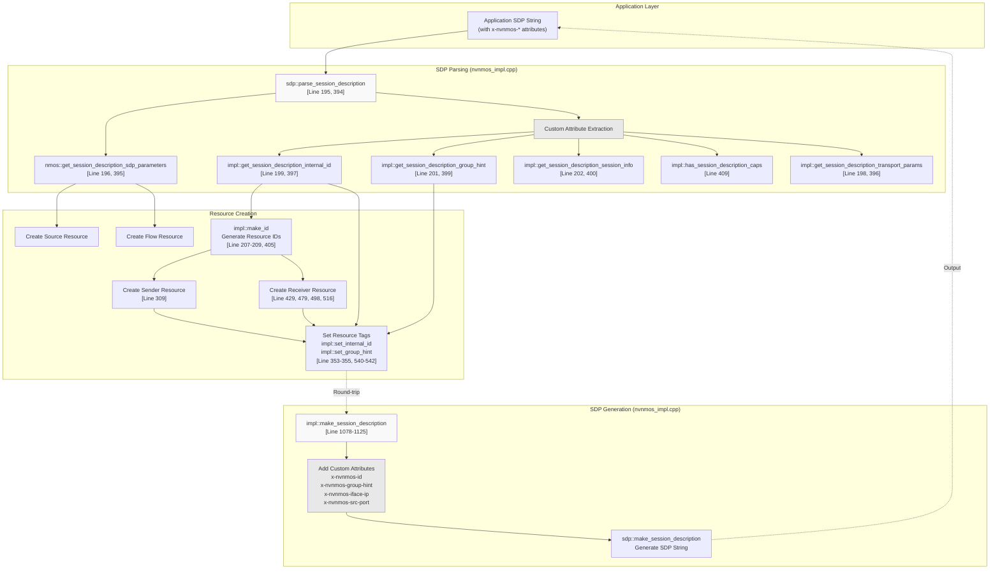
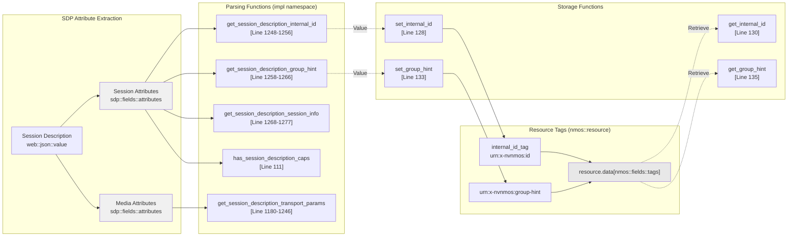

<!-- source: DeepWiki mcp.deepwiki.com · repo NVIDIA/nvnmos · page 7.2 Custom SDP Attributes · fetched 2026-10-26 -->

# Custom SDP Attributes

<details>
<summary>Relevant source files</summary>

The following files were used as context for generating this wiki page:

- [src/main.c](src/main.c)
- [src/nvnmos_impl.cpp](src/nvnmos_impl.cpp)
- [src/nvnmos_impl.h](src/nvnmos_impl.h)

</details>


## Purpose and Scope

This document describes the custom SDP attributes used by nvnmos to extend standard Session Description Protocol (SDP) files with NMOS-specific metadata. These attributes, prefixed with `x-nvnmos-`, enable applications to provide additional configuration information that is used during resource creation and connection activation.

For information about the overall SDP processing pipeline and how SDP is converted into NMOS resources, see [SDP Processing Pipeline](#5.3). For general information about how SDP is used to configure senders and receivers, see [Session Description Protocol (SDP)](#3.2).

## Attribute Overview

The nvnmos library defines two categories of custom attributes:

1. **Session and Media Attributes**: Standard SDP attributes (prefixed with `a=`) that provide NMOS-specific metadata
2. **Format-Specific Parameters**: Custom fmtp parameters embedded in `a=fmtp` attribute lines

These attributes are defined in the `nvnmos::attributes` and `nvnmos::fields` namespaces and are used internally to map between SDP representations and NMOS resource models.

Sources: [src/nvnmos_impl.h:66-84]()

## Session and Media Level Attributes

### Attribute Reference

| Attribute Name | SDP Syntax | Scope | Applies To | Required | Description |
|----------------|------------|-------|------------|----------|-------------|
| `internal_id` | `a=x-nvnmos-id:<id>` | Session | Sender, Receiver | Yes | Internal identifier used to generate repeatable NMOS resource IDs |
| `group_hint` | `a=x-nvnmos-group-hint:<hint>` | Session | Sender, Receiver | No | Grouping hint for organizing related resources (e.g., "tx-0:video") |
| `caps` | `a=x-nvnmos-caps` | Session | Receiver | No | Flag indicating that receiver capabilities should NOT be auto-generated |
| `interface_ip` | `a=x-nvnmos-iface-ip:<address>` | Media | Sender, Receiver | Yes | Local interface IP address for the RTP connection |
| `source_port` | `a=x-nvnmos-src-port:<port>` | Media | Sender | No | Source port number for outgoing RTP packets |

Sources: [src/nvnmos_impl.h:66-77](), [src/nvnmos_impl.cpp:1248-1277]()

### Detailed Attribute Descriptions

#### `x-nvnmos-id` (Internal ID)

The `x-nvnmos-id` attribute provides a stable, application-defined identifier for a sender or receiver. This value is used in combination with the node's seed ID to generate deterministic NMOS resource IDs via the `impl::make_id` function.

**Key Characteristics:**
- Must be unique across all senders and receivers in a node
- Used as input to repeatable ID generation algorithm
- Stored as a resource tag and can be retrieved via `impl::get_internal_id`
- Required for all sender and receiver configurations

**Example:**
```
a=x-nvnmos-id:source-0
```

Sources: [src/nvnmos_impl.cpp:122](), [src/nvnmos_impl.cpp:128-130](), [src/nvnmos_impl.cpp:199](), [src/nvnmos_impl.cpp:397]()

#### `x-nvnmos-group-hint` (Group Hint)

The `x-nvnmos-group-hint` attribute provides a grouping suggestion for related senders and receivers. This is typically used to indicate that multiple resources belong to the same logical group (e.g., video and audio components of the same media stream).

**Key Characteristics:**
- Optional attribute
- Common pattern: `<group-id>:<media-type>` (e.g., "rx-0:video", "rx-0:audio")
- Stored as a resource tag and can be retrieved via `impl::get_group_hint`
- Used in conjunction with NMOS grouping mechanisms (BCP-002-01)

**Example:**
```
a=x-nvnmos-group-hint:tx-0:video
```

Sources: [src/nvnmos_impl.cpp:133-135](), [src/nvnmos_impl.cpp:201](), [src/nvnmos_impl.cpp:399]()

#### `x-nvnmos-caps` (Capabilities Flag)

The `x-nvnmos-caps` attribute is a flag that controls automatic generation of receiver capabilities. When present (regardless of value), it signals that the application has explicitly defined capabilities and the library should not auto-generate them.

**Key Characteristics:**
- Optional, only applicable to receivers
- Presence of attribute (not value) determines behavior
- When absent, library auto-generates capability constraints based on SDP parameters
- When present, no automatic capability generation occurs

**Usage:**
```
a=x-nvnmos-caps
```

Sources: [src/nvnmos_impl.cpp:111](), [src/nvnmos_impl.cpp:409]()

#### `x-nvnmos-iface-ip` (Interface IP)

The `x-nvnmos-iface-ip` attribute specifies the local network interface IP address that should be used for the RTP connection. This attribute is used to:

1. Determine which network interface to bind to
2. Resolve the interface name from available host interfaces
3. Populate the `interface_ip` (receivers) or `source_ip` (senders) transport parameter

**Key Characteristics:**
- Required for all media descriptions
- Must correspond to an available host interface
- Used to determine the NMOS resource's `interface_bindings`
- Failure to find matching interface results in `node_implementation_exception`

**Example:**
```
a=x-nvnmos-iface-ip:192.0.2.1
```

Sources: [src/nvnmos_impl.cpp:1113-1115](), [src/nvnmos_impl.cpp:217-229](), [src/nvnmos_impl.cpp:411-423]()

#### `x-nvnmos-src-port` (Source Port)

The `x-nvnmos-src-port` attribute specifies the source port for outgoing RTP packets from a sender. This is only applicable to senders and is included in the generated session description for internal use.

**Key Characteristics:**
- Optional, only applicable to senders
- Not part of standard RTP/SDP specifications
- Used for internal tracking and session description round-tripping
- Included in merged session descriptions during connection activation

**Example:**
```
a=x-nvnmos-src-port:5004
```

Sources: [src/nvnmos_impl.cpp:1106-1111](), [src/main.c:124](), [src/main.c:187]()

## Format-Specific Parameters

Custom format-specific parameters are embedded within the standard `a=fmtp` attribute line. These parameters are prefixed with `x-nvnmos-` to distinguish them from standard format parameters.

| Parameter Name | fmtp Syntax | Applies To | Description |
|----------------|-------------|------------|-------------|
| `transport_bit_rate` | `x-nvnmos-transport-bit-rate=<value>` | Video (JXSV) | Total transport bit rate including IP/UDP/RTP overhead (bits/s) |
| `format_bit_rate` | `x-nvnmos-format-bit-rate=<value>` | Video (JXSV) | Format-specific bit rate excluding protocol overhead (bits/s) |

Sources: [src/nvnmos_impl.h:79-84](), [src/nvnmos_impl.cpp:1279-1313]()

### Bit Rate Parameters

These parameters are primarily used with JPEG XS (video/jxsv) streams to specify bit rates more precisely than the standard SDP bandwidth attribute.

**`x-nvnmos-transport-bit-rate`**
- Specifies total bit rate including all protocol overhead
- Used for BCP-006-01 compliance (NMOS with JPEG XS)
- If present, populates the sender's `bit_rate` field
- If absent during parsing, approximate value is calculated

**`x-nvnmos-format-bit-rate`**
- Specifies format-level bit rate (payload only)
- Used to populate flow's `bit_rate` field for JPEG XS flows
- If absent during parsing, approximate value is calculated from format parameters

**Example:**
```
a=fmtp:96 packetmode=0; profile=High444.12; x-nvnmos-format-bit-rate=1000000000; x-nvnmos-transport-bit-rate=1050000000
```

Sources: [src/nvnmos_impl.cpp:252](), [src/nvnmos_impl.cpp:264](), [src/nvnmos_impl.cpp:319-323](), [src/nvnmos_impl.cpp:1279-1313]()

## SDP Processing Flow



**SDP Processing Flow Diagram**: Shows how custom attributes flow from application SDP through parsing, resource creation, and back to generated SDP during connection activation.

Sources: [src/nvnmos_impl.cpp:190-387](), [src/nvnmos_impl.cpp:389-563](), [src/nvnmos_impl.cpp:1074-1313]()

## Usage Patterns

### Sender Configuration Pattern

When configuring a sender, the SDP must include:

1. **Required session-level attributes:**
   - `a=x-nvnmos-id:<unique-id>` - for ID generation

2. **Optional session-level attributes:**
   - `a=x-nvnmos-group-hint:<hint>` - for grouping

3. **Required media-level attributes:**
   - `a=x-nvnmos-iface-ip:<address>` - local interface binding

4. **Optional media-level attributes:**
   - `a=x-nvnmos-src-port:<port>` - source port specification

5. **Clock reference attributes (for senders):**
   - `a=ts-refclk:ptp=...` or `a=ts-refclk:localmac=...`

**Example Sender SDP:**
```
v=0
o=- 1234567890 1234567890 IN IP4 192.0.2.1
s=NvNmos Video Sender
i=YCbCr-4:2:2, 10 bit, 1920 x 1080
t=0 0
a=x-nvnmos-id:sink-0
a=x-nvnmos-group-hint:tx-0:video
m=video 5020 RTP/AVP 96
c=IN IP4 233.252.0.0/64
a=source-filter: incl IN IP4 233.252.0.0 192.0.2.1
a=x-nvnmos-iface-ip:192.0.2.1
a=x-nvnmos-src-port:5004
a=rtpmap:96 raw/90000
a=fmtp:96 sampling=YCbCr-4:2:2; width=1920; height=1080; ...
a=ts-refclk:ptp=IEEE1588-2008:AC-DE-48-23-45-67-01-9F:42
a=mediaclk:direct=0
```

Sources: [src/main.c:91-152](), [src/nvnmos_impl.cpp:190-387]()

### Receiver Configuration Pattern

When configuring a receiver, the SDP must include:

1. **Required session-level attributes:**
   - `a=x-nvnmos-id:<unique-id>` - for ID generation

2. **Optional session-level attributes:**
   - `a=x-nvnmos-group-hint:<hint>` - for grouping
   - `a=x-nvnmos-caps` - suppress automatic capability generation

3. **Required media-level attributes:**
   - `a=x-nvnmos-iface-ip:<address>` - local interface binding

**Note:** Receivers do not require `ts-refclk` attributes and should not include `x-nvnmos-src-port`.

**Example Receiver SDP:**
```
v=0
o=- 1234567890 1234567890 IN IP4 192.0.2.1
s=NvNmos Audio Receiver
i=2 ch, 48 kHz, 24 bit
t=0 0
a=x-nvnmos-id:source-1
a=x-nvnmos-group-hint:rx-0:audio
m=audio 5030 RTP/AVP 97
c=IN IP4 233.252.0.1/64
a=source-filter: incl IN IP4 233.252.0.1 192.0.2.1
a=x-nvnmos-iface-ip:192.0.2.1
a=rtpmap:97 L24/48000/2
a=fmtp:97 channel-order=SMPTE2110.(ST);
a=mediaclk:direct=0
```

Sources: [src/main.c:155-216](), [src/nvnmos_impl.cpp:389-563]()

## Attribute Parsing and Storage



**Attribute Storage Architecture**: Custom SDP attributes are parsed from session descriptions and stored as resource tags using URN-style identifiers.

Sources: [src/nvnmos_impl.cpp:66-68](), [src/nvnmos_impl.cpp:128-135](), [src/nvnmos_impl.cpp:1248-1277]()

### Internal ID Storage

The internal ID is extracted from the `x-nvnmos-id` session-level attribute and stored as a resource tag with the key `urn:x-nvnmos:id`. This enables retrieval of the application-defined identifier after resource creation.

```cpp
// Storage (line 128, 353, 540)
impl::set_internal_id(sender, internal_id);

// Retrieval (line 130, 892)
const auto internal_id = impl::get_internal_id(resource);
```

Sources: [src/nvnmos_impl.cpp:128](), [src/nvnmos_impl.cpp:353](), [src/nvnmos_impl.cpp:540](), [src/nvnmos_impl.cpp:892]()

### Group Hint Storage

The group hint is extracted from the optional `x-nvnmos-group-hint` session-level attribute and stored similarly:

```cpp
// Storage (line 133, 355, 542)
if (!group_hint.empty()) impl::set_group_hint(sender, group_hint);

// Retrieval (line 135, 950)
const auto group_hint = impl::get_group_hint(resource);
```

Sources: [src/nvnmos_impl.cpp:133](), [src/nvnmos_impl.cpp:355](), [src/nvnmos_impl.cpp:542](), [src/nvnmos_impl.cpp:950]()

## Round-Trip Behavior

During connection activation, the library regenerates SDP with custom attributes to provide a complete session description to the application's `rtp_connection_activated` callback. This ensures that all necessary configuration information is preserved.

**Activation Flow:**

1. **Controller-Initiated Activation** (IS-05):
   - Controller sends transport parameters via PATCH /staged
   - Library merges with original SDP configuration
   - Generates complete SDP with custom attributes via `impl::make_session_description`
   - Invokes `rtp_connection_activated` callback with merged SDP

2. **Application-Initiated Activation**:
   - Application calls `nmos_connection_rtp_activate`
   - Library updates connection resource state
   - Invokes `rtp_connection_activated` callback with provided SDP

**Key Implementation:**

The `impl::make_session_description` function at [src/nvnmos_impl.cpp:1078-1125]() adds custom attributes when generating internal SDP representations. However, note that the `/transportfile` endpoint exposed via IS-05 uses the standard `nmos::make_session_description` function at [src/nvnmos_impl.cpp:867](), which excludes custom attributes as they are "for 'internal' use only."

Sources: [src/nvnmos_impl.cpp:874-965](), [src/nvnmos_impl.cpp:1078-1125](), [src/nvnmos_impl.cpp:815-872]()

## Example: Complete Video Sender SDP

This example demonstrates all custom attributes in context:

```
v=0
o=- 1234567890 1234567890 IN IP4 192.0.2.1
s=UHD Video Sender
i=JPEG XS, YCbCr-4:2:2, 10 bit, 3840 x 2160, progressive, 59.94 Hz
t=0 0
a=x-nvnmos-id:uhd-sender-0
a=x-nvnmos-group-hint:tx-uhd:video
m=video 5020 RTP/AVP 96
c=IN IP4 233.252.0.10/64
b=AS:464000
a=source-filter: incl IN IP4 233.252.0.10 192.0.2.1
a=x-nvnmos-iface-ip:192.0.2.1
a=x-nvnmos-src-port:5004
a=rtpmap:96 jxsv/90000
a=fmtp:96 packetmode=0; profile=High444.12; level=4k-1; sublevel=Sublev3bpp; sampling=YCbCr-4:2:2; width=3840; height=2160; exactframerate=60000/1001; depth=10; colorimetry=BT2020; TCS=HLG; RANGE=FULL; SSN=ST2110-22:2019; TP=2110TPN; x-nvnmos-format-bit-rate=4000000000; x-nvnmos-transport-bit-rate=4200000000
a=ts-refclk:ptp=IEEE1588-2008:AC-DE-48-23-45-67-01-9F:42
a=ts-refclk:ptp=IEEE1588-2008:traceable
a=mediaclk:direct=0
```

**Attribute Summary:**
- `a=x-nvnmos-id:uhd-sender-0` - Unique internal identifier
- `a=x-nvnmos-group-hint:tx-uhd:video` - Groups with other UHD resources
- `a=x-nvnmos-iface-ip:192.0.2.1` - Local interface binding
- `a=x-nvnmos-src-port:5004` - RTP source port
- `x-nvnmos-format-bit-rate=4000000000` - JPEG XS payload bit rate
- `x-nvnmos-transport-bit-rate=4200000000` - Total transport bit rate

Sources: [src/main.c:91-152]()

## Custom Attribute Removal

When generating the `/transportfile` endpoint for IS-05 exposure, custom nvnmos parameters are removed from the fmtp attribute to ensure standard compliance:

```cpp
// Remove custom nvnmos parameters (line 836-839)
sdp_params.fmtp.erase(std::remove_if(sdp_params.fmtp.begin(), sdp_params.fmtp.end(), 
    [](const nmos::sdp_parameters::fmtp_t::value_type& param) {
        return boost::algorithm::starts_with(param.first, U("x-nvnmos-"));
    }), sdp_params.fmtp.end());
```

This ensures that SDP files served to external NMOS controllers via the IS-05 Connection API do not contain implementation-specific attributes.

Sources: [src/nvnmos_impl.cpp:836-839](), [src/nvnmos_impl.cpp:865-869]()

---

