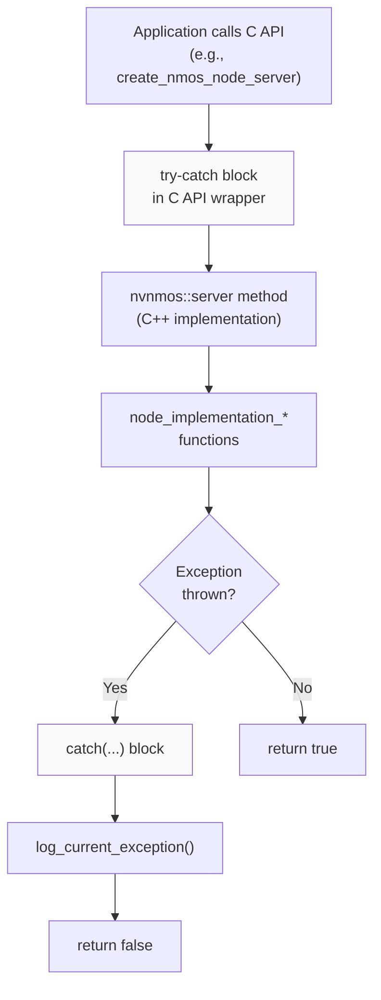
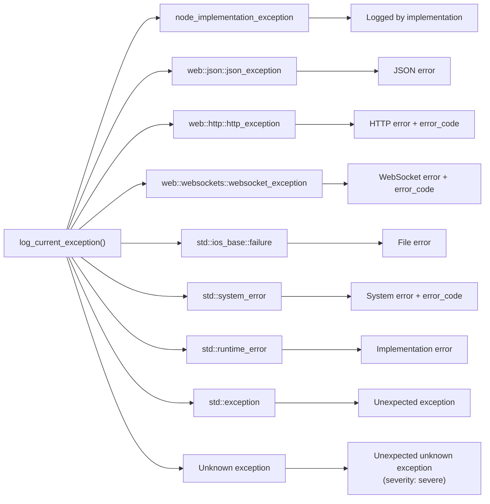
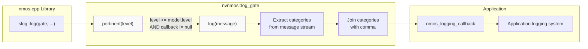

<!-- source: DeepWiki mcp.deepwiki.com · repo NVIDIA/nvnmos · page 7.3 Error Handling and Logging · fetched 2026-10-26 -->

# Error Handling and Logging

<details>
<summary>Relevant source files</summary>

The following files were used as context for generating this wiki page:

- [src/main.c](src/main.c)
- [src/nvnmos.cpp](src/nvnmos.cpp)
- [src/nvnmos.h](src/nvnmos.h)

</details>


This document describes the error handling and logging mechanisms in the nvnmos library. It covers the return value conventions used by the public API, the exception handling strategy used internally, and the logging callback architecture that allows applications to integrate nvnmos logs into their own logging systems.

For information about implementing callbacks for connection activation events, see [Callbacks and Event Handling](#4.4). For details on configuring the logging system during node creation, see [Configuration Structures](#4.3).

---

## Error Handling Strategy

The nvnmos library uses a dual-layer error handling strategy: boolean return values at the C API boundary and C++ exceptions internally.

### C API Return Values

All public API functions in [src/nvnmos.h]() return `bool` to indicate success or failure:

| Function | Returns `true` when | Returns `false` when |
|----------|-------------------|---------------------|
| `create_nmos_node_server` | Server successfully created and started | Invalid config, initialization failure, or exception |
| `destroy_nmos_node_server` | Server successfully stopped and deinitialized | Invalid server pointer |
| `add_nmos_receiver_to_node_server` | Receiver successfully added | Invalid parameters or processing error |
| `add_nmos_sender_to_node_server` | Sender successfully added | Invalid parameters or processing error |
| `remove_nmos_receiver_from_node_server` | Receiver successfully removed | Invalid parameters or resource not found |
| `remove_nmos_sender_from_node_server` | Sender successfully removed | Invalid parameters or resource not found |
| `nmos_connection_rtp_activate` | Connection successfully activated/deactivated | Invalid parameters or activation failure |

All API functions perform null-pointer checks before processing [src/nvnmos.cpp:480,498,511-514,532-535,553-556,573-577,596-599]().

**Sources:** [src/nvnmos.h:361-469](), [src/nvnmos.cpp:475-611]()

### Exception Handling Flow



**Diagram: Exception Handling at C API Boundary**

Internal implementation functions may throw exceptions, but these are always caught at the C API boundary and converted to boolean return values. When an exception is caught, `log_current_exception()` is called to log the error before returning `false`.

**Sources:** [src/nvnmos.cpp:475-611]()

### Exception Classification

The `log_current_exception()` method categorizes exceptions into specific types and logs them with appropriate context:



**Diagram: Exception Type Classification in log_current_exception()**

The function uses a cascade of `catch` blocks to identify the exception type and extract relevant error information. Exceptions are logged at `slog::severities::error` level, except for unknown exceptions which are logged at `slog::severities::severe`.

**Sources:** [src/nvnmos.cpp:359-401]()

---

## Logging Architecture

The nvnmos library provides a flexible logging system that routes internal log messages to application-provided callbacks. This allows applications to integrate nvnmos logs with their existing logging infrastructure.

### Log Gate Mechanism



**Diagram: Logging Data Flow Through log_gate**

The `nvnmos::log_gate` class [src/nvnmos.cpp:52-80]() implements `slog::base_gate` and acts as a bridge between the nmos-cpp library's logging system and the application's logging callback. It performs two key functions:

1. **Filtering**: The `pertinent()` method checks if a log message should be delivered based on the configured log level and whether a callback is registered
2. **Routing**: The `log()` method extracts category information from the message, formats it as a comma-separated string, and invokes the application callback

**Sources:** [src/nvnmos.cpp:52-80,108]()

### Logging Configuration

Logging behavior is configured through the `NvNmosNodeConfig` structure:

| Field | Type | Purpose |
|-------|------|---------|
| `log_callback` | `nmos_logging_callback` | Function to receive log messages; may be `NULL` to disable |
| `log_level` | `int` | Minimum severity level for log callbacks |
| `log_categories` | `const char**` | Array of topic strings to filter; may be `NULL` for all topics |
| `num_log_categories` | `unsigned int` | Size of `log_categories` array |

The log level is stored in the `log_model` and checked by `log_gate::pertinent()` before delivering messages [src/nvnmos.cpp:61-64]().

**Sources:** [src/nvnmos.h:221-229](), [src/nvnmos.cpp:118-119,313,316-324]()

---

## Log Levels and Categories

### Severity Levels

The nvnmos library defines seven severity levels, with higher numerical values indicating more serious conditions:

| Constant | Value | Usage |
|----------|-------|-------|
| `NVNMOS_LOG_DEVEL` | -40 | Low-level debugging information |
| `NVNMOS_LOG_VERBOSE` | -10 | Detailed API request/response tracking |
| `NVNMOS_LOG_INFO` | 0 | Expected API events and state changes |
| `NVNMOS_LOG_WARNING` | 10 | Minor recoverable problems |
| `NVNMOS_LOG_ERROR` | 20 | Serious recoverable errors (e.g., rejected requests) |
| `NVNMOS_LOG_SEVERE` | 30 | Errors unlikely to be recoverable without restart |
| `NVNMOS_LOG_FATAL` | 40 | Errors likely to cause immediate termination |

Messages with level greater than zero (warnings and errors) indicate problems, while messages with level less than zero are debugging or informational traces.

**Sources:** [src/nvnmos.h:131-146]()

### Log Categories

Categories are topic strings that indicate the origin or subsystem of a log message. Common categories include:

- Module names from nmos-cpp (e.g., `"node_api"`, `"registration"`, `"connection_api"`)
- Component identifiers (e.g., `"node_implementation"`, `"sdp_utils"`)
- Protocol-specific tags (e.g., `"is-04"`, `"is-05"`)

Multiple categories may be associated with a single log message, delivered to the callback as a comma-separated string [src/nvnmos.cpp:70-72]().

Applications can filter log messages by configuring `log_categories` in `NvNmosNodeConfig`. If specified, only messages matching at least one of the configured categories will be delivered.

**Sources:** [src/nvnmos.h:152-153](), [src/nvnmos.cpp:70-72]()

---

## Implementing Error Handling in Applications

Applications should check the return value of all nvnmos API calls and handle failures appropriately.

### Basic Error Handling Pattern

```c
// Example from src/main.c
if (!create_nmos_node_server(&node_config, &node_server)) {
    // Failed to create server - handle error
    return 1;
}

// Server created successfully - proceed with operation
if (!add_nmos_receiver_to_node_server(&node_server, &receiver_config)) {
    // Failed to add receiver - clean up and handle error
    destroy_nmos_node_server(&node_server);
    return 1;
}
```

### Error Handling Best Practices

1. **Always check return values**: Every API function returns `bool` - check it
2. **Clean up on error**: If initialization fails partway through, call `destroy_nmos_node_server()` to clean up any partial state
3. **Use logging**: Enable a logging callback during development to understand why operations fail
4. **Validate inputs**: Ensure SDP strings are well-formed and configuration structures are properly initialized before calling API functions
5. **Handle null pointers**: The API protects against null pointers, but applications should still avoid passing them

**Sources:** [src/main.c:298-327]()

---

## Implementing Logging in Applications

Applications integrate nvnmos logging by providing a callback function that receives log messages and routes them to the application's logging system.

### Logging Callback Signature

```c
typedef void (* nmos_logging_callback)(
    NvNmosNodeServer *server,
    const char *categories,
    int level,
    const char *message);
```

**Parameters:**
- `server`: Pointer to the server issuing the callback; allows correlation with server instance
- `categories`: Comma-separated list of topic strings (e.g., `"node_api,is-04"`)
- `level`: Severity/verbosity level (see Log Levels table above)
- `message`: The formatted log message string

**Sources:** [src/nvnmos.h:159-163]()

### Example Implementation

```c
// From src/main.c
static void handle_log(
    NvNmosNodeServer *server,
    const char *categories,
    int level,
    const char *message)
{
    printf("%s [%d:%s]\n", message, level, categories);
}

// Configure in NvNmosNodeConfig
node_config.log_callback = &handle_log;
node_config.log_level = NVNMOS_LOG_ERROR;  // Only errors and above
```

This simple example prints to stdout, but production applications should route to their logging framework (e.g., syslog, journald, or application-specific logger).

**Sources:** [src/main.c:71-78,290-291]()

### Filtering by Level

Set `log_level` in `NvNmosNodeConfig` to the minimum severity you want to receive:

```c
// Receive all messages
node_config.log_level = NVNMOS_LOG_DEVEL;

// Only warnings and errors
node_config.log_level = NVNMOS_LOG_WARNING;

// Only errors and fatal messages
node_config.log_level = NVNMOS_LOG_ERROR;
```

Messages with severity less than `log_level` will not be delivered to the callback.

### Filtering by Category

Specify categories to receive only messages from specific subsystems:

```c
const char* categories[] = {
    "node_api",
    "connection_api",
    "registration"
};

node_config.log_categories = categories;
node_config.num_log_categories = 3;
```

If `log_categories` is `NULL` or `num_log_categories` is zero, messages from all categories are delivered (subject to level filtering).

**Sources:** [src/nvnmos.h:225-229](), [src/nvnmos.cpp:316-324]()

### Key Log Messages

The library logs several important lifecycle events:

| Message | Level | Indicates |
|---------|-------|-----------|
| `"Starting NvNmos node"` | INFO | Node initialization beginning |
| `"Process ID: ..."` | INFO | Process identification |
| `"Initial settings: ..."` | INFO | Configuration settings as JSON |
| `"Preparing for connections"` | INFO | About to open API ports |
| `"Ready for connections"` | INFO | Server successfully started |
| `"Closing connections"` | INFO | Server shutdown beginning |
| `"Stopping NvNmos node"` | INFO | Server shutdown complete |
| `"Activation failed for internal id: ..."` | WARNING | Connection activation callback returned false |

Applications can monitor these messages to track server state and detect issues during initialization or operation.

**Sources:** [src/nvnmos.cpp:121,125-127,173,177,191,200,137-140]()

---

## Thread Safety Considerations

The logging callback may be invoked from multiple threads within the nmos-cpp library. Applications must ensure their logging callback implementation is thread-safe if it accesses shared state or non-thread-safe logging frameworks.

The `NvNmosNodeServer::user_data` pointer can be used to pass context to the logging callback, allowing applications to maintain per-server state.

**Sources:** [src/nvnmos.h:337-349]()

---

