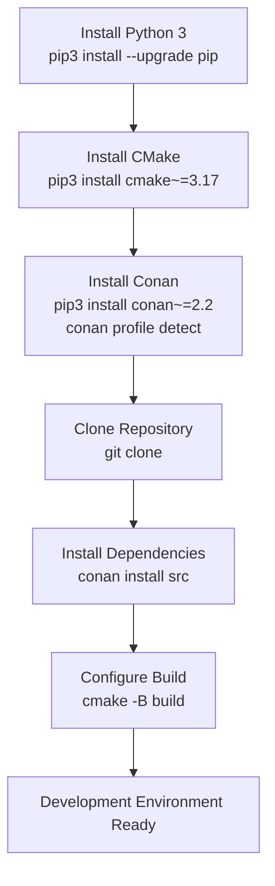
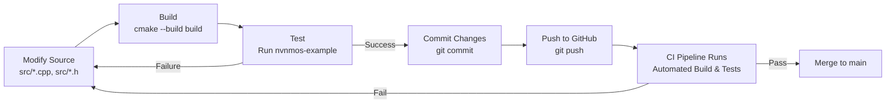
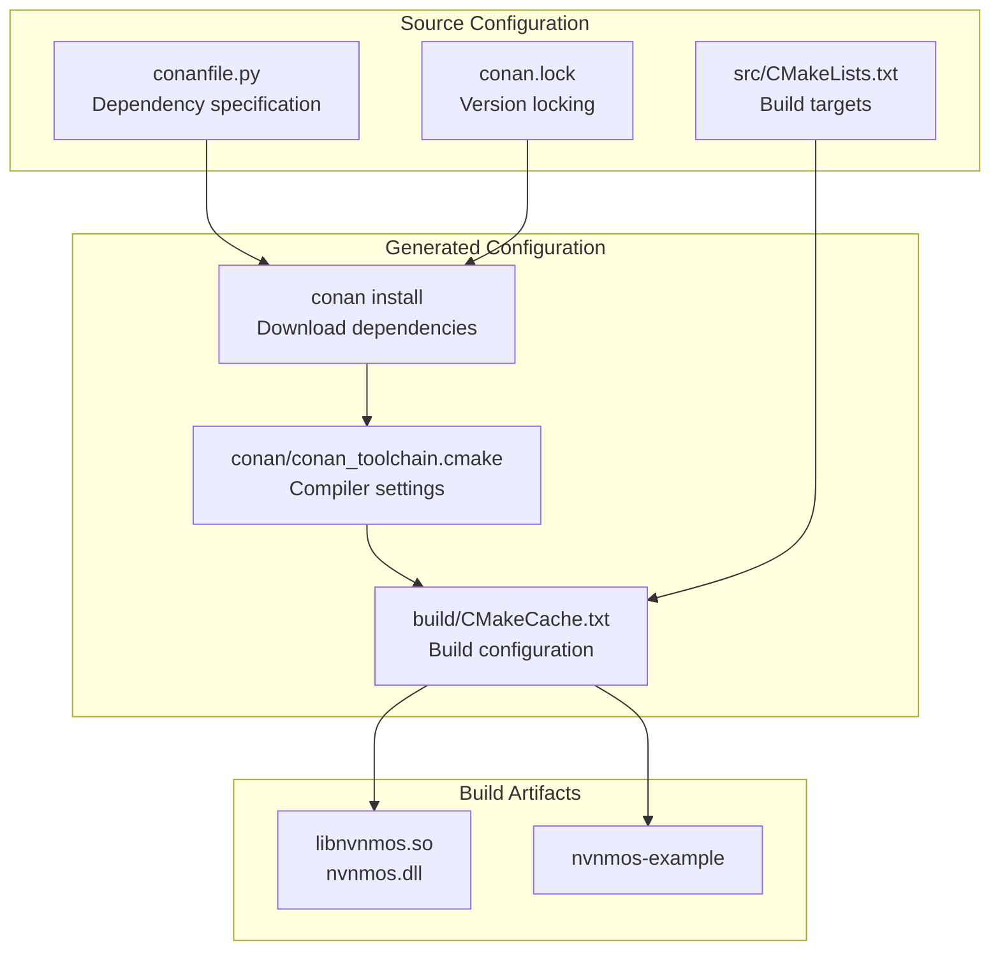
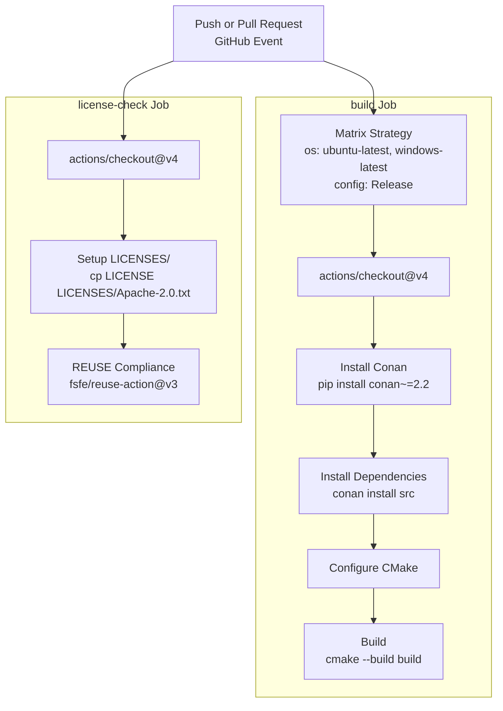
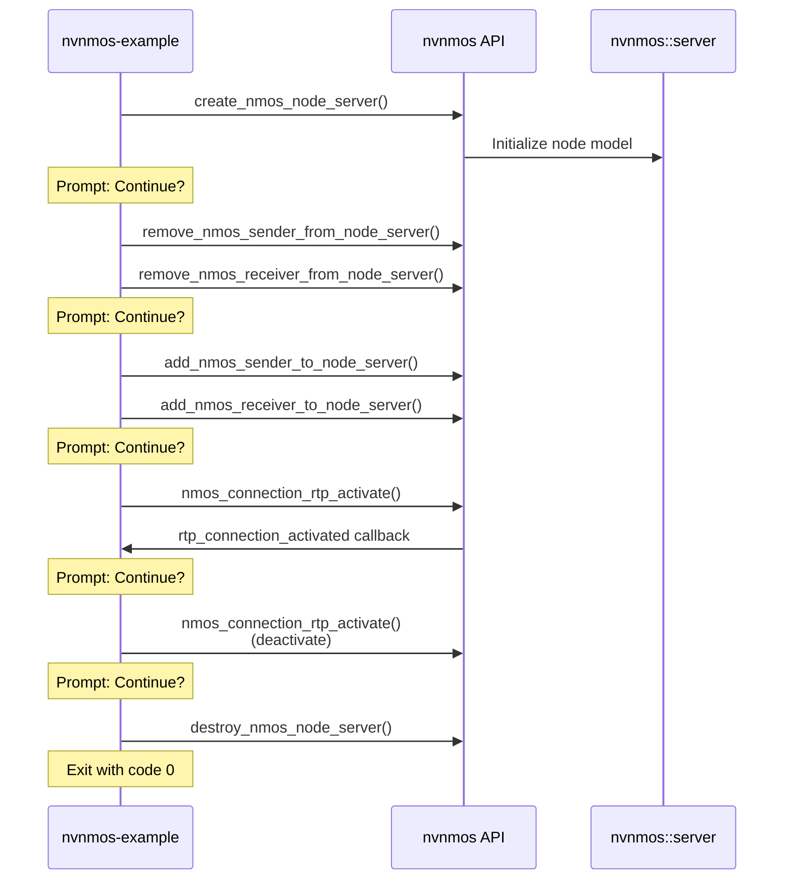

<!-- source: DeepWiki mcp.deepwiki.com · repo NVIDIA/nvnmos · page 8 Development · fetched 2026-10-26 -->

# Development

<details>
<summary>Relevant source files</summary>

The following files were used as context for generating this wiki page:

- [.github/workflows/ci.yml](.github/workflows/ci.yml)
- [README.md](README.md)

</details>


This page provides an overview of the development process, tooling, and workflows for contributing to or extending the nvnmos library. It covers environment setup, build procedures, testing, and the continuous integration pipeline.

For detailed information about:
- The CMake build system configuration, see [Build System](#6)
- CI/CD pipeline workflows, see [CI/CD Pipeline](#8.1)
- Documentation generation with Doxygen, see [Documentation Generation](#8.2)
- Licensing requirements, see [License and Copyright](#8.3)

## Development Environment Setup

The nvnmos library requires a standard C++ development environment with specific tooling for dependency management and build configuration.

### Required Tools

| Tool | Minimum Version | Purpose |
|------|----------------|---------|
| Python 3 | 3.8+ | Dependency management tooling |
| CMake | 3.17+ | Build system configuration |
| Conan | 2.2+ | C++ dependency management |
| GCC (Linux) | 11+ | C++ compiler |
| Visual Studio (Windows) | 2022 | C++ compiler and IDE |
| Git | Any recent | Version control |

### Environment Configuration

The development environment is configured through a series of detection and installation steps:



**Sources:** [README.md:95-183]()

The `conan profile detect` command creates a default profile based on the detected compiler and platform. This profile is stored in the user's Conan cache directory and defines compiler settings, architecture, and build configuration defaults.

## Development Workflow

### Code Changes and Testing

The typical development workflow follows a standard modify-build-test cycle:



**Sources:** [README.md:186-267](), [.github/workflows/ci.yml:1-62]()

### File Organization

The development workspace follows a specific directory structure:

| Directory | Contents | Purpose |
|-----------|----------|---------|
| `src/` | Source files, CMakeLists.txt, conanfile.py | Build configuration and implementation |
| `build/` | Build artifacts | Generated during cmake --build |
| `src/conan/` | Conan-generated files | Dependency installation output |
| `.github/workflows/` | CI pipeline definitions | Automated testing configuration |
| `LICENSES/` | License files | REUSE compliance |

**Sources:** [README.md:189-231]()

## Build System Integration

The build system uses CMake with Conan for dependency management. The process is orchestrated through multiple configuration files:



**Sources:** [README.md:186-267]()

For detailed information about CMake configuration options and package exports, see [Build System](#6).

## Continuous Integration Pipeline

The GitHub Actions workflow defined in `.github/workflows/ci.yml` automates building and testing on every push and pull request.

### CI Job Structure

The pipeline consists of two primary jobs:



**Sources:** [.github/workflows/ci.yml:1-62]()

### Build Matrix

The `build` job uses a matrix strategy to test multiple configurations in parallel:

| Dimension | Values |
|-----------|--------|
| Operating System | `ubuntu-latest`, `windows-latest` |
| Build Configuration | `Release` |

This results in 2 parallel builds (Linux Release, Windows Release).

**Sources:** [.github/workflows/ci.yml:16-21]()

### Platform-Specific Build Steps

The workflow includes conditional steps for platform-specific build commands:

**Linux Build Steps:**
- [.github/workflows/ci.yml:33-39]() - CMake configuration with `CMAKE_BUILD_TYPE`
- [.github/workflows/ci.yml:47-50]() - Build without `--config` flag

**Windows Build Steps:**
- [.github/workflows/ci.yml:40-46]() - CMake configuration with `CMAKE_CONFIGURATION_TYPES`
- [.github/workflows/ci.yml:51-54]() - Build with `--config` flag

### License Compliance

The `license-check` job verifies REUSE compliance by:
1. Creating a `LICENSES/` directory
2. Copying `LICENSE` to `LICENSES/Apache-2.0.txt`
3. Running the REUSE compliance checker via `fsfe/reuse-action@v3`

**Sources:** [.github/workflows/ci.yml:55-61]()

This ensures all source files contain proper SPDX license headers as required by the REUSE specification.

## Testing Strategy

### Unit Testing

The nvnmos library currently uses the `nvnmos-example` application as an integration test. The example exercises the complete API surface:



**Sources:** [README.md:293-331]()

### Running Tests Locally

To verify changes locally before pushing:

```bash
# Build the library and example
cmake --build build --parallel

# Run the example application
./build/nvnmos-example nmos-api.local 8080 192.0.2.0 -40

# The application will prompt at each step
# Press Enter to continue through all steps
```

The example exits with code 0 on success, code 1 on failure.

**Sources:** [README.md:293-331]()

## Docker-Based Development

The `Dockerfile` provides a reproducible development and build environment. It uses a multi-stage build pattern:

| Stage | Purpose | Key Components |
|-------|---------|----------------|
| `builder` | Build environment | Ubuntu base, build tools, Conan, CMake |
| `packager` | Package creation | Compiled binaries, documentation, archives |
| Final stage | Runtime environment | Minimal dependencies, entrypoint script |

**Sources:** [README.md:59-91]()

### Docker Build Arguments

Developers can customize the Docker build using build arguments:

| Argument | Default | Purpose |
|----------|---------|---------|
| `BASE_IMAGE` | `ubuntu:22.04` | Controls base OS and package compatibility |
| `PACKAGE_SUFFIX` | `-ubuntu-22.04` | Sets package filename suffix |
| `USE_CONAN_LOCK` | `1` | Enables reproducible dependency versions |

**Sources:** [README.md:81-89]()

To build with custom settings:

```bash
docker build \
  --build-arg BASE_IMAGE=ubuntu:24.04 \
  --build-arg PACKAGE_SUFFIX=-ubuntu-24.04 \
  --build-arg USE_CONAN_LOCK=0 \
  -t nvnmos-dev .
```

## Code Style and Standards

### File Headers

All source files must include SPDX license headers for REUSE compliance:

```cpp
// SPDX-FileCopyrightText: Copyright (c) 2022-2024 NVIDIA CORPORATION & AFFILIATES. All rights reserved.
// SPDX-License-Identifier: Apache-2.0
```

The CI pipeline enforces this through the `license-check` job.

**Sources:** [.github/workflows/ci.yml:55-61](), [README.md:1-16]()

### C API Design

The public API in `nvnmos.h` follows C conventions:
- Functions return `bool` for success/failure
- Opaque pointer types for internal state (`NvNmosNodeServer*`)
- Struct-based configuration (`NvNmosNodeConfig`, `NvNmosSenderConfig`, etc.)
- Callback function pointers for event handling

This design ensures compatibility with C and C++ applications and simplifies ABI stability.

## Documentation Generation

Documentation is automatically generated from source code comments using Doxygen and published to GitHub Pages. The process is configured through:

- `Doxyfile` - Doxygen configuration
- `.github/workflows/` - GitHub Actions deployment workflow

For details on the documentation build process, see [Documentation Generation](#8.2).

## Contributing Guidelines

### Pull Request Process

1. Fork the repository and create a feature branch
2. Make changes following the code style and license requirements
3. Ensure CI pipeline passes (both `build` and `license-check` jobs)
4. Submit pull request with clear description of changes
5. Address review feedback

### Adding Dependencies

When adding new C++ dependencies:
1. Update `src/conanfile.py` with the new dependency specification
2. Run `conan install` to update the lockfile
3. Commit both `conanfile.py` and `conan.lock` changes
4. Document the dependency in relevant documentation

For detailed information about Conan dependency management, see [Dependency Management with Conan](#6.3).

## Troubleshooting Development Issues

### Common Build Issues

| Issue | Cause | Solution |
|-------|-------|----------|
| `CMake 3.17 or higher required` | System CMake too old | Install via pip: `pip3 install cmake~=3.17` |
| `Conan profile not found` | Profile not detected | Run `conan profile detect` |
| `Build type mismatch` | Conan and CMake configs differ | Ensure matching `build_type` in both commands |
| Port already in use | Multiple instances running | Use different port numbers |

**Sources:** [README.md:340-382]()

### CI Pipeline Failures

When the CI pipeline fails:
1. Check the GitHub Actions logs for specific error messages
2. Reproduce locally using the same commands from `.github/workflows/ci.yml`
3. For license check failures, ensure all files have proper SPDX headers
4. For build failures, verify dependency versions match `conan.lock`

**Sources:** [.github/workflows/ci.yml:1-62]()

---

