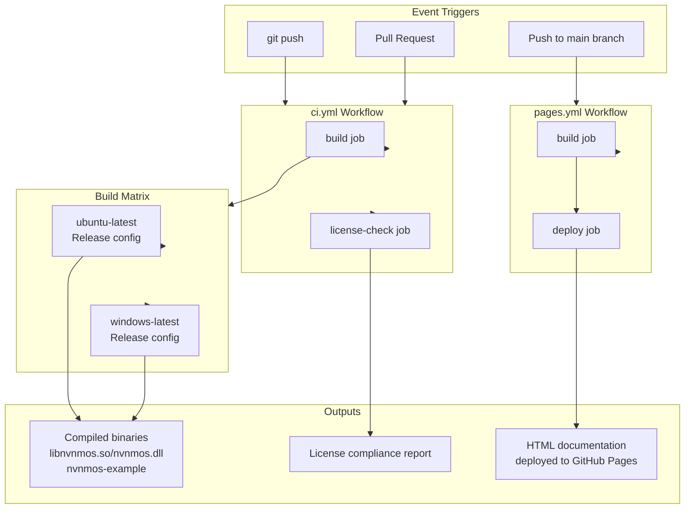
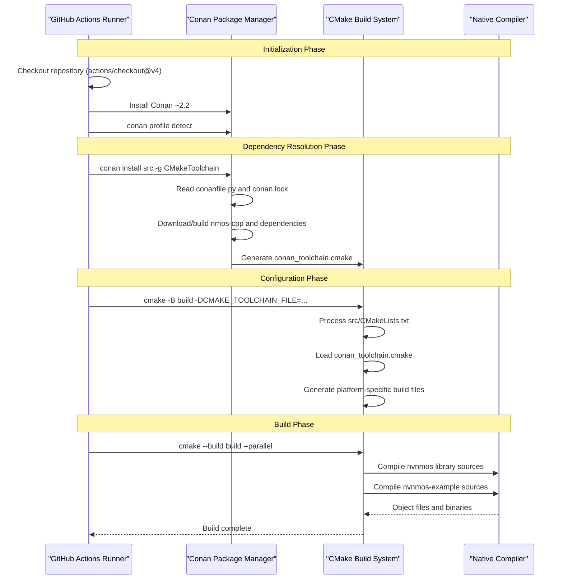
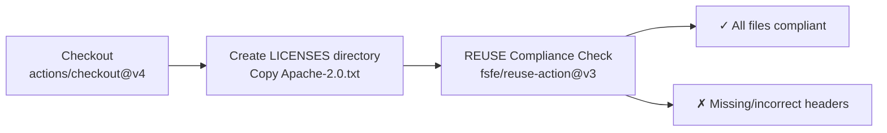
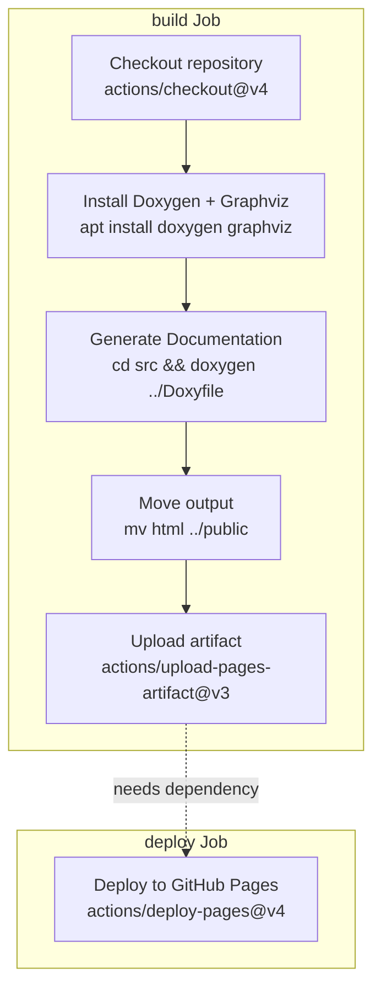
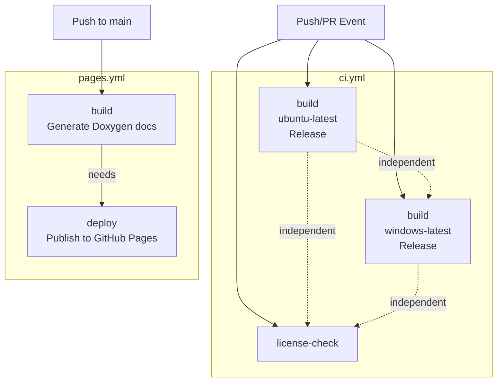

<!-- source: DeepWiki mcp.deepwiki.com · repo NVIDIA/nvnmos · page 8.1 CI/CD Pipeline · fetched 2026-10-26 -->

# CI/CD Pipeline

<details>
<summary>Relevant source files</summary>

The following files were used as context for generating this wiki page:

- [.github/workflows/ci.yml](.github/workflows/ci.yml)
- [.github/workflows/pages.yml](.github/workflows/pages.yml)

</details>


## Purpose and Scope

This document describes the continuous integration and continuous deployment (CI/CD) infrastructure for the nvnmos library. The pipeline automates build verification, license compliance checking, and documentation deployment using GitHub Actions workflows.

For information about the build system configuration itself, see [CMake Configuration](#6.1). For documentation generation specifics, see [Documentation Generation](#8.2).

**Sources:** [.github/workflows/ci.yml:1-62](), [.github/workflows/pages.yml:1-41]()

---

## Pipeline Overview

The nvnmos CI/CD pipeline consists of three independent GitHub Actions workflows that execute on different triggers:

| Workflow | File | Trigger | Purpose |
|----------|------|---------|---------|
| Build | `ci.yml` | Push, Pull Request | Multi-platform build verification |
| License Check | `ci.yml` | Push, Pull Request | REUSE compliance validation |
| Documentation Deployment | `pages.yml` | Push to `main` branch | Generate and publish API docs |

**Sources:** [.github/workflows/ci.yml:4-9](), [.github/workflows/pages.yml:4-9]()

---

## Workflow Architecture

The following diagram shows the relationship between workflows, jobs, and their outputs:



**Sources:** [.github/workflows/ci.yml:6-21](), [.github/workflows/pages.yml:6-9]()

---

## Build Workflow

### Build Job Configuration

The `build` job in `ci.yml` executes on a matrix of platforms and configurations:

```yaml
strategy:
  fail-fast: false
  matrix:
    os: [ubuntu-latest, windows-latest]
    config: [Release]
```

The `fail-fast: false` setting ensures that both platform builds complete even if one fails, providing comprehensive feedback.

**Sources:** [.github/workflows/ci.yml:16-20]()

### Build Pipeline Steps

The following sequence diagram shows the build pipeline execution:



**Sources:** [.github/workflows/ci.yml:23-54]()

### Platform-Specific Build Steps

The build workflow contains conditional steps for Linux and Windows platforms:

#### Linux Build Steps

```yaml
- name: Generate nvnmos (Linux)
  if: runner.os == 'Linux'
  run: |
    cmake -B build \
      -DCMAKE_TOOLCHAIN_FILE=conan/conan_toolchain.cmake \
      -DCMAKE_BUILD_TYPE=${{ matrix.config }} \
      src

- name: Build nvnmos (Linux)
  if: runner.os == 'Linux'
  run: |
    cmake --build build --parallel
```

On Linux, the build type is specified at configuration time using `CMAKE_BUILD_TYPE`.

**Sources:** [.github/workflows/ci.yml:33-50]()

#### Windows Build Steps

```yaml
- name: Generate nvnmos (Windows)
  if: runner.os == 'Windows'
  run: |
    cmake -B build \
      -DCMAKE_TOOLCHAIN_FILE=conan/conan_toolchain.cmake \
      -DCMAKE_CONFIGURATION_TYPES=${{ matrix.config }} \
      src

- name: Build nvnmos (Windows)
  if: runner.os == 'Windows'
  run: |
    cmake --build build --config=${{ matrix.config }} --parallel
```

On Windows, the configuration is specified at build time using `--config` because Visual Studio is a multi-configuration generator.

**Sources:** [.github/workflows/ci.yml:40-54]()

### Dependency Installation Details

The Conan installation step uses specific flags to ensure reproducible builds:

| Flag | Purpose |
|------|---------|
| `src` | Source directory containing `conanfile.py` |
| `-g CMakeToolchain` | Generate CMake toolchain file integration |
| `--settings:all build_type=${{ matrix.config }}` | Apply Release build type to all dependencies |
| `--build=missing` | Build dependencies from source if binaries unavailable |
| `--output-folder=src/conan` | Output generated files to `src/conan/` directory |

The `conan.lock` file in the repository ensures all developers and CI builds use identical dependency versions.

**Sources:** [.github/workflows/ci.yml:26-32]()

---

## License Compliance Workflow

### REUSE Specification Compliance

The `license-check` job validates that all files have proper copyright and license headers according to the REUSE specification:



The workflow performs these operations:

1. **Checkout repository**: Retrieves the complete source tree
2. **Setup LICENSES directory**: Creates `LICENSES/Apache-2.0.txt` from the repository `LICENSE` file
3. **Run REUSE check**: Validates that every file contains proper `SPDX-FileCopyrightText` and `SPDX-License-Identifier` headers

**Sources:** [.github/workflows/ci.yml:55-61]()

### Expected Header Format

Each source file must contain headers like:

```
SPDX-FileCopyrightText: Copyright (C) 2024 NVIDIA CORPORATION & AFFILIATES. All rights reserved.
SPDX-License-Identifier: Apache-2.0
```

The REUSE action scans all repository files and reports any missing or malformed headers.

**Sources:** [.github/workflows/ci.yml:1-2]()

---

## Documentation Deployment Pipeline

### GitHub Pages Workflow

The `pages.yml` workflow generates API documentation and deploys it to GitHub Pages on every push to the `main` branch:



**Sources:** [.github/workflows/pages.yml:11-40]()

### Documentation Generation Steps

The build job executes the following commands:

| Step | Command | Purpose |
|------|---------|---------|
| Install Dependencies | `sudo apt update && sudo apt install -y doxygen graphviz` | Install Doxygen and graph generation tools |
| Generate Docs | `cd src && doxygen ../Doxyfile` | Process Doxyfile configuration in repository root |
| Move Output | `mv html ../public` | Relocate generated HTML to `public/` directory |
| Upload Artifact | Upload `public/` directory | Prepare for deployment job |

**Sources:** [.github/workflows/pages.yml:19-28]()

### Deployment Job Permissions

The `deploy` job requires specific GitHub permissions to publish to Pages:

```yaml
permissions:
  pages: write
  id-token: write
```

These permissions allow the workflow to:
- **`pages: write`**: Deploy content to GitHub Pages
- **`id-token: write`**: Request OIDC tokens for authentication

The job depends on the `build` job completing successfully (`needs: build`).

**Sources:** [.github/workflows/pages.yml:30-40]()

---

## Trigger Mechanisms

### Build Workflow Triggers

```yaml
on:
  push:
  pull_request:
```

The `ci.yml` workflow executes on:
- **Any push** to any branch in the repository
- **Any pull request** opened, synchronized, or reopened

This ensures all code changes are validated before merging.

**Sources:** [.github/workflows/ci.yml:6-8]()

### Documentation Workflow Triggers

```yaml
on:
  push:
    branches:
      - main
```

The `pages.yml` workflow executes only on:
- **Pushes to the `main` branch**

This ensures documentation is updated only when changes are merged to the primary branch, avoiding unnecessary deployments for development branches.

**Sources:** [.github/workflows/pages.yml:6-9]()

---

## Workflow Execution Environment

### Default Shell Configuration

Both workflows specify bash as the default shell:

```yaml
defaults:
  run:
    shell: bash
```

This ensures consistent command syntax across Linux and Windows runners, as Windows runners execute bash through Git Bash.

**Sources:** [.github/workflows/ci.yml:10-12]()

### Runner Images

| OS | Runner Image | Compiler | Package Manager |
|---|---|---|---|
| `ubuntu-latest` | Ubuntu 22.04 (current) | GCC/Clang | apt |
| `windows-latest` | Windows Server 2022 (current) | MSVC | Chocolatey |

The `-latest` suffix ensures workflows automatically update to newer LTS releases when GitHub Actions updates the default images.

**Sources:** [.github/workflows/ci.yml:19](), [.github/workflows/pages.yml:13]()

---

## Build Artifacts

### Generated Files

While the current workflows do not explicitly upload build artifacts, the build process generates:

| Artifact | Linux | Windows |
|----------|-------|---------|
| Shared Library | `libnvnmos.so` | `nvnmos.dll` |
| Example Binary | `nvnmos-example` | `nvnmos-example.exe` |
| CMake Package Config | `NvNmosConfig.cmake` | `NvNmosConfig.cmake` |
| Conan Toolchain | `conan_toolchain.cmake` | `conan_toolchain.cmake` |

These files are generated in the `build/` directory but are not currently persisted as GitHub Actions artifacts.

**Sources:** [.github/workflows/ci.yml:47-54]()

### Documentation Artifacts

The Pages workflow generates and uploads:

- **HTML Documentation**: Complete Doxygen-generated API documentation
- **Search Index**: JavaScript search functionality
- **CSS/Images**: Styling and diagram assets from Graphviz

These artifacts are automatically deployed to `https://nvidia.github.io/nvnmos/` after successful generation.

**Sources:** [.github/workflows/pages.yml:23-28]()

---

## Parallel Execution Strategy

### Build Parallelization

Both Linux and Windows builds use the `--parallel` flag:

```bash
cmake --build build --parallel
```

This instructs CMake to execute compilation jobs in parallel based on the number of CPU cores available on the runner. GitHub Actions runners typically provide 2-4 cores, significantly reducing build time.

**Sources:** [.github/workflows/ci.yml:50](), [.github/workflows/ci.yml:54]()

### Job Parallelization

The build matrix creates independent jobs that execute in parallel:

```
ubuntu-latest + Release  │  Runs simultaneously
windows-latest + Release │
```

The `license-check` job also runs in parallel with the build jobs, as there are no dependencies between them.

**Sources:** [.github/workflows/ci.yml:16-21]()

---

## Workflow Dependencies Graph



**Sources:** [.github/workflows/ci.yml:14-61](), [.github/workflows/pages.yml:11-40]()

---

